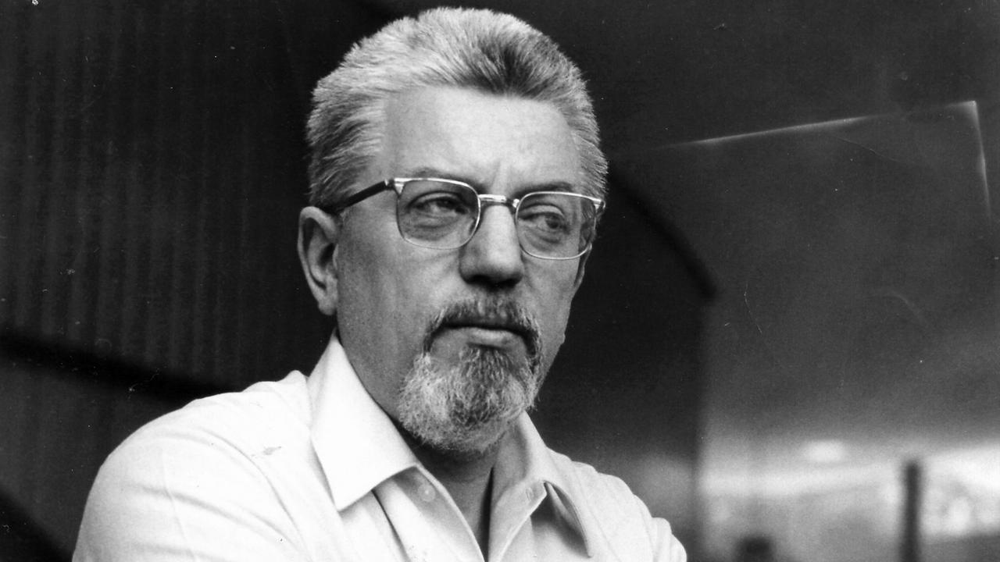
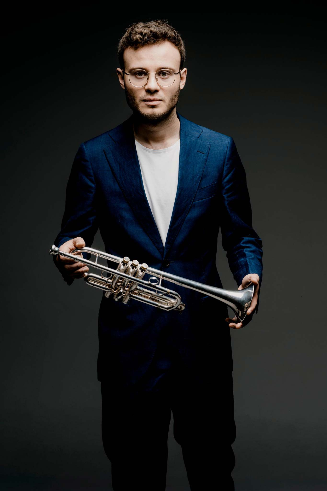

\part{CDMX}

\portadacapitulo{Programa general}

## Viernes 6 de noviembre, 20:00 h

Sala Principal, Palacio de Bellas Artes

**Orquesta Sinfónica Nacional**\
Ludwig Carrasco, director artístico

---

**Concierto inaugural**

### Programa

**Cristina García Islas**

- *In memoriam* (2025)\* \hfill 9'

**Bernd Alois Zimmermann** (Alemania, 1918-1970)

- *Nobody knows the trouble I see* (1954)\*\* \hfill 16'

**Simon Höfele**, trompeta

\
INTERMEDIO\

**Kaija Saariaho**

- *Vista* (2019)\*\* \hfill 28'

  - *Horizons*
  - *Targets*

\vfill

\* Estreno mundial \quad \*\*Estreno en México\par

Concierto en colaboración con el\
Patronato de la Industria Alemana para la Cultura.

### Personas compositoras

#### Cristina García Islas (México, 1983)

Doctora en Composición por la Université de Montréal y el Conservatoire de Musique de Montréal. Su música ha sido presentada en festivales y simposios internacionales en Alemania, Estados Unidos, Israel, Polonia, Canadá, Bélgica y México, entre ellos Eigenzeit 2023 Musik von jetzt, XXIV New Music Miami ISCM Festival, Contemporary Encounters by Meitar Ensemble y Festival Montréal/Nouvelles Musiques. En 2022 fue una de las cinco compositoras seleccionadas por la Stockholm Chamber Brass Academy para escribir una obra para quinteto de metales. Es profesora en la Universidad Anáhuac y la Facultad de Música de la UNAM. Ha participado como jurado en Ibermúsicas, INBAL, UNAM, Fonca y Conarte. Entre sus reconocimientos destacan el premio canadiense Beethoven's Legacy 2020 otorgado por la Orchestre Métropolitain de Montréal bajo la dirección de Yannick Nézet-Séguin, así como la beca del Sistema Nacional de Creadores de Arte 2019 y 2025.

##### *In memoriam*

Tras residir durante varios años en Canadá, país en el que realizó lo esencial de su preparación musical, la compositora mexicana Cristina García Islas radica desde 2017 en la CDMX, donde además de su ininterrumpido trabajo creativo, desempeña labores docentes en la Facultad de Música de la UNAM y en la Escuela de Artes de la Universidad Anáhuac. En 2025 fue mentora en Piso 16, Laboratorio de Iniciativas Culturales de la UNAM y formó parte del comité de selección de obras del Foro Internacional de Música Nueva Manuel Enríquez. En 2026 es jurado en el Sistema Nacional de Creadores de Artes, al que ella misma pertenece. En estos años, su vínculo con Canadá se ha mantenido sólido; prueba de ello es su regreso a ese país en 2024 para el estreno de su obra *Ré_silience*.

Su pasión por la música, el legado y la memoria de Johann Sebastian Bach lleva a Cristina García Islas a componer una obra orquestal titulada *In memoriam*, sobre la cual ha redactado este lúcido y preciso texto:

> «*In memoriam* es una obra sinfónica dedicada a Johann Sebastian Bach, una figura cuya obra continúa iluminando el pensamiento musical contemporáneo. Su extraordinario dominio del contrapunto trascendió la dimensión puramente técnica para convertirse en un medio profundamente expresivo: un espacio en el que distintas voces pueden encontrarse, perseguirse, transformarse y adquirir sentido a partir de su relación con las demás.

La obra toma como punto de partida el Ricercare a 6 de la *Ofrenda musical*, una de las expresiones más complejas y enigmáticas del arte contrapuntístico bachiano. A partir de su célebre tema, *In memoriam* construye un discurso propio en que el contrapunto y la imitación conviven con un lenguaje armónico profundamente cromático, grandes masas sonoras, texturas cambiantes y líneas melódicas en evolución constante. Las voces se buscan, se responden, se alejan y vuelven a encontrarse, mientras el material heredado de Bach se fragmenta y transforma hasta integrarse en un paisaje orquestal contemporáneo.

Más que una cita o un homenaje literal, *In memoriam* propone una evocación de la memoria de Bach desde una mirada contemporánea. Entre claroscuros sonoros, pasajes de intensa densidad y momentos de luminosa transparencia, la obra transita entre la oscuridad y la luz como metáforas de la condición humana y de la memoria misma. El motivo bachiano emerge, desaparece y reaparece entre suspiros, silencios y resonancias, como un recuerdo que nunca termina de extinguirse.

En ese recorrido, *In memoriam* busca rendir homenaje no sólo al legado de Johann Sebastian Bach, sino también a la permanencia de su espíritu creador. Siglos después, su música continúa planteando preguntas, generando nuevas posibilidades y habitando lenguajes muy distintos del suyo. Su voz permanece porque puede transformarse: resuena en el presente no como una reliquia del pasado, sino como una materia viva capaz de seguir dialogando con nuestro tiempo».

El 7 de mayo de 1747, Johann Sebastian Bach (1685-1750) visitó el palacio de Sanssouci en Potsdam, donde su hijo Carl Philipp Emmanuel (1714-1788) estaba empleado como clavecinista. La visita le permitió al viejo Bach encontrarse con el monarca, Federico II de Prusia, alias Federico el Grande, rey melómano que había adquirido unos fortepianos construidos por Gottfried Silbermann. Claro, la visita pronto se centró en esos instrumentos, y un algún momento Bach pidió a Federico que le diera un tema para improvisar. Dicho y hecho: el rey le dio un sencillo tema musical, Bach se sentó ante uno de los fortepianos de Silbermann e improvisó una fuga sobre el tema, conocido después como el Tema Real. Poco después, Bach obsequió a Federico el Grande una serie más elaborada de cánones y fugas sobre su tema, obra conocida como *Ofrenda musical* BWV 1079, una de las obras más abstractas, rigurosas y especulativas del gran chantre de la iglesia de Santo Tomás de Leipzig. Tal es el origen de la obra barroca que Cristina García Islas toma como referencia para su pieza orquestal *In memoriam*.

La compositora envía la partitura a la convocatoria 2026 del Foro Internacional de Música Nueva Manuel Enríquez, y su obra es elegida para formar parte de su programación, el más importante ciclo de música contemporánea de México. Así, *In memoriam* recibe su estreno absoluto el 6 de noviembre de 2026 con la Orquesta Sinfónica Nacional dirigida por Ludwig Carrasco.

\hfill Juan Arturo Brennan

\clearpage

#### Bernd Alois Zimmermann (Alemania, 1918-1970)

Estudió en la Universidad de Colonia y posteriormente en los conservatorios de Colonia y Berlín, siguió los estudios de Wolfgang Fortner y de René Leibowitz en Darmstadt. De 1950 a 1952 trabajó en el Instituto de Musicología de Colonia y colaboró también como compositor en varias emisoras radiofónicas. A partir de 1957 fue profesor de Composición en la Musikhochule de Colonia, donde dirigió un seminario de música de escena y de películas. Zimmermann experimentó en su obra con diferentes técnicas, como el collage y el serialismo. Desde comienzos de la década de los años cincuenta experimentó con materiales recogidos de otras obras, haciendo uso de la técnica de la cita musical. Durante la época en que finalizó su famosa ópera *Die Soldaten*, en 1960, llevó a cabo con éxito un complejo método de combinación de materiales procedentes de diferentes períodos estilísticos con su propia música.

##### *Nobody knows the trouble I see*

En un escueto perfil biográfico de Bernd Alois Zimmermann trazado por Marion Rothärmel se lee que uno de los elementos fundamentales en su pensamiento musical fue el empleo de citas diversas, tejidas cuidadosamente al interior de sus texturas atonales. Más adelante, Rothärmel especifica:

«Zimmermann aplicó su conocimiento de las conexiones y los contrastes históricos en sus obras, abrevando particularmente en la filosofía católica medieval, en la literatura de Esquilo y Dante a Dostoievski y Mayakovski, Pound y Joyce, y en la música del renacimiento hasta el siglo XX, pero más que nada en Bach, Mozart y Debussy».

La misma musicóloga hace otra observación, ciertamente valiosa; afirma que la ópera de Zimmermann *Die Soldaten* (Los soldados), creada entre 1958 y 1964, es la ópera alemana más importante después de *Wozzeck* (1925) y *Lulu* (1937), las grandes óperas de Alban Berg (1885-1935).

Si bien el catálogo de Zimmermann no es muy amplio, sí es muy variado: óperas, ballet, música orquestal, obras vocales, de cámara, instrumentales, para cinta magnética, música incidental para teatro, partituras para la radio, etc. La sección de música concertante del catálogo de Bernd Alois Zimmermann es especialmente rica: compuso sendos conciertos para orquesta, cuerdas, violín, trompeta, dos para violoncello, uno para dos pianos, y *Antífonas* para viola y pequeña orquesta.

*Nobody knows the trouble I've seen* (Nadie conoce la tribulación que he visto) es un *spiritual* afroamericano cuya primera publicación se localiza en 1866, aunque se sabe que es muy anterior. La lista de intérpretes que lo han cantado y/o grabado es notable: Louis Armstrong, Lena Horne, Mahalia Jackson, Paul Robeson, Marian Anderson, Harry James, Sam Cooke, entre muchos otros. Este famoso *spiritual* ha tenido innumerables presencias en la cultura popular, sobre todo en los Estados Unidos, e incluso algunos compositores académicos de ascendencia africana la han incorporado a su música de concierto, entre ellos Samuel Coleridge-Taylor (1875-1912) y Florence Price (1887-1953). Con un ligero pero significativo cambio en el título, Bernd Alois Zimmermann compuso un Concierto para trompeta al que designó *Nobody knows the trouble I see* (Nadie conoce la tribulación que veo), en el que la referencia al canto espiritual original está señalada por el contenido de blues y jazz de la obra. De hecho, la orquestación misma, que incluye guitarra, piano y órgano Hammond, está orientada por el compositor hacia una expresión específicamente jazzística, en particular en instrumentos como el clarinete, la trompeta, el saxofón, el trombón y la percusión.

Si bien *Nobody knows the trouble I see* está concebida en un solo movimiento, su continuidad fluye en secciones bien definidas e identificables. Inicia con una extensa sección lenta y oscura en la que la trompeta solista suena con sordina y se enfrenta a complejos saltos de registro. Viene después una sección viva en la que el compositor propone ágiles figuras repetidas para el solista, retadoras por igual para los dedos y la embocadura. La siguiente sección es introducida por el añejo sonido del órgano Hammond, y aquí el ambiente es claramente jazzístico, tanto en la trompeta solista como en los instrumentos que fungen como sus cómplices. Viene a continuación una sección lírica y expresiva, con algunas cualidades cantables, en la que probablemente se encuentre la referencia directa al *spiritual* original. Esta sección concluye con una coda contemplativa en la que la trompeta solista, de nuevo con sordina, se pierde en un murmullo.

Bernd Alois Zimmermann compuso *Nobody knows the trouble I see* entre 1953 y 1954, por encargo de la Orquesta Sinfónica de la Radio del Norte Alemán, y el estreno del concierto ocurrió el 10 de octubre de 1955 en Hamburgo con ese conjunto, dirigido por Ernest Bour, y el legendario trompetista checo-alemán Adolf Scherbaum como solista. Por cierto, la orquesta fue conocida con ese nombre hasta 2016 y, a partir de entonces, es la Orquesta Filarmónica del Elba, o Elbphilharmonie. Zimmermann le dedicó la partitura a Ernest Frice. El estreno en México del 6 de noviembre de 2026 es con Simon Höfele en la trompeta y la Orquesta Sinfónica Nacional dirigida por Ludwig Carrasco.

\hfill Juan Arturo Brennan

\clearpage

#### Kaija Saariaho (Finlandia, 1952 -- Francia, 2023)

Fue una voz destacada de su generación de compositores, tanto en su país natal como en el mundo entero. Estudió composición en Helsinki, Friburgo y París, donde residió desde 1982 hasta su muerte. Sus estudios e investigaciones en el IRCAM, el centro parisino de experimentación electroacústica, tuvieron una gran influencia en su música, y sus características texturas exuberantes y misteriosas se crearon a menudo combinando la interpretación en vivo con la electrónica. Expandió gradualmente su expresión musical a una gran variedad de géneros, y sus piezas de cámara y música coral se han convertido en piezas clave de conjuntos instrumentales y vocales, respectivamente.

##### *Vista*

Enero, 2019. La gran compositora finlandesa Kaija Saariaho asiste en Los Ángeles al estreno de *Trans*, su Concierto para arpa, con Xavier de Maistre como solista y la Filarmónica de Los Ángeles dirigida por otra gran mujer de la música de Finlandia, Susanna Mälkki. Después del estreno, la compositora viaja por tierra hacia San Diego, y en el trayecto toma conciencia de los paisajes cambiantes por los que va transitando, paisajes llamados también «vistas». La experiencia le sugiere música, y el complemento es su deseo de escribir una obra puramente orquestal, sin solistas, para Susanna Mälkki. La conjunción de todos estos elementos es su partitura sinfónica titulada *Vista*.

Esta poderosa obra se caracteriza por un detallado trabajo tímbrico, en el que los instrumentos de percusión proveen colores fantásticos. Hay aquí una gran riqueza de resonancias e interferencias, surgidas sin duda del conocimiento (y práctica) de Saariaho de las técnicas de la música espectral. Sobre todo en su primera parte, *Vista* se percibe como un amplio *continuum* sonoro en constante transformación.

La primera parte de *Vista*, titulada *Horizons* (Horizontes) se caracteriza por un discurso fluido, como una serie de oleajes sonoros de coloración iridiscente. La segunda parte, *Targets* (Blancos) se sustenta en un discurso más potente, más acentuado y de dinámicas más extremas, sin desatender las propuestas tímbricas de *Horizons*. En sus últimas páginas, sin embargo, *Targets* vuelve a una expresión más fluida, semejante a la de la primera parte de la obra, y concluye en una expresión de tensa calma, expertamente coloreada por la compositora. Sobre el contraste entre ambas secciones de *Vista*, Kaija Saariaho escribió:

> «Mientras que *Horizons* está basada en líneas y texturas abstractas, *Targets* es más tensa y dramática, con mucha energía física. La construcción formal de la pieza está basada en las distintas maneras de variar el reducido material musical».

El ensamble orquestal planteado por Saariaho en *Vista*, de dotación no del todo convencional, consta de tres flautas y piccolo, tres oboes y corno inglés, tres clarinetes y clarinetes bajo, tres fagotes y contrafagot, cuatro cornos, cuatro trompetas, tres trombones, tuba, timbales, tres percusionistas y cuerdas. Respecto a su orquestación, la compositora comentó lo siguiente:

> «Quise ponerme un reto y deliberadamente dejé fuera algunos de mis instrumentos favoritos en el contexto orquestal, como el arpa, el piano y la celesta. También elegí colores variados en la sección de maderas a tres, dándoles un lugar más prominente que lo usual. Estas decisiones hicieron que el proceso de composición fuera retador, ya que me forzaron a encontrar nuevas formas de expresarme con la orquesta. Pero después de una paciente búsqueda, encontré una sonoridad fresca que está más claramente definida sin las resonancias unificadoras del arpa y el piano, de modo que las líneas individuales y las texturas de los instrumentos de aliento son más prominentes».

La compositora finlandesa compuso la obra en respuesta a un encargo conjunto de la Orquesta Filarmónica de Helsinki, la Orquesta Filarmónica de Berlín, la Orquesta Filarmónica de Oslo y la Asociación Filarmónica de Los Ángeles. El estreno absoluto de *Vista* ocurrió el 12 de mayo de 2021 en Helsinki, con la Orquesta Filarmónica de Helsinki dirigida por Susanna Mälkki. La obra se escucha por primera vez en México el 6 de noviembre de 2026, con la Orquesta Sinfónica Nacional dirigida por Ludwig Carrasco.

\hfill Juan Arturo Brennan

---

### Intérpretes

**Orquesta Sinfónica Nacional**

Es la agrupación musical más representativa de nuestro país. Su primer antecedente es la Orquesta Sinfónica de México, fundada por Carlos Chávez en 1928. A partir de la creación del Instituto Nacional de Bellas Artes en 1947, la Sinfónica de México se convirtió, primero, en Sinfónica del Conservatorio Nacional de Música y, finalmente, en la Orquesta Sinfónica Nacional. Ha obtenido diversos reconocimientos, como la nominación al Grammy Latino 2002 al Mejor álbum clásico y el premio Lunas del Auditorio Nacional como Mejor espectáculo clásico en 2004. A lo largo de su historia, la han encabezado José Pablo Moncayo, Luis Herrera de la Fuente, Eduardo Mata, Sergio Cárdenas, José Guadalupe Flores, Francisco Savín, Enrique Arturo Diemecke, Carlos Miguel Prieto y, actualmente, Ludwig Carrasco. Figuras legendarias la han dirigido, tales como Pierre Monteux, Leonard Bernstein, Igor Stravinski, Georg Solti, Aaron Copland, Krzysztof Penderecki, Otto Klemperer, Sergiu Celibidache, Heitor Villa-Lobos y Charles Dutoit. Entre los solistas que se han presentado con ella figuran varios de los más grandes músicos de nuestro tiempo, como Arthur Rubinstein, Henryk Szeryng, Yo-Yo Ma, Mstislav Rostropovich, Jessye Norman, Frederica von Stade, Itzhak Perlman, Kiri Te Kanawa, Francisco Araiza, Plácido Domingo, Ramón Vargas y Joshua Bell, por nombrar sólo algunos. Desde su fundación, la Orquesta Sinfónica Nacional ha impulsado el desarrollo del repertorio mexicano a través de la colaboración cercana con compositores, además de un gran número de estrenos mundiales. Asimismo, es notable su acervo discográfico, de varias decenas de grabaciones, dedicadas en su mayoría a obras nacionales. Más allá de participar de forma continua en importantes festivales nacionales como el Festival del Centro Histórico de la Ciudad de México, el Festival Internacional Cervantino y el Festival de Música de Morelia Miguel Bernal Jiménez, su trayectoria internacional es muy amplia: ha realizado giras a diferentes países, donde ha obtenido siempre grandes éxitos. Destacan sus conciertos en algunas de las salas más reconocidas de Europa, como la Tonhalle de Düsseldorf, Gewandhaus de Leipzig, Konzerthaus de Berlín, Concertgebouw de Ámsterdam, Thèâtre Du Châtelet de París, Palais Des Beaux Arts de Bruselas, la Musikverein de Viena, la Grosses Festspielhaus de Salzburgo, la Alte Oper de Fráncfort y la Philharmonie de Colonia. Bajo la actual dirección artística del maestro Ludwig Carrasco, la Orquesta Sinfónica Nacional emprende una nueva etapa en la que, además de su actividad artística, se replantea su alcance social, caracterizo por la misión de difundir y dar constante apoyo al repertorio sinfónico mexicano y latinoamericano.

**Integrantes**

Concertino: Shari Mason, William R. Harvey | Violines I: Mykyta Klochkov\*, Isabel Arriaga, Karina Cortés, Nancy Cortés, Mario Escoto, Moisés Laudino, Pablo Martínez, Cuauhtémoc Morales, Elisa Nivón, Francisco Pereda, Olga Pogodina, Abel Romero, Igor Ryndine | Violines II: Marta Olvera\*, Omar Guevara\*\*, Enriqueta Arellanes, Andrés Castillo R., Emilio Cornejo, Ana María Ezaine, Frangel López, María Camila Florez, Alberto Gamboa, Lina Vázquez, Laura Ramírez, David Anthony Ramos, Arturo Rodríguez, Alejandra Reyes, Osvaldo Loaiza Moreno | Violas: Alena Stryuchkova, Nikolay Dimitrov, Emilio Ahedo, César Bustamante, Luis Antonio Castillo, Mauricio Chabaud, Jorge Delezé, Laura Loranca, Judith Reyes, Bogdan Zawistowski, Jorge A, Sabino Mauricio Alvarado | Violonchelos: Vitali Roumanov\*, Miguel Ángel Villeda\*\*, Alejandra Galarza, Gustavo González, Salomón Guerrero, Iván Koulikov, Sona Poshotyan, Pablo Rainier Reyes, María Valle, Jairo Ortiz, Iván Levi Fernández, Nubia Elida Fierros Ortiz | Contrabajos: Jesús Bustamante, Eugenio Machetto, Víctor Arámburu, Vicente Castro, Alejandro Hernández, Mario Hernández, Enrique Palma, Álvaro Porras, Armando Rangel, Fredy Hernández | Flautas: Julieta Cedillo\*, Evangelina Reyes\*, Horacio Puchet | Flauta y piccolo: Luis Ernesto Diez de Sollano\*\*, Rodrigo Cortez López\*\* | Oboes: Alejandro Tello\*, Luis Delgado\*, Norma Puerto de Dios | Oboe y corno inglés: Rolando Cantú\*\*, Carlos Felipe Rosas\*\* | Clarinetes: Eleanor Weingartner\*, Luis Arturo Cornejo\*, Arnaldo Mendoza Trejo | Clarinete y clarinete requinto: Rodolfo Mojica | Clarinete y clarinete bajo: Jorge J. Domínguez\* | Fagotes: Cecilia Rodríguez\*, Rocío Yllescas Jacobo\*, Carolina Lagunes | Fagot y contrafagot: Ernesto Martínez\*\* | Cornos: Carlos Torres\*, Gerardo Díaz Arango \* Javier León\*\*, Artemio Núñez, David Antonio Velásquez P., Martín Durán | Trompetas: Edmundo Romero\*, Josué Olivier Sánchez\*\* | Trombones: Fernando Islas\*, Alejandro López Velarde\* | Trombón bajo: Misael Clavería\*\* | Tuba: Roberto Garamendi\* | Timbales: Julián Romero\* | Percusiones: Esteban Solano Casillas\*\*, Alejandro Reyes, José Eduardo Chávez, Luis Miguel Jiménez Montoya | Piano y celesta: Argentina Durán | Arpa: Baltazar Juárez.

Principal\* Principal Adjunto\*\* Periodo meritorio\*\*\*

Director Ejecutivo: Oscar Arévalo | Subdirector de Producción y Operación: Benito Alcocer | Jefa del Departamento de Enlace Artístico: Roxana Acosta | Jefa del Departamento de Personal: Tania Silva | Jefe del Departamento de Difusión: Izkrah Pinto | Jefe del Departamento de Recursos Financieros y Materiales: Horacio Téllez | Responsable del Área de Biblioteca: Rodrigo Villaseñor.

Apoyo administrativo

Dirección Ejecutiva: Guadalupe de la Rosa | Departamento de Enlace Artístico: Silvia Arriaga, Víctor Uribe, Ariadna Argüelles | Departamento de Personal: Dora Sosa, Luis Gabriel Chávez, María del Carmen Juárez | Departamento de Difusión: Fernanda Mondragón | Departamento de Recursos Financieros y Materiales: Laura Hernández, Yolanda Torres, Karla González, José Carlos Quiroz Miranda, Mariana Salas | Departamento de Biblioteca: Jessika García, Apolonia López | Archivo: Joanna Ortega | Comisión Sindical: Gabriela León Fuentes, Roberto Lescas Sumano | Asistentes Teatrales: Arturo Sosa, Misael Torres, Arturo Serrano, Sergio Ángeles.

### Dirección y solistas

#### Ludwig Carrasco

Inició su labor como director titular y artístico de la Orquesta Sinfónica Nacional de México en 2023. Anteriormente ocupó el mismo cargo al frente de las orquestas de Cámara de Bellas Artes, Filarmónica de Querétaro y Sinfonietta Prometeo en Estados Unidos. En su carrera como director y violinista, ha ofrecido conciertos en 31 países de América, Asia y Europa, dirigiendo las orquestas del Palazzo Ricci, Gstaad Festival, Sinfónica de Heredia, Filarmónica de la Ciudad de México, Sinfónica de Xalapa, Filarmónica de la UNAM y del Teatro de Bellas Artes, entre otras. Se ha presentado en los festivales internacionales de Salzburgo, Lucerna, Davos, Ultraschall, Gstaad, Alicante, Granada, Santander, June in Buffalo, IMPULS, Bayreuth, Spoleto, Internacional Cervantino y Tage für Neue Musik Zürich. Cultiva por igual el repertorio sinfónico y escénico, así como proyectos multidisciplinarios, además de ser un activo promotor de la música contemporánea, dirigiendo el estreno mundial de más de ciento veinte obras e interpretando cerca de ochenta estrenos nacionales. Nacido en Morelia, inició sus estudios musicales a los cinco años, ampliando su formación en Alemania, Austria, España, Estados Unidos, Francia, Italia y Suiza. Obtuvo la Licenciatura y la Maestría en Música en las especialidades de Violín y Dirección de orquesta, así como títulos de posgrado en Musicología y Gestión cultural. Se doctoró en dirección orquestal por la Northwestern University bajo la tutela de Victor Yampolsky.

#### Simon Höfele

Es solista frecuente de las orquestas Royal Concertgebouw, Mahler Chamber, BBC Symphony, Sinfonica Nazionale della RAI y de Chambre de Lausanne, entre otras. Ha trabajado con directores como Semyon Bychkov, Alpesh Chauhan, Vladimir Jurowski, Joana Mallwitz, Markus Stenz, Lorenzo Viotti, Duncan Ward y Kahchun Wong. En la temporada 2025-2026 debutó con la PhilZuid and Tiroler Symphonie-Orchester Innsbruck, en Austria, y volvió a tocar con la Bochum Symphoniker y la Wuppertal Symphonieorchester, y participó también en los festivales Heidelberger Frühling y Kissinger Sommer. Como músico de cámara se ha presentado en reconocidas salas de concierto como Wigmore Hall, Tonhalle Zürich, Wiener Konzerthaus, Concertgebouw, Grande Auditório da Gulbenkian, L'Auditori Barcelona, Müpa Budapest, BOZAR y Elbphilharmonie, así como en los festivales Rheingau Musik, Schleswig-Holstein Musik y Grafenegg. Mantiene una estrecha colaboración con la pianista Elisabeth Brauß y ha trabajado también con otros solistas, como el pianista Frank Dupree y el compositor y pianista Kaan Bulak. En cuanto defensor de la música contemporánea, le han dedicado varias obras, entre otros los compositores Lisa Streich, Helena Winkelman, Miroslav Srnka, Konstantia Gourzi y Mark Simpson. Realizó también el estreno alemán del Concierto para trompeta de Detlev Glanert con la Staatsphilharmonie Nürnberg.
