\part{CONCIERTOS EN CIUDAD DE MÉXICO}
 
## VIE | NOV 6, 20:00 h - INAUGURACIÓN: OSN, Carrasco / Höfele

Sala Principal, Palacio de Bellas Artes

---

**Concierto inaugural**

### Programa

**Cristina García Islas**

- *In memoriam* (2025)\* \hfill 9'

**Bernd Alois Zimmermann**

- *Nobody Knows the Trouble I See* (1954)\*\* \hfill 16'

[**Simon Höfele**, trompeta]{.solista}

\
INTERMEDIO\

**Kaija Saariaho**

- *Vista* (2019)\*\* \hfill 28'

  - *Horizons*
  - *Targets*

**Orquesta Sinfónica Nacional**\
Ludwig Carrasco, director artístico

*Concierto en colaboración con el Patronato de la Industria Alemana para la Cultura.*

### Personas compositoras

#### Cristina García Islas (México, 1983)


Doctora en Composición por la Université de Montréal y el Conservatoire de
Musique de Montréal. Su música ha sido presentada en festivales y simposios
internacionales en Alemania, Estados Unidos, Israel, Polonia, Canadá, Bélgica y
México, entre ellos Eigenzeit 2023 Musik von jetzt, XXIV New Music Miami ISCM
Festival, Contemporary Encounters by Meitar Ensemble y Festival
Montréal/Nouvelles Musiques. En 2022 fue una de las cinco compositoras
seleccionadas por la Stockholm Chamber Brass Academy para escribir una obra
para quinteto de metales. Es profesora en la Universidad Anáhuac y la Facultad
de Música de la UNAM. Ha participado como jurado en Ibermúsicas, INBAL, UNAM,
Fonca y Conarte. Entre sus reconocimientos destacan el premio canadiense
Beethoven's Legacy 2020 otorgado por la Orchestre Métropolitain de Montréal
bajo la dirección de Yannick Nézet-Séguin, así como la beca del Sistema
Nacional de Creadores de Arte 2019 y 2025.

##### *In memoriam*

Tras residir durante varios años en Canadá, país en el que realizó lo esencial
de su preparación musical, la compositora mexicana Cristina García Islas radica
desde 2017 en la CDMX, donde además de su ininterrumpido trabajo creativo,
desempeña labores docentes en la Facultad de Música de la UNAM y en la Escuela
de Artes de la Universidad Anáhuac. En 2025 fue mentora en Piso 16, Laboratorio
de Iniciativas Culturales de la UNAM y formó parte del comité de selección de
obras del Foro Internacional de Música Nueva Manuel Enríquez.

En 2026 es jurado en el Sistema Nacional de Creadores de Artes, al que ella
misma pertenece. En estos años, su vínculo con Canadá se ha mantenido sólido;
prueba de ello es su regreso a ese país en 2024 para el estreno de su obra
*Ré_silience*.

Su pasión por la música, el legado y la memoria de Johann Sebastian Bach lleva
a Cristina García Islas a componer una obra orquestal titulada *In memoriam*,
sobre la cual ha redactado este lúcido y preciso texto:

> «*In memoriam* es una obra sinfónica dedicada a Johann Sebastian Bach, una
> figura cuya obra continúa iluminando el pensamiento musical contemporáneo. Su
> extraordinario dominio del contrapunto trascendió la dimensión puramente
> técnica para convertirse en un medio profundamente expresivo: un espacio en
> el que distintas voces pueden encontrarse, perseguirse, transformarse y
> adquirir sentido a partir de su relación con las demás.

La obra toma como punto de partida el Ricercare a 6 de la *Ofrenda musical*,
una de las expresiones más complejas y enigmáticas del arte contrapuntístico
bachiano. A partir de su célebre tema, *In memoriam* construye un discurso
propio en que el contrapunto y la imitación conviven con un lenguaje armónico
profundamente cromático, grandes masas sonoras, texturas cambiantes y líneas
melódicas en evolución constante. Las voces se buscan, se responden, se alejan
y vuelven a encontrarse, mientras el material heredado de Bach se fragmenta y
transforma hasta integrarse en un paisaje orquestal contemporáneo.

Más que una cita o un homenaje literal, *In memoriam* propone una evocación de
la memoria de Bach desde una mirada contemporánea. Entre claroscuros sonoros,
pasajes de intensa densidad y momentos de luminosa transparencia, la obra
transita entre la oscuridad y la luz como metáforas de la condición humana y de
la memoria misma. El motivo bachiano emerge, desaparece y reaparece entre
suspiros, silencios y resonancias, como un recuerdo que nunca termina de
extinguirse.

En ese recorrido, *In memoriam* busca rendir homenaje no solo al legado de
Johann Sebastian Bach, sino también a la permanencia de su espíritu creador.
Siglos después, su música continúa planteando preguntas, generando nuevas
posibilidades y habitando lenguajes muy distintos del suyo. Su voz permanece
porque puede transformarse: resuena en el presente no como una reliquia del
pasado, sino como una materia viva capaz de seguir dialogando con nuestro
tiempo».

El 7 de mayo de 1747, Johann Sebastian Bach (1685-1750) visitó el palacio de
Sanssouci en Potsdam, donde su hijo Carl Philipp Emmanuel (1714-1788) estaba
empleado como clavecinista. La visita le permitió al viejo Bach encontrarse con
el monarca, Federico II de Prusia, alias Federico el Grande, rey melómano que
había adquirido unos fortepianos construidos por Gottfried Silbermann. Claro,
la visita pronto se centró en esos instrumentos, y en algún momento Bach pidió
a Federico que le diera un tema para improvisar. Dicho y hecho: el rey le dio
un sencillo tema musical, Bach se sentó ante uno de los fortepianos de
Silbermann e improvisó una fuga sobre el tema, conocido después como el Tema
Real. Poco después, Bach obsequió a Federico el Grande una serie más elaborada
de cánones y fugas sobre su tema, obra conocida como *Ofrenda musical* BWV
1079, una de las obras más abstractas, rigurosas y especulativas del gran
chantre de la iglesia de Santo Tomás de Leipzig. Tal es el origen de la obra
barroca que Cristina García Islas toma como referencia para su pieza orquestal
*In memoriam*.

La compositora envía la partitura a la convocatoria 2026 del Foro Internacional
de Música Nueva Manuel Enríquez, y su obra es elegida para formar parte de su
programación, el más importante ciclo de música contemporánea de México. Así,
*In memoriam* recibe su estreno absoluto el 6 de noviembre de 2026 con la
Orquesta Sinfónica Nacional dirigida por Ludwig Carrasco.

\hfill Juan Arturo Brennan

#### Bernd Alois Zimmermann (Alemania, 1918-1970)


Estudió en la Universidad de Colonia y posteriormente en los conservatorios de
Colonia y Berlín, siguió los estudios de Wolfgang Fortner y de René Leibowitz
en Darmstadt. De 1950 a 1952 trabajó en el Instituto de Musicología de Colonia
y colaboró también como compositor en varias emisoras radiofónicas. A partir de
1957 fue profesor de Composición en la Musikhochschule de Colonia, donde dirigió
un seminario de música de escena y de películas. Zimmermann experimentó en su
obra con diferentes técnicas, como el collage y el serialismo. Desde comienzos
de la década de los años cincuenta experimentó con materiales recogidos de
otras obras, haciendo uso de la técnica de la cita musical. Durante la época en
que finalizó su famosa ópera *Die Soldaten*, en 1960, llevó a cabo con éxito un
complejo método de combinación de materiales procedentes de diferentes períodos
estilísticos con su propia música.

##### *Nobody Knows the Trouble I See*

En un escueto perfil biográfico de Bernd Alois Zimmermann trazado por Marion
Rothärmel se lee que uno de los elementos fundamentales en su pensamiento
musical fue el empleo de citas diversas, tejidas cuidadosamente al interior de
sus texturas atonales. Más adelante, Rothärmel especifica:

«Zimmermann aplicó su conocimiento de las conexiones y los contrastes
históricos en sus obras, abrevando particularmente en la filosofía católica
medieval, en la literatura de Esquilo y Dante a Dostoievski y Mayakovski, Pound
y Joyce, y en la música del renacimiento hasta el siglo XX, pero más que nada
en Bach, Mozart y Debussy».

La misma musicóloga hace otra observación, ciertamente valiosa; afirma que la
ópera de Zimmermann *Die Soldaten* (Los soldados), creada entre 1958 y 1964, es
la ópera alemana más importante después de *Wozzeck* (1925) y *Lulu* (1937),
las grandes óperas de Alban Berg (1885-1935).

Si bien el catálogo de Zimmermann no es muy amplio, sí es muy variado: óperas,
ballet, música orquestal, obras vocales, de cámara, instrumentales, para cinta
magnética, música incidental para teatro, partituras para la radio, etc. La
sección de música concertante del catálogo de Bernd Alois Zimmermann es
especialmente rica: compuso sendos conciertos para orquesta, cuerdas, violín,
trompeta, dos para violonchelo, uno para dos pianos, y *Antífonas* para viola y
pequeña orquesta.

*Nobody Knows the Trouble I've Seen* (Nadie conoce la tribulación que he visto)
es un *spiritual* afroamericano cuya primera publicación se localiza en 1866,
aunque se sabe que es muy anterior. La lista de intérpretes que lo han cantado
y/o grabado es notable: Louis Armstrong, Lena Horne, Mahalia Jackson, Paul
Robeson, Marian Anderson, Harry James, Sam Cooke, entre muchos otros. Este
famoso *spiritual* ha tenido innumerables presencias en la cultura popular,
sobre todo en los Estados Unidos, e incluso algunos compositores académicos de
ascendencia africana la han incorporado a su música de concierto, entre ellos
Samuel Coleridge-Taylor (1875-1912) y Florence Price (1887-1953). Con un ligero
pero significativo cambio en el título, Bernd Alois Zimmermann compuso un
Concierto para trompeta al que designó *Nobody Knows the Trouble I See* (Nadie
conoce la tribulación que veo), en el que la referencia al canto espiritual
original está señalada por el contenido de blues y jazz de la obra. De hecho,
la orquestación misma, que incluye guitarra, piano y órgano Hammond, está
orientada por el compositor hacia una expresión específicamente jazzística, en
particular en instrumentos como el clarinete, la trompeta, el saxofón, el
trombón y la percusión.

Si bien *Nobody Knows the Trouble I See* está concebida en un solo movimiento,
su continuidad fluye en secciones bien definidas e identificables. Inicia con
una extensa sección lenta y oscura en la que la trompeta solista suena con
sordina y se enfrenta a complejos saltos de registro. Viene después una sección
viva en la que el compositor propone ágiles figuras repetidas para el solista,
retadoras por igual para los dedos y la embocadura. La siguiente sección es
introducida por el añejo sonido del órgano Hammond, y aquí el ambiente es
claramente jazzístico, tanto en la trompeta solista como en los instrumentos
que fungen como sus cómplices. Viene a continuación una sección lírica y
expresiva, con algunas cualidades cantables, en la que probablemente se
encuentre la referencia directa al *spiritual* original. Esta sección concluye
con una coda contemplativa en la que la trompeta solista, de nuevo con sordina,
se pierde en un murmullo.

Bernd Alois Zimmermann compuso *Nobody Knows the Trouble I See* entre 1953 y
1954, por encargo de la Orquesta Sinfónica de la Radio del Norte Alemán, y el
estreno del concierto ocurrió el 10 de octubre de 1955 en Hamburgo con ese
conjunto, dirigido por Ernest Bour, y el legendario trompetista checo-alemán
Adolf Scherbaum como solista. Por cierto, la orquesta fue conocida con ese
nombre hasta 2016 y, a partir de entonces, es la Orquesta Filarmónica del Elba,
o Elbphilharmonie. Zimmermann le dedicó la partitura a Ernest Frice. El estreno
en México del 6 de noviembre de 2026 es con Simon Höfele en la trompeta y la
Orquesta Sinfónica Nacional dirigida por Ludwig Carrasco.

\hfill Juan Arturo Brennan

#### Kaija Saariaho (Finlandia, 1952 -- Francia, 2023)


Fue una voz destacada de su generación de compositores, tanto en su país natal
como en el mundo entero. Estudió composición en Helsinki, Friburgo y París,
donde residió desde 1982 hasta su muerte. Sus estudios e investigaciones en el
IRCAM, el centro parisino de experimentación electroacústica, tuvieron una gran
influencia en su música, y sus características texturas exuberantes y
misteriosas se crearon a menudo combinando la interpretación en vivo con la
electrónica. Expandió gradualmente su expresión musical a una gran variedad de
géneros, y sus piezas de cámara y música coral se han convertido en piezas
clave de conjuntos instrumentales y vocales, respectivamente.

##### *Vista*

Enero, 2019. La gran compositora finlandesa Kaija Saariaho asiste en Los
Ángeles al estreno de *Trans*, su Concierto para arpa, con Xavier de Maistre
como solista y la Filarmónica de Los Ángeles dirigida por otra gran mujer de la
música de Finlandia, Susanna Mälkki. Después del estreno, la compositora viaja
por tierra hacia San Diego, y en el trayecto toma conciencia de los paisajes
cambiantes por los que va transitando, paisajes llamados también «vistas». La
experiencia le sugiere música, y el complemento es su deseo de escribir una
obra puramente orquestal, sin solistas, para Susanna Mälkki. La conjunción de
todos estos elementos es su partitura sinfónica titulada *Vista*.

Esta poderosa obra se caracteriza por un detallado trabajo tímbrico, en el que
los instrumentos de percusión proveen colores fantásticos. Hay aquí una gran
riqueza de resonancias e interferencias, surgidas sin duda del conocimiento (y
práctica) de Saariaho de las técnicas de la música espectral. Sobre todo en su
primera parte, *Vista* se percibe como un amplio *continuum* sonoro en
constante transformación.

La primera parte de *Vista*, titulada *Horizons* (Horizontes) se caracteriza
por un discurso fluido, como una serie de oleajes sonoros de coloración
iridiscente. La segunda parte, *Targets* (Blancos) se sustenta en un discurso
más potente, más acentuado y de dinámicas más extremas, sin desatender las
propuestas tímbricas de *Horizons*. En sus últimas páginas, sin embargo,
*Targets* vuelve a una expresión más fluida, semejante a la de la primera parte
de la obra, y concluye en una expresión de tensa calma, expertamente coloreada
por la compositora. Sobre el contraste entre ambas secciones de *Vista*, Kaija
Saariaho escribió:

> «Mientras que *Horizons* está basada en líneas y texturas abstractas,
> *Targets* es más tensa y dramática, con mucha energía física. La construcción
> formal de la pieza está basada en las distintas maneras de variar el reducido
> material musical».

El ensamble orquestal planteado por Saariaho en *Vista*, de dotación no del
todo convencional, consta de tres flautas y piccolo, tres oboes y corno inglés,
tres clarinetes y clarinetes bajo, tres fagotes y contrafagot, cuatro cornos,
cuatro trompetas, tres trombones, tuba, timbales, tres percusionistas y
cuerdas. Respecto a su orquestación, la compositora comentó lo siguiente:

> «Quise ponerme un reto y deliberadamente dejé fuera algunos de mis
> instrumentos favoritos en el contexto orquestal, como el arpa, el piano y la
> celesta. También elegí colores variados en la sección de maderas a tres,
> dándoles un lugar más prominente que lo usual. Estas decisiones hicieron que
> el proceso de composición fuera retador, ya que me forzaron a encontrar
> nuevas formas de expresarme con la orquesta. Pero después de una paciente
> búsqueda, encontré una sonoridad fresca que está más claramente definida sin
> las resonancias unificadoras del arpa y el piano, de modo que las líneas
> individuales y las texturas de los instrumentos de aliento son más
> prominentes».

La compositora finlandesa compuso la obra en respuesta a un encargo conjunto de
la Orquesta Filarmónica de Helsinki, la Orquesta Filarmónica de Berlín, la
Orquesta Filarmónica de Oslo y la Asociación Filarmónica de Los Ángeles. El
estreno absoluto de *Vista* ocurrió el 12 de mayo de 2021 en Helsinki, con la
Orquesta Filarmónica de Helsinki dirigida por Susanna Mälkki. La obra se
escucha por primera vez en México el 6 de noviembre de 2026, con la Orquesta
Sinfónica Nacional dirigida por Ludwig Carrasco.

\hfill Juan Arturo Brennan

------------------------------------------------------------------------

### Intérpretes

**Orquesta Sinfónica Nacional**


Es la agrupación musical más representativa de nuestro país. Su primer
antecedente es la Orquesta Sinfónica de México, fundada por Carlos
Chávez en 1928. A partir de la creación del Instituto Nacional de Bellas
Artes en 1947, la Sinfónica de México se convirtió, primero, en
Sinfónica del Conservatorio Nacional de Música y, finalmente, en la
Orquesta Sinfónica Nacional. Ha obtenido diversos reconocimientos, como
la nominación al Grammy Latino 2002 al Mejor álbum clásico y el premio
Lunas del Auditorio Nacional como Mejor espectáculo clásico en 2004. A
lo largo de su historia, la han encabezado José Pablo Moncayo, Luis
Herrera de la Fuente, Eduardo Mata, Sergio Cárdenas, José Guadalupe
Flores, Francisco Savín, Enrique Arturo Diemecke, Carlos Miguel Prieto
y, actualmente, Ludwig Carrasco. Figuras legendarias la han dirigido,
tales como Pierre Monteux, Leonard Bernstein, Igor Stravinski, Georg
Solti, Aaron Copland, Krzysztof Penderecki, Otto Klemperer, Sergiu
Celibidache, Heitor Villa-Lobos y Charles Dutoit. Entre los solistas que
se han presentado con ella figuran varios de los más grandes músicos de
nuestro tiempo, como Arthur Rubinstein, Henryk Szeryng, Yo-Yo Ma,
Mstislav Rostropovich, Jessye Norman, Frederica von Stade, Itzhak
Perlman, Kiri Te Kanawa, Francisco Araiza, Plácido Domingo, Ramón Vargas
y Joshua Bell, por nombrar solo algunos. Desde su fundación, la Orquesta
Sinfónica Nacional ha impulsado el desarrollo del repertorio mexicano a
través de la colaboración cercana con compositores, además de un gran
número de estrenos mundiales. Asimismo, es notable su acervo
discográfico, de varias decenas de grabaciones, dedicadas en su mayoría
a obras nacionales. Más allá de participar de forma continua en
importantes festivales nacionales como el Festival del Centro Histórico
de la Ciudad de México, el Festival Internacional Cervantino y el
Festival de Música de Morelia Miguel Bernal Jiménez, su trayectoria
internacional es muy amplia: ha realizado giras a diferentes países,
donde ha obtenido siempre grandes éxitos. Destacan sus conciertos en
algunas de las salas más reconocidas de Europa, como la Tonhalle de
Düsseldorf, Gewandhaus de Leipzig, Konzerthaus de Berlín, Concertgebouw
de Ámsterdam, Théâtre du Châtelet de París, Palais des Beaux-Arts de
Bruselas, la Musikverein de Viena, la Grosses Festspielhaus de
Salzburgo, la Alte Oper de Fráncfort y la Philharmonie de Colonia. Bajo
la actual dirección artística del maestro Ludwig Carrasco, la Orquesta
Sinfónica Nacional emprende una nueva etapa en la que, además de su
actividad artística, se replantea su alcance social, caracterizado por la
misión de difundir y dar constante apoyo al repertorio sinfónico
mexicano y latinoamericano.

**Integrantes**

Shari Mason, William R. Harvey, **concertinos** | Mykyta
Klochkov\*, Isabel Arriaga, Karina Cortés, Nancy Cortés, Mario Escoto,
Moisés Laudino, Pablo Martínez, Cuauhtémoc Morales, Elisa Nivón,
Francisco Pereda, Olga Pogodina, Abel Romero, Igor Ryndine, **violines primeros** |
Marta Olvera\*, Omar Guevara, Enriqueta Arellanes, Andrés Castillo
R., Emilio Cornejo, Ana María Ezaine, Frangel López, María Camila
Florez, Alberto Gamboa, Lina Vázquez, Laura Ramírez, David Anthony Ramos,
Arturo Rodríguez, Alejandra Reyes, Osvaldo Loaiza Moreno, **violines segundos**
| Alena Stryuchkova, Nikolay Dimitrov, Emilio Ahedo, César
Bustamante, Luis Antonio Castillo, Mauricio Chabaud, Jorge Delezé, Laura
Loranca, Judith Reyes, Bogdan Zawistowski, Jorge A, Sabino Mauricio
Alvarado, **violas** | Vitali Roumanov\*, Miguel Ángel Villeda,
Alejandra Galarza, Gustavo González, Salomón Guerrero, Iván Koulikov,
Sona Poshotyan, Pablo Rainier Reyes, María Valle, Jairo Ortiz, Iván Levi
Fernández, Nubia Elida Fierros Ortiz, **violoncelos** | Jesús Bustamante,
Eugenio Machetto, Víctor Arámburu, Vicente Castro, Alejandro Hernández,
Mario Hernández, Enrique Palma, Álvaro Porras, Armando Rangel, Fredy
Hernández, **contrabajos** | Flautas: Julieta Cedillo\*, Evangelina Reyes\*, Horacio
Puchet | Flauta y piccolo: Luis Ernesto Diez de Sollano, Rodrigo Cortez
López | Oboes: Alejandro Tello\*, Luis Delgado\*, Norma Puerto de Dios |
Rolando Cantú, Carlos Felipe Rosas, **oboe y corno inglés** | Eleanor
Weingartner\*, Luis Arturo Cornejo\*, Arnaldo Mendoza Trejo, **clarinetes** |
Rodolfo Mojica, **clarinete y clarinete requinto** | Jorge J. Domínguez\*,
**clarinete y clarinete bajo** | Fagotes: Cecilia Rodríguez\*, Rocío Yllescas
Jacobo\*, Carolina Lagunes | Ernesto Martínez, **fagot y contrafagot** | 
Carlos Torres\*, Gerardo Díaz Arango\*, Javier León, Artemio Núñez, David
Antonio Velásquez P., Martín Durán, **cornos** | Edmundo Romero\*, Josué Olivier
Sánchez, **trompetas** | Fernando Islas\*, Alejandro López Velarde\*, **trombones** |
Trombón bajo: Misael Clavería | Tuba: Roberto Garamendi\* | Julián Romero\*,
**timbales** | Esteban Solano Casillas, Alejandro Reyes, José Eduardo Chávez,
Luis Miguel Jiménez Montoya, **percusiones** | Argentina Durán, **piano y
celesta** | Baltazar Juárez, **arpa**

Principal \* / Principal Adjunto \*\* / Periodo meritorio \*\*\*

**Director Ejecutivo**: Oscar Arévalo | **Subdirector de Producción y
Operación**: Benito Alcocer | **Jefa del Departamento de Enlace Artístico**:
Roxana Acosta | **Jefa del Departamento de Personal**: Tania Silva | **Jefe
del Departamento de Difusión**: Izkrah Pinto | **Jefe del Departamento de
Recursos Financieros y Materiales**: Horacio Téllez | **Responsable del Área
de Biblioteca**: Rodrigo Villaseñor.

**Apoyo administrativo**

**Dirección Ejecutiva**: Guadalupe de la Rosa | **Departamento de Enlace
Artístico**: Silvia Arriaga, Víctor Uribe, Ariadna Argüelles | **Departamento
de Personal**: Dora Sosa, Luis Gabriel Chávez, María del Carmen Juárez |
**Departamento de Difusión**: Fernanda Mondragón | **Departamento de Recursos
Financieros y Materiales**: Laura Hernández, Yolanda Torres, Karla González,
José Carlos Quiroz Miranda, Mariana Salas | **Departamento de Biblioteca**:
Jessika García, Apolonia López | Archivo: Joanna Ortega | **Comisión
Sindical**: Gabriela León Fuentes, Roberto Lescas Sumano | **Asistentes
Teatrales**: Arturo Sosa, Misael Torres, Arturo Serrano, Sergio Ángeles.

### Dirección y solistas

#### Ludwig Carrasco

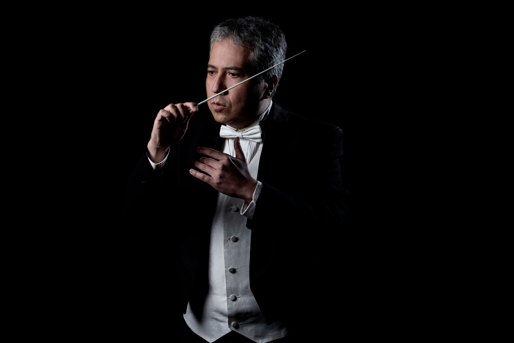

Inició su labor como director titular y artístico de la Orquesta
Sinfónica Nacional de México en 2023. Anteriormente ocupó el mismo cargo
al frente de las orquestas de Cámara de Bellas Artes, Filarmónica de
Querétaro y Sinfonietta Prometeo en Estados Unidos. En su carrera como
director y violinista, ha ofrecido conciertos en 31 países de América,
Asia y Europa, dirigiendo las orquestas del Palazzo Ricci, Gstaad
Festival, Sinfónica de Heredia, Filarmónica de la Ciudad de México,
Sinfónica de Xalapa, Filarmónica de la UNAM y del Teatro de Bellas
Artes, entre otras. Se ha presentado en los festivales internacionales
de Salzburgo, Lucerna, Davos, Ultraschall, Gstaad, Alicante, Granada,
Santander, June in Buffalo, IMPULS, Bayreuth, Spoleto, Internacional
Cervantino y Tage für Neue Musik Zürich. Cultiva por igual el repertorio
sinfónico y escénico, así como proyectos multidisciplinarios, además de
ser un activo promotor de la música contemporánea, dirigiendo el estreno
mundial de más de ciento veinte obras e interpretando cerca de ochenta
estrenos nacionales. Nacido en Morelia, inició sus estudios musicales a
los cinco años, ampliando su formación en Alemania, Austria, España,
Estados Unidos, Francia, Italia y Suiza. Obtuvo la Licenciatura y la
Maestría en Música en las especialidades de Violín y Dirección de
orquesta, así como títulos de posgrado en Musicología y Gestión
cultural. Se doctoró en dirección orquestal por la Northwestern
University bajo la tutela de Victor Yampolsky.

#### Simon Höfele


Es solista frecuente de las orquestas Royal Concertgebouw, Mahler
Chamber, BBC Symphony, Sinfonica Nazionale della RAI y de Chambre de
Lausanne, entre otras. Ha trabajado con directores como Semyon Bychkov,
Alpesh Chauhan, Vladimir Jurowski, Joana Mallwitz, Markus Stenz, Lorenzo
Viotti, Duncan Ward y Kahchun Wong. En la temporada 2025-2026 debutó con
la PhilZuid and Tiroler Symphonie-Orchester Innsbruck, en Austria, y
volvió a tocar con la Bochum Symphoniker y la Wuppertal
Symphonieorchester, y participó también en los festivales Heidelberger
Frühling y Kissinger Sommer. Como músico de cámara se ha presentado en
reconocidas salas de concierto como Wigmore Hall, Tonhalle Zürich,
Wiener Konzerthaus, Concertgebouw, Grande Auditório da Gulbenkian,
L'Auditori Barcelona, Müpa Budapest, BOZAR y Elbphilharmonie, así como
en los festivales Rheingau Musik, Schleswig-Holstein Musik y Grafenegg.
Mantiene una estrecha colaboración con la pianista Elisabeth Brauß y ha
trabajado también con otros solistas, como el pianista Frank Dupree y el
compositor y pianista Kaan Bulak. En cuanto defensor de la música
contemporánea, le han dedicado varias obras, entre otros los
compositores Lisa Streich, Helena Winkelman, Miroslav Srnka, Konstantia
Gourzi y Mark Simpson. Realizó también el estreno alemán del Concierto
para trompeta de Detlev Glanert con la Staatsphilharmonie Nürnberg.

::: logos


:::

## SÁB | NOV 7, 12:00 h - Maratón de guitarras

Pabellón Escénico, Jardín Escénico

### Programa

**Jorge Torres Sáenz**

-   *Aiora* (2025)\* `\hfill `{=tex}8'

**David Hernández Ramos**

-   *Le rêve de Dardanus*, variaciones para guitarra sobre un aria de
    Rameau (2026)\* `\hfill `{=tex}16'

**Mario Ortiz**, guitarra

**Eduardo Soto Millán**

-   *Xochikozkatl* \[Collar de flores\] (2019)\* `\hfill `{=tex}12'

**Ensamble Artificios**

José Manuel Alcántara\
Carlos Iturralde\
Alejandro Castaños, guitarras eléctricas

**William Kanengiser**

-   *Gongan* (1997)\*\* `\hfill `{=tex}4'

**Fernando Lewis de Mattos**

-   *Ibia-Mom Jaci Ndipapahabi* (1999)\*\* `\hfill `{=tex}7'

**Liliana Z. del Río**

-   *La llegada de Atheris* (2019)\*\* `\hfill `{=tex}6'

**Atanas Ourkouzounov**

-   *Cinq illusions sonores* (2012)\*\* `\hfill `{=tex}12'

**Ignacio Baca Lobera**

-   *Tracto* (2005) `\hfill `{=tex}10'

**Marek Pasieczny**

-   *Scintilla after Arvo Pärt* (2014-2015)\*\* `\hfill `{=tex}6'

**Tetraktys Guitar Quartet**

Rodrigo Villaseñor Rodríguez\
Miguel Ángel Rivera Bedolla\
Luis Enrique Estrada Fernández\
Hugo Armando Medina González

**Leo Brouwer**

-   De *Sonata de los misterios* (2011)\*\* `\hfill `{=tex}18'
-   *I. Preludio*
-   *III. Tiento y toccata*

**Ernesto García de León**

-   De Partita núm. 3, Op. 83, *De la infancia selvática* (2020)\*
    `\hfill `{=tex}23'
-   *III. Argumento de grillos y cigarras*
-   *IV. Araña mono*
-   *VI. Jaguarundi, yaguarundí*

**Manuel Enríquez**

-   *Tres instantáneas* (1988) `\hfill `{=tex}6'

**Stefan Soewandi**

-   *Kamajaya* (1998)\*\* `\hfill `{=tex}17'

**Vladimir Ibarra**, guitarra

### Personas compositoras

#### Jorge Torres Sáenz (México, 1968)


Compositor formado en México y Francia. Ha dedicado su vida a la música,
la filosofía y el arte. Fue discípulo de Jacques Charpentier y Alain
Louvier en el Conservatorio Superior de Música de París. Forma parte de
la Academia de Composición del Conservatorio Nacional de Música y
colabora con la formación de jóvenes músicos en la Universidad
Panamericana. Frente a la crisis planetaria de nuestros días, su interés
apunta hacia la importancia de repensar la música y el arte desde una
perspectiva ecosófica, atendiendo a las relaciones entre experiencia,
tradición, psique, ética y estética.

##### *Aiora*

El nombre de la pieza hace referencia a la fiesta de purificación que
realizaban los atenienses con el fin de apaciguar la ira de Dioniso.
Balanceándose en las ramas de los árboles, las jóvenes doncellas de la
ciudad recordaban el movimiento del cuerpo colgado de la mítica Erígone,
hija de Icario y protegida del dios, quien tras recibir la noticia del
asesinato de su padre, se ahorcó en la rama de un encino. Con el fin de
inmortalizarla, Dioniso transfiguró el cuerpo de Erígone en la
constelación de Virgo.

#### David Hernández Ramos (México, 1975)


Es miembro del Sistema Nacional de Creadores de Arte. Nacido en la
Ciudad de México, estudió la Licenciatura en Violín en la Facultad de
Música de la UNAM (FaM) bajo la tutela de Manuel Suárez y composición en
París con Jean-Luc Hervé en el Conservatorio de Boulogne-Billancourt
donde, en 2009, obtuvo su diploma en Composición. Ha ganado múltiples
premios en concursos de composición a nivel internacional en México,
Bélgica, España y Japón. Sus obras han sido interpretadas en Francia,
España, Portugal, Suiza, Austria, Cuba, Estados Unidos, Brasil,
Colombia, Chile y México. Es profesor de Violín barroco en la FaM.

##### *Le rêve de Dardanus*, variaciones para guitarra sobre un aria de Rameau

Se inspira en el aria «Ah! Que votre sort est charmant» de la ópera
*Dardanus* de Jean-Philippe Rameau. En ella, Dárdano, el protagonista,
escucha esta aria en un sueño mientras permanece prisionero. La pieza
propone un recorrido en reversa: comienza con una variación muy
abstracta, aparentemente distante del tema original y avanza
gradualmente hacia formas cada vez más reconocibles. En el proceso
atraviesa distintos lenguajes y técnicas compositivas: atonales,
modales, tonales y seriales, desplazándose libremente entre ellos. Este
tránsito puede dar la impresión de que la música se aleja del material
inicial, hasta culminar finalmente con la presentación íntegra del aria.
La diversidad de transiciones entre las variaciones busca evocar el
carácter difuso, simbólico y, por momentos, surrealista del mundo de los
sueños.

#### Eduardo Soto Millán (México, 1956)


Compositor y productor, crítico musical, promotor cultural, investigador
y académico. Ha dado clases en el INBAL por más de treinta años. Ha sido
programador musical en Radio Educación, coordinador de Actividades
Musicales de la Casa del Lago de la UNAM, director de Música de Cámara
de la Dirección de Música-Difusión Cultural UNAM, cofundador del Centro
Independiente de Investigaciones Musicales y Multimedia, fundador del
Centro de Apoyo para la Música Mexicana de Concierto de la SACM,
presidente fundador de la Sociedad Mexicana de Música Nueva, coordinador
nacional de Música y Ópera del INBAL, director artístico del Foro
Internacional de Música Nueva Manuel Enríquez y de las Jornadas
INBAL-SACM, coordinador académico y director del Centro Veracruzano de
las Artes Hugo Argüelles, director de Grupos Artísticos de la Dirección
General de Difusión Cultural de la Universidad Veracruzana, así como
miembro del Consejo Consultivo del Centro Latinoamericano para la Música
(CELAM) con sede en Venezuela. Ha colaborado en medios como *World New
Music Magazine*, *Pauta*, *La Jornada* y *Proceso*. Fundador y director
del Grupo de Música Contemporánea de la Escuela Nacional de Música de la
UNAM y del Ensamble Intermúsica. Compositor residente del Grupo Relâche
en la Arizona State University West y autor del *Diccionario de
Compositores Mexicanos de Música de Concierto - Siglo XX*. Su amplio
catálogo de obras comprende música de cámara, solos y ensambles
diversos, orquesta y música con tecnologías actuales, así como música
para danza y teatro. Fue miembro del Sistema Nacional de Creadores de
Arte 2018-2021.

##### *Xochikozkatl* (Collar de flores)

> «Escrita para José Manuel Alcántara, es una obra en la que me ha
> interesado explorar la relación tímbrica-producción *muda* del sonido
> en un tratamiento en que su arquitectura surge a partir de sutilezas,
> y cuya resultante sonora propone una experiencia dinámica y envolvente
> en un contexto expresivo específico. El material está dispuesto de tal
> manera que cada uno de los intérpretes posee la libertad de establecer
> su discurso integrado al de la totalidad de la obra. El título ha sido
> compartido por Mardonio Carballo, a quien está dedicada. Fue compuesta
> gracias al apoyo del Sistema Nacional de Creadores de Arte».

#### William Kanengiser (Estados Unidos, 1959)


Ha forjado una carrera que expande las posibilidades de la guitarra
clásica. Galardonado en los concursos Internacional Concert Artists
Guild 1987 y Toronto Guitar '81, ha realizado giras por Norteamérica,
Asia y Europa con sus innovadores programas y su expresiva musicalidad.
Grabó cuatro discos para el sello GSP, interpretando música tan diversa
como la caribeña, la de Europa del Este y el jazz. Miembro del
profesorado de guitarra de la Escuela de Música Thornton de la USC desde
1983, ha impartido clases magistrales por todo el mundo y ha producido
dos videos didácticos. Recientemente interpretó el estreno en Estados
Unidos del *Folk Concerto* de Clarice Assad, junto a Scott Tennant y la
Orquesta Sinfónica de Albany dirigida por David Allan Miller.

##### *Gongan*

Inspirado en la tradición musical de la Orquesta de Gamelán de
Indonesia, conformada principalmente por diferentes tipos de gongs e
instrumentos de percusión ajenos a la tradición musical europea, con el
uso de pinzas metálicas, palillos de madera y esponjas para alterar el
sonido natural de las guitarras, Kanengiser evoca los timbres orientales
de una orquesta donde no hay protagonistas y en donde cada integrante
del ensamble toca un fragmento musical que, en conjunto, crea una
melodía y armonía, ya que en este tipo de música se acostumbra tocar
menos notas y de mayor duración, entre más grave sea el sonido y, por el
contrario, más notas y mayor velocidad, entre más agudo sea.

#### Fernando Lewis de Mattos (Brasil, 1963-2018)


Fue un destacado compositor, instrumentista y profesor brasileño,
reconocido principalmente por su labor en la música académica y
contemporánea de Rio Grande do Sul. Prolífico compositor con un catálogo
que incluye piezas para diversos instrumentos, su estilo integró
elementos de la música tradicional con lenguajes contemporáneos.

##### *Ibia-Mom Jaci Ndipapahabi*

El título utiliza términos que derivan de lenguas indígenas de
Sudamérica, específicamente de la familia tupí-guaraní. «Jaci» (o Yacy),
en guaraní y tupí significa Luna. Es una figura central en su mitología,
a menudo considerada la protectora de los amantes y la noche. Ibia-Mom
suele referirse a conceptos relacionados con la tierra o el suelo en
variantes de estas lenguas. Ndipapahabi es un término más complejo, pero
en el contexto de las obras de Mattos, quien frecuentemente explora
temas indígenas y regionales, suele aludir a sonoridades o cantos
ancestrales. Aunque no existe una traducción literal al español en
diccionarios estándar, el título evoca una *Oda o canto a la Luna y la
Tierra* desde una perspectiva mística indígena.

#### Liliana Z. del Río (México, 1987)


Licenciada en Composición musical por la West London University, inició
sus estudios en 2008 en el Centro de Investigación de Estudios de la
Música. Entre sus maestros se encuentran Víctor Rasgado e Ignacio Baca
Lobera. Ha sido beneficiaria de los programas Jóvenes Creadores 2015 y
2020, Cátedra Extraordinaria *Arturo Márquez* 2017 y de Fortalecimiento
para Jóvenes Compositores y Jóvenes Creadores 2020. Su música ha formado
parte de los festivales y foros Eduardo Mata, Internacional de Música
Nueva Manuel Enríquez, Expresiones Contemporáneas, de Mujeres en la
Música Nueva de Colombia e Internacional Cervantino, y ha sido
interpretada por la Orquesta Juvenil Eduardo Mata, Sinfónica de la
Universidad Autónoma del Estado de Hidalgo, Filarmónica de Sonora y
Filarmónica de Jalisco.

##### *La llegada de Atheris*

> «Surge de una experiencia casi onírica: la visión de una serpiente en
> constante movimiento que, de pronto, muda de piel. El giro ocurre al
> descubrir que esa serpiente soy yo. A partir de ese instante, la
> percepción se fragmenta y la mirada se desplaza hacia una especie de
> tercera persona, donde identidad y observación se confunden. La obra
> explora una transformación continua a través de diversas texturas
> sonoras. El cuarteto de guitarras se convierte en un organismo
> mutable, donde los efectos sonoros funcionan como narrativa y no como
> ornamento, revelando un proceso de cambio constante. En este juego de
> perspectivas, la música transita entre el interior y la distancia: a
> veces narra desde dentro de la metamorfosis y, otras, observa ese
> proceso con extrañeza. Más que contar una historia, la obra habita ese
> umbral en el que dejamos de ser quienes éramos, sin saber aún en qué
> nos estamos convirtiendo».

#### Atanas Ourkouzounov (Bulgaria, 1970)


Es una de las personalidades más interesantes de la música contemporánea
búlgara. Guitarrista y compositor con una sólida formación musical, es
considerado uno de los principales autores en el ámbito de la música
para guitarra de la nueva generación. Estudió guitarra, música de
cámara, análisis, etnomusicología e improvisación en el Conservatorio de
París y se graduó en 1997 con el primer premio de guitarra por
unanimidad. En su catálogo hay más de cien obras para guitarra,
incluyendo solos, dúos, tríos, cuartetos, conjuntos instrumentales y
cinco conciertos.

##### *Cinq illusions sonores*

La música de Ourkouzounov es el extraño equilibrio y simbiosis entre un
lirismo de intensa introspección y métricas nada ortodoxas, en la que se
hace gala de un virtuosismo rítmico. También puede entenderse como una
constante contraposición de elementos enraizados en la tradición búlgara
y una fuerte formación académica compositiva. El título de esta obra es
ilustrativo, pues en ella podemos escuchar exploraciones sobre cinco
ideas sonoras que desarrolla en una suerte de miniaturas pintorescas y
caleidoscópicas.

#### Ignacio Baca Lobera (México, 1957)


Con una trayectoria de más de cuarenta años ha explorado en su obra el
microtonalismo, las nuevas técnicas instrumentales, la improvisación
controlada, la electroacústica y diversas formas de aleatoriedad.
Asimismo, ha formado a varias generaciones de compositores y ha
promovido la música contemporánea en diferentes ámbitos. Su obra ha
recibido los premios Kranichsteiner Musikpreis, Irino Prize, Guggenheim
Fellow. Forma parte del Sistema Nacional de Creadores desde 1997.

##### *Tracto*

> «Tracto: lapso de tiempo, espacio entre dos lugares. La forma musical,
> como problema, tiene una larga historia en la música occidental, sobre
> todo desde principios del siglo XX. Qué tanto peso y desgaste soporta
> el material son aspectos que, de manera orgánica, determinan la
> resolución formal de una obra. Si alteramos el sentido de la
> repetición y la disposición espacio-temporal de los diversos elementos
> de tal manera que las expectativas de la narrativa musical (desde el
> punto de vista del compositor, al momento de componer) se mantienen
> permanente *alteradas*, entonces arribamos a una resolución formal no
> orgánica, que es lo que he buscado en mis composiciones recientes».

#### Marek Pasieczny (Polonia, 1980)


Posee tres maestrías en música: en Composición e Interpretación
otorgadas por el Real Conservatorio de Escocia en Glasgow, Reino Unido,
y otra en Interpretación obtenida en la Academia de Música *Karol
Lipinski* de Breslavia, Polonia. En 2010 inició un doctorado conjunto en
Composición e Interpretación en Australia, antes de regresar a Europa en
2012 y finalizar su doctorado en la Universidad de Surrey en Guildford,
Reino Unido, en 2015. Como compositor, guitarrista, conferenciante y
jurado, ha participado regularmente en festivales en Polonia, Francia,
Alemania, Países Bajos, Suiza, Austria, República Checa, Grecia,
Turquía, Rusia, Bosnia Herzegovina, Reino Unido, Italia, China, Japón,
Australia, Nueva Zelanda, Sudáfrica, Canadá y Estados Unidos.

##### *Scintilla after Arvo Pärt*

> «Esta miniatura es mi homenaje al compositor Arvo Pärt. La pieza se
> divide en tres movimientos. El movimiento central, titulado *Salmo*,
> constituye el corazón de la obra, inspirado y basado en las primeras
> cuatro líneas vocales masculinas de la obra de Pärt, *De Profundis*.
> Original para piano solo y posteriormente transcrita para guitarra
> solista, siguiendo el estilo tintinnabulum de Pärt, en la adaptación
> posterior para dos guitarras la guitarra I conserva el mismo material
> que la versión para guitarra solista. Sin embargo, a la guitarra II se
> le añadieron nuevas capas, presentando nuevos materiales compositivos
> que modificaron por completo la estructura armónica de la pieza. Esta
> técnica se conoce como palimpsesto; una práctica antigua que consistía
> en reutilizar pergaminos raspando los textos antiguos para dejar
> espacio a los nuevos. Sin embargo, bajo la nueva capa de texto se
> pueden apreciar vestigios del original».

#### Leo Brouwer (Cuba, 1939)


Nació en La Habana. Es Commandeur des Arts et Lettres 2018, miembro
honorario de la American Academy of Arts and Letters 2019, miembro de
honor del CIM de la UNESCO, del Instituto Italo-Latinoamericano,
académico correspondiente de la Academia de Bellas Artes de Granada y de
la Real Academia de Ciencias, Bellas Artes y Nobles Letras de Córdoba,
España, y miembro numerario de la Academia Cubana de la Lengua. Brouwer
es una figura fundamental de la música contemporánea, reconocido
internacionalmente como compositor, director, guitarrista y pedagogo con
una obra que abarca más de quinientas creaciones y una extensa
discografía. A lo largo de su trayectoria ha dirigido instituciones
clave como la Orquesta Sinfónica Nacional de Cuba y la Orquesta de
Córdoba, siendo distinguido con múltiples galardones, incluyendo dos
Grammy Latino y el Premio Iberoamericano Tomás Luis de Victoria.

##### *Sonata de los misterios*

> «Compuesta en 2011 para archilaúd, se trata de una sonata de gran
> formato en que convergen reminiscencias a formas antiguas y recursos
> propios de la música contemporánea. En el *Preludio*, se desarrolla
> una serie de arpegios que muestran la extensión y posibilidades del
> instrumento seguidos de unas folias en *tempo di sarabanda*. En la
> *Pavana Melancólica* convergen virtuosos arabescos y arpegios de
> carácter atonal interrumpidos por una fantasía de Luys Milán y un
> final de carácter sombrío y misterioso, de ahí el título de la obra.
> El último movimiento comienza con una cita del inicio de la décima
> sinfonía de Shostakovich seguida de tres breves tocatas, la primera de
> carácter libre e improvisatorio, la segunda de carácter tribal y una
> tercera de influencia stravinskiana. Con autorización del compositor,
> he preparado una versión para guitarra de ocho cuerdas en la que se
> logran mantener todas las notas graves propias del archilaúd de manera
> que la obra conserva sus cualidades tímbricas».

#### Ernesto García de León (México, 1952)


Compositor veracruzano que durante medio siglo ha dedicado su vida
creativa a una suerte de constante evocación de los recuerdos de su
infancia vivida en Jáltipan, su pueblo natal. El compositor ha
construido una poética musical que captura y preserva artísticamente la
exuberancia de la flora, la fauna y las tradiciones de Veracruz: ruidos
selváticos de monos, felinos salvajes, aves silvestres, diversidad de
insectos; ecosistemas como ríos, manantiales, manglares y selvas;
fenómenos naturales como las características lluvias y tormentas del
trópico, crepúsculos, albas, calor sofocante y brisas marinas; árboles
endémicos como la ceiba, la palmera, el marañón y el bálsamo; personajes
míticos como chaneques, nahuales y duendes; motivos de las tradiciones
veracruzanas como la fiesta de El Viejo, las mojigangas, los come tierra
(chogosteros), el son jarocho y la rumba. La poética musical de García
de León evoca toda esta riqueza natural y cultural a través de las
cuerdas.

##### *De la infancia selvática*, partita núm. 3, Op. 83

> «Durante mi infancia, la selva con su follaje exuberante se encontraba
> a solo 200 metros de mi casa. No era necesario caminar mucho. Yo solía
> vagar por las afueras de mi pueblo con mis amigos y hermanos
> colgándome de las lianas como un mono, deambulando en los parajes
> selváticos, nadando en los arroyos y en los ríos, trepando árboles,
> comiendo frutas, pescado \[...\]. \[Años más tarde\] me encontré con
> una terrible sorpresa: un paraje completamente talado y devastado. Fue
> una mala experiencia que me dejó un desagradable sabor de boca y un
> enojo por tal inconsciencia, ignorancia y maldad. *De la infancia
> selvática* es una evocación de ruidos, aromas, sensaciones,
> situaciones plagadas de murmurantes seres sobrenaturales, misteriosos
> y amenazantes, pero, de alguna manera, amigables».

#### Manuel Enríquez (México, 1926-1994)


Originario de Ocotlán, Jalisco, fue una figura fundamental de la
vanguardia musical en México. Se formó con Áurea Corona y Miguel Bernal
Jiménez, perfeccionándose después en la Juilliard School con Ivan
Galamian y Peter Mennin. En 1961, gracias a la beca Guggenheim,
incursionó en la música electrónica en Columbia y Princeton bajo la guía
de Stefan Wolpe. Como violinista, fue concertino de la Sinfónica de
Guadalajara y fundó el célebre Cuarteto México, con el que realizó giras
por Europa y América. Su labor docente y administrativa fue vasta:
dirigió el Conservatorio Nacional y el Cenidim, donde impulsó la
investigación electroacústica y virreinal. En 1979 fundó el Foro
Internacional de Música Nueva (que hoy lleva su nombre), espacio vital
para la difusión de la creación contemporánea. Distinguido como Creador
Emérito y miembro de la Academia de Artes, su legado permanece como
pilar de la identidad musical mexicana del siglo XX.

##### *Tres instantáneas*

Compuestas en 1988 y dedicadas al guitarrista y compositor Flores
Chaviano, se trata de tres páginas de música cuya escritura oscila entre
notación no mensurada, módulos, grafismos y elementos aleatorios. Este
tipo de composición, ampliamente explorada por Enríquez, interpela al
intérprete para formar parte activa del proceso creativo de la obra.
Aquí debe tomar decisiones sobre alturas, efectos, timbres, ritmos, pero
manteniéndose siempre dentro de unos márgenes estructurales que dan
sostén a las piezas, de manera que el resultado sea un evento sonoro en
que intérprete y compositor se vuelven en un binomio difícilmente
separable.

#### Stefan Soewandi (Alemania, 1962)


Compositor de ascendencia india nacido en Múnich, guitarrista y pedagogo
con una sólida formación académica obtenida en instituciones como el
Richard Strauss-Konservatorium de Múnich y la Musikhochschule de Viena,
donde se graduó con honores en Pedagogía instrumental, especializándose
también en teoría e historia de la música. Estudió con Leo Brouwer y
Roland Dyens. Desde 1991 es profesor de guitarra independiente. Ha sido
docente en la Universidad Católica de Eichstätt y actualmente ejerce en
la Escuela de Música de Garching. Entre 1991 y 1999 publicó diversas
composiciones propias con editoriales especializadas como Chanterelle y
AMA Verlag.

##### *Kamajaya*

Está pieza inspirada en la deidad hindú que lleva el mismo nombre, dios
que en la mitología javanesa se asocia con distintas fuerzas creadoras
de la naturaleza como el amor, la pasión, la atracción sexual y la
belleza. Se trata de una obra minimalista, un continuo sonoro con
células motívicas que se presentan, transforman y desarrollan,
propiciando un caleidoscopio sonoro que remite a estos impulsos
creadores de la naturaleza. La obra transita por momentos de calma y
consonancia en contraste con momentos vertiginosamente virtuosos y
disonantes, lo cual evoca distintos aspectos de la naturaleza y su
capacidad transformadora en la renovación de ciclos de vida.

------------------------------------------------------------------------

### Intérpretes

#### Mario Ortiz


Cursó la Licenciatura en Guitarra clásica en la Universidad de
Guanajuato y la Maestría en Interpretación musical y el Doctorado en
Artes Musicales en la Universidad de Kentucky, donde estudió bajo la
tutela de Dieter Hennings y recibió la beca Fulbright García-Robles.
Como concertista se ha presentado en festivales internacionales y foros
especializados en música nueva en México, Japón, Italia, Puerto Rico y
Estados Unidos. Además, ha participado como solista con la Lexington
Chamber Orchestra y la Sinfonietta MIQ. En 2015 y 2022 fue becario del
programa de Estímulos a la Creación y Desarrollo Artístico con proyectos
orientados a la música de reciente creación. Actualmente se desempeña
como profesor de tiempo completo en el Departamento de Música y Artes
Escénicas de la Universidad de Guanajuato.

#### Ensamble Artificios


Artificios es una figura que invita a diferentes músicos profesionales
especialistas en música contemporánea a realizar proyectos específicos.
En esta ocasión, *Xochikozkatl* de Eduardo Soto Millán convoca a Carlos
Iturralde, compositor, miembro del Sistema Nacional de Creadores y
guitarrista eléctrico; Alejandro Castaños, compositor, miembro del
Sistema Nacional de Creadores y guitarrista eléctrico y a José Manuel
Alcántara, guitarrista especializado en la música experimental para
guitarra acústica y eléctrica.

#### Tetraktys Guitar Quartet

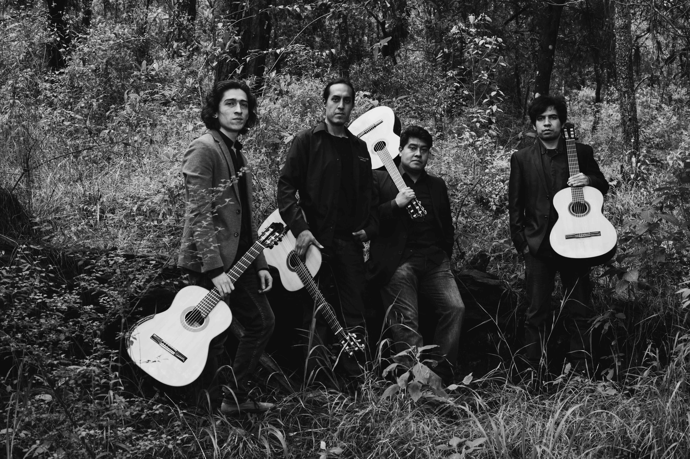

Formado en 2009, el cuarteto fue acreedor al reconocimiento especial del
Premio Nacional de la Juventud 2013. Ha recibido asesoría de destacados
músicos como Leo Brouwer, Cuarteto Penderecki, Arón Bitrán, Horacio
Franco, Eduardo Martín, Dúo Bruck-Ross y Cuarteto Latinoamericano entre
otros. En su trayectoria Tetraktys ha realizado estrenos, tanto
mundiales como nacionales, de obras de Leo Brouwer, Marios J. Elia,
Leonardo Balada, J. P. Simoniello y L. Caballero, entre otros. Ha
participado en los festivales Internacional Cervantino, Foro
Internacional de Música Nueva Manuel Enríquez, Feria Internacional
Cubadisco 2012, Internacional de Tamaulipas y e Internacional de Música
de Cámara *Leo Brouwer* de La Habana. Ha realizado conciertos para Radio
UNAM, IMER, Once TV y el INBAL, además de presentarse en España, Cuba e
Italia.

#### Vladimir Ibarra


Guitarrista guanajuatense. Se ha presentado en ensambles y como solista
en Cuba, Estados Unidos, Hong Kong, Costa Rica, Colombia, España e
Italia. En México ha actuado en los principales recintos del país: la
Sala Manuel M. Ponce del Palacio de Bellas Artes, el Salón de
Recepciones del Munal, las salas Nezahualcóyotl y Carlos Chávez de la
UNAM, así como los teatros Juárez y Principal de Guanajuato. Hitos en su
trayectoria como intérprete son la presentación de obras de gran formato
de compositores como Hans Werner Henze, Maurice Ohana, Bruno Maderna,
Fausto Romitelli, Martín Matalón y George Crumb, y ha participado en los
festivales Internacional Cervantino, Foro Internacional de Música Nueva
Manuel Enríquez y Callejón del Ruido. Cuenta con dos producciones
discográficas: *Marañón: música para guitarra de ocho cuerdas de Ernesto
García de León* y *The Dream of a Shadow: Phillip Houghton complete
works*.

## SÁB | NOV 7, 17:00 h - Instalación sonora: Nuño de Buen

Casa Rafael Galván, UAM

**Instalación**

------------------------------------------------------------------------

### Programa

**Andrés Nuño de Buen**

- *Sobre las sensaciones de tono y otros fantasmas*\* `\hfill `{=tex}50'

### Personas compositoras

#### Andrés Nuño de Buen (México, 1988)


Compositor radicado en Berlín. Su música investiga la vibración,
resonancia y háptica del sonido mediante instrumentos acústicos, medios
electrónicos, instalaciones sonoras e instrumentos de construcción
propia. Su práctica actual gira en torno al sintetizador acústico o
diapasófono: un instrumento-instalación que emplea diapasones,
electroimanes y botellas de vidrio para producir síntesis sonora de
manera completamente acústica: sin micrófonos, bocinas ni procesamiento
electrónico. Obras como *Alquitara* para 12 músicos con diapasones y
botellas de vidrio, presentada en el Lucerne Festival Forward 2021 o
*Leve* para el cuarteto de guitarras ALEPH, Premio de Composición de la
Ciudad de Stuttgart 2022, trasladan ese interés por la materia sonora y
sus principios acústicos a la música de concierto. Su música se ha
presentado en festivales y ciclos de conciertos en México, Estados
Unidos, España, Francia, Alemania, Austria, Suiza, Suecia, Turquía,
Rusia y Japón, y ha contado con el apoyo de instituciones como la
Secretaría de Cultura de México, la Academia de las Artes de Berlín y la
Kunststiftung Baden-Württemberg. Estudió con Wolfgang Rihm y Markus
Hechtle en la Hochschule für Musik de Karlsruhe y con Alejandro Romero,
José Luis Castillo y Carole Chargueron en la Escuela Superior de Música
del INBAL.

##### *Sobre las sensaciones de tono y otros fantasmas*

> «Inspirado por los experimentos que el físico y médico alemán Hermann
> von Helmholtz publicó en 1863 en su libro *Sobre las sensaciones de
> tono*. Mi sintetizador acústico o diapasófono combina ondas
> sinusoidales para sintetizar sonidos de forma completamente acústica:
> sin micrófonos, bocinas ni procesamiento electrónico. El instrumento
> funciona mediante electromagnetismo, vibración y resonancia:
> electroimanes excitan la vibración de diapasones, que a su vez hacen
> resonar botellas de vidrio afinadas con agua. El resultado es un
> híbrido entre instalación sonora e instrumento musical que confiere
> presencia física a sonidos que generalmente asociamos a un mundo
> digital carente de cuerpo. El diseño y construcción de la primera
> versión de mi instrumento, en 2022, coincidió con la muerte de mi
> papá, por lo que este proyecto estará siempre ligado para mí a un
> proceso de duelo profundo. Durante este periodo, la presencia de estos
> sonidos en mi vida comenzó a sentirse como una especie de convivencia
> con lo fantasmagórico. Y es que una característica de las ondas
> sinusoidales puras es que el oído humano tiene dificultad para
> localizar su fuente sonora. Aunque estemos frente al objeto en
> vibración, percibimos el sonido como si viniera de otro lado. Los
> tonos del diapasófono se despliegan en el espacio y adquieren una
> materialidad casi tangible, pero al mismo tiempo permanecen
> ilocalizables y, en cierto modo, incorpóreos. Hay algo en la
> naturaleza invisible e inaprensible del sonido que lo acerca a lo
> espectral, un vínculo que se remonta a los primeros instrumentos
> prehistóricos, construidos con restos de animales y usados en
> contextos rituales. Pero no es necesario irnos tan lejos: poco después
> de los experimentos de Helmholtz, las primeras máquinas de grabación
> se vendían no como aparatos para reproducir música, sino como un modo
> de preservar para siempre las voces de los seres queridos».

::: logos

.png>)
.png>)
.png>)
:::

## SÁB | NOV 7, 19:00 h - Gonzalo Gutiérrez, piano

Sala Manuel M. Ponce, Palacio de Bellas Artes

### Programa

**Juro Kim Feliz**

-   *O forse, l'ho già perduta poco a poco...* (2018)\*\* `\hfill `{=tex}7'

**Lucas Barroso**

-   *8 miniaturas para piano* (2024) `\hfill `{=tex}8'

**Oscar Pablo Di Liscia**

-   *Piezas con forma apropiada* (2024)\*\* `\hfill `{=tex}10'

**Leopoldo Novoa Matallana**

-   *Historias para piano, Suite* \[selecciones\] (2023)
    `\hfill `{=tex}10'
  -   *Bambuco desnudo*
  -   *Porro caderia'o*
  -   *Calypso colapso*
  -   *Currulao acosao*

**Ismael Morales**

-   *Lúmina* (2025)\* `\hfill `{=tex}4'

**Rebecca Saunders**

-   *to an utterance -- a study* (2020)\*\* `\hfill `{=tex}12'

**Gonzalo Gutiérrez**, piano

### Personas compositoras

#### Juro Kim Feliz (Filipinas, 1987)


Compositor radicado en Toronto que ha presentado su obra en Asia,
América y Europa. Recibió el premio Goethe Southeast Asian Young
Composer Award en 2009 y una distinción en el Ars Electronica Forum
Wallis en 2018 y 2024. Fue compositor en residencia en el programa New
Music Concerts de Toronto en 2022 y 2023 y tuvo residencias en Brush
Creek Foundation for the Arts 2018, Kimmel Harding Nelson Center for the
Arts 2019, Willapa Bay AiR 2023 y MacDowell 2025. Su obra aparece en los
sellos Ravello Records y Ablaze Records. Contribuye regularmente con
artículos en la revista *Musicworks* de Toronto.

##### *O forse, l'ho già perduta poco a poco...*

> «Avelina Manalo (1926--2009) fue una gran pedagoga en Filipinas, que
> enseñó a multitud de pianistas. Estudió en Rusia e Italia y se
> presentó en numerosos conciertos en su país y en el extranjero. Yo
> estudié con ella al final de sus días y después de su muerte me di
> cuenta de que la conocí muy poco. Mi interés en su vida, siendo una
> artista filipina en Europa, se fusionó con mi lectura del libro de
> Italo Calvino *Las ciudades invisibles*, en donde diálogos ficticios
> entre Kublai Khan y Marco Polo cuentan sobre ciudades bizarras en
> Venecia, la tierra natal de Marco Polo. También estudiaba *Jeux d'eau*
> de Maurice Ravel como homenaje al tiempo pasado junto a mi maestra y
> esa música se convirtió en un vehículo a su memoria del mismo modo en
> el que Marco Polo, en la obra de Calvino, compara a Venecia con otras
> ciudades extranjeras. Esta obra es la culminación de estos diferentes
> tópicos y recuerdos».

#### Lucas Barroso (México, 1983)


Es un compositor y pianista mexicano-belga formado en el Provinciale
Instituut Kunst-Humaniora de Bélgica y en la Escuela Superior de Música
del INBAL, en la cátedra de Mauricio García de la Torre. Su estética
explora la intimidad entre compositor, intérprete y audiencia a través
de la manipulación de microgestos, variaciones mínimas y fenómenos de
resonancia y difusión acústica. Su catálogo de música orquestal, de
cámara y electrónica ha sido interpretado por solistas y ensambles
nacionales y extranjeros y ha sido seleccionado por el 47 FIMNME en
2025, Emerge Coalition 2026 en Estados Unidos y Platypus Ensamble en
Austria en 2026, además de realizar la música original de cortometrajes
estrenados en festivales en México y Corea del Sur. Es ayudante de
investigación de Julio Estrada y director ejecutivo de la Filarmónica
del Lago desde 2023. Como intérprete se especializa en el estreno de
música contemporánea panamericana.

##### *8 miniaturas para piano*

Ocho instantes suspendidos en el tiempo, donde la regularidad rítmica y
textural sirve de anclaje frente a la volatilidad del sonido. En esta
colección de piezas breves, los gestos aparecen y se disuelven como
siluetas en la niebla, acumulando capas de eco y resonancias.

#### Oscar Pablo Di Liscia (Argentina, 1955)


Es Doctor en Humanidades y Artes de la UNR y estudió también composición
de forma particular con Dante Grela y Francisco Kröpfl. Fue director de
la Carrera de Composición con medios electroacústicos de la Universidad
Nacional de Quilmes y profesor titular ordinario de Computación aplicada
a la música y composición electroacústica. Fue secretario de
Investigación y Posgrado y profesor titular ordinario del Laboratorio de
Sonido de la Universidad Nacional de las Artes (UNA). Actualmente es
profesor emérito y director de la Especialización de Posgrado en Sonido
aplicado a las artes digitales en la UNA. Su producción artística, que
ha recibido subsidios del Fondo Nacional de Las Artes y las fundaciones
Antorchas, Rockefeller, Música y Tecnología e Ibermúsicas, ha sido
distinguida en competiciones nacionales e internacionales y se ha
presentado, grabado y editado en Argentina, Austria, Portugal, Estados
Unidos, Francia, Chile, Cuba, España, Países Bajos, México, Colombia y
Uruguay. Sus áreas principales de investigación son la espacialización
de sonido, el análisis espectral de sonido, la composición y el análisis
musical.

##### *Piezas con forma apropiada*

El título alude con ironía al doble carácter de estas piezas, tanto el
uso de lo ajeno como también a la *forma apropiada* en el sentido de
aquellas que han sido consideradas ideales en la música clásica.
La primera de ellas, *Fuga sesgada*, explota el contrapunto extendido a través
de la creación de planos adicionales con notas de adorno y polifonías internas
de sucesiones de acordes, usando los grados conjuntos, que se consideran los
intervalos melódicos por excelencia del contrapunto escolástico.
La segunda *Jizznopedia*, no se apropia de una forma en el sentido estricto,
sino del *mood* de Satie cuya *Gymnopédie* núm. 1 está siempre desmenuzada,
sugerida y coloreada con armonía de jazz. La tercera, *Varnolds*, es un rondó
con variaciones en que el juego de intervalos de la pieza Op. 19 núm. 2 de
Schoenberg es replicado en cada episodio con diferentes combinaciones de
intervalos y su *ostinato* es variado a diferentes niveles.

#### Leopoldo Novoa Matallana (Colombia, 1958)


Compositor, intérprete y lutier colombiano-mexicano. Realizó estudios en
el Conservatorio Nacional y la Universidad Pedagógica de Colombia, en la
Facultad de Música de la UNAM, el IRCAM de París y en el LIEM de Madrid.
Ha hecho investigación sobre música tradicional en Colombia y México. Ha
compuesto obras para ensambles de México, Japón, Colombia, Estados
Unidos, Ecuador y Brasil. Tiene obras para percusiones, una cantata, dos
suites, para violonchelo y para piano, piezas contemporáneas para arpa,
guitarra barroca, tiorba y viola da gamba, un trío y dos quintetos para
metales, piezas para voz y percusión corporal; también es autor de dos
óperas *La muerte y el hablador* y *Domingo Benkos*. Como compositor de
música para teatro y danza ha trabajado con José Caballero, Luis de
Tavira, David Holguín, Johann Kresnik y Alberto Lomnitz. Ha sido maestro
del CUT-UNAM, el Cenart, el CEMA de Morelos y la UBBJG de Playa Vicente,
Veracruz. Ha impartido talleres en Latinoamérica, Europa y Estados
Unidos. Miembro del Sistema Nacional de Creadores de Arte 2023-2025.

##### *Historias para piano, Suite*

Es una suite de piezas inspiradas en sucesos reales que marcaron al
compositor de 2010 a 2025. Incluyen desde el reto de componer una pieza
con solo las blancas del piano, pero que logre una sonoridad
contemporánea, hasta un calipso con desarrollos armónicos y
contrapuntísticos complejos a partir de las frases más tradicionales del
género, pasando por una danza lenta y sonoramente profunda con la
sensación de una noche larga, tensa y casi silenciosa después de un
combate injusto.

#### Ismael Morales Díaz (México, 1993)


Es Licenciado en Composición musical por el London College of Music de
la University of West London y cuenta con la Licenciatura en Lengua y
Literaturas Hispánicas por la UNAM. Su obra ha sido interpretada en
México, Colombia, España, Francia, Austria y Argentina y ha sido
publicada por Editorial SUR y diversos proyectos discográficos
internacionales. Ha desarrollado proyectos que integran arte, ciencia y
tecnología para el Foro Internacional de Música Nueva Manuel Enríquez y
los festivales Internacional de Ciencia y Arte El Aleph de la UNAM, las
Jornadas de Música Contemporánea de Colombia y el Encuentro entre
Compositores e Intérpretes en Argentina. Paralelamente, ha trabajado en
producción radiofónica, dirección artística de festivales y procesos de
investigación-creación centrados en intermedialidad, écfrasis musical y
ecologías de la escucha.

##### *Lúmina*

La palabra «lúmina» posee un significado amplio y versátil que abarca
tanto lo físico como lo simbólico. En su acepción anatómica, denota el
espacio interno de ciertos órganos, un conducto por el que fluyen
sustancias esenciales para la vida. No obstante, su resonancia
trasciende lo técnico para adentrarse en terrenos filosóficos y
poéticos. Desde esta perspectiva, la lúmina se convierte en símbolo de
introspección: un lugar interior donde la luz, como metáfora del
conocimiento o la verdad, penetra para iluminar los rincones más
profundos del alma y la mente. Además, encarna una paradoja fascinante:
la idea de una luz contenida, atrapada en un espacio cerrado, que evoca
un potencial aún no expresado. En el ámbito ontológico, la lúmina se
concibe como un espacio en el que el ser adquiere significado, ya sea en
su plenitud o en su vacío.

#### Rebecca Saunders (Reino Unido, 1967)


En sus composiciones explora las propiedades organizadas del sonido
tanto espaciales como esculturales, lo cual consigue en cercanos
diálogos colaborativos con una variedad de músicos y artistas. Su música
ha sido interpretada por renombrados ensambles y solistas, como Ensemble
Musikfabrik, Klangforum Wien, Ensemble Modern, Diotima, Ensemble
Resonanz, Ensemble Intercontemporain y numerosas orquestas
internacionales. Ha recibido diversos premios, entre ellos el Ernst von
Siemens Music Prize 2019, el Golden Lion for Music de la Bienal de
Venecia 2024, el Happy New Ears Prize 2015, el Hindemith Prize, el
Mauricio Kagel Music Prize, así como varios premios de la Royal
Philharmonic Society y BASCA British Composer Awards. Enseña, entre
otras instituciones, en los Cursos de Verano de Darmstadt y es miembro
de la Berlin Academy of Arts y de la Sachsen Academy of Arts en Dresde,
Alemania.

##### *to an utterance -- a study*

*utterance* /ˈʌt(ə)r(ə)ns/ *n.*

1.  expresar, una palabra hablada, murmurada, revelada, una declaración,
    o sonido vocal; el acto de expresar; expresión vocal; la forma y
    poder del habla; una secuencia de un discurso consistente en una o
    más palabras precedidas o seguidas por silencio;
2.  de suma importancia, el extremo -- estar al borde de un precipicio

*to an utterance: arcaico + literario*: el amargo final

El piano solo tiene una voz incorpórea, busca contar su propia historia,
titubeante, en una búsqueda incierta. Busca su silencio final a través
de su propio exceso al hablar: un incesante y compulsivo soliloquio. Un
protagonista musical como ser, al precipicio del no ser.

------------------------------------------------------------------------

### Intérpretes

#### Gonzalo Gutiérrez


Nació en la Ciudad de México, donde inició sus estudios musicales en la
Escuela Nacional de Música de la UNAM. Estudió piano con Manuel Delaflor
y Néstor Castañeda, y posteriormente con István Nadás y Ludovica Mosca
en Barcelona. Ha sido solista de la Orquesta Filarmónica de la Ciudad de
México, así como del ensamble del Conservatorio de las Rosas. Ha
colaborado con la Orquesta Sinfónica Nacional, la Orquesta del Teatro de
Bellas Artes, Ónix Ensamble y el Ensamble del Cepromusic. A nivel
internacional, se ha presentado en diversas salas como el Tokyo Opera
City Recital Hall, el New York Americas Society y el Boston University
Concert Hall, entre muchos otros recintos.

## DOM | NOV 8, 12:00 h - Instalación sonora: Nuño de Buen / Vigueras

Casa Rafael Galván, UAM

**Instalación - Concierto**

------------------------------------------------------------------------

### Programa

**Andrés Nuño de Buen**

- *Sobre las sensaciones de tono y otros fantasmas*\* `\hfill `{=tex}50'

**Andrés Nuño de Buen**

**Fernando Vigueras**, guitarra

### Personas compositoras

#### Andrés Nuño de Buen (México, 1988)


Compositor radicado en Berlín. Su música investiga la vibración,
resonancia y háptica del sonido mediante instrumentos acústicos, medios
electrónicos, instalaciones sonoras e instrumentos de construcción
propia. Su práctica actual gira en torno al sintetizador acústico o
diapasófono: un instrumento-instalación que emplea diapasones,
electroimanes y botellas de vidrio para producir síntesis sonora de
manera completamente acústica: sin micrófonos, bocinas ni procesamiento
electrónico. Obras como *Alquitara* para 12 músicos con diapasones y
botellas de vidrio, presentada en el Lucerne Festival Forward 2021 o
*Leve* para el cuarteto de guitarras ALEPH, Premio de Composición de la
Ciudad de Stuttgart 2022, trasladan ese interés por la materia sonora y
sus principios acústicos a la música de concierto. Su música se ha
presentado en festivales y ciclos de conciertos en México, Estados
Unidos, España, Francia, Alemania, Austria, Suiza, Suecia, Turquía,
Rusia y Japón, y ha contado con el apoyo de instituciones como la
Secretaría de Cultura de México, la Academia de las Artes de Berlín y la
Kunststiftung Baden-Württemberg. Estudió con Wolfgang Rihm y Markus
Hechtle en la Hochschule für Musik de Karlsruhe y con Alejandro Romero,
José Luis Castillo y Carole Chargueron en la Escuela Superior de Música
del INBAL.

##### *Sobre las sensaciones de tono y otros fantasmas*

> «Inspirado por los experimentos que el físico y médico alemán Hermann
> von Helmholtz publicó en 1863 en su libro *Sobre las sensaciones de
> tono*. Mi sintetizador acústico o diapasófono combina ondas
> sinusoidales para sintetizar sonidos de forma completamente acústica:
> sin micrófonos, bocinas ni procesamiento electrónico. El instrumento
> funciona mediante electromagnetismo, vibración y resonancia:
> electroimanes excitan la vibración de diapasones, que a su vez hacen
> resonar botellas de vidrio afinadas con agua. El resultado es un
> híbrido entre instalación sonora e instrumento musical que confiere
> presencia física a sonidos que generalmente asociamos a un mundo
> digital carente de cuerpo. El diseño y construcción de la primera
> versión de mi instrumento, en 2022, coincidió con la muerte de mi
> papá, por lo que este proyecto estará siempre ligado para mí a un
> proceso de duelo profundo. Durante este periodo, la presencia de estos
> sonidos en mi vida comenzó a sentirse como una especie de convivencia
> con lo fantasmagórico. Y es que una característica de las ondas
> sinusoidales puras es que el oído humano tiene dificultad para
> localizar su fuente sonora. Aunque estemos frente al objeto en
> vibración, percibimos el sonido como si viniera de otro lado. Los
> tonos del diapasófono se despliegan en el espacio y adquieren una
> materialidad casi tangible, pero al mismo tiempo permanecen
> ilocalizables y, en cierto modo, incorpóreos. Hay algo en la
> naturaleza invisible e inaprensible del sonido que lo acerca a lo
> espectral, un vínculo que se remonta a los primeros instrumentos
> prehistóricos, construidos con restos de animales y usados en
> contextos rituales. Pero no es necesario irnos tan lejos: poco después
> de los experimentos de Helmholtz, las primeras máquinas de grabación
> se vendían no como aparatos para reproducir música, sino como un modo
> de preservar para siempre las voces de los seres queridos».

------------------------------------------------------------------------

### Intérpretes

#### Fernando Vigueras


Músico y artista sonoro especializado en prácticas y lenguajes
experimentales vinculados con la interdisciplina. En su trabajo indaga
en el uso objetual de instrumentos musicales para recrear modos
concretos de producción sonora, a través de intervenciones en sitio
específico, conciertos e instalaciones interactivas. Es Maestro en
Interpretación musical con especialidad en guitarra por el programa de
Posgrado en Música de la UNAM. Licenciado Instrumentista en guitarra por
la Facultad de Música de la UNAM y Licenciado en Jazz con especialidad
en guitarra en la Escuela Superior de Música del INBAL. Ha sido becario
del programa Jóvenes Creadores del Fonca. Ha colaborado en proyectos
interdisciplinarios con Ute Wassermann, Ricardo Castillo, Jaap Blonk,
Galia Eibenschutz, Aura Arreola, Sarmen Almond y Katia Castañeda. Forma
parte del ensamble de improvisación Generación Espontánea. Paralelamente
a su labor artística, ha realizado programas curatoriales y proyectos
expositivos para distintas instituciones como el Centro Cultural de
España en México, Ex Teresa Arte Actual, Museo Universitario del Chopo y
Casa del Lago. Es beneficiario del programa Creadores Escénicos con
Trayectoria en la categoría del Sistema de Apoyos a la Creación en la
categoría de Interdisciplina.

::: logos

.png>)
.png>)
.png>)
:::

## DOM | NOV 8, 16:30 h - Cuarteto Arcano

Museo Universitario Arte Contemporáneo, UNAM

### Programa

**Graziano Riccardi**

-   *Quello che resta* (2021)\*\* `\hfill `{=tex}12'

**Inés Badalo**

-   *Quimera etérea* (2018)\*\* `\hfill `{=tex}10'

**Alberto Alcalá**

-   *Estudio de continuidad* no. 2 (2018)\* `\hfill `{=tex}7'

**Joy Schabes**

-   *Murmullos del tiempo* (2024)\* `\hfill `{=tex}5'

**Saúl Atzin**

-   *Flamas, muerte: catástrofe* (2024)\* `\hfill `{=tex}11'

**Cuarteto Arcano**

Erik Eduardo Sánchez González, violín I\
Mariana Valencia González, violín II\
Anna Arnal, viola\
Luz del Carmen Águila y Elvira, violonchelo

### Personas compositoras

#### Graziano Riccardi (Italia, 1997)


Compositor y profesor de Composición en el Conservatorio *A. Scontrino*
de Trapani. Graduado en piano con A. Deljavan, obtuvo la Maestría en
Composición con honores bajo la guía de F. Gardella y R. Panfili,
perfeccionándose en la Accademia di Santa Cecilia con I. Fedele y A.
Solbiati. Fue asistente en la Hochschule de Múnich e impartió seminarios
y clases magistrales en España y México, destacando un reciente
seminario en la UNAM en 2025. Ha ganado concursos como Città di Udine
2023, Franco Evangelisti 2023 y Francesco Agnello 2025. Recibió el
premio especial Ise-Shima 2023 en Japón y el segundo premio New
Generation 2023 en Kazajistán. Su música es interpretada por
agrupaciones como Divertimento Ensemble, Quartetto Indaco, Spódzielnia
Muzyczna y Cepromusic. Sus partituras las publican las editoriales SZ
Sugar, Sconfinarte y Curci.

##### *Quello che resta*

> «En un período de mi vida donde la decepción y el desaliento
> predominaban sobre la razón, la persona más querida para mí, mi esposo
> mexicano Jorge, de quien estoy perdidamente enamorado y que, con su
> actitud *zen*, logra ahuyentar mis pensamientos más oscuros, me regaló
> un libro que me ayudó a encontrarme o, mejor dicho, a redescubrirme.
> El libro de Ch. L. Candiani, *Il silenzio è cosa viva*, fue el don que
> me permitió escribir este cuarteto de cuerdas. El título se inspira en
> la experiencia de la autora al impartir seminarios de poesía para
> niños, uno de ellos se intitulaba *Quello che resta* (Lo que queda),
> sobre el cual un niño albanés de 10 años escribió un poema».

#### Inés Badalo (España, 1989)


Ha ganado los premios de Composición del Colegio de España en París y
del Instituto Nacional de las Artes Escénicas y de la Música en Francia
y España, de Composición de la Sociedad Portuguesa de Autores/Antena 2
RTP y FIDAPA del Concurso Internacional de Composición Città di Udine en
Italia. Su música es interpretada por las orquestas Sinfónica de la WDR
de Colonia, Nacional de España, Sinfónica Nacional de México,
Gulbenkian, Sinfónica del Principado de Asturias, Real Filharmonía de
Galicia y los ensambles hand werk, Plural y Sigma Project. Sus obras son
dirigidas por Baldur Brönnimann, Shiyeon Sung, Juanjo Mena, Nuno Coelho
y Michael Wendeberg. Su música se programa en los festivales Wittener
Tage für Neue Kammermusik, Internationalen Ferienkursen für Neue Musik
Darmstadt, Mishima Contemporary Music Days, Japón, Riverview Performing
Arts Center, Estados Unidos, Suena Festival für zeitgenössische Musik
Wien, Austria y Contemporanea-Festival di Nuova Musica en Italia.

##### *Quimera etérea*

Está dedicada al Cuarteto Dalia. Destaca el tratamiento instrumental,
realizado mediante una exploración tímbrica de los instrumentos de
cuerda, tanto en el plano individual como a nivel del conjunto, lo que
permite crear diversas texturas cuya estructura se forja por las
distintas modulaciones tímbricas que se suceden, configurando una red
que genera procesos sonoros a través de las modificaciones progresivas
de la fuente sonora. A su vez, desde la abstracción, la obra evoca *El
arte de la fuga* de Johann Sebastian Bach a través de su tema y de la
polarización de determinadas alturas, con la nota re siempre presente a
lo largo de la obra, al igual que el tema de Bach, en re menor.

#### Alberto Alcalá (México, 1986)


Nació en la Ciudad de México. Estudió el nivel técnico de guitarra y
posteriormente la Licenciatura en Composición en el Conservatorio
Nacional de Música. Cursó la Licenciatura y Maestría en Matemáticas, en
la UNAM, y actualmente realiza un proyecto de doctorado sobre
matemáticas aplicadas al análisis musical asistido por computadora. Sus
obras se han estrenado en diversos recintos y festivales de México,
entre ellos el Colegio Nacional y el Festival Internacional Cervantino.
Entre 2008 y 2012 fue tres veces acreedor a la Beca para Jóvenes
Creadores del Estado de México. En 2015 ganó el segundo lugar en el VI
Concurso Internacional de Composición del Museo Iconográfico del
Quijote. Actualmente realiza labores docentes en la Escuela Superior de
Música del INBAL y la Facultad de Música de la UNAM.

##### *Estudio de continuidad* no. 2

En esta obra para cuarteto de cuerdas se presenta la evolución de
elementos mínimos que se agregan y entretejen poco a poco y generan
distintas densidades y texturas, para después fragmentarse en partículas
que gradualmente vuelven a aglomerarse y esfumarse. Se articula el
discurso con base en la exploración de texturas conexas y variaciones
continuas de distintos parámetros musicales, así como el contraste con
elementos aislados y cambios discretos en la sonoridad.

#### Joy Schabes (México, 1994)


Compositora egresada de la UNAM y con estudios en la University of
Liverpool, Reino Unido. Su música, de enfoque interdisciplinario y
experimental, ha sonado en recintos como la Sala Nezahualcóyotl, el
Palacio de Bellas Artes, El Colegio Nacional, Klebelsberg Kastély en
Budapest y Victoria Rooms en Reino Unido, así como en los festivales
Aires Nacionales y de Cámara de Aguascalientes. Fue beneficiaria de la
beca Jóvenes Creadores del Fonca 2025 y ganó el premio Pantalla de
Cristal por mejor música para mediometraje. Su obra se caracteriza por
un lenguaje sonoro que transita entre lo instrumental, lo
electroacústico y lo experimental, siempre guiado por un profundo
interés en la creación de atmósferas poéticas y narrativas.

##### *Murmullos del tiempo*

La obra habla de cómo cada vivencia, cada instante, deja un rastro sutil
o profundo, moldeando lo que somos. Aun cuando volvemos a nuestro
centro, llevamos impregnado el eco de lo vivido, los *murmullos* que el
tiempo deposita en nuestra memoria y nuestro ser. Es una obra para
cuarteto de cuerdas que explora la transformación interior de un ser a
lo largo del tiempo. A través de recursos como los armónicos y los
pizzicatos, la pieza evoca la fragilidad, el movimiento y las pequeñas
grietas que el paso del tiempo va dejando en el espíritu. La obra se
inicia con delicados armónicos, símbolos de la esencia pura e intacta.
Posteriormente, surge un segundo tema, más salvaje y enérgico, que
representa los acontecimientos inesperados, las crisis y las
experiencias que sacuden la identidad. Finalmente, el regreso a los
armónicos, ahora acompañados de pizzicatos, sugiere un retorno al núcleo
original, pero con huellas visibles: la misma esencia, transformada.

#### Saúl Atzin (México, 2002)


Originario de Ecatepec. Estudia en la Facultad de Música de la UNAM con
Gabriela Ortiz. También ha tomado clases con Pablo Martínez Teutli,
Leonardo Coral, Lucía Álvarez, Julio Estrada, Saulo León y Rob Smith. Su
música ha sido interpretada por Diego Sánchez-Villa, Guillermo Cuellar,
Andrea Robledo Acevedo y el Aura Contemporary Ensamble de la Universidad
de Houston. En su obra destacan las piezas *Flamas, muerte: catástrofe*,
ganadora del Premio Nuestra América 2024 del Cuarteto de Cuerdas José
White y *Somos testigos de su odio*, ganadora de la convocatoria de
Música Nueva para Cuarteto de Cuerdas del Cuarteto Atanor y el Colectivo
Latinoamericano 2026, en Colombia.

##### *Flamas, muerte: catástrofe*

> «A raíz de la constante devastación al medio ambiente ocasionada por
> la humanidad hasta nuestros días, se ha dañado cantidad diversa de
> biomas en el planeta debido a un incremento de la temperatura ajeno a
> diversos ecosistemas. Esto provoca la extinción de especies animales,
> la acidificación del océano, el retroceso de los glaciares, el
> deshielo ártico, la subida del nivel del mar; además de efectos
> económicos y sociales, como cambios en la productividad agrícola,
> expansión de enfermedades, inundaciones, impacto sobre pueblos
> indígenas y migraciones ambientales. Este trabajo tiene como objetivo
> difundir esta problemática, para desenvolvernos en el apoyo de una
> concientización social. Así surge la idea de esta pieza musical que,
> básicamente, sigue el proceso de un ecosistema hasta su muerte; para
> ser más específico, de un bosque que se incendia, desde la paz, hasta
> el caos infernal de la extinción».

------------------------------------------------------------------------

### Intérpretes

#### Cuarteto Arcano


Fundado en 2002. Sus integrantes se formaron musicalmente en México,
Estados Unidos y países de Europa; asimismo, forman parte de diversas
agrupaciones del país. Como cuarteto comenzó sus estudios con Elzbieta
Krengiel en México, y los continuó en la Escuela Superior de Música
Reina Sofía en Madrid con el violinista Rainer Schmidt, donde obtuvo el
reconocimiento especial al mejor cuarteto de la cátedra. Comprometida
particularmente con la música mexicana y latinoamericana, la agrupación
se ha planteado como objetivo el estudio detallado, la interpretación y
la difusión de una amplia gama de estilos del repertorio para cuarteto.
El ensamble se ha presentado en escenarios de México y España y ha
compartido el escenario con los clarinetistas Pascual Martínez Forteza y
Burt Hara, además del pianista Jorge Federico Osorio. Ha sido
beneficiario de apoyos de la Fundación Carolina y el Fonca; entre los
premios que ha ganado destaca el primer lugar y mejor interpretación de
obra latinoamericana en el I Concurso Nacional de Cuartetos de Cuerda en
Morelia. Se ha destacado también con varias participaciones en el Foro
Internacional de Música Nueva Manuel Enríquez. Grabó el disco *Cuerdas
sin cordura*, que incluye obras de jóvenes compositores mexicanos.

::: logos

:::

## DOM | NOV 8, 18:00 h - OJUEM: Areán / Rosado

Sala Nezahualcóyotl, CCU, UNAM

### Programa

**Erick Rodríguez**

-   *Mosaicos* `\hfill `{=tex}10'

*Obra auspiciada por la Cátedra extraordinaria de composición musical Arturo Márquez*

**Francisco Coll**

-   *Ciudad sin sueño*, fantasía para piano y orquesta
    `\hfill `{=tex}20'

[**Alberto Rosado**, piano]{.solista}

**Aurés Moussong**

-   *Ve* (2022)\* `\hfill `{=tex}11'

**Javier Álvarez**

-   *De aquí a la veleta* `\hfill `{=tex}19'

**Orquesta Juvenil Universitaria Eduardo Mata**\
José Areán, director artístico

**Alberto Rosado**, piano

### Personas compositoras

#### Aurés Moussong (México, 1984)


Estudió Composición en la Escuela Superior de Música con Horacio Uribe,
Georgina Derbez y José Luis Castillo. Obtuvo una Maestría en Composición
por la Liszt Academy de Budapest y la UdK de Berlín, así como una
especialización en el Conservatoire de Strasbourg con Daniel D'Adamo.
Recientemente finalizó un CAS en composición con Dieter Ammann en la
Hochschule Luzern. Ha recibido premios en los concursos internacionales
Ibermúsicas en Portugal, CHINA-CEEC en China, *Egidio Carella* en Italia
y WoCe en Hungría. Su obra *Dialogue à quatre* se estrenó en el Festival
Música de Estrasburgo y fue finalista del Basel Composition Competition
con *Macabre Carnaval*. Su música ha sido interpretada por la OFUNAM y
el Moscow Contemporary Ensemble en el XII Festival de Música
Contemporánea de San Petersburgo. Desde 2023 es miembro del Sistema
Nacional de Creadores de Arte de México.

##### *Ve*

El título, *Ve*, del imperativo del verbo ir, condensa en una sola palabra
tanto la idea de partida como la de un impulso irrevocable. Es una obra para
orquesta sinfónica cuyo título nace de un momento íntimo y decisivo en la vida
del compositor. Fue la última palabra que escuchó de su padre antes de
despedirse, y desde entonces permanece como una presencia constante, una
afirmación de voluntad. La pieza no busca ilustrar ese instante de forma
literal, sino explorar la carga emocional que puede contener una sola palabra:
el impulso de partida, la fragilidad del vínculo y la forma en que ciertos
recuerdos continúan resonando mucho después de haber ocurrido. A través del
desarrollo orquestal, la obra se mueve entre gestos contenidos y expansiones
sonoras más amplias, como si la memoria oscilara entre la claridad y la
distancia. *Ve* no pretende cerrar ese recuerdo, sino mantenerlo vivo en
suspensión, como algo que acompaña sin resolverse del todo.

### Intérpretes

#### Orquesta Juvenil Universitaria Eduardo Mata

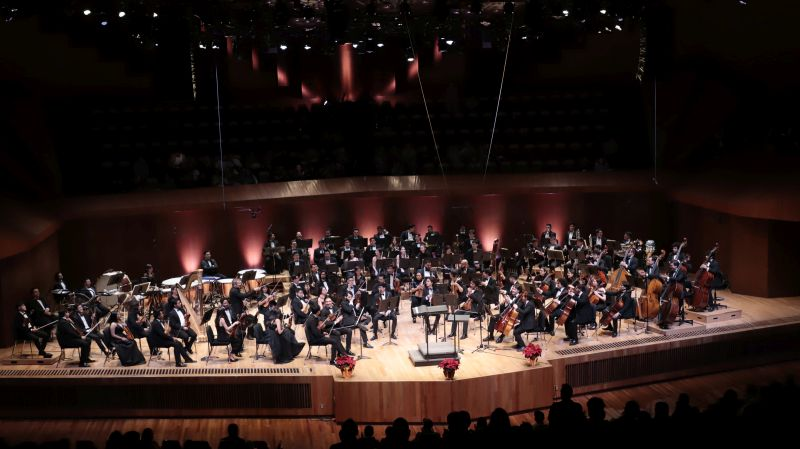

Fundada en 2012, lleva el nombre del reconocido director mexicano
Eduardo Mata, titular de la OFUNAM entre 1966 y 1976. Sus integrantes
desarrollan una intensa actividad orquestal y complementan su formación
mediante clases magistrales con solistas invitados, seminarios de música
de cámara y talleres seccionales. Se ha presentado en Michoacán,
Querétaro, Morelos, Estado de México, Guerrero y Guanajuato. En 2015
realizó una gira internacional que incluyó su debut en el Auditorium
Parco della Musica de la Academia Nacional de Santa Cecilia en Roma y su
participación en los festivales Emilia Romagna de Imola y Semanas
Musicales de Merano, en Italia. En 2019 lanzó su primer disco, *El árbol
de la vida*, con obras de Moncayo, Revueltas y Vázquez. Ese mismo año
ofreció presentaciones en la sede de la Organización de las Naciones
Unidas y en el Museo del Barrio de Nueva York. Actualmente la dirección
titular está a cargo de José Areán, sitio que anteriormente ocupó
Gustavo Rivero Weber. A lo largo de su trayectoria, la Orquesta ha
trabajado con directores huéspedes como Enrique Bátiz, Avi Ostrowsky,
Massimo Quarta, Lanfranco Marcelletti, Ronald Zollman, Enrique Arturo
Diemecke, Moshe Atzmon, Bojan Sudjić y Rodrigo Macías y ha colaborado
con solistas como Pascal Rogé, Roberto Díaz, Jorge Federico Osorio,
Anabel De la Mora, Alexander Kniazev, Massimo Quarta, Anna Hashimoto,
Manuel Ramos, Erika Dobosiewicz, Friedrich Kleinhapl, Makoto Ueno, María
Tretyakova, Noé Colín, Victor Sych, Fernando de la Mora, Nikolai
Khoziainov, Wonmi Kim y Pablo Garibay.

**Integrantes**

Emmanuel Bautista, Juan Pablo Ortega, Iván Núñez, Edgar Román, Leopoldo
Mendoza, Diana Ayón, Belem Espitia, David Jiménez, Mariana Cervantes,
Daniel Manzano, Juan Pablo Ramírez, **violines primeros** | Maya
García, Aarón Jiménez, Armando Frost, Nubia Torres, Claudio Zepeda,
Milton Carrera, Erick Álvarez, Abril Herrera, Rafael Flores, Guadalupe
Aguirre, **violines segundos** | Marco Inda, Samuel Rojas, Juan Manuel
González, Alejandro Márquez, Felipe Soto, Félix Zapata, Jonathan
Coronel, **violas** | Pablo Montero, Mario Nucamendi, Alanis Pérez,
Georgy Diorditsa, Mengielly Díaz, Andrés Ibarra, **violonchelos** |
Ricardo Caminos, Salvador Mena, Santiago Benítez, **contrabajos** |
Arleth Arpide, Mariana Aguirre, Binitz Cruz, **flautas** | Daniela
Sierra, Jesús Limón, Diana Miguel, **oboes** | Gabino Salas, Miguel
Pérez, Carlos Toro, **clarinetes** | Emiliano Caballero, Martín
Ascencio, **fagotes** | Diego Sánchez, Ángel Herrera, Donovan Medrano,
René Salazar, **cornos** | Hayden Cornejo, Roberto Durán, Yair Morales,
**trompetas** | Víctor Manuel Valencia, Diego Elorza, Aleksei Arreola,
**trombones** | Javier Guzmán, Uriel Villalobos, José Mauricio Pérez,
**percusiones**.

Mauricio Villalba, gerente; Eduardo Barrera, coordinador de becarios;
Alfredo Trujano, bibliotecario; Samuel Romero, Emanuel Martínez,
técnicos.

### Dirección y solistas

#### José Areán


Ha desarrollado una amplia trayectoria en la ópera, la música sinfónica
y la gestión cultural. Su carrera operística comenzó como director
musical asistente de la Ópera de Bellas Artes de 1996 a 2001, cargo tras
el cual fue nombrado director artístico de la compañía de 2007 a 2009.
Ha colaborado con cantantes como Plácido Domingo, Francisco Araiza,
Ramón Vargas, Rolando Villazón, Javier Camarena, Arturo Chacón y Ainhoa
Arteta. Ha sido director titular de las orquestas Filarmónica de la
Ciudad de México, Sinfónica de Aguascalientes y Sinfónica de Yucatán. En
2025 asumió la titularidad de la Orquesta Sinfónica Juvenil Eduardo Mata
(OJUEM). Su actividad internacional incluye presentaciones en Europa,
Asia y América Latina, con orquestas como la Filarmónica de Tokio,
Estatal de Braunschweig, Filarmónica de Bogotá y Filarmónica Estatal
George Enescu. Entre 2002 y 2007 fue director del Festival del Centro
Histórico de la Ciudad de México, donde produjo la primera presentación
integral en México de *El anillo del nibelungo*. Desde 2006 conduce el
programa televisivo *Escenarios*, dedicado a la ópera, el ballet y la
música. Formado en la UNAM y en el Conservatorio de Viena, ha
desarrollado su labor en distintos campos de la música.

#### Alberto Rosado


Pertenece a una generación de intérpretes formados en un repertorio
clásico y comprometidos de una manera especial con la música
contemporánea. Su vocación musical se reparte entre la interpretación y
la docencia, entre la cámara y el recital solista, o entre la orquesta y
la electrónica. Ha trabajado con más de un centenar de compositores de
todo el mundo que han enriquecido su visión de la música y de la
interpretación, así como con directores de la talla de Eötvös, Mälkki,
Nott, Mena, Pons o Frühbeck de Burgos. Entre la treintena de grabaciones
editadas, destacan el Concierto para piano de López López con Kairos, el
Concierto de Ligeti con Neos y las obras completas para piano de
Halffter y López López con Verso. Las más actuales son
*e-piano_video&electronics*, con IBS-Classical, *Infinita Domenica* de
José Manuel López López junto al Cuarteto Arditti para Kairos y *Fin du
Temps* y *Kammersymphonie* para IBS, junto a Andrada, Estellés,
Apellániz e Iturriagagotia. Es profesor de música de cámara, piano
contemporáneo e imparte la Maestría de Piano y música de cámara en el
Conservatorio Superior de Castilla y León, donde dirige el Taller de
música contemporánea.

::: logos
{recorte="0.12 0.38 0.28 0.6"}
{recorte="0.28 0.38 0.52 0.6"}
{recorte="0.52 0.38 0.752 0.6"}
{recorte="0.752 0.38 0.88 0.6"}
:::

## LUN | NOV 9, 19:00 h - Black Noise & Victoria Amaro

Pabellón Escénico, Jardín Escénico

### Programa

**George Crumb**

-   *The Sleeper* (1984)\* `\hfill `{=tex}6'

**Zoe Pupo**

-   *El signo amarillo* (2025)\* `\hfill `{=tex}7'

**Kaija Saariaho**

-   *Il pleut* (1986)\*\* `\hfill `{=tex}5'

**Armando Luna**

-   *3 alebrijes* (2000) `\hfill `{=tex}10'

INTERMEDIO\

**John Cage**

-   *Aria* (1958) `\hfill `{=tex}9'

**Manuel Enríquez**

-   *De acuerdo* (1993) `\hfill `{=tex}7'
-   *Con fantasía*
-   *Lento*

**Kaija Saariaho**

-   *Changing Light* (2002)\*\* `\hfill `{=tex}6'

**Wilfrido Terrazas**

-   *Retrato de Walter Lärmer* (2011-2012) `\hfill `{=tex}13'

**Giacinto Scelsi**

-   *Ogloudoglou* (1969)\*\* `\hfill `{=tex}4'

**Black Noise Ensamble**

Victoria Amaro, dirección y voz\
María Alejandra Granados Medina, viola\
José Alejandro Martínez Sánchez, contrabajo\
Mariana Aurora Chávez Lara, flauta\
Rolando Alberto Cantú Rodríguez, oboe\
Alan Braulio Hernández Fernández, fagot\
Miguel Ángel Rivera Bedolla, guitarra\
Guillermo Cuellar Ocaña, piano y teclados\
Abraham Parra Arámburo, percusiones\

**Victoria Amaro**, soprano

### Personas compositoras

#### George Crumb (Estados Unidos, 1929-2022)


Fue un compositor estadounidense que transformó la experiencia musical
en un ritual sonoro de misterio y magia. Perteneciente a la vanguardia
del siglo XX, desarrolló un universo único donde el timbre, el silencio
y la teatralidad cobran protagonismo. Su obra más célebre, *Black
Angels* (1970), escrita para cuarteto de cuerdas amplificado, es un
descenso a las tinieblas de la guerra de Vietnam que utiliza
instrumentos raspados, voces susurradas y cuencos de cristal. En
*Makrokosmos* explora el piano desde dentro, punteando las cuerdas e
insertando papeles para evocar un cosmos mágico. Crumb no solo escribía
notas; creaba atmósferas. Su música, profundamente influenciada por la
poesía de Lorca, es frágil, visceral y onírica. Un viajero sonoro que
encontró lo eterno en lo diminuto.

##### *The Sleeper*

Esta pieza es un viaje al universo sonoro y onírico de Edgar Allan Poe.
Crumb abandona la belleza convencional para sumergirnos en la atmósfera
cósmica, alucinógena y ligeramente espeluznante del poema. La partitura
exige técnicas extendidas que transforman la interpretación: el piano se
prepara con objetos entre las cuerdas, se puntean sus entrañas y la voz
utiliza el *canto hacia adentro* (inhalación cantada) para crear frases
sin interrupción, como si la respiración obedeciera a otro mundo. No es
una simple canción, es un ritual íntimo donde el lirismo se fractura en
susurros, percusiones y un suspenso sonoro que habita en los bordes del
silencio.

#### Zoe Pupo (México, 2002)


Compositora e intérprete mexicana, cuyo trabajo se centra en la
exploración de la música clásica contemporánea, el jazz contemporáneo,
la improvisación libre y el postespectralismo. Su práctica instrumental,
tanto en piano como en clavecín, nutre su lenguaje compositivo,
permitiéndole explorar las posibilidades expresivas de cada instrumento
con sensibilidad y rigor. Además de su obra académica, desarrolla el
proyecto alterno María Morfeo, un espacio donde investiga formas
contemporáneas de improvisación y experimentación sonora dentro del
poliestilismo, integrando texturas acústicas y electrónicas. Su trabajo
refleja un diálogo constante entre tradición y exploración sonora,
consolidando un enfoque meticuloso sobre forma, timbre y dinámica, y
ampliando las fronteras de su lenguaje compositivo dentro de la música
contemporánea.

##### *El signo amarillo*

> «Pieza escrita en 2025 para el Black Noise Ensamble. *El signo
> amarillo* deviene del relato homónimo del escritor William R.
> Chambers. Una de las cualidades que me inspiraron a componer esta
> pieza es la ambivalencia del horror cósmico del escritor. En la pieza,
> lo indescriptible aparece en la forma de pensar el tiempo fuera del
> compás racional medido en fracciones, los eventos aparecen en bloques
> medidos en segundos, los cuales contienen gestos mayormente expresados
> en notación gráfica, algunos de ellos diseñados para dar cabida a un
> cierto margen de indeterminación. Aparece también en la glosolalia de
> la voz y en los gestos directamente sobre el arpa del piano. Las
> texturas más minuciosas se reflejan en los gestos escritos de forma
> tradicional, los jadeos que interrumpen el flujo de la voz, el juego
> con la textura de la cuerda en la guitarra y las arcadas circulares
> *sul ponticello* en el contrabajo. La pieza pretende la superposición
> de ambos extremos narrativos».

#### Kaija Saariaho (Finlandia, 1952 -- Francia, 2023)


Fue una voz destacada de su generación de compositores, tanto en su país
natal como en todo el mundo. Estudió composición en Helsinki, Friburgo y
París, donde residió desde 1982 hasta su muerte. Sus estudios e
investigaciones en el IRCAM, el centro parisino de experimentación
electroacústica, tuvieron una gran influencia en su música, y sus
características texturas exuberantes y misteriosas se crearon a menudo
combinando la interpretación en vivo con la electrónica. Expandió
gradualmente su expresión musical a una gran variedad de géneros, y sus
piezas de cámara y música coral se han convertido en piezas clave de
conjuntos instrumentales y vocales, respectivamente.

##### *Il pleut*

> «Fue mi primer intento de musicalizar un texto francés. Ya llevaba un
> par de años viviendo en París y me dedicaba a leer poesía en francés.
> La obra de Apollinaire representaba para mí la manifestación de lo que
> había descubierto en Francia a principios de los años ochenta: una
> nueva y valiente manera de ver el mundo, de acoger con los brazos
> abiertos todo lo innovador e intenso, sin dejar de ser crítico y
> rechazando todo aquello que pareciera una tradición artificial y
> marchita. Una forma de ser uno mismo, sin concesiones. El poema de
> Apollinaire, *Il pleut*, está escrito en versos descendentes que
> evocan la lluvia. La sencilla idea formal de mi pieza es una
> transposición de este concepto gráfico: tanto la voz de soprano como
> la parte de piano siguen una línea descendente, cada una a su manera.
> El pianista desciende gradualmente por la escala cromática en el
> teclado, mientras que la voz cantada se mueve alrededor de la misma
> línea con cierta libertad».

#### Armando Luna (México, 1964-2015)


En 1978 ingresó a la Escuela de Bellas Artes de la Universidad Autónoma
de Chihuahua y en 1980 ingresó al Conservatorio Nacional de Música (CNM)
bajo la tutela de Salvador Jiménez y Gonzalo Ruiz Esparza. En 1984 fue
admitido por Mario Lavista en su taller de composición. De 1989 a 1991
fue becado por la Universidad Carnegie Mellon en Pittsburgh para cursar
la Maestría en Composición bajo la tutela de Leonardo Balada. Fue
titular de las cátedras de Composición, Análisis, Armonía e
Instrumentación del CNM y del Conservatorio del Estado de México. Desde
2000 fue miembro del Sistema Nacional de Creadores de México.

##### *3 alebrijes*

La música de Armando Luna sorprende por su originalidad; es
prácticamente imposible confundir su lenguaje con el de alguien más. No
son solamente el *aparente* caos y el marcado sentido lúdico que
revisten sus obras, son también los tópicos y pretextos extramusicales a
los que alude con su imaginario: tiliches, desfiguros, desgarriates,
calaveras, aquelarres, travesuras, garabatos, etcétera. En esta ocasión
nos atañen los alebrijes, estos seres eclécticos y fantásticos,
maravillosos y, a veces, aterradores. Manifestaciones oníricas puras que
no hacen sino fecundar los sentidos y la imaginación del oyente, cuya
tarea será armar este rompecabezas sonoro y darles vida a sus propios
seres mágicos.

#### John Cage (Estados Unidos, 1912-1992)


Nació en Los Ángeles. Estudió con Henry Cowell y Schoenberg. Sus
primeras composiciones publicadas, en un riguroso sistema atonal propio,
datan de este período. En 1937 se trasladó a Seattle y allí fundó una
orquesta de percusión; su música evolucionó entonces hasta llenar
unidades de tiempo con ostinatos. También comenzó a utilizar
dispositivos electrónicos e inventó el *piano preparado*, que consiste
en colocar diversos objetos entre las cuerdas de un gran piano para
crear una orquesta de percusión eficaz bajo el control de dos manos.
Durante este período, Cage se interesó en las filosofías orientales,
especialmente el Zen. En busca de eliminar la elección creativa de la
composición, usó lanzamientos de monedas para determinar los eventos e
introdujo otras técnicas indeterminadas.

##### *Aria*

Es una obra vanguardista y de bravura para voz solista, diseñada para
cantarse con gran libertad. Se caracteriza por la indeterminación, al
permitir que el intérprete elija el estilo vocal y la interpretación de
su compleja partitura gráfica a color, desafiando las nociones
tradicionales de ópera.

#### Manuel Enríquez (México, 1926-1994)


Originario de Ocotlán, Jalisco, fue una figura fundamental de la
vanguardia musical en México. Se formó con Áurea Corona y Miguel Bernal
Jiménez, perfeccionándose después en la Juilliard School con Ivan
Galamian y Peter Mennin. En 1961, gracias a la beca Guggenheim,
incursionó en la música electrónica en Columbia y Princeton bajo la guía
de Stefan Wolpe. Como violinista, fue concertino de la Sinfónica de
Guadalajara y fundó el célebre Cuarteto México, con el que realizó giras
por Europa y América. Su labor docente y administrativa fue vasta:
dirigió el Conservatorio Nacional y el Cenidim, donde impulsó la
investigación electroacústica y virreinal. En 1979 fundó el Foro
Internacional de Música Nueva (que hoy lleva su nombre), espacio vital
para la difusión de la creación contemporánea. Distinguido como Creador
Emérito y miembro de la Academia de Artes, su legado permanece como
pilar de la identidad musical mexicana del siglo XX.

##### *De acuerdo*

Escrita en 1993, fue una de las últimas piezas compuestas por el autor
antes de su fallecimiento, el 22 de abril de 1994. La obra forma parte
del catálogo de obras para fagot que buscan expandir las posibilidades
técnicas y expresivas de este instrumento, en el contexto de la música
de cámara. El uso notable de la técnica extendida en el fagot destaca en
esta pieza, predominando el uso de multifónicos como herramienta de
expresión melódica. En sus dos movimientos, *Con fantasía* y *Lento*, el
diálogo entre piano y fagot juega un papel crucial en el desarrollo
tímbrico de la pieza, pues los acordes del piano surgen del espectro de
notas que los multifónicos del fagot van dejando a su paso, volviéndose,
así, uno indispensable para el otro. En todo momento nos queda clara la
gran capacidad del autor en el manejo de la idiomática de diversos
instrumentos, sin que queden exentos los instrumentos de aliento o
inclusive el piano.

#### Kaija Saariaho (Finlandia, 1952 -- Francia, 2023)


Fue una voz destacada de su generación de compositores, tanto en su país
natal como en el mundo entero. Estudió composición en Helsinki, Friburgo y
París, donde residió desde 1982 hasta su muerte. Sus estudios e
investigaciones en el IRCAM, el centro parisino de experimentación
electroacústica, tuvieron una gran influencia en su música, y sus
características texturas exuberantes y misteriosas se crearon a menudo
combinando la interpretación en vivo con la electrónica. Expandió
gradualmente su expresión musical a una gran variedad de géneros, y sus
piezas de cámara y música coral se han convertido en piezas clave de
conjuntos instrumentales y vocales, respectivamente.

##### *Changing Light*

> «Esta pieza fue escrita para el proyecto Compassion de Edna Michell.
> En la composición, sigo la idea de un diálogo, sugerida por el texto
> que he elegido. La intimidad y la fragilidad del universo sonoro del
> dúo reflejan la fragilidad de nuestra existencia incierta».

#### Wilfrido Terrazas (México, 1974)


Es un flautista, improvisador, compositor y docente mexicano cuyo
trabajo explora los territorios fronterizos entre improvisación,
notación musical y creación colectiva. Es miembro de Generación
Espontánea y Liminar. Ha realizado más de cuatrocientos estrenos
mundiales, escrito más de ochenta composiciones y grabado más de
cincuenta álbumes, ocho de ellos como solista o líder. Ha presentado su
trabajo en 22 países. Es coorganizador de la Semana Internacional de
Improvisación en Ensenada, su ciudad de origen, y profesor de tiempo
completo en la University of California San Diego.

##### *Retrato de Walter Lärmer*

> «Es un ensayo de composición-improvisación para ensamble mixto en el
> que los intérpretes siguen una serie de instrucciones verbales
> ordenadas en una secuencia temporal, pero no están especificadas ni
> las duraciones ni los detalles de realización de las sonoridades
> sugeridas por la partitura. La pieza pretende abrir así un número
> impredecible de posibilidades de creación colectiva e interacción
> entre los músicos que la hacen. Fue escrita como un modesto homenaje a
> uno de los pensadores pioneros de la música experimental en el siglo
> XX, el filólogo alemán Walter Lärmer».

#### Giacinto Scelsi (Italia, 1905-1988)


Fue una de las figuras más enigmáticas, visionarias y tardíamente
reconocidas de la música vanguardista del siglo XX. Su obra representa
una ruptura radical con la tradición occidental, al centrar su universo
creativo no en la melodía ni en la armonía, sino en el sonido en sí
mismo, en su espesor, su microtonalidad y su capacidad de transformación
interior. Tras una crisis mental y física severa en la década del
cuarenta, Scelsi encontró refugio en el piano, obsesionándose con la
reiteración de una sola nota. Esta experiencia mística y terapéutica lo
llevó a percibir *el espesor de la nota*, descubriendo un universo de
armónicos y microtonos inexplorado. Abandonó las técnicas de composición
convencionales para adoptar un enfoque cuasi místico, influenciado por
la filosofía oriental, donde él se consideraba más un *transmisor* que
un compositor. La obra de Scelsi se caracteriza por la inmovilidad
aparente, una paradoja donde la música cambia.

##### *Ogloudoglou*

Es una obra experimental para voz y percusión (interpretada por un solo
músico) que representa un ejemplo destacado de la música vocal de
vanguardia de finales del siglo XX. La obra se caracteriza por su
enfoque microtonal y un uso intensivo de la voz, que a menudo trasciende
el canto tradicional para acercarse a la exploración tímbrica, el grito
o el susurro, reflejando el enfoque de Scelsi en la *nota única* y sus
armónicos.

------------------------------------------------------------------------

### Intérpretes

#### Black Noise Ensamble


Formado en 2021 como un ensamble multinstrumental de formación variable,
nacido de la necesidad de explorar y explotar nuevos recursos expresivos
en el contexto de la música contemporánea de concierto. Su campo de
acción interpretativa tiene tres vertientes principales: la música nueva
de jóvenes compositores, el repertorio ya clásico de los referentes
obligados del siglo XX que constituyen un parámetro de las estéticas de
vanguardia actuales y la improvisación libre. Ha participado en el Foro
Internacional de Música Nueva *Manuel Enríquez*, el Maratón Ónix de
Música contemporánea, el Seminario de Música Contemporánea de la
Facultad de Música de la UNAM, el festival Signos sonoros, el Festival
Aires, el Encuentro Nacional de Música Contemporánea Armando Luna y en
Impro random sessions, realizando estrenos mundiales y nacionales en
cada presentación.

#### Victoria Amaro


Comenzó sus estudios musicales en la Escuela de Iniciación Julián
Carrillo y en la Universidad de Guanajuato, posteriormente fue alumna en
la Escuela Superior de Música del INBAL y de la Escuela de Música Vida y
Movimiento del Centro Cultural Ollin Yoliztli. Desde 2017 ha participado
de manera activa en la creación y difusión de música nueva, sumando más
de cuarenta estrenos como solista y con los ensambles Cepromusic,
Liminar, Vórtice y Atempo. Desde 2023 forma parte del Colectivo Black
Noise como soprano y directora musical. Actualmente graba los discos:
*Microconciertos, efímeras composiciones para ensamble de cámara*,
proyecto ganador del Programa de Fomento a Proyectos y Coinversiones
Culturales con Black Noise, así como un integral del compositor potosino
Julián Carrillo con Liminar.

## MAR | NOV 10, 19:00 h - Alberto Rosado, piano

Sala Manuel M. Ponce, Palacio de Bellas Artes

**Resonancias de ida y vuelta**

La vanguardia pianística a ambos lados del Atlántico

------------------------------------------------------------------------

### Programa

**Manuel Enríquez**

-   *A lápiz* (1965) `\hfill `{=tex}9'
-   *Trazos*
-   *Delineando*
-   *Figuras*

**Cristóbal Halffter**

-   *Cadencia* (1983) `\hfill `{=tex}11'

**Julio Estrada**

-   *Canto de tejido* (1974) `\hfill `{=tex}7'

**Mario Lavista**

-   *Simurg* (1980) `\hfill `{=tex}8'

**Joan Guinjoan**

-   *Jondo* (1979) `\hfill `{=tex}8'

**Carlos Cruz de Castro**

-   *El tren de cuerda, Imágenes de infancia* (1988-1989)
    `\hfill `{=tex}3'
-   Preludio no. 1, *Simetrías para Colien* `\hfill `{=tex}2'

**Alicia Urreta**

-   *Dameros I* (1985) `\hfill `{=tex}5'

**Luis de Pablo**

-   *Retratos y transcripciones*. Serie 1 (1991) `\hfill `{=tex}5'
-   *3. Tango*

**Alberto Rosado**, piano

-----

### Personas compositoras

#### Manuel Enríquez (México, 1926-1994)


Originario de Ocotlán, Jalisco, fue una figura fundamental de la
vanguardia musical en México. Se formó con Áurea Corona y Miguel Bernal
Jiménez, perfeccionándose después en la Juilliard School con Ivan
Galamian y Peter Mennin. En 1961, gracias a la beca Guggenheim,
incursionó en la música electrónica en Columbia y Princeton bajo la guía
de Stefan Wolpe. Como violinista, fue concertino de la Sinfónica de
Guadalajara y fundó el célebre Cuarteto México, con el que realizó giras
por Europa y América. Su labor docente y administrativa fue vasta:
dirigió el Conservatorio Nacional y el Cenidim, donde impulsó la
investigación electroacústica y virreinal. En 1979 fundó el Foro
Internacional de Música Nueva (que hoy lleva su nombre), espacio vital
para la difusión de la creación contemporánea. Distinguido como Creador
Emérito y miembro de la Academia de Artes, su legado permanece como
pilar de la identidad musical mexicana del siglo XX.

#### Cristóbal Halffter (España, 1930-2021)


Desde 1970, fue director invitado en las más importantes orquestas
europeas, compositor asociado de la Sinfónica de Madrid y miembro del
consejo de la Fundación Prince Pierre de Mónaco y la Ernst von Siemens
Musikstiftung. Fue miembro de la Real Academia de Bellas Artes de San
Fernando en Madrid, de la Real Academia de Suecia y de las Akademie der
Künste Berlín y der Schönen Künste Múnich, así como doctor *honoris
causa* por las universidades de León y Complutense de Madrid. Su obra
abarca todos los campos creativos y está editada por Universal Edition.
Entre las distinciones que recibió en España, Alemania, Francia y
Mónaco, figuran la Medalla de Oro del Goethe Institut y la de las Bellas
Artes de España, donde fue reconocido también con el Premio Nacional de
Música en 1953 y 2004. En 2015 el Gobierno de España le concedió la Gran
Cruz de la Orden Civil de Alfonso X el Sabio.

#### Julio Estrada (México, 1943)


Historiador, pedagogo y creador musical. Premio Universidad Nacional
2001. Doctor en Música y Musicología por la Universidad de Estrasburgo,
es profesor del posgrado de la Escuela Nacional de Música, donde dirige
el Laboratorio de Creación Musical. Es miembro del Instituto de
Investigaciones Estéticas de la UNAM, de la Academia Mexicana de
Ciencias y del Sistema Nacional de Investigadores. Profesor invitado en
las universidades de Stanford, La Jolla y Rostock; en 2000-2001 asumió
en la Sorbona la Cátedra Alfonso Reyes; también fue director del Centre
d'Études de Mathématiques et Automatique Musicales de París.

#### Mario Lavista (México, 1943-2021)


Estudió composición en el Conservatorio Nacional de Música (CNM). Fue
becado por el Gobierno francés para estudiar con Jean-Étienne Marie en
la Schola Cantorum de París y con Henri Pousseur; fue alumno de
Karlheinz Stockhausen en Alemania. Le fue concedida una beca de la
Fundación Guggenheim para componer su ópera *Aura*. Fue nombrado miembro
de la Academia de Artes. Mas adelante recibió la medalla Mozart e
ingresó al Colegio Nacional de México. En estrecha colaboración con
algunos instrumentistas, exploró e investigó las nuevas posibilidades
técnicas y expresivas que ofrecen los instrumentos tradicionales. Dictó
cursos y seminarios en universidades de Estados Unidos y Canadá. Tuvo a
su cargo la cátedra de Composición, análisis y lenguaje musical del
siglo XX en el CNM. Fue fundador y director de la revista *Pauta*.

#### Joan Guinjoan (España, 1931-2019)


Estudió en el Conservatorio Superior de Música del Liceo de Barcelona
con Cristóbal Taltavull. Continuó sus estudios en la École Normale de
Musique de París indagando en la composición, la orquestación y la
electroacústica. En 1964 tomó contacto con la vanguardia musical
francesa y decidió abandonar la interpretación para centrarse por
completo en la composición. Compuso más de cien obras de música de
cámara, vocal y sinfónica. Dirigió orquestas de Europa y América. Fue
director del Centro de Difusión y Documentación de la Música
Contemporánea de Barcelona. Obtuvo los premios Chevalier des Arts et des
Lettres en 1981, Officier des Arts et Lettres en 1990 por el gobierno
francés, Nacional de Música 1990 y, en 1999, le fue concedida la Cruz de
Sant Jordi. En 2004 fue galardonado con el V Premio Iberoamericano de la
Música Tomás Luis de Victoria, considerado el equivalente al Cervantes
de la música culta.

#### Carlos Cruz de Castro (España, 1941)


Nació en Madrid. Estudió composición en el Conservatorio Superior de
Música de Madrid con Gerardo Gombau y Francisco Calés y dirección de
orquesta con Enrique Asensio, para luego ampliar sus estudios de
composición con Milko Kelemen en la Hochschule Robert Schumann Institut
de Düsseldorf. Cofundador de la Asociación de Compositores Sinfónicos
españoles (ACSE). Es Académico correspondiente de la Real Academia
Canaria de Bellas Artes de San Miguel Arcángel y Miembro de honor de la
Academia de la Música valenciana. En 2011 le fue concedida la Medalla de
Oro de las Bellas Artes. Fue jefe de producción de Radio Clásica de
Radio Nacional de España. Su catálogo abarca obras sinfónicas, música de
cámara, para diversos instrumentos, obras para plantillas no
convencionales y obras gráficas.

#### Alicia Urreta (México, 1930-1987)


Nació en Veracruz. Compositora y pianista. Estudió en el Conservatorio
Nacional de Música. Alumna de Brendel, Flavigny, Iglesias y de la Rocha.
Especialista en composición de música electrónica y electroacústica en
la Schola Cantorum de París. Fue profesora de Acústica en el IPN,
pianista titular de la Orquesta Sinfónica Nacional, coordinadora general
de la Compañía Nacional de Ópera del INBAL, coordinadora de música de la
Casa del Lago, directora de Actuaciones Musicales de la UNAM y fundadora
de la Camerata de México. Compuso, entre otras obras, una ópera de
cámara, cinco ballets, piezas para instrumentos solistas, una cantata,
música incidental y música para cine.

#### Luis de Pablo (España, 1930-2021)


Comenzó sus estudios de piano a los siete años y desde los 12 compuso de
forma autodidacta. Su primera vinculación con un profesional de la
composición fue con Mauricio Ohana. Realizó estudios de composición con
Max Deutsch en París y participó, desde 1956, en los cursos de Darmstadt
de música contemporánea. En 1964 fundó en Madrid el primer Laboratorio
de Música Electrónica de España y, posteriormente, el centro privado
ALEA. Su catálogo abarca más de ciento cincuenta obras distribuidas en
todos los géneros: música orquestal, música de cámara, instrumentos
solistas, música vocal, música electroacústica y ópera. Recibió los
reconocimientos Académico de Bellas Artes, Madrid y Granada, Académico
de Santa Cecilia en Roma, Académico de la Regia Accademia Filarmonica de
Bolonia, de la Real Academia Belga, Oficial de las Artes y Letras de
Francia, Medalla de Oro del Círculo de Bellas Artes de Madrid y miembro
de la Sociedad Europea de Cultura desde 1966.

##### Notas al programa

El programa de este recital propone una travesía por el pensamiento
pianístico de ocho creadores que definieron el rumbo de la música nueva
a ambos lados del Atlántico durante la segunda mitad del siglo XX.
Nacidos entre las décadas de 1920 y 1940, estos compositores no solo
articularon el tránsito desde las técnicas estructuralistas y aleatorias
hacia lenguajes personales e inconfundibles, sino que establecieron las
bases pedagógicas y estéticas sobre las que se asienta la creación
actual en España y México.

El vínculo entre ambas naciones en este periodo es profundo y
bidireccional. La semilla del exilio español ---encarnada en figuras
tutelares como Rodolfo Halffter--- germinó en México para formar a
referentes como Mario Lavista, cuyo *Simurg* (1980) rinde culto a la
resonancia, al color armónico y al canto de los pájaros, o Julio
Estrada, cuyo *Canto tejido* (1974) presenta una red de sonidos
aislados, en el que sus conexiones propician la audición de «una textura
que enlaza lo secuencial a su expresión verbal». A su vez, compositores
españoles como Cristóbal Halffter, en cuya virtuosística *Cadencia*
(1983) para un concierto de piano imaginario ---que escribiría años más
tarde--- palpita la tensión dramática del instrumento, o Luis de Pablo,
quien en *Tango* (1991) desarticula esta danza a través de su
característico filtro compositivo, abstrayendo su ritmo y gesto
característicos hacia una síntesis poética. Ambos mantuvieron una
relación directa y afectiva con el medio cultural mexicano, compartiendo
escenarios, aulas e intercambios estéticos.

El propio emblema central de este Foro, Manuel Enríquez, con la notación
abierta de *A lápiz* (1965), lideró la apertura hacia las vanguardias
internacionales que conectarían directamente con las búsquedas europeas.
En esa misma línea de ida y vuelta transitan la figura de Alicia Urreta,
pianista y creadora mexicana de raíz hispánica, cuyo *Dameros I* (1984)
explora la geometría sonora, y la de Carlos Cruz de Castro, firme
impulsor de los puentes hispano-mexicanos, representado aquí por su
lúdica *Tren de cuerda* de *Imágenes de infancia* y su concentrado
*Preludio nº 1 Simetrías para Colien* (1995). Completa esta panorámica
Joan Guinjoan, cuyo *Jondo* (1979) filtra la gestualidad del flamenco a
través de la exigencia vanguardista, demostrando cómo lo telúrico y lo
abstracto hallaron una voz común en esta generación ineludible.

-----

### Intérpretes

#### Alberto Rosado


Pertenece a una generación de intérpretes formados en un repertorio
clásico y comprometidos de una manera especial con la música
contemporánea. Su vocación musical se reparte entre la interpretación y
la docencia, entre la cámara y el recital solista, o entre la orquesta y
la electrónica. Ha trabajado con más de un centenar de compositores de
todo el mundo que han enriquecido su visión de la música y de la
interpretación, así como con directores de la talla de Eötvös, Mälkki,
Nott, Mena, Pons o Frühbeck de Burgos. Entre la treintena de grabaciones
editadas destacan el Concierto para piano de López López con Kairos, el
Concierto de Ligeti con Neos y las obras completas para piano de
Halffter y López López con Verso. Las más actuales son
*e-piano_video&electronics*, con IBS-Classical, *Infinita Domenica* de
José Manuel López López junto al Cuarteto Arditti para Kairos y *Fin du
Temps* y *Kammersymphonie* para IBS, junto a Andrada, Estellés,
Apellániz e Iturriagagotia. Es profesor de música de cámara, piano
contemporáneo e imparte la Maestría de Piano y música de cámara en el
Conservatorio Superior de Castilla y León, donde dirige el Taller de
música contemporánea.

## MIÉ | NOV 11, 19:00 h - Generación Espontánea

Museo de Arte Carrillo Gil

**Concierto del 20 aniversario de Generación Espontánea**

En homenaje a Natalia Pérez Turner

------------------------------------------------------------------------

### Programa

-   Improvisación libre

**Generación Espontánea**\
Carlos Alegre, violín\
Sarmen Almond, voz\
Darío Bernal Villegas, percusión\
Alexander Bruck, viola\
Ramón del Buey, clarinete bajo\
Misha Marks, latarra y bombardino\
Wilfrido Terrazas, flauta\
Fernando Vigueras, guitarra\
Jacob Wick, trompeta\
Ana Ruiz, piano\

------------------------------------------------------------------------

### Intérpretes

#### Generación Espontánea


Es una mítica antibanda de improvisación libre mexicana nacida en 2006.
El colectivo ha grabado cuatro álbumes: *reVuelta* (2009), *Kiosco*
(2011), *Cátedra* (2011) y *The Marvellous Transatlantic* (2013). Ha
realizado más de ciento cuarenta presentaciones, algunas de ellas en
teatros y salas de concierto, pero la mayoría en espacios alternativos.
También ha llevado a cabo colaboraciones con artistas de prácticamente
todas las disciplinas, entre ellos los coreógrafos Evoé Sotelo y Benito
González y el colectivo de artistas visuales Luz y Fuerza: Cine
Expandido. Otros colaboradores e invitados del ensamble han sido Remi
Álvarez, Angélica Castelló, Galia Eibenschutz, Carmina Escobar, Daniela
Franco, Kenneth Goldsmith, Amanda Irarrázabal, Lê Quan Ninh, Jaime
Lobato, Don Malfon, Wade Matthews, Iván Naranjo, G.T. Pellizzi, Carlos
Sandoval, Robyn Schulkowsky, Milo Tamez, Artur Vidal, y Christian Wolff,
entre muchos más. Entre los hitos de la trayectoria «genebria» también
están haber sido corridos a medio concierto del campus de una
prestigiada universidad privada mexicana, nunca haber terminado su
legendario disco *comercial* intitulado *Se vende*, recibir un pago de
una entidad pública con dos años de retraso y, por encima de todo, haber
fundado el honorable Sindicato Único de Trabajadores de la Improvisación
Libre (SUTIL). El trabajo de Generación Espontánea se caracteriza por la
experimentación con instrumentos y objetos sonoros acústicos, la
exploración de distintas posibilidades de interacción entre músicos y
público y la intervención sonora de los más diversos espacios.

::: logos


:::

## MIÉ | NOV 11, 19:00 h - Piccolegio / Trío LaMN

Laboratorio Escénico, Jardín Escénico

### Programa

**Kaija Saariaho**

-   *Dolce tormento* (2004)\*\* `\hfill `{=tex}5'

**Piccolegio**, piccolo

**Kaija Saariaho**

-   *Cloud Trio* (2010) `\hfill `{=tex}17'

**Manuel Enríquez**

-   *Móvil II* (1978) `\hfill `{=tex}7'

**Alejandro Romero**

-   *Eón interior* (2023)\*\* `\hfill `{=tex}11'
-   *Lento*
-   *Subito-con fuoco-Lontano*
-   *Slogato*

**Ana Elisa de María**

-   *Blanco* (2026)\* `\hfill `{=tex}8'

**Eugenio Vargas**

-   *Ecos* (2024)\* `\hfill `{=tex}6'

**György Kurtág**

-   *Signs, Games and Messages* (1989) `\hfill `{=tex}13'

**Luciano Berio**

-   *Divertimento* (1946-rev. 1985) `\hfill `{=tex}5'

---

**Trío LaMN (Laboratorio de Música Nueva)**

Leonardo Chávez, violín\
Alena Stryuchkova, viola\
Diego Gutiérrez, violonchelo

### Personas compositoras

#### Kaija Saariaho (Finlandia, 1952 -- Francia, 2023)


Fue una voz destacada de su generación de compositores, tanto en su país
natal como en el mundo entero. Estudió composición en Helsinki, Friburgo
y París, donde residió desde 1982 hasta su muerte. Sus estudios e
investigaciones en el IRCAM, el centro parisino de experimentación
electroacústica, tuvieron una gran influencia en su música, y sus
características texturas exuberantes y misteriosas se crearon a menudo
combinando la interpretación en vivo con la electrónica. Expandió
gradualmente su expresión musical a una gran variedad de géneros, y sus
piezas de cámara y música coral se han convertido en piezas clave de
conjuntos instrumentales y vocales, respectivamente.

##### *Dolce tormento*

Es una obra relativamente corta pero, como sugiere el título, está llena
de *dulce tormento* en el carácter de la música. El texto proviene de un
soneto de Petrarca. Saariaho eligió el flautín para esta pieza a fin de
explorar la combinación de la voz con este instrumento. El registro
agudo y la resonancia limitada del flautín, así como la naturaleza del
idioma italiano, plantearon nuevos desafíos en el desarrollo de una
polifonía musical. De todas sus obras para flauta, esta es la que tiene
una notación más libre, y la interpretación es un desafío adicional,
especialmente para flautistas que no están familiarizados con el
lenguaje musical de Saariaho.

##### *Cloud Trio*

> «En esta pieza, los tres instrumentos tienen diferentes tareas y
> funciones, representan aspectos muy diferentes de la interpretación de
> cuerdas. Estas tareas son a veces muy concretas: el violín tiende a
> comportarse como un eco o una reverberación, la viola crea nuevas
> nubes junto a las existentes y el violonchelo tiene a menudo una
> función de sombra de las líneas instrumentales superiores. Mis ideas
> para esta pieza giran en torno a texturas comunes, como crear una
> textura coherente, aún compleja y detallada, con líneas individuales.
> Las cuatro secciones de la pieza tienen sus propios colores y
> personajes, y dejo al oyente imaginar qué tipos de nubes fueron sus
> fuentes de inspiración».

#### Manuel Enríquez (México, 1926-1994)


Originario de Ocotlán, Jalisco, fue una figura fundamental de la
vanguardia musical en México. Se formó con Áurea Corona y Miguel Bernal
Jiménez, perfeccionándose después en la Juilliard School con Ivan
Galamian y Peter Mennin. En 1961, gracias a la beca Guggenheim,
incursionó en la música electrónica en Columbia y Princeton bajo la guía
de Stefan Wolpe. Como violinista, fue concertino de la Sinfónica de
Guadalajara y fundó el célebre Cuarteto México, con el que realizó giras
por Europa y América. Su labor docente y administrativa fue vasta:
dirigió el Conservatorio Nacional y el Cenidim, donde impulsó la
investigación electroacústica y virreinal. En 1979 fundó el Foro
Internacional de Música Nueva (que hoy lleva su nombre), espacio vital
para la difusión de la creación contemporánea. Distinguido como Creador
Emérito y miembro de la Academia de Artes, su legado permanece como
pilar de la identidad musical mexicana del siglo XX.

##### *Móvil II*

La obra fue una colaboración con los laboratorios de música electrónica
de Columbia-Princeton de Nueva York, en donde Enríquez utilizó el violín
para transformar y procesar sus sonidos. La obra formó parte de la
exposición *Modos de oír* en el Laboratorio Arte Alameda en 2018.

#### Alejandro Romero (México, 1970)


Realizó la Licenciatura en Composición en la Escuela Superior de Música
con Arturo Márquez y estudió de forma particular con Ana Lara e Hilda
Paredes. Cursó la Maestría en Composición musical en la Facultad de
Música de la UNAM. Tomó cursos de composición con Franco Donatoni. A lo
largo de su formación desarrolló un fuerte interés por la significación
musical, lo que lo orientó hacia la investigación semiológico-musical,
formándose con músicos académicos como Jean-Jacques Nattiez, Gino
Stefani, François-Bernard Mâche, David Lidov y Raymond Monelle, en el
marco del Seminario de Semiología Musical de la UNAM, del que fue
miembro activo de 1998 a 2006. Fue integrante del Sistema Nacional de
Creadores de Arte en 2005, 2010 y 2014. En el extranjero su música se ha
interpretado en festivales en Alemania, Austria, Francia, España,
Italia, Suiza, Canadá, Brasil, Chile y Argentina.

##### *Eón interior*

> «Es una obra escrita en 2023 para el Trío LaMN, dividida en tres
> partes. La idea central de la pieza nace de un pasaje del *Infinito
> turbulento* de Henry Michaux, en donde el autor toma el espacio más
> pequeño posible para hacer referencia a un infinito sensible, en donde
> la imaginación y la creación definen un espacio del yo que se extiende
> plegándose hacia el interior. Dice el poeta: "En una figura dada un
> espacio minúsculo que comienza a socavarse de infinito..." De esta
> forma el trío se presenta como una pieza que teje sus procesos desde
> una búsqueda tímbrica y gestual, propiciando el contraste entre trazos
> densos y momentos sumamente transparentes, que coagulan en una obra
> que le apuesta a esos instantes en donde la captura párvula se vuelve
> una serie de sensaciones, plegándose infinitamente».

#### Ana Elisa de María (México, 2004)


Saxofonista, compositora y etnomusicóloga originaria de Oaxaca. Con una
fuerte conexión con sus raíces y un enfoque innovador en su obra,
continúa desarrollando su lenguaje musical, explora nuevas sonoridades y
contribuye activamente a la actual escena de la música contemporánea con
la improvisación libre, la acusmática y, por supuesto, la música
tradicional oaxaqueña. Es miembro de Mero Lek, cofundadora de Dal Niente
y del Colectivo Surreal. Su trayectoria la ha llevado a presentarse en
diferentes estados del país, festivales y salas de concierto.
Actualmente estudia en la Escuela Superior de Música del INBAL y en la
Facultad de Música de la UNAM.

##### *Blanco*

> «Es un trío de cuerdas que busca explorar la riqueza tímbrica de los
> instrumentos para evocar la imagen de un atardecer blanco, aquel en el
> que nuestra alma trasciende».

#### Eugenio Vargas (México, 1994)


Egresó de la carrera de Composición en la Escuela de Bellas Artes de la
Universidad Panamericana, donde estudió con Germán Romero, Mauricio
García de la Torre, Francisco Cortés y Jorge Torres Sáenz, quien marcó
de manera significativa su forma de acercarse a la música. El ritmo es
el eje central de su trabajo creativo, un aspecto que constantemente lo
inspira y motiva a explorar nuevas posibilidades sonoras. Compositores
como Conlon Nancarrow, Olivier Messiaen y Georges Aperghis han sido
referentes en su búsqueda musical, que se caracteriza por una dedicación
constante para crear una expresión auténtica y personal.

##### *Ecos*

En la obra se exploran las posibilidades de la microtonalidad, las
texturas y la forma musical, que dialogan de manera orgánica y siempre
están guiadas por el ritmo. La obra refleja un compromiso por mantener
una relación sincera y consciente con la música, respetando su esencia y
la del propio creador. Esta obra fue pensada y dedicada al Trío LaMN.

#### György Kurtág (Rumanía, 1926)


Compositor húngaro considerado una de las figuras más importantes de la
música contemporánea europea, conocido por su estilo conciso, expresivo
y profundamente introspectivo. Estudió en la Academia de Música Franz
Liszt de Budapest, donde más tarde también fue profesor. Durante su
carrera desarrolló un lenguaje musical muy personal, influido por Béla
Bartók y Anton Webern, caracterizado por piezas breves pero intensas,
con gran atención al detalle y al silencio. Entre sus obras más
destacadas se encuentra *Játékok* (Juegos), una colección de piezas para
piano que comenzó en la década de 1970, así como su ópera *Fin de
partie*, basada en la obra de Samuel Beckett, estrenada en 2018. Kurtág
ha recibido numerosos premios internacionales y es reconocido por su
contribución única a la música de los siglos XX y XXI.

##### *Signs, Games and Messages*

La obra es una colección abierta y en constante crecimiento de piezas
breves escritas a partir de finales de los años ochenta. No es una obra
única cerrada, sino un conjunto de miniaturas para distintas
combinaciones instrumentales (violín, viola, violonchelo y trío de
cuerdas, entre otros). Cada pieza es muy corta, a veces de apenas unos
segundos o minutos. Tiene un estilo extremadamente concentrado, donde
cada gesto musical es significativo. La obra refleja rasgos típicos de
Kurtág, como el uso del silencio en cuanto elemento expresivo, lenguaje
fragmentario y muy refinado. Asimismo, se hace evidente la influencia de
Anton Webern en la brevedad y precisión, gran atención al color y la
articulación instrumental.

#### Luciano Berio (Italia, 1925-2003)


Fue un compositor italiano modernista y uno de los principales
representantes de la vanguardia musical europea. Es reconocido por su
trabajo en la música experimental, particularmente su Sinfonía para
orquesta; también fue pionero en la música electrónica. Sus primeras
obras estuvieron influenciadas por Igor Stravinski y sus experimentos
con técnicas seriales y electrónicas, mientras que sus obras posteriores
exploran la indeterminación y el uso de textos hablados como material
básico para la composición.

##### *Divertimento*

Es una obra temprana de cámara, antes de adentrarse por completo en la
vanguardia y la música electrónica. Esta pieza es un ejemplo del estilo
inicial de Berio, influenciado por la tradición clásica, a menudo
asociado a su época de formación.

------------------------------------------------------------------------

### Intérpretes

#### Piccolegio

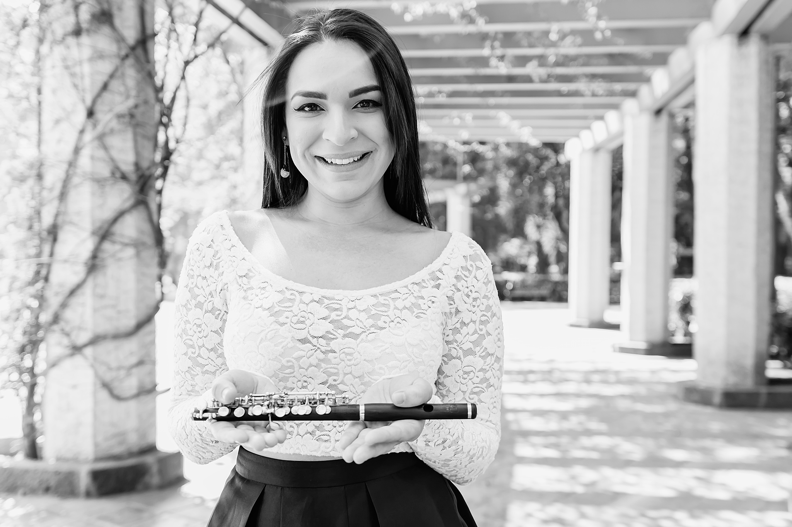

Interpretación, pedagogía e investigación son algunas de las facetas que
ha explorado la piccolista Mariaceli Navarro Salerno. Es Licenciada en
Música, *cum laude*, egresada del Instituto Universitario de Estudios
Musicales en la cátedra de José García Guerrero. Obtuvo la Maestría en
Música en la Universidad Simón Bolívar de Venezuela, bajo la tutela de
Luis Julio Toro y un diplomado con Marco Granados. Es ganadora de
concursos internacionales de piccolo, entre ellos: el Kujala
International Piccolo de Estados Unidos en 2013 y el Severino Gazzelloni
de Italia en 2013, además obtuvo el tercer premio del Piccolo Artist
Competition 2016 en Estados Unidos. Desde 2017, desarrolla un proyecto
de divulgación educativa de la flauta piccolo denominado Piccolegio, a
través de plataformas digitales. Piccolegio no es solo su marca
personal, es una comunidad que ha creado un sentido de pertenencia.

#### Trío LaMN (Laboratorio de Música Nueva)


Es un trío de cuerdas fundado en 2021 que se enfoca en repertorio de los
siglos XX y XXI. Está conformado por intérpretes profesionales con
amplia trayectoria en música contemporánea. Su objetivo es promover y
difundir la música actual por medio de conciertos, estrenos de obras,
grabaciones y colaboración con compositoras y compositores. El trío
reside en la Ciudad de México. Destacan sus participaciones dentro del
Foro Internacional de Música Nueva Manuel Enríquez 2023 y 2024. El Trío
ganó el apoyo de Fomento a Proyectos y Coinversiones Culturales 2023
para grabar la obra integral para cuerdas del compositor mexicano José
Luis Hurtado.

## JUE | NOV 12, 19:00 h - Alberto Rosado, piano

Museo Universitario Arte Contemporáneo, UNAM

**e-piano**

Diálogos entre piano, imagen y electrónica

------------------------------------------------------------------------

### Programa

**Iñaki Estrada**

-   *I+D* (2010) `\hfill `{=tex}10'
    Video de Paloma Pájaro

**Raquel García-Tomás**

-   *Tangible* (2012) `\hfill `{=tex}8'
    Video de Pere Ginard

**Arturo Fuentes**

-   *Disparate volante* (2009) `\hfill `{=tex}10'
    Video de Emmanuel Flores

**Georgina Derbez**

-   *Expandable Self* (2021) `\hfill `{=tex}5' Imágenes de Sandra Pani
-   *Las pupilas de la luna* (2020) `\hfill `{=tex}11' Imágenes de *Las
    horas negras* (2012) de Patricia Aridjis

**Hilda Paredes**

-   *Páramo de voces* (2006) `\hfill `{=tex}14' Fotografías de Graciela
    Iturbide; Bernardo Arcos Mijailidis y Hugo López Arce, edición de
    video

------------------------------------------------------------------------

**Alberto Rosado**, piano

### Personas compositoras

#### Iñaki Estrada (España, 1977)


Nació en San Sebastián. Tras su paso por el Conservatorio de París y el
IRCAM, la Real Academia de España en Roma es el trampolín desde el cual
comienza una producción incesante de música que le ha llevado a
colaborar con los mejores ensambles españoles e internacionales.
Instituciones culturales le han encargado trabajos, entre ellas, el
Auditorio Nacional de Música, la Fundación BBVA, Ernst von Siemens Music
Foundation, el Gobierno Vasco, la Casa de Velázquez, Ensemble l'Itinéraire y
Quincena Musical de San Sebastián. Ha colaborado con Bertrand Chavarría,
Alberto Rosado, Miguel Ángel Lorente, Carmen Domínguez, Clara Novakova,
Eric Maria Couturier y Clara Andrada.

#### Arturo Fuentes (México, 1975)


A lo largo de las dos últimas décadas, Fuentes, ciudadano austriaco
nacido en México, ha creado un catálogo muy diverso de más de cien
obras. Compositor y artista multidisciplinario, ha incursionado en la
dirección escénica, el cine documental y la obra pictórica. Radicado
entre México y Austria, ha desarrollado un lenguaje personal que se
caracteriza por la exploración del timbre, el silencio, la poética del
sonido e imagen y sus posibilidades escénicas.

#### Georgina Derbez (México, 1968)


Una de las voces más potentes de su generación, fue escogida por el
Utopia Ensamble de Francia para representar a México en un concierto
dedicado a la música contemporánea de dicho país. Algunas de sus obras
más representativas son su concierto para clarinete y orquesta *Ascenso
al Celeste* (2018), su Doble concierto para flauta, piano y orquesta
(2012) y su ópera de cámara *La Creciente* (2015). Su catálogo comprende
obras para solos, dúos, tríos, cuarteto de cuerdas, ensambles de cámara
y orquesta sinfónica. Sus obras han sido interpretadas en América,
Europa y Asia. Becaria del Sistema Nacional de Creadores de Arte por
cuarta ocasión, funge como maestra de Composición, Análisis y
Orquestación en la Escuela Superior de Música del INBAL. Su educación
musical la realizó con Martha García Renart y Ana María Tradatti en
piano; y Arturo Márquez y Ana Lara en composición, complementando con
múltiples cursos europeos con maestros como Toshio Hosokawa y Klaus
Huber, entre otros.

#### Hilda Paredes (México, 1957)


Su obra se caracteriza por una exploración profunda del timbre, el ritmo
y la relación entre instrumentos acústicos, electrónica y voz,
integrando con frecuencia referencias culturales y literarias. Realizó
estudios de Composición en México y posteriormente en el Guildhall
School of Music and Drama en Londres, ciudad donde ha desarrollado gran
parte de su carrera. Su música ha sido interpretada por destacados
ensambles y orquestas internacionales y presentada en festivales y foros
especializados en música contemporánea. El catálogo de Paredes incluye
obras de cámara, orquestales, vocales, electroacústicas y óperas, en las
que combina investigación sonora con un fuerte sentido expresivo. Su
trabajo ha contribuido de manera significativa a la proyección de la
creación musical mexicana en el ámbito internacional.

#### Raquel García-Tomás (España, 1984)


Compositora especializada en creación interdisciplinar, doctorada en el
Royal College of Music de Londres. En 2020 fue galardonada con el Premio
Nacional de Música. En 2017 recibió el Premio El Ojo Crítico de Música
Clásica de RTVE. Recientemente ha recibido el Premi Nacional de Cultura
2024 de la Generalitat de Catalunya. Su música ha sido interpretada en
salas de España, Reino Unido, Luxemburgo, Alemania, Suecia, República
Checa y Hungría. Su música ha estado presente en los festivales
Huddersfield Contemporary Music, Kunstfest Weimar y de Lucerna, y ha
colaborado con agrupaciones como la London Sinfonietta, la Oslo
Sinfonietta y el Phace Ensemble, entre otros. En la temporada 2024-2025,
fue compositora residente de la Real Filharmonía de Galicia.

##### Notas al programa

El tránsito del siglo XX al XXI ha marcado un hito decisivo en la
evolución de la música contemporánea: la consolidación de la música
mixta como un ecosistema creativo donde el instrumento acústico, la
tecnología electrónica y el lenguaje audiovisual coexisten en constante
simbiosis. En este territorio híbrido, la literatura para piano y
electrónica ha experimentado un desarrollo extraordinario tanto en
México como en España. Este programa surge precisamente de este diálogo
transdisciplinar e intercontinental, reuniendo obras nacidas en las dos
primeras décadas del presente siglo que expanden la naturaleza física
del piano y lo convierten en un lienzo interactivo de luz, sonido e
imagen.

El itinerario sonoro se inicia con *I+D* (2010) del compositor
donostiarra Iñaki Estrada, una investigación donde el piano procesado en
tiempo real entabla un diálogo con la propuesta visual de Paloma Pájaro,
indagando en las fronteras de la materia sonora y su traducción
plástica. La compositora catalana Raquel García-Tomás aporta en
*Tangible* (2012) una mirada profundamente interdisciplinar
---característica central de su catálogo---, donde el piano y la
síntesis electroacústica convergen con el imaginario visual de Pere
Ginard, explorando la corporeidad del sonido y evidenciando la fusión
casi natural de todos los elementos. Le sigue *Disparate volante* (2009)
del compositor mexicano Arturo Fuentes, obra que toma como catalizador
la energía gestual del pianista para proyectarla en un universo
electroacústico de alta densidad tímbrica, entrelazado con la creación
en vídeo de Emmanuel Flores. El universo creativo de Georgina Derbez se
despliega a través de dos piezas complementarias que abordan la
transformación del espacio y la memoria. *Expandable Self* (2021) es el
vértice musical de un proyecto colaborativo tridimensional que unió la
música de Georgina Derbez, la poesía de Aurelia Cortés Peyron y las
artes visuales de Sandra Pani. La obra toma como punto de partida
estético una serie de dibujos en gran formato de Pani, donde el cuerpo
humano se desdibuja, se fragmenta y se expande en busca de su propia
identidad. Por su parte, *Las pupilas de la luna* (2020) integra la
electrónica con la poética visual de la serie fotográfica *Las Horas
Negras* de Patricia Aridjis, tejiendo un espacio meditativo sobre la
mirada, la ausencia y el claroscuro.

Cierra la velada *Páramo de voces* (2006), de Hilda Paredes, una de las
voces mexicanas de mayor proyección internacional. Inspirada en el
universo literario de Juan Rulfo y enriquecida por el diálogo con la
mirada fotográfica de Graciela Iturbide (con edición en vídeo de
Bernardo Arcos Mijailidis y Hugo López Arce), la obra constituye un
retablo sonoro de resonancias suspendidas y ecos polifónicos donde la
memoria acústica del piano se diluye en el espacio electrónico.

Varias de estas creaciones han sido compuestas expresamente para Alberto
Rosado, lo que testimonia la relación de complicidad indispensable entre
el intérprete y el creador en el desarrollo del repertorio
contemporáneo. Este programa no solo celebra la madurez de la música
mixta hispano-mexicana, sino que reafirma al piano como un organismo
vivo, capaz de reinventarse a través del arte audiovisual y la
tecnología de nuestro tiempo.

---

### Intérpretes

#### Alberto Rosado


Pertenece a una generación de intérpretes formados en un repertorio
clásico y comprometidos de una manera especial con la música
contemporánea. Su vocación musical se reparte entre la interpretación y
la docencia, entre la cámara y el recital solista, o entre la orquesta y
la electrónica. Ha trabajado con más de un centenar de compositores de
todo el mundo que han enriquecido su visión de la música y de la
interpretación, así como con directores de la talla de Eötvös, Mälkki,
Nott, Mena, Pons o Frühbeck de Burgos. Entre la treintena de grabaciones
editadas destacan el Concierto para piano de López López con Kairos, el
Concierto de Ligeti con Neos y las obras completas para piano de
Halffter y López López con Verso. Las más actuales son
*e-piano_video&electronics*, con IBS-Classical, *Infinita Domenica* de
José Manuel López López junto al Cuarteto Arditti para Kairos y *Fin du
Temps* y *Kammersymphonie* para IBS, junto a Andrada, Estellés,
Apellániz e Iturriagagotia. Es profesor de música de cámara, piano
contemporáneo e imparte la Maestría de Piano y música de cámara en el
Conservatorio Superior de Castilla y León, donde dirige el Taller de
música contemporánea.

::: logos

:::

## VIE | NOV 13, 17:00 h - Dirén Checa, violín

Laboratorio Escénico, Jardín Escénico

### Programa

**René Mayoral**

-   *Retornar* (2024) `\hfill `{=tex}6'

**Kaija Saariaho**

-   *Nocturno* (1994) `\hfill `{=tex}6'

**Fermín León**

-   *Parábola de la matriz* (2024) `\hfill `{=tex}10'

**Guadalupe Perales**

-   *Lamento* (2016-rev. 2022) `\hfill `{=tex}6'

**Juan José Bárcenas**

-   *Entrando en la noche \[Rizoma II\]* (2024)\* `\hfill `{=tex}11'

INTERMEDIO\

**Morton Feldman**

-   *Para Aaron Copland* (1981) `\hfill `{=tex}5'

**Kaija Saariaho**

-   *Frises* (2011) `\hfill `{=tex}23'
-   *Frise jaune*
-   *Frise de fleurs*
-   *Pavage*
-   *Frise grise*

---

**Dirén Checa**, violín y electrónica

### Personas compositoras

#### René Mayoral (México, 1993)


Es un violonchelista, escritor y cantautor mexicano de Hermosillo,
Sonora. Estudió música contemporánea en Israel.\
\
\
\
\

##### *Retornar*

> «Esta pieza es un acto de solidaridad con la gente de Palestina que ha
> sido violentamente desplazada de su tierra durante décadas por el
> ejército de Israel, gracias al financiamiento de las potencias del
> mundo occidental. Muchas de las víctimas, al ser obligadas a dejar su
> hogar, aunque la casa sea destruida, conservan la llave como un
> recordatorio de su derecho de retorno, una deuda que se les debe, una
> esperanza que permanece y se hereda en las familias de generación en
> generación. El primer gran éxodo que sufrieron fue en 1948, la llamada
> Nakba (en árabe, catástrofe). Desde entonces los despojos no han
> parado. Los símbolos de resistencia palestina ---la llave, la sandía
> como bandera, la sonrisa frente a un arresto, los cantos y el baile---
> son imágenes combativas llenas de vida. Este optimismo resiliente que
> se expresa como un aferrarse a la vida, incluso frente al genocidio
> que sufren desde octubre de 2023, es una especie de milagro. Esta
> pieza busca evocar eso».

#### Kaija Saariaho (Finlandia, 1952 -- Francia, 2023)


Fue una voz destacada de su generación de compositores, tanto en su país
natal como en el mundo entero. Estudió composición en Helsinki, Friburgo
y París, donde residió desde 1982 hasta su muerte. Sus estudios e
investigaciones en el IRCAM, el centro parisino de experimentación
electroacústica, tuvieron una gran influencia en su música, y sus
características texturas exuberantes y misteriosas se crearon a menudo
combinando la interpretación en vivo con la electrónica. Expandió
gradualmente su expresión musical a una gran variedad de géneros, y sus
piezas de cámara y música coral se han convertido en piezas clave de
conjuntos instrumentales y vocales, respectivamente.

##### *Nocturno*

Es una miniatura de seis minutos creada por Saariaho como homenaje tras
el fallecimiento de Witold Lutoslawski. Sin embargo, no hace referencia
a la obra del maestro polaco, sino que utiliza material del concierto
para violín *Graal théâtre*, en el que trabajaba en aquel momento. El
estreno de *Nocturno* corrió a cargo de John Storgårds el 16 de febrero
de 1994 en Helsinki. Lejos de ser una obra menor, *Nocturno* es una de
las demostraciones más concisas e íntimas del arte de Saariaho, que
consiste en dejar emerger una voz singular del bullicio del mundo en una
danza ascendente y vibrante, hasta que la oscuridad la envuelve de
nuevo.

#### Fermín León (México, 1998)


Compositor cuya música conecta danzas, pinturas, mecanismos y memorias.
Estudió en la Facultad de Música de la UNAM con Gabriela Ortiz y cursa
la maestría en el Conservatorio Giuseppe Verdi de Milán con Gabriele
Manca. Su trabajo como compositor comunica diseños e imágenes que
capturan en música el dramatismo de los patrones presentes en campos
como la física, sicología, biología y artes visuales. La obra invita al
escucha a explorar cómo pueden conectarse las fuentes musicales y
extramusicales más dispares. Ejemplos de ello son *Farra* (2024),
premiada por el Concurso de Composición Arturo Márquez para Orquesta de
Cámara y *Borubo Ka* (2020), estrenada por Rodrigo Macías y la OJUEM. Su
experiencia como guitarrista eléctrico lo ha motivado a utilizar una
escritura basada en la ergonomía de cada instrumento para expresar su
lenguaje poético.

##### *Parábola de la matriz*

> «Objetos, plantas, animales; no más que patrones en nosotros mismos;
> habitamos un volumen definido por nuestro movimiento a través del
> tiempo. Una sombra que permanece en todos los lugares que pisamos,
> cada tacto un nicho en su superficie, cada nutriente una gota que la
> permea. Tras nosotros, caminos entrelazados una y otra vez por tensión
> y cariño; sus formas perfectamente adecuadas a la de los demás; ningún
> espacio queda vacante. Líneas, sonidos, gestos; no más que patrones en
> sí mismos. Las dimensiones del violín acogen pequeños seres
> autopoiéticos que, bailando, se entrelazan. Revolotean cambiando la
> posición del arco, deslizando la mano y aligerando la presión de los
> dedos, siempre nutridos del continuo enérgico que cubre cada momento;
> ningún espacio queda vacante».

#### Guadalupe Perales (México, 1992)


Compositora motivada por las búsquedas tímbricas e involucrada con la
improvisación sonora. Interesada especialmente en las prácticas y
creaciones colaborativas, así como en la música china. Es integrante de
la colectiva Las Montoneras, dedicada a la difusión y promoción del
quehacer musical de mujeres mexicanas. Fue coordinadora del Festival
Expresiones Contemporáneas sede Ciudad de México y de Female FEC
Artists, mujeres compositoras, intérpretes y artistas sonoras del
Festival Expresiones Contemporáneas. Recibió su formación musical en el
Centro de Investigación y Estudios de la Música y es Licenciada en
Teoría musical por la University of West London y en Composición musical
por el Trinity College London. Estudió con la compositora e intérprete
de laúd chino Gao Hong. Actualmente cursa la Maestría en Composición en
el Conservatorio de Música de Tianjin, China, bajo la tutela de Xu
Changjun.

##### *Lamento*

En la obra escuchamos una melodía que se desprende de una textura gris,
borrosa, que gradualmente se va aclarando, para, finalmente volver a su
lugar de origen. Escuchamos un llanto que se ha quedado guardado muy
dentro; se escucha por un momento y, de manera irremediable, vuelve al
lugar de donde salió.

#### Juan José Bárcenas (México, 1982)


Compositor y artista sonoro-multimedia originario de Querétaro. Estudió
composición con Felipe de las Casas, Mauricio Beltrán Miranda e Ignacio
Baca Lobera. Ha creado más de cincuenta obras que abarcan música de
cámara, orquestal, electroacústica, multimedia, videoarte, animación e
improvisación electrónica. Desde 2006 imparte composición, armonía,
contrapunto y entrenamiento auditivo. Su obra ha sido presentada en
Alemania, Argentina, Bélgica, Chile, Colombia, Corea, Costa Rica, Cuba,
España, Estados Unidos, Francia, Países Bajos, Japón, Malasia, México,
Perú, Reino Unido, Rusia y Venezuela. Entre sus reconocimientos destacan
los premios Rodolfo Halffter en 2010, ALEA III en 2017, Iconográfico del
Quijote en 2015 e Ibermúsicas en 2014 y 2022. Es cofundador de Cronopio
Ensamble y su obra ha sido publicada en siete discos.

##### *Entrando en la noche*

En la obra el violín trasciende su condición instrumental para
convertirse en un cuerpo sonoro que respira, se tensa y se transforma.
Inspirada en la obra de Francisco Toledo, la pieza no pretende ilustrar
imágenes, sino pintar con sonido. Como en la pintura del artista
oaxaqueño, la materia, el gesto y la atmósfera son el centro de la
experiencia. A través de diez miniaturas, el violín despliega un
universo de texturas donde el arco puede ser plumilla o machete y cada
sonido parece surgir de una materia viva, rugosa y cambiante. Más que
una narración, la obra propone una sucesión de fragmentos y resonancias
que exploran el tiempo como sustancia. Compuesta en 2024 con el apoyo
del Sistema Nacional de Creadores de Arte y escrita para el violinista
Abel Romero, la obra es una invitación a adentrarse en lo desconocido
desde el umbral mismo del sonido.

#### Morton Feldman (Estados Unidos, 1926-1987)


Compositor considerado una de las figuras más influyentes de la música
contemporánea del siglo XX. Nacido en Nueva York, Feldman estudió con
Aaron Copland y Wolff. Su obra se caracteriza por un enfoque único hacia
la textura sonora, la duración y el silencio, desafiando las nociones
tradicionales de la forma musical. Es conocido por el uso de escuetas
dinámicas y la creación de atmósferas etéreas, y haber trabajado a
menudo con instrumentos inusuales y estructuras no convencionales. Sus
composiciones, como *Rothko Chapel* y *Patterns in a Chromatic Field*,
exploran la relación entre el tiempo y el sonido, favoreciendo la
percepción del oyente. A lo largo de su carrera colaboró con artistas
visuales y expandió los límites de la música contemporánea influyendo en
generaciones de compositores y músicos. Su legado continúa resonando en
la música experimental y contemporánea.

##### *Para Aaron Copland*

Es una de las obras más reconocidas de Feldman, compuesta en 1981 como
un homenaje al célebre compositor estadounidense Aaron Copland, cuya
influencia en la música del siglo XX fue fundamental. Esta pieza es un
ejemplo del estilo típico de Feldman, que se caracteriza por su
atmósfera introspectiva y su exploración de texturas sonoras. La obra
presenta una estructura no convencional, enfocándose en la dinámica
sutil y el uso del silencio, lo que invita a los oyentes a una
experiencia auditiva contemplativa. Feldman utiliza un lenguaje musical
minimalista, con elementos repetitivos y una paleta tímbrica rica, que
refleja la sensibilidad de Copland hacia el paisaje sonoro americano.
*Para Aaron Copland* es una obra que encapsula la esencia de la música
de Feldman, celebrando la creatividad y la innovación en la composición,
al tiempo que rinde homenaje a un maestro que influyó en su propia
carrera y en la música contemporánea.

------------------------------------------------------------------------

#### Kaija Saariaho (Finlandia, 1952 -- Francia, 2023)


Fue una voz destacada de su generación de compositores, tanto en su país
natal como en el mundo entero. Estudió composición en Helsinki, Friburgo
y París, donde residió desde 1982 hasta su muerte. Sus estudios e
investigaciones en el IRCAM, el centro parisino de experimentación
electroacústica, tuvieron una gran influencia en su música, y sus
características texturas exuberantes y misteriosas se crearon a menudo
combinando la interpretación en vivo con la electrónica. Expandió
gradualmente su expresión musical a una gran variedad de géneros, y sus
piezas de cámara y música coral se han convertido en piezas clave de
conjuntos instrumentales y vocales, respectivamente.

##### *Frises*

> «Nació por encargo del violinista Richard Schmoucler, que propuso unir
> obras alrededor de la *Segunda Partita* de Bach, especialmente la
> *Chacona*, y pidió que mi pieza empezara con la nota final, el re. La
> obra tiene cuatro partes, cada una inspirada en una forma *ostinata*
> histórica: carillón, *passacaglia*, *ground bass* y *chaconne,* cuatro
> variaciones sobre tema, proceso armónico u otro parámetro. Añadí
> electrónica: sonidos preparados activados por el intérprete y
> transformaciones en tiempo real, distintas en cada parte. *Frise
> jaune* es un preludio-improvisación sobre re, con armónicos y campanas
> electrónicas (carillón). *Frise de fleurs* usa un *ground bass* que
> enriquece sus acordes hacia lo lírico. *Pavage* trabaja
> transformaciones matemáticas del material, como un empedrado
> metamórfico. *Frise grise* es una procesión solemne: *passacaglia* con
> *pizzicati* de la mano izquierda en tres cuerdas y melodía en la
> cuarta, descendiendo de mi a sol hasta volver al re en doble cuerda».

### Intérpretes

#### Dirén Checa


Violinista mexicana que desarrolla su carrera interpretando música
nueva, trabajando con compositores vivos y creando experiencias sonoras
de vanguardia. Es artista residente del Cepromusic, fue becaria de la
OJUEM, ha tocado con la OFCM y es violinista invitada de la OSM. Estudió
en Eastman School of Music e Interlochen Arts Academy y, entre otros, se
ha formado con Adrián Justus, Irvine Arditti, Carlo Chiarappa, Bin Huang
y Mikhail Kopelman. Se ha presentado en México, Estados Unidos,
Colombia, Costa Rica y Austria. Ha hecho estrenos en México y mundiales
de múltiples obras, algunas escritas para ella, y ha trabajado con
algunos de los compositores más importantes de la escena actual. Su
proyecto MUSIC OF SOUND está dedicado a la difusión de música
contemporánea y experimental de una forma accesible para todo público a
través de conciertos, recursos académicos, conferencias y talleres.

## VIE | NOV 13, 19:00 h / DOM | NOV 15, 12:00 h - Coro de Madrigalistas de Bellas Artes: Cadet

Viernes 13 de noviembre, 19:00 h\
Pabellón Escénico, Jardín Escénico

Domingo 15 de noviembre, 12:00 h\
Sala Manuel M. Ponce, Palacio de Bellas Artes

### Programa

**Diana Syrse**

-   *Islas* (2020) `\hfill`{=tex}7'

**Sebastián Hinojosa**

-   *Kyrie* (2025)\* `\hfill`{=tex}3'

**Emma Wilde**

-   *Light is Withheld* (2019)\*\* `\hfill`{=tex}6'

**María Granillo**

-   *Marinas* (1993) `\hfill`{=tex}11'
-   *La orilla del mar*
-   *Canciones de mujeres*
-   *Pescador de luna*

INTERMEDIO\

**Gabriela Ortiz**

-   *Río Bravo* (2010-versión coral 2024) `\hfill`{=tex}7'

**Arturo Morfín**

-   *Raum* (2017)\* `\hfill`{=tex}11'

**Rodrigo Cadet**

-   *Verde embeleso de la vida humana* `\hfill`{=tex}7'

**György Ligeti**

-   *Magány* (1946) `\hfill`{=tex}4'
-   *Éjszaka* (1955) `\hfill`{=tex}2'
-   *Reggel* (1955) `\hfill`{=tex}2'
 

**Coro de Madrigalistas de Bellas Artes**\
Rodrigo Cadet, director invitado

### Personas compositoras

#### Diana Syrse (México, 1984)


Estudió Canto y Composición en la Facultad de Música de la UNAM, una
maestría como Compositora-intérprete en el California Institute of the
Arts en Estados Unidos, una segunda maestría en la Hochschule für Musik
und Theatre de Múnich, Alemania, y un doctorado en la Universidad de
Birmingham, Reino Unido, con Daria Kwiatkowska y Scott Wilson. Entre sus
profesores de composición se encuentran: Gabriela Ortiz, Moritz Eggert,
Wolfgang von Schweinitz, Don Freund y Marc Lowenstein; y entre sus
profesores de canto se encuentran Edith Contreras y Jacqueline Bobak. Ha
recibido clases magistrales de Pascal Dusapin, Brian Ferneyhough,
Wolfgang Rihm, George Lewis y David Rosenboom.

##### *Islas*

Es una obra para coro mixto *a cappella* nacida durante la pandemia de
COVID-19 y concebida originalmente para un coro virtual. Escrita
especialmente para el Coro Staccato, bajo la dirección de Marco Ugalde,
fue creada para su estreno en el Festival Digital El Aleph de la UNAM en
2020. El texto y la concepción visual fueron desarrollados en
colaboración con el dramaturgo y escritor alemán Martin Mutschler,
mientras que el concepto artístico contó con la colaboración del
dramaturgo letón Evarts Svilpe. La obra reflexiona sobre el aislamiento,
la incertidumbre y la solidaridad entre Europa y América Latina,
proponiendo una imagen de la humanidad como un solo organismo que,
después de la crisis, puede volver a encontrarse, respirar y renacer
colectivamente.

#### Sebastián Hinojosa (México, 1998)


Ganador del primer lugar en el Concurso de Composición Orquestal
Morelia, Ciudad Creativa de la Música 2024, del Premio Nacional de
Composición Orquestal Raíces 2020 y de una mención honorífica en el New
York Carnegie Hall Competition 2021, Nació en Toluca y se ha enfocado en
la composición musical y la ejecución del piano. Con estudios en
República Checa y España, su música ha sido interpretada en diversos
estados del territorio mexicano, destacando su obra orquestal *Entropía
de Occidente* con la Orquesta Filarmónica de Jalisco. Se ha destacado
por elaborar arreglos orquestales de música popular contemporánea,
arropados por las voces de artistas como Jenny Beaujean y Gerardo
Reynoso.

##### *Kyrie*

> «Una de las oraciones más antiguas y universales de la liturgia
> cristiana, presentada como una pieza que fingirá ser parte de una
> *misa brevis*, cuyo *Agnus Dei* ya tuvo su estreno en 2025 en la
> Catedral Metropolitana de la Ciudad de México. Pareciera que todo lo
> que principia, anuncia algo claro y conciso, pero esta regla se puede
> romper, presentando armonías cuya resolución no corresponde a los
> cánones diatónicos, pero que, por momentos, llega a poseer una textura
> muy clara. Pese a que el estado de ánimo general de esta pieza es de
> carácter contemplativo, no se deja de usar el recurso de cambio de
> *tempo* para indicar ciertas fases de la pieza, de modo que sea usado
> como recurso para llegar a una coda, cuyo final, sí es resolutivo».

#### Emma Wilde (Reino Unido, 1991)


Nació en Manchester. Estudio composición y clarinete en la Universidad
de Manchester y recibió la beca McMyn para realizar estudios doctorales
en composición. Sus obras han sido interpretadas en los festivales más
importantes del Reino Unido, México, Australia, Estados Unidos y Europa.
Fue compositora seleccionada en el prestigiado programa de la Orquesta
Sinfónica de Londres, Panufnik Composers Scheme 2017. Su obra *Tijax*
fue estrenada por la misma orquesta bajo de la dirección de
François-Xavier Roth en 2018. Entre sus comisiones recientes se incluyen
*El blanco día* para la London Sinfonietta, estrenada en The Queen
Elizabeth Hall, Londres, y *El hilo del tiempo* para The Royal Northern
Sinfonia, presentada en el Festival New Year New Voices 2018 en Sage,
Reino Unido.

##### *Light is Withheld*

La obra utiliza un fragmento de texto del *Libro de Job* que explora
temas como la luz y las estrellas. La pieza empieza de manera muy
tranquila para representar los inicios de la creación del mundo. Las
texturas crecen hasta llegar a un clímax cuando todas las voces se
combinan al unísono para representar la energía y vitalidad descritas en
el texto con la frase «las criaturas celestes gritaban en regocijo». La
obra fue encargada por *Choir and Organ Magazine* en Reino Unido para el
coro de la Universidad de St. Andrews en Escocia, en 2019. En 2024, la
obra fue galardonada con el premio Her Voice de Chicago a Cappella en
Estados Unidos y recibió su estreno en dicho país por el mismo coro.

#### María Granillo (México, 1962)


Realizó la Licenciatura en Composición en la Escuela Nacional de Música
de la UNAM, fue integrante del Taller Nacional de Composición dirigido
por Daniel Catán, Julio Estrada, Federico Ibarra y Mario Lavista.
Realizó un posgrado en Composición en la Guildhall School of Music and
Drama en Londres y posteriormente obtuvo la Maestría en Composición en
la University of York, Reino Unido. En 2006, obtuvo el Doctorado en
Composición en la University of British Columbia, Canadá. Sus obras han
sido interpretadas en México, Brasil, Colombia, Estados Unidos, Canadá,
Reino Unido, Dinamarca, Francia, España, Alemania y Rusia. Ha
pertenecido al Sistema Nacional de Creadores y es profesora titular de
composición en la Facultad de Música de la UNAM desde 1993. Sus
composiciones abarcan todos los géneros de la música de concierto, así
como música original para teatro, cine y danza; han sido interpretadas y
grabadas por los más destacados intérpretes mexicanos y extranjeros y
por las principales orquestas mexicanas.

##### *Marinas*

> «Admiradora de la poesía de José Gorostiza, importantísimo poeta
> tabasqueño integrante del grupo de los Contemporáneos durante la
> primera mitad del siglo XX, cuya obra tiene cualidades particularmente
> musicales, me di a la tarea de tomar tres de sus poemas con temas
> marinos: "La orilla del mar", "La tarde" y "Pescador de luna", para
> hacer este ciclo de canciones para coro *a cappella*. Más que ilustrar
> o acompañar las imágenes poéticas de Gorostiza, que son completamente
> autosuficientes, mi intención fue crear para cada poema un universo
> musical paralelo, en el que las palabras y la música pudiesen
> reflejarse mutuamente, construyendo resonancias en la imaginación del
> escucha y generando un tercer discurso en el que la poesía y la música
> se fundiesen en una sola entidad. La obra fue premiada en el Segundo
> Concurso Nacional de Composición Coral 1998, que otorga el Sistema
> Nacional de Fomento Musical y el Fonca y grabada en el CD *La Noche*
> por The Gregg Smith Singers bajo el sello Newport Classic, Ltd. en
> 2001».

#### Gabriela Ortiz (México, 1964)


Compositora mexicana de gran proyección internacional, es una de las
figuras más relevantes de la música contemporánea. Su obra se distingue
por una fusión vital entre tradiciones mexicanas, ritmos populares y
técnicas actuales, con una escritura de gran fuerza rítmica y riqueza
tímbrica. Ha recibido importantes reconocimientos, entre ellos el Premio
Nacional de Artes y Literatura en México y el Latin Grammy Awards por su
álbum *Revolución Diamantina*. Su música ha sido interpretada por
destacadas orquestas y ensambles a nivel mundial, consolidando una voz
artística que combina identidad cultural, innovación y proyección
global.

##### *Río Bravo*

Nació en la frontera de dos culturas, de dos naciones, México y Estados
Unidos de América, y también de dos disciplinas que dialogan entre sí:
la poesía y la música. El poema da vida a la herida abierta de una
ciudad fronteriza donde las mujeres viven con el temor constante a la
violencia, donde el río es el límite, el muro líquido que divide el
desierto entre dos mundos. De un lado lo llaman Bravo; del otro, Grande.
Sus aguas, reducidas y silenciosas, borran ambos nombres. Fluyen
lentamente y mojan las espaldas de quienes lo cruzan tratando de
encontrar una salida al abandono. Gabriela Ortiz recrea con su música
esta atmósfera en la que convergen sentimientos de desolación y
esperanza. Evoca el constante ir y venir del aire, los pasos de mujeres
valientes, el sonido de los huesos enterrados en la arena, pero también
el viento cuando entra y limpia el polvo, la claridad del sol. La música
de Ortiz, inspirada en el poema, fluye como una oración interminable,
como una ola de canto melismático que lleva consigo el ritmo y la mirada
de las mujeres de Ciudad Juárez. Sus pensamientos transitan entre el
terror y las sonrisas. Un violín, una mezzosoprano y seis copas de
cristal cantan los susurros de estas mujeres, el miedo contenido en sus
oraciones, sus sueños y sus pesadillas, que yacen al pie de la frontera.
Contemporánea y al mismo tiempo ancestral como el desierto, mística como
el canto del agua, *Río Bravo* es el eco de las voces de esa tierra
árida, dividida en dos por un río, como un gran muro de agua. La versión
para coro mixto fue encargada por Donald Nally, director del ensamble
coral The Crossing en 2024.

\hfill Mónica Sánchez Escuer

#### Arturo Morfín (México, 1989)


Nació en la Ciudad de México. Estudió composición en el CIEM, en donde
obtuvo los grados de Licenciado y Fellow otorgados por el London College
of Music. Ha participado en el programa Prácticas de Vuelo en el CMMAS y
el simposio Laberintos Sonoros del Cenart. Su música se ha programado en
el Festival Internacional Cervantino y el Foro Internacional de Música
Nueva Manuel Enríquez. Fue beneficiario de la beca Jóvenes Creadores
2023-2024 otorgado por el Sistema de Apoyos a la Creación y Proyectos
Culturales. Ha tenido conciertos y presentaciones en México, Estados
Unidos, Canadá, Francia, España y Noruega. Es egresado del Diplomado de
Composición para música de cine, teatro y artes escénicas impartido en
el Núcleo Integral de Composición. También ha hecho música para
televisión, danza y colaboraciones con artes visuales y videoarte.

##### *Raum*

> «Ante la mirada de las estrellas las civilizaciones y las vidas
> humanas son breves como los son las flores para nosotros. Pero las
> estrellas también son finitas y son también fugaces ante ojos más
> grandes. Este fenómeno concéntrico se repite ascendente y
> descendentemente, abriendo miles de realidades a escala entre ellas,
> todas intensas y enormes en su propio escalón. Sumado a esto los
> límites existen y nada dura eternamente, el tiempo destruye todo, pero
> la vida también engendra nueva vida de forma continua, haciendo que
> cada realidad esté en constante movimiento y transformación. Esta es
> la sabiduría comunicada por el demonio goético Raum. La letra de la
> obra está escrita en angélico, idioma oculto con pocas palabras
> reveladas y gramática desconocida. Con el material disponible escribí
> un poema sobre el Tiempo, la percepción del Tiempo y las realidades
> concéntricas».

#### Rodrigo Cadet (México, 1983)


Originario de la Ciudad de México, compositor y director egresado de la
Escuela Superior de Música, ha escrito obras para orquesta, ensambles de
cámara y coro. Ha hecho estudios de composición y orquestación con Hugo
Rosales, Alejandro Romero, Georgina Derbez, Arturo Márquez y Mario
Lavista; de dirección coral con Alfredo Mendoza, Sergio Cárdenas y Digna
Guerra, y de dirección orquestal con Enrique Arturo Diemecke. Ha sido
director asociado del ensamble Tempus Fugit, director asistente en la
Compañía Nacional de Ópera y director invitado del ensamble del
Cepromusic. Le han sido comisionadas nuevas obras por instituciones como
la Universidad de Yale, el VocalEssence Ensamble y la asociación
Classical Movements.

##### *Verde embeleso de la vida humana*

> «Fue comisionada por la Universidad de Yale para ser interpretada por
> el Yale Glee Club durante su gira por México en 2017--2018. La obra
> parte del poema homónimo de Sor Juana Inés de la Cruz, una reflexión
> en torno a la esperanza y al carácter engañoso que esta puede adquirir
> para quien se aferra constantemente a ella. Frente a la seducción de
> una esperanza idealizada, Sor Juana adopta una mirada lúcida y
> profundamente realista: reconoce su atractivo, pero también la ilusión
> que encierra. Este contraste constituye el eje de la composición.
> Musicalmente, busqué oponer una visión expresiva, expansiva y por
> momentos casi romántica de ese mundo fantástico de la esperanza a
> episodios más sobrios y oscuros, asociados con la mirada crítica y
> realista del poema. A lo largo de la obra alternan, así, pasajes
> construidos mediante acumulaciones de densidad armónica, cercanas al
> *cluster*, con secciones de escritura contrapuntística. Poco antes del
> clímax, el discurso adquiere un carácter marcadamente romántico,
> aunque atravesado por sonoridades contemporáneas, como si por un
> instante la música se abandonara por completo a la promesa de la
> esperanza. Sin embargo, la obra no concluye en esa exaltación. Su
> final se repliega hacia una sonoridad tenue, sostenida por armonías
> escuetas y misteriosas que nos devuelven a una realidad más incierta y
> despojada: la de un mundo que, a veces, insiste en buscar una
> esperanza que quizá no existe».

#### György Ligeti (Rumanía, 1923 -- Austria, 2006)


Fue un compositor cuya obra transformó radicalmente el lenguaje musical
contemporáneo. Nacido en Transilvania, en una familia judía, vivió los
horrores de la Segunda Guerra Mundial, lo que marcó profundamente su
vida y sensibilidad artística. Tras la guerra, estudió en la Academia
Franz Liszt de Budapest, donde también enseñó, aunque su creatividad se
vio limitada por la censura del régimen comunista. En 1956, tras la
represión soviética en Hungría, huyó a Viena, donde se integró a los
círculos de vanguardia musical. Su técnica más emblemática, la
micropolifonía, consiste en entrelazar múltiples líneas melódicas para
crear densas texturas sonoras. Su obra se caracteriza por una
imaginación desbordante, humor, complejidad rítmica y una constante
búsqueda de lo nuevo. Fue también un pensador musical profundo, influido
por las matemáticas, la lingüística y el arte visual.

##### *Magány*

Compuesta en 1946, durante el segundo año de estudios de György Ligeti
en la Academia de Música de Budapest, *Magány* (Soledad) es una breve
obra para coro mixto *a cappella* sobre un poema de Sándor Weöres.
Pertenece al periodo húngaro temprano del compositor, una etapa en la
que la escritura coral tuvo una presencia importante en su producción.
El propio Ligeti señaló como decisiva la influencia de las obras corales
de Béla Bartók y Zoltán Kodály, junto con la experiencia adquirida
cantando regularmente en conjuntos corales. En *Magány*, la atención al
ritmo, la sonoridad y las cualidades expresivas del texto de Weöres
revela ya un especial interés por la relación entre lenguaje y escritura
vocal, aunque la obra permanece todavía vinculada a los modelos
estilísticos de su primera etapa.

##### *Éjszaka - Reggel*

*Éjszaka* (Noche) y *Reggel* (Mañana) fueron compuestas en Budapest en
1955 sobre dos poemas breves de Sándor Weöres. Ligeti las concibió como
dos piezas estrechamente relacionadas, integrantes de una misma
composición: *Éjszaka* evoca una atmósfera nocturna, estática y
misteriosa, mientras que *Reggel* presenta una imagen mucho más animada
y colorista del amanecer. Escritas al final de su etapa húngara, ambas
obras ocupan un lugar significativo en la evolución estilística del
compositor. Ligeti señaló que en ellas puede observarse su progresivo
alejamiento de la influencia de Bartók y la aparición de procedimientos
que adquirirían una importancia fundamental en su música posterior, como
la polifonía compleja, la formación de *clusters* y la superposición de
diferentes superficies y planos sonoros.

------------------------------------------------------------------------

### Intérpretes

#### Coro de Madrigalistas de Bellas Artes

.JPG)

Fundado en 1938 por Luis Sandi, tuvo desde su origen la misión de llevar
lo mejor del arte coral a las instituciones educativas de todos los
niveles, teatros y salas de concierto, objetivo que ha cumplido en sus
85 años de actividades artísticas. Sus directores artísticos han sido
Luis Sandi, Jesús Macías, Jesús Carreño, Rufino Montero, Pablo Puente,
Jorge Córdoba, Antonio López-Ríos, Samuel Pascoe, James Demster, Digna
Guerra y Carlos Aransay. Su repertorio abarca desde las primeras
manifestaciones musicales en Occidente hasta las obras corales
contemporáneas. Ha estrenado numerosas composiciones, algunas de ellas
escritas especialmente para el grupo. Ha participado en los principales
festivales de México: el Internacional Cervantino, el Internacional de
Música de Morelia, el Foro Internacional de Música Nueva Manuel
Enríquez, Retrospectiva Musical del Siglo XX, el Alicia Urreta y el
Internacional Esto es Mozart, estableciendo además lazos con la UNAM y
el Museo Rufino Tamayo.

Ha grabado cinco discos con repertorio diverso. En 2004 fue galardonado
con el reconocimiento que otorga la Unión Mexicana de Cronistas de
Teatro y Música, y en 2018 recibió la Medalla de Oro Luis Sandi al
mérito coral. Ha brindado conciertos en gran parte del territorio
nacional y en varias ciudades de Estados Unidos; en 2013 realizó una
gira por España y en 2018 culminó las celebraciones por su 80
aniversario con un concierto en el emblemático Gran Teatro Nacional de
Lima, Perú. Ha colaborado con la Orquesta Sinfónica Nacional, Orquesta
de Cámara de Bellas Artes, Orquesta del Teatro de Bellas Artes, Orquesta
Filarmónica de la Ciudad de México, Tambuco, Capella Barroca de México,
La Academia Colonense, Antiqva Metrópoli, Camerata Salzburg y la
Orquesta Barroca de Friburgo.

**Integrantes**

Guadalupe Jiménez, Blanca Rodríguez, Karla Muñoz, Cynthia Sánchez,
Alejandra Cadenas, Akemi Endo, Marlene Palomares, **sopranos**; Nurani
Huet, Mónica N. Vélez, Mayté Cervantes, Julietta Beas, Frida McNally,
Anabel García, **altos**; Aarón Medrano, Orlando Pineda, Gerardo
Matamoros, Eduardo Díaz Cerón, Gerardo Reynoso, Josué Hernández,
**tenores**; Daniel Cervantes, Salvador Guízar, Vladimir Rueda, Marco
Antonio Talavera, Jehú Sánchez, Alberto Albarrán, Edgardo Nieto,
**bajos**; David Pérez Ávila, **piano**.

Mariemmy Ruiz, **gerente**; Salomón Chávez, **jefe de personal**; Mónica
Delgado, **secretaria**; Carlos Flores, **asistente operativo**; Erika
Alcázar, **bibliotecaria**; Paulina Rodríguez, **servicio social**.

#### Rodrigo Cadet


Originario de la Ciudad de México. Compositor y director egresado de la Escuela Superior de Música, ha escrito obras para orquesta, ensambles de cámara y coro. Ha hecho estudios de composición y orquestación con Hugo Rosales, Alejandro Romero, Georgina Derbez, Arturo Márquez y Mario Lavista; de dirección coral con Alfredo Mendoza, Sergio Cárdenas y Digna Guerra, y de dirección orquestal con Enrique Arturo Diemecke. Ha sido director asociado del ensamble Tempus Fugit, director asistente en la Compañía Nacional de Ópera y director invitado del ensamble del Cepromusic. Ha sido director huésped en las orquestas Sinfónica Nacional, Sinfónica del IPN, Filarmónica de Sonora y de Cámara de Bellas Artes, entre otras. Ha dirigido el estreno de varias óperas, entre ellas *El día que María perdió la voz* de Marcela Rodríguez y *Titus* de Guillermo Eisner. Le han sido comisionadas nuevas obras por instituciones como la Universidad de Yale, el VocalEssence Ensamble y la asociación Classical Movements.

## SÁB | NOV 14, 11:30 h - Alberto Rosado, piano

Salón de Recepciones, Museo Nacional de Arte

**Lo fijo y lo volátil**

Tres décadas de creación pianística

------------------------------------------------------------------------

### Programa

**José Manuel López López**

-   *Lo fijo y lo volátil* (1996) `\hfill`{=tex}8'

**Javier Torres Maldonado**

-   *Inoltre* (2017) `\hfill`{=tex}9'

**Alejandro Romero**

-   *Deformación y artificio* (2021) `\hfill`{=tex}6'

**Inés Badalo**

-   *Zafre \[study\]* (2021) `\hfill`{=tex}10'

**Gabriela Ortiz**

-   *Estudios entre preludios* (2017)

-   Preludio 1 y Estudio 1 (Homenaje a Ligeti) `\hfill`{=tex}5'

-   *Su-Muy-Key* (2004) `\hfill`{=tex}7'

**Mauricio Sotelo**

-   *Entra el alba en la Alhambra* (2022) `\hfill`{=tex}5'

**Carlos D. Perales**

-   *Legatissimo -- in termini estremi*, no. 2 (2019) `\hfill`{=tex}6'
-   *Pochissimo -- in termini estremi*, no. 4 (2020) `\hfill`{=tex}6'

**Alberto Rosado**, piano

------------------------------------------------------------------------

### Personas compositoras

#### José Manuel López López (España, 1956)


Estudió piano, composición y dirección de orquesta en Madrid, donde fue
alumno de Luis de Pablo. Recibió las enseñanzas de Luigi Nono en los
Cursos Manuel de Falla de Granada y de Franco Donatoni en la Academia
Chigiana de Siena. En Francia amplió su formación en el GMB de Bourges y
Aviñón, en los cursos Acanthes de análisis y composición con Olivier
Messiaen y Pierre Boulez. Estudió música electrónica en la Universidad
París 8 con Horacio Vaggione y en el IRCAM, donde trabajó con Tristan
Murail, Philippe Manoury y Hugues Dufourt. Ha representado a España en
la Tribuna Internacional de Compositores de la UNESCO. En 2000 el
Gobierno español le otorgó el Premio Nacional de Música y en 2013
recibió el premio de Música René Dumesnil, concedido por la Academia
Francesa de Bellas Artes. Fue director artístico del Auditorio Nacional
de Música de Madrid. Fue compositor residente en la Cátedra Manuel de
Falla en Cádiz y profesor invitado por el Mozarteum de Salzburgo en
2011. Enseñó Composición en el Conservatorio Superior de Música de
Aragón y es profesor-investigador y director del Atelier de composition
en la Universidad París 8 y en el Conservatorio regional de París.

#### Javier Torres Maldonado (México, 1968)


Estudió con Franco Donatoni, Ivan Fedele y Azio Corghi. Realizó estudios
de música electroacústica en el Conservatorio de Milán y por un breve
periodo en el IRCAM de París. Ha realizado una importante labor de
enseñanza como profesor de Composición electroacústica y por computadora
en los conservatorios de Milán, Alejandría y Parma. Ha sido ganador de
los premios internacionales de composición: Grame Centro Nacional para
la Creación Musical de Lyon, Reina Elisabeth de Bruselas, Alfredo
Casella de Siena, Reine Marie-José de Ginebra y Mozart de Salzburgo,
entre otros. Ha recibido encargos de diferentes instituciones
internacionales como el premio Da Capo de la Bienal de Brandeburgo y el
premio Ibermúsicas/Iberescena. Su música se programa constantemente en
festivales internacionales y por renombrados intérpretes especializados
en el repertorio contemporáneo.

#### Mauricio Sotelo (España, 1961)


Nació en Madrid. Realizó sus estudios de Composición con Francis Burt en
la Universidad de Música de Viena, y se graduó en 1987 con premio
extraordinario. Estudió Música electroacústica con Dieter Kaufmann y
Dirección de orquesta con Karl Österreicher. Posteriormente profundizó
sus conocimientos con Luigi Nono. Su música ha sido reconocida con los
premios Nacional de Música (2001), Internacional de Composición Reina
Sofía (2000), Composers' Price de la Fundación Ernst von Siemens (1997)
y de Composición de las ciudades de Hamburgo, Colonia y Viena. Su música
se publica desde 1991 en el catálogo de Universal Edition de Viena.
Desde 2010 es Profesor Titular de Composición principal en la Escola
Superior de Música de Catalunya y ha sido invitado como docente por
instituciones de Austria, Alemania, Argentina, Italia, Estados Unidos,
Japón y México. Ha recibido encargos de las más altas instituciones
musicales europeas, como Salzburgo, Viena, Berlín, Liceu de Barcelona,
Teatro Real de Madrid o Teatro Real de LaMonnaie de Bruselas. Fue
Compositor residente del Centro Nacional de Difusión Musical en
2021-2022 y del Festival Internacional de Música y Danza de Granada
2022.

#### Alejandro Romero (México, 1970)


Realizó la Licenciatura en Composición en la Escuela Superior de Música
con Arturo Márquez y estudió de forma particular con Ana Lara e Hilda
Paredes. Cursó la Maestría en Composición musical en la Facultad de
Música de la UNAM. Tomó cursos de composición con Franco Donatoni. A lo
largo de su formación desarrolló un fuerte interés por la significación
musical, lo que lo orientó hacia la investigación semiológico-musical,
formándose con músicos académicos como Jean-Jacques Nattiez, Gino
Stefani, François-Bernard Mâche, David Lidov y Raymond Monelle, en el
marco del Seminario de Semiología Musical de la UNAM, del que fue
miembro activo de 1998 a 2006. Fue integrante del Sistema Nacional de
Creadores de Arte en 2005, 2010 y 2014. En el extranjero su música se ha
interpretado en festivales en Alemania, Austria, Francia, España,
Italia, Suiza, Canadá, Brasil, Chile y Argentina.

#### Inés Badalo (España, 1989)


Ha ganado los premios de Composición del Colegio de España en París y
del Instituto Nacional de las Artes Escénicas y de la Música en Francia
y España, de Composición de la Sociedad Portuguesa de Autores/Antena 2
RTP y FIDAPA del Concurso Internacional de Composición Città di Udine en
Italia. Su música la interpretan las orquestas Sinfónica de la WDR de
Colonia, Nacional de España, Sinfónica Nacional de México, Gulbenkian,
Sinfónica del Principado de Asturias, Real Filharmonía de Galicia y los
ensambles hand werk, Plural y Sigma Project, dirigidas por Baldur
Brönnimann, Shiyeon Sung, Juanjo Mena, Nuno Coelho y Michael Wendeberg.
Su obra se programa en los festivales Wittener Tage für Neue
Kammermusik, Internationalen Ferienkursen für Neue Musik Darmstadt,
Mishima Contemporary Music Days, Japón, Riverview Performing Arts
Center, Estados Unidos, Suena Festival für zeitgenössische Musik Wien,
Austria y Contemporanea-Festival di Nuova Musica en Italia.

#### Gabriela Ortiz (México, 1964)


Compositora mexicana de gran proyección internacional, es una de las
figuras más relevantes de la música contemporánea. Su obra se distingue
por una fusión vital entre tradiciones mexicanas, ritmos populares y
técnicas actuales, con una escritura de gran fuerza rítmica y riqueza
tímbrica. Ha recibido importantes reconocimientos, entre ellos el Premio
Nacional de Artes y Literatura en México y el Latin Grammy Awards por su
álbum *Revolución Diamantina*. Su música ha sido interpretada por
destacadas orquestas y ensambles a nivel mundial, consolidando una voz
artística que combina identidad cultural, innovación y proyección
global.

#### Carlos D. Perales (España, 1979)


Nativo de Úbeda. Estudió Piano y Composición en el Conservatorio
Superior de Música de Sevilla con Pilar Bilbao y Antonio J. Flores. Más
tarde, en Viena, cursó Composición y Dirección de orquesta en la
Universität für Musik und darstellende Kunst formándose con M. Jarrell,
D. Schermann, W. Suppan, Y. Yuasa y L. Hager. Se especializó en
Composición electroacústica con D. Kauffman en el Institut für
Komposition, Elektroakustik und TonmeisterInnen-Ausbildung. Fue
compositor residente en el Mixed Reality Lab de la Universidad Nacional
de Singapur. Es doctor por la Universidad Politécnica de Valencia. Su
principal línea de trabajo se centra en la extensión del sonido acústico
mediante las posibilidades de expresión de los dispositivos electrónicos
y la interacción humano-computador. Sus obras han sido interpretadas en
Colombia, Suecia, Cuba, Grecia, China, Polonia, Suiza, Estados Unidos y
Canadá. Es Catedrático de Tecnología musical en el Conservatorio
Superior de Música Joaquín Rodrigo de Valencia y profesor en la Maestría
de Composición Musical con Nuevas Tecnologías de la Universidad
Internacional de la Rioja.

##### Notas al programa

El programa que cierra la participación de Alberto Rosado en el 48º Foro
Internacional de Música Nueva Manuel Enríquez ofrece una panorámica
sobre la creación pianística de los últimos treinta años en España y
México. Las obras aquí reunidas testimonian un momento de deslumbrante
madurez técnica y expresiva. Lejos de adscribirse a un dogma estilístico
único, los autores entienden el piano como un laboratorio de
investigación acústica, perceptiva y gestual, donde conviven el rigor de
la construcción formal, la microtonalidad, la exploración de la materia
sonora y el diálogo sutil con la tradición.

Abre el concierto *Lo fijo y lo volátil* (1996) del compositor madrileño
José Manuel López López, obra referencial en cuanto a la creación para
piano y electrónica que reflexiona sobre el contraste entre la
articulación del sonido y la progresiva evaporación de la materia en
resonancias suspendidas. Por su parte, el mexicano Alejandro Romero en
*Deformación y artificio* (2021) somete el piano y la electrónica a un
juego de anamorfosis musicales, distorsionando gestos, impulsos y
estructuras con una agudeza rítmica e imaginación tímbrica desbordantes.
En una línea de refinada especulación tímbrica se sitúa *Inoltre* (2017)
del mexicano Javier Torres Maldonado, creador afincado en Italia cuya
escritura profundiza en el control microscópico de la acústica del
instrumento, desplegando un tejido de refracciones y armónicos de gran
plasticidad.

En la voz de Inés Badalo, compositora hispano-lusa, la obra *Zafre
(study)* (2025) indaga en la ductilidad y textura de la materia sonante
a través de un trabajo obsesivo con la densidad y el color instrumental
de un piano extendido. El programa se adentra a continuación en el
universo poético de Gabriela Ortiz, una de las figuras más
internacionales de la música mexicana actual: sus *Estudios entre
preludios* (2007) ---representados por el Preludio 1 y el Estudio 1,
tributo explícito a la complejidad rítmica de György Ligeti--- y
*Su-Muy-Key* (2004) entrelazan el virtuosismo vertiginoso, la pulsión
rítmica y una colorida sugerencia multicultural de extraordinaria fuerza
escénica.

*Entra el alba en la Alhambra* (2022) es una pieza representativa de la
madurez creativa de Mauricio Sotelo, donde el lenguaje espectral se
entrelaza de forma orgánica con la memoria acústica y la poética del
flamenco. Cierran la velada dos entregas del ciclo *in termini estremi*
del compositor jiennense Carlos D. Perales: *Legatissimo... nº 2* (2019)
y *Pochissimo... nº 4* (2020). Ambas piezas tensan los parámetros
pianísticos llevándolos al límite de sus posibilidades físicas y
expresivas, confrontando la continuidad extrema del gesto con la
atomización del sonido.

------------------------------------------------------------------------

### Intérpretes

#### Alberto Rosado


Pertenece a una generación de intérpretes formados en un repertorio
clásico y comprometidos de una manera especial con la música
contemporánea. Su vocación musical se reparte entre la interpretación y
la docencia, entre la cámara y el recital solista, o entre la orquesta y
la electrónica. Ha trabajado con más de un centenar de compositores de
todo el mundo que han enriquecido su visión de la música y de la
interpretación, así como con directores de la talla de Eötvös, Mälkki,
Nott, Mena, Pons o Frühbeck de Burgos. Entre la treintena de grabaciones
editadas destacan el Concierto para piano de López López con Kairos, el
Concierto de Ligeti con Neos y las obras completas para piano de
Halffter y López López con Verso. Las más actuales son
*e-piano_video&electronics*, con IBS-Classical, *Infinita Domenica* de
José Manuel López López junto al Cuarteto Arditti para Kairos y *Fin du
Temps* y *Kammersymphonie* para IBS, junto a Andrada, Estellés,
Apellániz e Iturriagagotia. Es profesor de música de cámara, piano
contemporáneo e imparte la Maestría de Piano y música de cámara en el
Conservatorio Superior de Castilla y León, donde dirige el Taller de
música contemporánea.

## SÁB | NOV 14, 12:00 h - Maratón de percusiones

Pabellón Escénico, Jardín Escénico

### Programa

**Iannis Xenakis**

-   *Rebonds A* (1987-1989) `\hfill`{=tex}6'

**Liao Lin Ni**

-   *TTy* (2011-rev. 2020) `\hfill`{=tex}12'

**Gabriela Ortiz**

-   *Atlas Pumas* (1996)\* `\hfill`{=tex}12'
-   *Primer tiempo*
-   *Medio tiempo*
-   *Segundo tiempo*

[**Bryan Flores**, percusiones]{.solista}

**Manuel Enríquez**

-   *Canto a un dios mineral* (1992) `\hfill`{=tex}10'

**Iannis Xenakis**

-   *Rebonds B* (1987-1989) `\hfill`{=tex}6'

**Bryan Flores**, percusiones

**Manuel Enríquez**

-   *Políptico* `\hfill`{=tex}16'

**Fourtissimo Percussion Ensemble**

Marco Mora\
Bryan Flores\
Eduardo Torres\
Rubí Topacio Ortiz\
Abraham Parra\
Carlos Blázquez

**Nicolaus A. Huber**

-   *Dasselbe ist nicht dasselbe* (1978)\*\* `\hfill`{=tex}16'

**Manuel Enríquez**

-   *Interecos, para la puerta de Ángela Gurría* (1983)
    `\hfill`{=tex}14'

**Bruce Hamilton**

-   *Interzones* (1996) `\hfill`{=tex}11'

**Kaija Saariaho**

-   *Six Japanese Gardens* (1993-1995) `\hfill`{=tex}18'

**Abraham Parra Arámburo**, percusiones

**Gene Koshinski**

-   *Killjoy* (2019)\* `\hfill`{=tex}15'

**Terry Riley**

-   *Días de los Muertos* (1998)\* `\hfill`{=tex}15'
-   *Se aparece la Muerte inocentemente por la tarde*
-   *La Muerte en medias caladas negras*

**Aldo Aranda**, percusiones

**Carlos Larrauri**, guitarra

### Personas compositoras

#### Iannis Xenakis (Rumanía, 1922 -- Francia, 2001)


Compositor, arquitecto e ingeniero de origen griego naturalizado
francés, es una de las figuras más influyentes de la música
contemporánea del siglo XX. Estudió ingeniería en Atenas y trabajó con
Le Corbusier en París, experiencia que marcó profundamente su
pensamiento estructural. Su música se caracteriza por el uso de modelos
matemáticos, teorías de probabilidad y procesos estocásticos para
organizar el sonido. Obras como *Metastasis* y *Pithoprakta*
revolucionaron la concepción del tiempo, la textura y la masa sonora. Su
lenguaje combina rigor científico con una intensa fuerza expresiva,
explorando la música como fenómeno físico y arquitectónico.

##### *Rebonds A* y *B*

Es una de las obras más emblemáticas del repertorio para percusión sola
del siglo XX. Concebida en dos secciones, *Rebonds A* y *Rebonds B*, la
pieza explora la energía del gesto rítmico como elemento estructural
fundamental. Xenakis prescinde de una notación tradicional de alturas
para centrarse en la articulación, la densidad y la resonancia del
sonido. La obra se construye mediante la repetición y transformación de
patrones rítmicos, generando una sensación de impulso continuo y
acumulación de tensión. El contraste entre instrumentos de parche y de
madera permite una rica paleta tímbrica, donde cada ataque adquiere una
dimensión casi física. Más que un discurso narrativo, *Rebonds* propone
una experiencia sonora directa, en la que el intérprete se enfrenta a un
desafío de precisión, resistencia y control, convirtiendo la ejecución
en un acto de gran intensidad corporal y arquitectónica.

#### Liao Lin Ni (Taiwán, 1970)


Compositora que se ha consolidado como una voz destacada en la música
contemporánea asiática. Su obra se caracteriza por una refinada
exploración del timbre, el silencio y la resonancia, integrando
influencias de la estética oriental con técnicas extendidas y lenguajes
contemporáneos occidentales. Su música suele enfocarse en procesos
sutiles de transformación sonora, donde pequeños gestos generan
atmósferas introspectivas y de gran delicadeza. A través de una
escritura precisa y detallada, Liao construye paisajes sonoros que
invitan a una escucha atenta, en los que el tiempo se percibe de manera
expandida. Su trabajo ha sido interpretado en festivales
internacionales, consolidando una presencia creciente dentro del
panorama actual de la música contemporánea.

##### *TTy*

Es una obra significativa dentro del repertorio contemporáneo para
percusión por su enfoque radicalmente reducido: está escrita para un
solo tam-tam, instrumento que la compositora explota en toda su riqueza
tímbrica y expresiva. Lejos de limitar el discurso, esta restricción
abre un universo sonoro amplio, donde cada gesto adquiere un peso
estructural. La compositora desarrolla la pieza a partir de técnicas
extendidas, variaciones de ataque, uso del arco, cambios de baquetas y
control de la resonancia, generando una gama de colores que transforma
continuamente la percepción del instrumento. El tam-tam deja de ser un
elemento puntual para convertirse en un espacio sonoro en sí mismo. La
obra destaca por su atención al detalle, al silencio y a la evolución
microscópica del sonido, consolidándose como un ejemplo refinado de
exploración tímbrica y escucha profunda dentro de la música
contemporánea.

#### Gabriela Ortiz (México, 1964)


Compositora mexicana de gran proyección internacional, es una de las
figuras más relevantes de la música contemporánea. Su obra se distingue
por una fusión vital entre tradiciones mexicanas, ritmos populares y
técnicas actuales, con una escritura de gran fuerza rítmica y riqueza
tímbrica. Ha recibido importantes reconocimientos, entre ellos el Premio
Nacional de Artes y Literatura en México y el Latin Grammy Awards por su
álbum *Revolución Diamantina*. Su música ha sido interpretada por
destacadas orquestas y ensambles a nivel mundial, consolidando una voz
artística que combina identidad cultural, innovación y proyección
global.

##### *Atlas Pumas*

Es una obra para marimba y violín que refleja el lenguaje enérgico y
colorido de Gabriela Ortiz, donde convergen elementos de la cultura
urbana mexicana y técnicas contemporáneas. El título sugiere una
dualidad simbólica: la resistencia y el sostén ---Atlas---, frente a la
fuerza, agilidad e identidad colectiva asociada a los Pumas. La pieza se
articula a partir de patrones rítmicos incisivos, contrastes de textura
y una amplia exploración tímbrica. Ortiz construye un discurso en
constante transformación, donde la repetición y la variación generan
impulso y tensión. La obra exige gran precisión y presencia escénica,
convirtiendo la interpretación en una experiencia física y sonora
intensa.

#### Manuel Enríquez (México, 1926-1994)


Originario de Ocotlán, Jalisco, fue una figura fundamental de la
vanguardia musical en México. Se formó con Áurea Corona y Miguel Bernal
Jiménez, perfeccionándose después en la Juilliard School con Ivan
Galamian y Peter Mennin. En 1961, gracias a la beca Guggenheim,
incursionó en la música electrónica en Columbia y Princeton bajo la guía
de Stefan Wolpe. Como violinista, fue concertino de la Sinfónica de
Guadalajara y fundó el célebre Cuarteto México, con el que realizó giras
por Europa y América. Su labor docente y administrativa fue vasta:
dirigió el Conservatorio Nacional y el Cenidim, donde impulsó la
investigación electroacústica y virreinal. En 1979 fundó el Foro
Internacional de Música Nueva (que hoy lleva su nombre), espacio vital
para la difusión de la creación contemporánea. Distinguido como Creador
Emérito y miembro de la Academia de Artes, su legado permanece como
pilar de la identidad musical mexicana del siglo XX.

##### *Canto a un dios mineral*

Es una obra para percusión sola que encarna la búsqueda sonora y
experimental de Manuel Enríquez dentro de la música contemporánea
mexicana. La pieza se construye como un homenaje a Jorge Cuesta, autor
del poema del mismo título, y una exploración del sonido en su estado
más esencial, donde la materia ---la madera, el metal y la piel---
adquiere un carácter casi ritual y simbólico. A través de contrastes de
timbre, dinámicas extremas y el uso de técnicas extendidas, Enríquez
genera un discurso fragmentado, pero profundamente expresivo. El título
sugiere una dimensión poética: un canto dirigido a lo inerte, a lo
mineral, donde el intérprete actúa como mediador entre el gesto humano y
la resonancia de los materiales. La obra exige gran sensibilidad en el
manejo del color y el silencio, construyendo un paisaje sonoro que
oscila entre lo primitivo y lo abstracto, en una experiencia
introspectiva y de intensa presencia física.

##### *Políptico*

La obra refleja el interés de Enríquez por la exploración tímbrica, la
fragmentación del discurso musical y la construcción de formas abiertas.
Su título remite a una obra compuesta por múltiples paneles, idea que se
traduce en una estructura articulada en secciones contrastantes que
funcionan como unidades relativamente autónomas, generando un discurso
no lineal en el que la continuidad surge a partir del contraste. A
través del uso de técnicas extendidas, variaciones en la densidad y un
cuidadoso trabajo de textura, Enríquez construye un espacio sonoro en
constante transformación, donde el silencio y la resonancia adquieren un
papel estructural. La obra propone así una experiencia de escucha
activa, invitando al oyente a recorrer sus distintos planos y establecer
relaciones propias entre los fragmentos.

#### Nicolaus A. Huber (Alemania, 1939)


Nació en Passau. De 1958 a 1962 estudió educación musical en la
Hochschule für Musik und Theatre München y posteriormente composición
con Franz Xaver Lehner y Günter Bialas. Continuó su formación con Josef
Anton Riedl, Karlheinz Stockhausen y, sobre todo, con Luigi Nono. Desde
1974 hasta su jubilación en 2003, Huber fue profesor de composición en
la Folkwang Hochschule de Essen.

##### *Dasselbe ist nicht dasselbe*

> «Mi composición para tambor constituye una contraparte de mi serie de
> piezas rítmicas, *Darabukka* para piano o *Morgenlied* para gran
> orquesta. El contraste interno se sustituye por la tensión entre los
> distintos usos del tambor y un número relativamente grande de
> elementos interpretativos invariables. Aunque el tambor se desarrolló
> a principios del siglo XIX, tiene sus raíces en una antigua y diversa
> cultura percusiva. Los aspectos técnicos de esta composición se basan
> en diversos aspectos de esta rica cultura, tanto en las costumbres
> sociales como en la variedad de técnicas y expresiones
> interpretativas. Sin embargo, la pieza no se limita a citar, eso sería
> ahistórico, sino todo lo contrario: lo moderno y progresista, en la
> medida en que lo observo en nuestro entorno social, es bastante
> evidente, pues, como indica el título de la pieza, "lo mismo no es lo
> mismo"».

#### Manuel Enríquez (México, 1926-1994)


Compositor, violinista y director mexicano, es una figura central en el desarrollo de la música contemporánea en México. Formado en el Conservatorio Nacional de Música y posteriormente en la Juilliard School de Nueva York, fue un impulsor clave de nuevas estéticas sonoras en la segunda mitad del siglo XX. Su obra explora la atonalidad, las técnicas extendidas y la experimentación tímbrica, consolidando un lenguaje personal de gran rigor y expresividad. Enríquez también desempeñó un papel fundamental como promotor cultural, destacando como fundador del Foro Internacional de Música Nueva que lleva su nombre, espacio dedicado a la difusión de la creación contemporánea. En el marco de su centenario, su legado adquiere renovada relevancia, reafirmando su influencia en generaciones posteriores de compositores y en la consolidación de la música nueva en México.

##### *Interecos, para la puerta de Ángela Gurría*

La composición de esta obra le fue propuesta a Manuel Enríquez por
Federico Silva, quien previamente había invitado a la escultora mexicana
Ángela Gurría a realizar la obra monumental *Puerta-escultura* (1983),
una pieza formada por placas de hierro con puntas que se despliegan con
potencia y agresividad y que genera una sensación de impenetrabilidad
para la Capilla de la Ex Hacienda de San Andrés. En la obra musical la
escultura de Gurría se usa como un instrumento más de percusión,
acompañado de sonidos electrónicos grabados en cinta. La obra se estrenó
durante la inauguración de la Capilla en 1983, donde también se
encuentra el mural *Anunciación* de Federico Silva, que tenía el
propósito de «transformar la naturaleza clerical del edificio en un
espacio dedicado a las artes, despojándolo de sus elementos religiosos».

#### Bruce Hamilton (Estados Unidos, 1966)


Nativo de Filadelfia, compone e interpreta música de diversos géneros.
Lleva más de treinta y cinco años desempeñándose como percusionista,
improvisador y músico electrónico. Su música está publicada por Non
Sequitur Music y se puede escuchar en los sellos Albany, Amaranth, OAR,
black circle, Capstone, Aural Films, Ilse, \[ink | fuel\], Linear
Obsessional, Memex, Phill, SEAMUS, Spectropol, split-notes, Three Legs
Duck y Mark. Su obra creativa es ecléctica; explora múltiples estilos e
híbridos de géneros. Ha recibido honores, premios y encargos de ALEA
III, AMC, ASCAP, PAS, Barlow Endowment, Carbondale Community Arts,
Indiana University, Jerome Foundation, National Society of Arts and
Letters, Pittsburgh New Music Ensemble, Exit 9, Whatcom Symphony,
Russolo-Pratella Foundation y SEAMUS. Entre las presentaciones recientes
de su música se incluyen las realizadas en NYCEMF, NWEAMO, ICMC, Friends
of Rain y Electronic Music Midwest.

##### *Interzones*

> «Esta obra fue comisionada por el percusionista Timothy Adams y
> terminada en 1996 en el Center for Electronic and Computer Music de la
> Universidad de Indiana. Muestras de guitarra, saxofón, tarola y
> vibráfono fueron manipuladas con el software de edición Sound Hack and
> Sound Designer. Estos sonidos, junto con otros de la biblioteca del
> Centro antes mencionado, se secuenciaron utilizando Digital Performer
> para crear la cinta. Las muchas diferentes secciones de la pieza
> pueden ser descritas como variaciones, pero prefiero pensarlas como
> diferentes escenas o zonas musicales. Aunque la pieza es esencialmente
> abstracta, muchos sonidos y gestos dentro de estas zonas evocan
> imágenes surreales para mí. En general, es evidente la influencia del
> jazz que se escucha en todo momento y que parecía apropiada dada la
> rica historia del vibráfono en la tradición jazzística».

#### Kaija Saariaho (Finlandia, 1952 -- Francia, 2023)


Fue una voz destacada de su generación de compositores, tanto en su país
natal como en el mundo entero. Estudió composición en Helsinki, Friburgo
y París, donde residió desde 1982 hasta su muerte. Sus estudios e
investigaciones en el IRCAM, el centro parisino de experimentación
electroacústica, tuvieron una gran influencia en su música, y sus
características texturas exuberantes y misteriosas se crearon a menudo
combinando la interpretación en vivo con la electrónica. Expandió
gradualmente su expresión musical a una gran variedad de géneros, y sus
piezas de cámara y música coral se han convertido en piezas clave de
conjuntos instrumentales y vocales, respectivamente.

##### *Six Japanese Gardens*

> «Es una colección de impresiones de los jardines que vi en Kioto
> durante mi estancia en Japón en el verano de 1993 y mis reflexiones
> sobre el ritmo en aquel entonces. La pieza se divide en seis partes.
> Cada una de ellas ofrece una perspectiva específica del material
> rítmico, desde la primera parte, más sencilla, donde se introduce la
> instrumentación principal, hasta figuras polirrítmicas o de *ostinato*
> complejas, o la alternancia de material rítmico y puramente
> colorístico. La selección de instrumentos interpretados por el
> percusionista se reduce voluntariamente para dar espacio a la
> percepción de las evoluciones rítmicas. Además, la paleta sonora
> reducida se amplía con la adición de una parte electrónica, en la que
> escuchamos sonidos de la naturaleza, cantos rituales e instrumentos de
> percusión grabados en el Conservatorio de Música de Kunitachi con
> Shinti Ueno. La pieza fue encargada por el Conservatorio de Música de
> Kunitachi y escrita para Shinti Ueno».

#### Gene Koshinski (Estados Unidos, 1980)


Conocido por su extraordinaria versatilidad, se ha presentado en
Argentina, Austria, Bélgica, Brasil, China, República Checa, Francia,
Alemania, Japón, Jordania, Países Bajos, Noruega, Eslovenia, España,
Suecia, Reino Unido, Canadá y Estados Unidos; con más de doscientas
presentaciones y conferencias como invitado en algunas de las
instituciones más prestigiadas del mundo. Gracias a su enfoque en la
creación de contenido audiovisual de alta calidad, su audiencia digital
ha superado los cuatro millones de espectadores. Como compositor, sus
obras se han utilizado en televisión, cine, museos de arte y
producciones de ballet, y en salas de concierto se han interpretado en
más de cuarenta países en cinco continentes, con cientos de
presentaciones al año.

##### *Killjoy*

> «Cuando Zane Forshee se acercó a mí para componer esta pieza, me pidió
> que basara el trabajo en algún material o idea(s) extraída(s) de un
> libro u otra forma de literatura. Me pareció apropiado elegir una
> historia infantil debido a su nuevo papel como padre. Esto me llevó a
> la historia de *La Cenicienta*, que ha resistido la prueba del tiempo,
> entreteniendo a niños y adultos por igual, generación tras generación.
> En el corazón de la historia está la torre del reloj. Cuando el reloj
> marca la medianoche, termina el tiempo de La Cenicienta en el baile
> del príncipe y el hechizo mágico de su hada madrina. En la historia,
> el reloj asume el papel de un antagonista (que, en la vida real, es
> algo con lo que todos podemos identificarnos). *Killjoy* explora los
> sonidos de los relojes, utilizando su valor musical como punto de
> partida. En esencia, la obra es una colección de variaciones sobre
> temas proporcionados por varios relojes donde, en muchos casos, el
> *tema* nunca se declara realmente».

#### Terry Riley (Estados Unidos, 1935)


Estudió en la Universidad Estatal de San Francisco y en el Conservatorio
de Música de San Francisco. Más tarde ganó un premio de composición en
la Universidad de California en Berkeley. Comenzó con una educación
musical formal pero pronto se sintió atraído por la música de John Cage,
los experimentos de La Monte Young, las improvisaciones del jazz y la
música clásica del norte de la India. Su influencia más notoria fue
Pandit Pran Nath, un maestro de música clásica indostaní, que también
enseñó a La Monte Young y Maria Zazeela. Viajó numerosas veces a la la
India para el estudio de la rítmica de varios instrumentos musicales
como la tabla, tambura y voz. Su obra más conocida es *In C* (en
español: El do mayor), compuesta en 1964, donde se revela sobre todo la
influencia de su colaboración con La Monte Young y el grupo Fluxus en
Nueva York, así como el trabajo que realizó en los estudios de Radio
France con grabaciones en cinta.

##### *Días de los Muertos*

Terry Riley concibió su suite de dos movimientos, *Días de los Muertos*,
como una exploración musical de las formas intempestivas e inesperadas
en las que la Muerte se manifiesta. Esta idea se inspiró en un pasaje de
los escritos de Carlos Castañeda, en el que Don Juan advierte a Carlos
que esté siempre atento a la Muerte, porque siempre está acechando cerca
y puede aparecer sin previo aviso. Riley extrapola este concepto a dos
escenarios musicales, que son ejecutados por un guitarrista acústico y
un percusionista. El primero de los dos movimientos, *Se aparece la
Muerte inocentemente por la tarde*, comienza con la guitarra en una
serie de declaraciones figurativas contundentes puntuadas por pequeños
platillos. El segundo movimiento, *La Muerte en medias caladas negras*,
comienza con intercambios misteriosos y a veces tímidos entre la marimba
y la guitarra. Suena como un rey de la Danza de los Siete Velos.

------------------------------------------------------------------------

### Intérpretes

#### Bryan Flores


Percusionista mexicano apasionado por la música nueva. Ha sido ganador
de los concursos Tercer Latinoamericano de Marimbistas y de Solistas
OFUNAM 2015. Se ha presentado como solista en México, Colombia y
Alemania con las orquestas OFUNAM, Filarmónica de Barranquilla y
Norddeutsche Philharmonie Rostock. Becario del Fonca en dos ocasiones,
ha participado en los festivales Brahms Festival Lübeck e Internacional
de Percusión Barranquilla. En 2021 recibió la beca DAAD para cursar un
posgrado en la Musikhochschule Lübeck con Johannes Fischer. Ha
colaborado con diversas agrupaciones internacionales y nacionales como
Philharmonisches Orchester Vorpommern, Neueköllner Oper, Neue
Philharmonie Hamburg, Lübecker Kammerorchester, Cepromusic, el flautista
Stefan Temmingh y la Orquesta Sinfónica de Minería. En 2021 grabó su
primer álbum con apoyo del Fonca. En 2022 fue el primer percusionista en
ingresar como solista al programa Live Music Now Deutschland en Lübeck,
Alemania. Desde 2024 es miembro residente del Ensamble Cepromusic.

#### Fourtissimo Percussion Ensemble

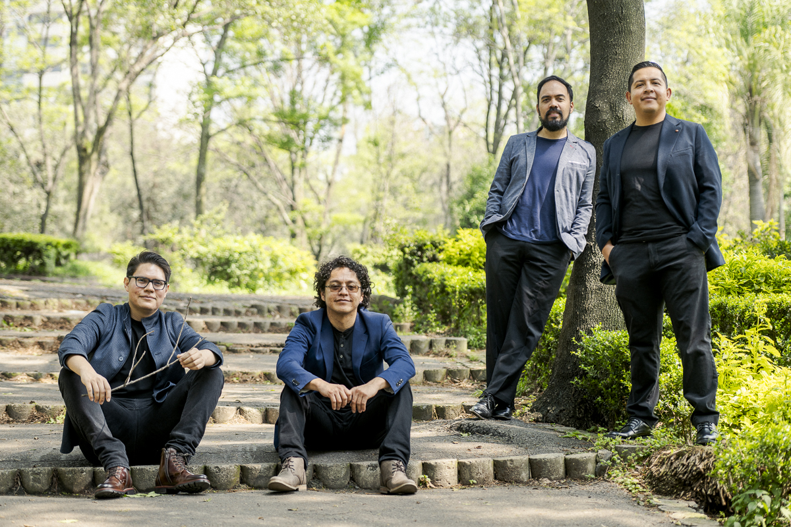

Surgió en 2015. A lo largo de su trayectoria el grupo ha mantenido como
prioridad no solo generar música nueva en colaboración estrecha con
compositores vivos, sino también la de exportar la música y el trabajo
nacional a través de todos los medios posibles. Abordar, exponer y
documentar versiones novedosas del repertorio que forma parte de la
literatura para percusiones. Bajo estas premisas han estrenado y grabado
más de diez obras de compositores mexicanos. Destacan sus presentaciones
en el FIMNME, las Jornadas INBAL-SACM, el Festival Internacional
Divertimento y Más Cultura IPN. Como solista el ensamble se ha
presentado en dos ocasiones con el *Garbage Concerto* de Jan Järvlepp,
en 2019, con la OJUEM UNAM y en 2024 con la Orquesta Sinfónica del IPN.

#### Abraham Parra Arámburo


Nació en Puebla. Egresado de la Licenciatura en Percusiones en 2014 y en
2020 de la maestría bajo la cátedra de Alfredo Bringas. Fue solista en
*La Orestiada* de Iannis Xenakis durante el Festival Internacional
Cervantino 2022 con el ensamble Cepromusic. Fue seleccionado por dos
años consecutivos por la Academia Cervantina en 2014 y 2015, dentro del
marco del Festival Internacional Cervantino a través de diferentes
conciertos, entre ellos los realizados con Red Fish Blue Fish en 2014
con la obra *Drumming* de Steve Reich y bajo la dirección de Steven
Schick y *Pleiades* en 2015 de Iannis Xenakis con Aiyun Huang e Iván
Manzanilla. Fue profesor de tiempo completo en el Afghanistan National
Institute of Music en Kabul en 2016 y 2017. Desde 2018 es músico
residente del Ensamble Cepromusic.

#### Aldo Aranda


Es un percusionista multifacético y virtuoso de la marimba que concibe
la percusión como un lenguaje expandido donde convergen sonido, cuerpo y
escena. Su trabajo transita entre el teatro musical contemporáneo, la
improvisación, la danza y la tecnología, creando propuestas que
desdibujan los límites del concierto tradicional. Paralelamente a su
labor interpretativa, desarrolla una intensa actividad pedagógica y ha
sido invitado a impartir talleres y conferencias en instituciones
internacionales como las universidades de California en San Diego, de
Nuevo México, de Música de Bucarest y de Guanajuato. Reconocido por la
Secretaría de Cultura como Creador Artístico con Trayectoria, su trabajo
se proyecta como un puente entre culturas, generaciones y lenguajes.
Actualmente reside en Amberes, donde desarrolla nuevos proyectos
interdisciplinarios y su próxima producción discográfica como solista.

## SÁB | NOV 14, 13:00 h - Ensamble de Música Nueva (FaM-UNAM)

Sala Xochipilli, Facultad de Música, UNAM

### Programa

**Jonathan Figueroa**

-   *California Journey* (2019) `\hfill `{=tex}6'
    -   *First days in California*
    -   *Last days in California*

**Manuel Enríquez**

-   *Zenzontle*, concierto para flauta\
    A Marisa Canales (1994) `\hfill `{=tex}4'
    -   *I*

[**Miguel Ángel Villanueva**, flauta]{.solista}

**Carlos Chávez**

-   Concierto para cuatro cornos (1967) `\hfill `{=tex}21'
    -   *Allegro*
    -   *Adagio*
    -   *Rondo*

[**Mario Sánchez, Eileen Castillo, Carlos Frausto, Pedro Antonio**, solistas]{.solista}

**Gustavo Larrea**

-   *Voces* (2018) `\hfill `{=tex}22'

[**José del Mar**, barítono]{.solista}

**Andrea Sarahí**

-   *Ex vivo* (2019) `\hfill `{=tex}8'
    -   *I - II*

**Ensamble de Música Nueva de la FaM-UNAM**\
Germán Tort, director artístico

**Miguel Ángel Villanueva**, flauta

### Personas compositoras

#### Jonathan Figueroa (México, 1987)


Sus obras han sido estrenadas en México, Estados Unidos, Colombia y
Costa Rica por orquestas y ensambles como Brightwork newmusic, Hocket,
Argus Quartet, Los Angeles Percussion Quartet, Cuarteto José White,
Orquesta Sinfónica de la UACH y Orquesta Sinfónica de la UAT, entre
otros. Fue ganador de la primera mención en el Quinto Concurso
Internacional de Composición Nuestra América. Entre sus maestros
destacan Alan Shockley, Raymond Torres-Santos, Alexander Elliott Miller,
Adriana Verdié y Emil Awad. Adicionalmente, ha recibido clases y
talleres de Ana Lara, Enrico Chapela, José Luis Hurtado y Jorge Torres
Sáenz. Es Licenciando en Música con especialidad en Composición y piano
por la Universidad Veracruzana y maestro en Música con especialidad en
Composición por la California State University, Long Beach.

##### *California Journey*

> «Está inspirada en el tiempo que viví en California como estudiante de
> maestría. En octubre de 2017, compuse *First Days in California*. Con
> esta pieza busqué alejarme de los procedimientos seriales que había
> estado trabajando previamente y adentrarme en un lenguaje totalmente
> distinto mucho más cercano al minimalismo y las sonoridades triádicas.
> En 2019, cuando mi estancia en California estaba por llegar a su fin,
> sentí la necesidad de escribir un segundo movimiento que funcionara
> como cierre de esa etapa. Así nació *Last Days in California*, la cual
> retoma elementos presentes en el primer movimiento. Ambas piezas
> quedaron reunidas bajo el título *California Journey*, obra que
> enmarca mi paso por California a través de la primera y la última
> composición que escribí durante esa etapa de mi vida. La presente
> versión es una adaptación de la obra original al sustituir la parte de
> violín por una parte de viola».

#### Manuel Enríquez (México, 1926-1994)


Originario de Ocotlán, Jalisco, fue una figura fundamental de la
vanguardia musical en México. Se formó con Áurea Corona y Miguel Bernal
Jiménez, perfeccionándose después en la Juilliard School con Ivan
Galamian y Peter Mennin. En 1961, gracias a la beca Guggenheim,
incursionó en la música electrónica en Columbia y Princeton bajo la guía
de Stefan Wolpe. Como violinista, fue concertino de la Sinfónica de
Guadalajara y fundó el célebre Cuarteto México, con el que realizó giras
por Europa y América. Su labor docente y administrativa fue vasta:
dirigió el Conservatorio Nacional y el Cenidim, donde impulsó la
investigación electroacústica y virreinal. En 1979 fundó el Foro
Internacional de Música Nueva (que hoy lleva su nombre), espacio vital
para la difusión de la creación contemporánea. Distinguido como Creador
Emérito y miembro de la Academia de Artes, su legado permanece como
pilar de la identidad musical mexicana del siglo XX.

##### *Zenzontle*

> «Con el vivo recuerdo del ancestral pájaro que habita nuestros bosques
> y cuyo virtuosismo y facilidad de emisión son verdaderamente
> excepcionales, he sentido el deseo de escribir esta pieza para flauta
> en sol, flauta en do, cuerdas y percusión, y que he dedicado a Marisa
> Canales. No ha sido mi intención transcribir fielmente intervalos,
> ritmos o giros musicales al *estilo Messiaen*, sino simplemente
> sentirme empujado por timbres, contrastes y, en general, el ambiente
> sonoro que puede rodear al ave. El lenguaje de la obra se ciñe
> totalmente a mis convicciones creativo-musicales, otorgando gran
> libertad a la parte solista para que decida duraciones, orden,
> etcétera, así como al director y resto del conjunto».

#### Carlos Chávez (México, 1899-1978)


Fue, por múltiples razones, una figura fundamental en la historia de la
música de México y uno de los más importantes compositores de América
Latina del siglo XX. Además, como director de orquesta presentó en
nuestro país muchas de las más importantes obras nuevas del repertorio
nacional e internacional y dirigió más de cien orquestas en el mundo.
Creó instituciones fundamentales y fue maestro de varias generaciones de
compositores. Su obra es extensa y variada: seis sinfonías, cuatro
conciertos, una ópera, seis ballets, un nutrido catálogo de obras
orquestales, de cámara y vocales.

##### Concierto para cuatro cornos

Es una reestructuración de la Sonata para cuatro cornos (1929) que no
altera la composición original. Esto se decidió en razón de que los
intérpretes difícilmente podrían resistir por sí solos la ejecución de
una obra de más de veinte minutos, la cual implica múltiples pasajes de
compromiso. El concierto fue estrenado únicamente con la interpretación
del tercer movimiento en 1937 con motivo del Coolidge Festival de
Washington D.C. El último movimiento del concierto fue orquestado y
estrenado en México en 1939, concluyendo así la edición de la primera
versión del concierto, la cual fue aclamada y formó parte del interés de
músicos de la época como Colin McPhee, Leopold Stokowski, Leonard
Bernstein, Paul Collaer y Darius Milhaud. Finalmente, Chávez decidió
destruir esta primera versión del concierto y reorquestarlo en 1964.
Dicha versión fue editada por Bolwin-Mills Publ. Corp., casa que
actualmente se encuentra fuera de servicio; por ello no existe una forma
directa de adquirir o rentar las partituras de esta obra, lo que la
convierte en una pieza con fines de rescate, cuyas interpretaciones
futuras tienen como objetivo salvaguardar la música académica mexicana
por medios físicos y digitales.

\hfill Mario Sánchez Cárdenas

#### Gustavo Larrea (México, 1996)


Nació en la Ciudad de México donde estudió composición y orquestación
con Gabriela Ortiz, Arturo Márquez, Enrique González Medina y Ambrosio
Salvador en la Escuela Superior de Música del INBAL y la Facultad de
Música de la UNAM. Su música tiene un profundo interés por las ciudades,
por su continuo movimiento y flujo de energía, y por las circunstancias
personales que vive. Su música ha sido ejecutada por el Quinteto de
Alientos de la Ciudad de México, Consortium Sonorus, Christian Gohmer,
Lanfranco Marcelletti, José Luis Castillo, Ludwig Carrasco, Jesús
Medina, Tere Frenk, Gustavo Martín y las orquestas Sinfónica de Xalapa,
Juvenil Universitaria Eduardo Mata y de Cámara de Bellas Artes y ha sido
interpretada en las salas de concierto Roberto Cantoral, Tlaqná,
Nezahualcóyotl y Carlos Chávez, el Auditorio Blas Galindo, el MUAC y el
Palacio de Bellas Artes.

##### *Voces*

Es una obra que condensa en unos cuantos minutos los funestos
testimonios sobre uno de los días más negros de 1968 en México.
Inspirado en el poema de José Emilio Pacheco que, a su vez, está
inspirado en el libro de Elena Poniatowska *La noche de Tlatelolco*,
Larrea organiza el texto para construirlo en una dolorosa narrativa que
poco a poco se convierte en un *thriller* musical. Desde la
introducción, en las armonías del tema que se van haciendo cada vez más
pesadas con contrapuntos que se imitan unos a otros en intrincados e
incisivos giros melódicos, la obra convierte las voces desconcertadas de
todos esos estudiantes en gritos que exigen una explicación a los
responsables de la tragedia que ha marcado a la juventud mexicana desde
entonces. Cincuenta años más tarde, esta obra representa tanto a esos
jóvenes como a los de hoy en día, que siguen exigiendo respuestas a las
acciones atroces de aquellos que tratan de acallar sus voces.

\hfill Odín Zamorano

#### Andrea Sarahí (México, 1996)


Compositora cuya obra explora la música como un espacio de reflexión, y
aborda temas como el paisaje sonoro, la fantasía, la desigualdad y la
violencia. Su música ha sido interpretada por las orquestas Sinfónica
Nacional y Filarmónica de la UNAM y ha participado los festivales
Bowdoin International Music, Texas New Music y Precept.Concept.Precept
en Eslovenia. Ha estudiado con Gabriela Ortiz, María Granillo, Arturo
Márquez y Derek Bermel. En 2023 lanzó el álbum *Calladita: cinco obras
sobre la violencia*. Actualmente cursa la Maestría en Composición en la
Facultad de Música de la UNAM.

##### *Ex vivo*

> «Es una obra para orquesta de cámara que escribí bajo la guía de
> Arturo Márquez dentro de su Cátedra Extraordinaria. Consta de cuatro
> movimientos y está impregnada de color, elemento central que se
> manifiesta tanto en la armonía como en las melodías. El título
> proviene del término médico *ex vivo*, que hace referencia a un
> procedimiento en el que un órgano o tejido es extraído del cuerpo para
> ser manipulado fuera de él y posteriormente reimplantado. Esta idea
> dialoga con la obra al sugerir un proceso de transformación,
> intervención y reconfiguración no solo del material musical, sino
> también de una visión personal».

------------------------------------------------------------------------

### Intérpretes

#### Ensamble de Música Nueva de la Facultad de Música de la UNAM


Está conformado por instrumentistas que cursan los últimos años de sus
respectivas licenciaturas y maestrías en la Facultad de Música de la
UNAM (FaM). Como instrumentistas se han presentado en importantes foros
y varios de ellos son integrantes de las orquestas sinfónicas Eduardo
Mata, Carlos Chávez, Filarmónica Mexiquense y Estanislao Mejía de la
FaM. Abordan un repertorio de música contemporánea que no es usualmente
interpretada en México por jóvenes. Desde su formación, en 2016, han
realizado programas con técnicas de composición y puntos de vista
estéticos diferentes, además de haber interpretado más de cuarenta
estrenos mundiales de obras de Mario Lavista, Víctor Ibarra, Galina
Ustvólskaya, Armando Luna, Jorge Torres, Paulina Monteón, Emmanuel
Séjourné, Andrea Chamizo y Mario Stern. Desde 2017 han participado en el
Foro Internacional de Música Nueva Manuel Enríquez, bajo la batuta de
Germán Tort, su director artístico.

#### Germán Tort


Es Licenciado en Dirección de orquesta por el Conservatorio Nacional de
Música (CNM). Diploma de Dirección de orquesta por el Conservatoire de
Noisy-le-Sec en Francia. Maestrante en Dirección de orquesta en
Interpretación de música mexicana de concierto en el CNM. Realizó
estudios en los conservatorios de Evry, *Frédéric Chopin*, l'École
Grégorien de París, l'École Normale de Musique de París y The Pierre
Monteux School for Conductors and Orchestra Musicians en Estados Unidos.
Ha dirigido las orquestas Sinfónica de la Universidad de Guanajuato,
Filarmónica del Estado de Querétaro, Sinfónica de Yucatán, Sinfónica de
Oaxaca, Sinfónica de la Marina, el Ensamble Cepromusic y a Solistas
Ensamble de Bellas Artes. Fue director titular de la Orquesta Sinfónica
del CNM de 2017 a 2022. Actualmente es director de los ensambles de
Música Nueva de la Facultad de Música de la UNAM y de la Escuela
Superior de Música del INBAL, con quien ha estrenado en México más de
cincuenta obras de compositores mexicanos y extranjeros.

#### Miguel Ángel Villanueva


Se ha presentado en Europa, América y África interpretando
principalmente la música de compositores mexicanos como Eugenio
Toussaint, Horacio Uribe, Lucía Álvarez y Eduardo Angulo. Ha grabado
como solista con las orquestas Filarmónica de la Ciudad de México,
Sinfónica de la UANL y el Ensamble Orquestal Ars Moderna. Ha sido
invitado como solista, recitalista y maestro a festivales nacionales e
internacionales en Reino Unido, España, Francia, Estados Unidos,
Colombia, Ecuador, Argentina, Brasil, Canadá y México. Desde 1995 es
profesor titular de la Facultad de Música de la UNAM (FaM) donde, aparte
de su labor docente, organiza el Festival Universitario de Flauta
Transversa, así como el Concurso Nacional de Flauta Transversa. Es
egresado de la FaM, del Conservatoire National de Région de Saint-Maur y
de l'École Normale de Musique de París, donde obtuvo la Licenciatura
Instrumentista, la Medalla de Oro y el Diploma Superior de Ejecución
respectivamente. Sus maestros fueron Héctor Jaramillo, Ida Ribera,
Michel Moraguès y Shigenori Kudo. En 2023 obtuvo el Doctorado en
Interpretación en la UNAM. Desde 2017 forma parte de los Artistas de la
casa Powell Flutes.

::: logos

:::

## SÁB | NOV 14, 17:00 h - Dúo Gasparini-Monnet

Sala Manuel M. Ponce, Palacio de Bellas Artes

### Programa

**Kaija Saariaho**

-   *Changing Light* (2002) `\hfill`{=tex}7'

**Luciano Berio**

-   *Sequenza III* para voz femenina solista (1965) `\hfill`{=tex}7'
-   *Sequenza VIII* para violín solo (1976) `\hfill`{=tex}13'

**Canciones tradicionales**

-   Arreglo de Noemi Gasparini `\hfill`{=tex}10'

INTERMEDIO\

**Gonzalo Macías**

-   *Cliché* (2014) `\hfill`{=tex}5'

**Leonardo Coral**

-   *Orígenes* (2014) `\hfill`{=tex}8'
-   *Arcaico y profundo*
-   *Misterioso*
-   *Canto*
-   *El perpetuo fluir*

**György Kurtág**

-   *Kafka Fragments*, Op. 24 (1987) `\hfill`{=tex}25'

**Dúo Gasparini-Monnet**

Noemi Gasparini, violín\
Makeda Monnet, soprano

### Personas compositoras

#### Kaija Saariaho (Finlandia, 1952 -- Francia, 2023)


Fue una voz destacada de su generación de compositores, tanto en su país
natal como en el mundo entero. Estudió composición en Helsinki, Friburgo
y París, donde residió desde 1982 hasta su muerte. Sus estudios e
investigaciones en el IRCAM, el centro parisino de experimentación
electroacústica, tuvieron una gran influencia en su música, y sus
características texturas exuberantes y misteriosas se crearon a menudo
combinando la interpretación en vivo con la electrónica. Expandió
gradualmente su expresión musical a una gran variedad de géneros, y sus
piezas de cámara y música coral se han convertido en piezas clave de
conjuntos instrumentales y vocales, respectivamente.

##### *Changing Light*

> «La obra fue escrita para el proyecto *Compassion* de Edna Michell. En
> la pieza seguí la idea de un diálogo, sugerido por el texto escogido.
> El mundo sonoro íntimo y frágil del dúo refleja lo delicado de nuestra
> incierta existencia. Luz y oscuridad, noche y día. Nos maravillamos
> ante el misterio de las estrellas. Luna y cielo, arena y mar. Nos
> maravillamos ante el misterio del Sol. Amanecer, medio día, atardecer.
> Aunque mortales, somos la joya de la creación. Carne y hueso, acero y
> piedra. Vivimos en refugios temporales y frágiles. Amor enorme y
> firme, compasión, gracia. Ampáranos, señor; nuestro origen es el
> polvo. Esplendor, piedad, majestad, amor duradero. Apenas estamos por
> debajo de los ángeles. Cielos resplandecientes, atardecer, amanecer.
> La grandeza de la creación eleva nuestras vidas. La oscuridad de la
> noche, la luz del amanecer. Renueva nuestras vidas como renuevas el
> tiempo».

#### Luciano Berio (Italia, 1925-2003)


Fue un compositor italiano modernista y uno de los principales
representantes de la vanguardia musical europea. Es reconocido por su
trabajo en la música experimental, particularmente su Sinfonía para
orquesta, y también fue pionero en la música electrónica. Sus primeras
obras estuvieron influenciadas por Igor Stravinski y sus experimentos
con técnicas seriales y electrónicas, mientras que sus obras posteriores
exploran la indeterminación y el uso de textos hablados como material
básico de la composición.

##### *Sequenza III*

Es una composición para voz femenina solista que forma parte de
*Sequenza*, una serie de obras para instrumentos solistas iniciada en
1958. *Sequenza III* se inspiró en la virtuosa voz de la exesposa de
Berio, Cathy Berberian. Berio musicalizó un breve texto en inglés de
Markus Kutter, parcialmente fragmentado en palabras, sílabas y sonidos
de vocales y consonantes. Utilizó la voz no solo para cantar, sino
también para otros sonidos vocales, creando una forma de teatro musical.
La obra fue estrenada por Berberian en 1966 y se publicó en Universal
Edition ese mismo año.

##### *Sequenza VIII*

> «Para ti he multiplicado mis voces, mis vocablos, mis vocales, y ahora
> proclamo que eres mi vocativo».

Aquí, Berio regresa al violín que tocaba en su infancia, con el que tuvo
una relación *atormentada*. Rinde homenaje tanto al instrumento que
considera «el más sutil y complejo» como al repertorio clásico y
romántico que el violín engendró. Encontramos ecos de una Chacona de
Bach o un Capricho de Paganini, así como los arquetipos del violinista
virtuoso. *Sequenza VIII* puede escucharse como una secuencia de gestos
instrumentales que juegan según el principio de la variación libre.
Estas variaciones se desarrollan en torno a los sonidos La y Si, puntos
de referencia perceptivos a lo largo de la pieza.

#### Gonzalo Macías (México, 1958)


Nació en Tlaxcala. Estudió piano con Isaías Noriega de la Vega y Jorge
Suárez y composición con Federico Ibarra. En 1988, como becario del
gobierno francés, estudió composición con Sergio Ortega, análisis con
Betsy Jolas, orquestación con Gérard Grisey y música electroacústica con
Michel Zbar. En 1992 recibió la Medalla Mozart del Instituto Cultural
Domecq de la Ciudad de México. Su música se ha publicado en Ediciones
Mexicanas de Música y se ha estrenado en el Foro Internacional de Música
Nueva *Manuel Enríquez* y el Festival Internacional Cervantino.
Igualmente, ha participado en la composición de música para teatro,
colaborando con directores como David Olguín, Jorge Vargas, Ludwig
Margules y Javier Malpica. Ha sido miembro del Sistema Nacional de
Creadores de Artes. Desde 2023 se dedica de tiempo completo a la
composición, concluyendo un periodo de más de cuarenta años de enseñanza
de la música.

##### *Cliché*

Muchas veces las primeras ideas que surgen al comenzar la composición de
una pieza son rápidamente dejadas de lado, porque nos parecen triviales
y poco interesantes. Pero ¿qué pasaría si en vez de realizar esta labor
de limpieza prudente y juiciosa, permitiéramos que estos lugares
comunes, esa especie de citas musicales escuchadas mil veces, se
volvieran el material de base para la composición de una pieza?

#### Leonardo Coral (México, 1962)


Estudió con Federico Ibarra en la UNAM. Obtuvo la maestría con la obra
*Ciclo de vida y muerte*, con la asesoría de María Granillo. Sus
creaciones se han tocado en México, Europa, Estados Unidos, Canadá,
Asia, Australia y Latinoamérica. Es miembro del SNCA. Hay 41 discos con
su música. Diversas orquestas y ensambles han presentado su trabajo:
OFUNAM, OSN, OSEM, OFCM, OCBA, OSUANL, OSUG, OSIDEM, OBC, OSEP,
Cepromusic, Ónix, Cuarteto Latinoamericano, Tambuco, Camerata de las
Américas, Cuarteto de la Ciudad de México, Duplum, Cuarteto Arcano,
Cello Alterno y Zikluz. Así como destacados solistas: Tere Frenk,
Mauricio Náder, Krisztina Deli, Juan Carlos Laguna, Gonzalo Gutiérrez,
Omar Hernández, Ignacio Mariscal, Fernando Domínguez, Luis Humberto
Ramos, Omán Kaminsky, Alejandro Escuer, Judith Reyes, Hugo Ticciati,
Cuauhtémoc Rivera, Nana Babayeva, Rodrigo Garibay y han dirigido sus
obras José Areán, Rodrigo Cadet, José Luis Castillo, Andrés Cárdenes y
Félix Carrasco.

##### *Orígenes*

Es una obra de gran virtuosismo y forma parte de *Orígenes, formas y
estampas quijotescas*. Las piezas que constituyen esta serie son:
*Estampas Quijotescas IV. Manteamiento de Sancho Panza, II. Dulcinea del
Toboso VI. Batalla entre Don Quijote y el Caballero de la Blanca Luna;
Preludios para piano 2a. serie I. Onírico XII. Ráfaga; Orígenes para
violín IV. El perpetuo fluir, Sonata para piano No. 7 III. Vivo con
fuoco*.

#### György Kurtág (Rumanía, 1926)


Compositor húngaro considerado una de las figuras más importantes de la
música contemporánea europea, conocido por su estilo conciso, expresivo
y profundamente introspectivo. Estudió en la Academia de Música Franz
Liszt de Budapest, donde más tarde fue también profesor. Durante su
carrera desarrolló un lenguaje musical muy personal, influido por Béla
Bartók y Anton Webern, caracterizado por piezas breves pero intensas,
con gran atención al detalle y al silencio. Entre sus obras más
destacadas se encuentra *Játékok* (Juegos), una colección de piezas para
piano que comenzó en la década de 1970, así como su ópera *Fin de
partie*, basada en la obra de Samuel Beckett, estrenada en 2018. Kurtág
ha recibido numerosos premios internacionales y es reconocido por su
contribución única a la música de los siglos XX y XXI.

##### *Kafka Fragments*, Op. 24

Esta obra es la más extensa que Kurtág haya compuesto hasta la fecha. Se
trata de un ciclo para soprano y violín, basado en textos de Franz
Kafka, extraídos de su diario y cartas, así como de *Preparativos de
boda en el campo*. Un único fragmento, de Elias Canetti, constituye una
excepción. Está dedicado a la memoria del gran poeta húngaro János
Pilinszky y recuerda al cuarto de sus *lieder* sobre poemas de
Pilinszky; mediante su ritmo abrupto, salpicado de silencios, la música
representa el andar vacilante e inestable de un niño pequeño, una
metáfora particularmente impactante de la imposibilidad de contar una
historia, o incluso de hablar. Estos fragmentos, acertadamente titulados
*unas pocas palabras, a lo sumo unas pocas frases*, crean microcosmos
cuya yuxtaposición jamás alcanzará la plenitud de la narración.

------------------------------------------------------------------------

### Intérpretes

#### Dúo Gasparini-Monnet


Integrado por **Noemi Gasparini**, violín, y **Makeda Monnet**, soprano,
el dúo ha participado en los festivales *Pablo Casals*, Clásico de
Villars, en Suiza, y Schiermonnikoog, en los Países Bajos. También en
proyectos de ópera y teatro, así como en propuestas de carácter no
convencional, entre ellas una colaboración con la equilibrista
Tatiana-Mosio Bongonga.

Noemi Gasparini ha actuado como solista con las orquestas del País
Vasco, Colonne de París y Paris Rive Droite. Realizó sus estudios en la
Manhattan School of Music y obtuvo una maestría en el Conservatoire
National Supérieur de Paris. En 2024 participó en *313*, pieza para
violín solo compuesta e interpretada junto con la cantante española
Silvia Pérez Cruz, así como en proyectos con Flor de Toloache, mariachi
femenino de Nueva York, y Jarana Beat, banda méxico-afroamericana
radicada en Nueva York.

Makeda Monnet ha sido solista con la Berliner Philharmoniker y la
Philharmonie de Paris. Recibió los premios del CRR de París y de Canto
del Conservatoire National Supérieur de Paris. En 2021 interpretó
*Estrella de la mañana*, de A. Nante, en el Victoria Hall de Ginebra, y
*Carte Noire Nommée Désir*, de R. Chaillon.

::: logos

:::

## SÁB | NOV 14, 19:00 h - Cepromusic: Saariaho

Anfiteatro Simón Bolívar, Colegio de San Ildefonso, UNAM

**Monográfico Saariaho**

------------------------------------------------------------------------

### Programa

**Kaija Saariaho**

-   *Lichtbogen* (1986) `\hfill`{=tex}19'
-   *Près* (1992) `\hfill`{=tex}18'

INTERMEDIO\

-   *Semafor* (2020) `\hfill`{=tex}14'
-   *Solar* (1993) `\hfill`{=tex}17'

**Ensamble Cepromusic**

José Luis Castillo, director artístico

Maximiliano Trigo, **flauta** | Arielle Amezcua, **oboe** | Gabriel
Padilla, **clarinete** | Pablo Ramírez, **clarinete bajo** | Ángel
Flores, **fagot** | Alfredo Fenollosa, **corno** | Diego Velásquez,
**trompeta** | Xavier Frausto, **trombón** | Abraham Parra,
**percusión** | Bryan Flores, **percusión** | Francisco García,
**piano** | Dirén Checa, **violín** | Javier Regalado, **violín** |
Juanmanuel Flores, **violín** | Eduardo Cabrera, **viola** | Diego
Gutiérrez, **violonchelo** | Konstantin Evmenkin, **violonchelo** |
Alejandro Motta, **contrabajo** | Juan Cáceres Avitia, **coordinador de nuevas tecnologías aplicadas a la creación musical**

*Beneficiarios del Programa de Residencias Artísticas en Grupos Estables del INBAL*

### Personas compositoras

#### Kaija Saariaho (Finlandia, 1952 -- Francia, 2023)


Fue una voz destacada de su generación de compositores, tanto en su país
natal como en el mundo entero. Estudió composición en Helsinki, Friburgo
y París, donde residió desde 1982 hasta su muerte. Sus estudios e
investigaciones en el IRCAM, el centro parisino de experimentación
electroacústica, tuvieron una gran influencia en su música, y sus
características texturas exuberantes y misteriosas se crearon a menudo
combinando la interpretación en vivo con la electrónica. Expandió
gradualmente su expresión musical a una gran variedad de géneros, y sus
piezas de cámara y música coral se han convertido en piezas clave de
conjuntos instrumentales y vocales, respectivamente.

##### *Lichtbogen*

El nombre de la pieza proviene de las auroras boreales del cielo ártico.
En ella, Saariaho trabajó por primera vez con la computadora en el
contexto de la música puramente instrumental, junto con dos herramientas
diferentes en IRCAM. Para la armonía, el sistema CRIME propició que el
material armónico se creara analizando transiciones cortas interpretadas
con un violonchelo, partiendo de un sonido armónico artificial y
culminando en complejos sonidos multifónicos. Para el ritmo, utilizó una
red de programas del entorno FORMES. Estos programas le permitieron
construir interpolaciones y transiciones para diferentes parámetros
musicales. *Lichtbogen* fue un encargo del Ministerio de Música de
Francia.

##### *Près*

Es una pieza que consta de tres movimientos. El primero se centra en una
textura bastante lineal en la que la parte del violonchelo se fusiona a
veces con sonidos sintéticos, donde el sonido del violonchelo se
modifica en una estación de trabajo musical desarrollada en el IRCAM. El
título de la obra se relaciona con su obra hermana (*Amers*, término
náutico para referirse a marcas o puntos de referencia), y también con
la pintura de Paul Gauguin, *Junto al mar*; y, por lo tanto, con la
experiencia del mar y las olas, sus diferentes ritmos y sonidos, el
tiempo tormentoso y la calma. En otras palabras: materia, formas de las
olas, figuras rítmicas, timbres. La carga de la música y la liberación
final de esa carga. *Près* está dedicada a Anssi Karttunen, quien la
estrenó en Estrasburgo el 11 de noviembre de 1992.

##### *Semafor*

La grafía sueca de la palabra semáforo hace referencia al difunto
artista finlandés Ernst Mether-Borgström. *Semafor* comenzó a gestarse
mientras Saariaho terminaba su obra orquestal *Vista*, con la pregunta
de ¿qué pasaría si toda la pieza girara en torno a un material
contradictorio, pero reducido? Gradualmente, la música se convirtió en
un estudio sobre la ruptura de la combinación de *ostinato* y grito,
reconstruyéndola, variándola, modificándola, desarrollándola y
transformándola. La música cambia de carácter, pasando de la alegría a
la calma a lo largo de la pieza, también con la ayuda de cambios de
tempo que regulan el flujo musical.

##### *Solar*

*Solar* se basa en la idea de una estructura armónica siempre presente,
que irradia una imagen a su alrededor y fuerza a la armonía a regresar
una y otra vez a su forma original, como si siguiera las leyes de la
gravedad. La pieza toma su nombre de esta idea. Esta armonía *solar*
contrasta con un principio armónico muy diferente, basado más en
polaridades.

------------------------------------------------------------------------

### Intérpretes

#### Cepromusic

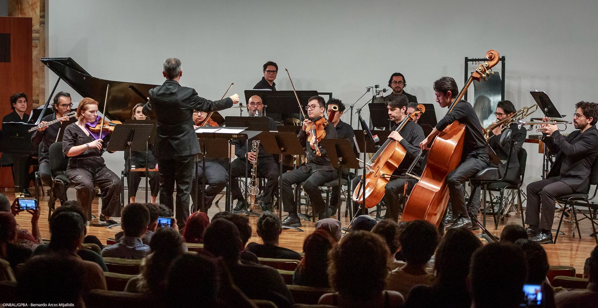

El Centro de Experimentación y Producción de Música Contemporánea
(Cepromusic), creado en 2012, es un espacio en el que convergen
actividades artísticas y académicas en favor de la creación, desarrollo
y difusión de la música contemporánea en México. Además de sus
temporadas regulares en el Palacio de Bellas Artes, el Ensamble
Cepromusic ha realizado diez giras internacionales por Alemania,
Colombia, Escocia, España, Inglaterra, Brasil y Estados Unidos; así como
residencias artísticas y académicas en Colombia, España, Estados Unidos,
México y Reino Unido. En 2018 fue invitado al Festival de Verano de
Darmstadt. El Cepromusic ha tenido residencias y colaboraciones con
compositores e intérpretes como Anna Göckel, Chris Cogburn, Christian
Wolff, Dafne Vicente, Irvine Arditti, James Dillon, John Butcher, Joshua
Fineberg, Kaija Saariaho, Katalin Károlyi, Klaus Lang, Peter Ablinger,
Sigma Project Quartet, Susan Platts, Tiffany DuMouchelle, Tony Arnold,
UMS'n JIP y Ute Wassermann, entre otros. Además de su decidida vocación
latinoamericana, el Ensamble Cepromusic es el instrumento de gran parte
de los compositores mexicanos contemporáneos, habiendo colaborado,
encargado, interpretado y grabado a compositores nacionales de varias
generaciones. El ensamble colabora habitualmente con otras disciplinas
como la fotografía, el video, el teatro, el cine silente, la danza y la
multimedia, y cuenta con tres producciones discográficas. Desde su
creación el ensamble ha ejecutado cuatrocientos conciertos en los que ha
interpretado más de ochocientas obras y trescientos estrenos.

#### José Luis Castillo


Nació en España. Director artístico del Cepromusic y director titular de
la Orquesta Filarmónica de Jalisco. Estudió composición, análisis y
dirección de orquesta en Valencia, Salzburgo, Luxemburgo y París con
Manuel Galduf y Alexander Müllenbach. Radica en México desde 1997. Fue
director artístico del programa académico de perfeccionamiento musical
Instrumenta Oaxaca, coordinador del ciclo de Música Contemporánea del
Festival Internacional Cervantino, profesor de composición en el
Instituto de Cultura de Guanajuato, director artístico de la Orquesta
Sinfónica de la Universidad de Guanajuato y de la Orquesta de Cámara de
Bellas Artes y director musical de la Camerata de las Américas. Ha sido
reconocido en dos ocasiones por la Unión Mexicana de Críticos de Teatro
y Música y premiado en Luxemburgo, Países Bajos e Italia. Más de setenta
orquestas en veinticinco países y una discografía de quince títulos
avalan su trayectoria, y además de ópera, ballet, repertorio camerístico
y sinfónico cuenta con un amplio catálogo de películas silentes con
musicalización en vivo, más de doscientos estrenos mundiales y cientos
de estrenos en México. Como compositor, sus obras se interpretan en
importantes foros y festivales de música contemporánea. Es profesor de
Composición en la Escuela Superior de Música del INBAL, realiza la
edición crítica de las obras de Silvestre Revueltas en colaboración con
Roberto Kolb y es director musical del Ensamble Cepromusic.

::: logos

{recorte="0.12 0.38 0.28 0.6"}
{recorte="0.28 0.38 0.52 0.6"}
{recorte="0.52 0.38 0.752 0.6"}
{recorte="0.73 0.38 0.9 0.6"}
:::

## DOM | NOV 15, 17:00 h - Vicente Moronta, oboe

Laboratorio Escénico, Jardín Escénico

**Resonancias latinoamericanas para oboe y público rumbero**

------------------------------------------------------------------------

### Programa

**Adrián Suárez**

-   *Wirapuru* (2018)\*\* `\hfill `{=tex}3'

**Pedro García Velásquez**

-   *Interludio Guaguancó I* (2024)\*\* `\hfill `{=tex}6'

**Arturo Fuentes**

-   *La lentezza del single* (2024)\*\* `\hfill `{=tex}8'

**Juan Pablo Pettoruti**

-   *Un corte para activar la racha* (2026)\*\* `\hfill `{=tex}5'

**Diana Arismendi**

-   *La Stanza* para oboe solo (2015)\* `\hfill `{=tex}6'

**Pedro García Velásquez**

-   *Interludio Guaguancó II* (2024)\*\*
-   *Guaguancó metálico* para oboe solo y coreografía (2024)\*\*
    `\hfill `{=tex}8'

**Luis Quintana**

-   *Aguanilé* (2017)\*\* `\hfill `{=tex}5'

**Víctor Ibarra**

-   *...de las sílabas del agua* (2025)\*\* `\hfill `{=tex}8'

**David Núñez**

-   *Intermezzo del maestro ignorante* (2026)\*\* `\hfill `{=tex}6'

**Mirtru Escalona Mijares**

-   *MURANKÏNËTO* (2026)\*\* `\hfill `{=tex}8'

**Carolina Carrizo**

-   *Sem elle* (2026)\*\*

**Arturo Corrales**

-   *Merengoe* (2026)\*\* `\hfill `{=tex}9'

**Vicente Moronta**, oboe y electrónica

### Personas compositoras

#### Adrián Suárez (Venezuela, 1969)


Destacado compositor, trombonista, arreglista e investigador venezolano,
reconocido por fusionar tradiciones venezolanas, caribeñas y elementos
clásicos. Licenciado en Artes (UCV-1994), ha ganado múltiples premios,
incluyendo el Premio de Composición Casa de las Américas 2017 por
*Diamante duende* y reconocimientos en el American Prize por su obra
para banda sinfónica *Akasha*.

##### *Wirapuru*

> «Wirapuru es un ave presente en una antigua leyenda amazónica, según
> la cual el canto de ese pájaro trae bendiciones a quien lo escucha. Yo
> lo asocio con un ave de la Sierra del Imataca llamada Pájaro
> violinero. Utilizo la idea concreta de un ave venezolana para hablar
> de una leyenda amazónica. Me interesa atar todo el contenido ancestral
> del Aulós griego, utilizado para los cultos de Dioniso y Cibeles al
> imaginario amazónico. Cuenta la leyenda que un hombre es transfigurado
> después de su muerte en Wirapurú, y este entona un trino que produce
> una misteriosa e inexplicable paz en la selva. Este opúsculo es una
> oblación a los espíritus que deambulan entre el cielo y la tierra».

#### Pedro García Velásquez (Colombia, 1984)


Nació en Bogotá. Comenzó sus estudios musicales a los cuatro años y a
los siete empezó a practicar violín. Ingresó a la Universidad del Valle
en Cali, donde prosiguió sus estudios musicales y desde entonces se
apasiona y dedica a la composición. En Bogotá integró la clase de
composición de Harold Vásquez Castañeda. Gracias a una beca de la
fundación Mazda de Colombia, continuó sus estudios y se graduó en
Composición en 2006 en la Pontificia Universidad Javeriana. Se instaló
en Francia para proseguir su formación musical. En 2007 estudió con
Jean-Luc Hervé en el Conservatorio Nacional de Región de
Boulogne-Billancourt y en 2008 integró la clase de Frédéric Durieux en
el Conservatorio Nacional Superior de París.

##### *Interludio Guaguancó I y II*

Estos interludios son fantasías electrónicas que establecen un diálogo
entre el material de las piezas y diversos estilos de música de baile, a
través de una estética psicodélica y electrónica de *glitch*. En la
creación de esta obra se han utilizado numerosas muestras sonoras.

##### *Guaguancó metálico*

Un ritmo de salsa cautivador. Melodías microtonales entrelazadas con
multifónicos producidos por el oboe. Una resonancia metálica. Un músico
sinfónico que baila y pisa fuerte mientras interpreta ritmos frenéticos
y endiablados. Una pausa que evoca el recuerdo lejano de una suave
melodía de viento. Estos son los ingredientes que se entrelazan y
despliegan en esta pieza, un homenaje a la juventud latina, bailarina y
delirante.

#### Arturo Fuentes (México, 1975)


A lo largo de las dos últimas décadas, Fuentes, ciudadano austriaco
nacido en México, ha creado un catálogo muy diverso de más de cien
obras. Compositor y artista multidisciplinario, ha incursionado en la
dirección escénica, el cine documental y la obra pictórica. Radicado
entre México y Austria, ha desarrollado un lenguaje personal que se
caracteriza por la exploración del timbre, el silencio, la poética del
sonido e imagen y sus posibilidades escénicas.

##### *La lentezza del single*

> «Vivo en el piso del famoso artista italiano Antonio Marchetti, en el
> corazón de la ciudad de Rímini, a pocos kilómetros del mar Adriático.
> Esta ciudad, que se ha hecho inmortal gracias al genio cinematográfico
> de Fellini, me envuelve ahora con una atmósfera impregnada de las
> obras de Marchetti: pinturas, esculturas, libros y objetos que dan
> testimonio de su creatividad. Entre estos tesoros se encuentra *La
> lentezza del single*, un libro que, con su sugerente título, despierta
> mi atención. La dualidad temporal entre la lentitud y la velocidad,
> así como la idea de singularidad que destaca, despiertan mi
> curiosidad. Para Marchetti, la *singularidad* es una estructura cónica
> que aparece en muchas de sus obras, mientras que para mí representa la
> convergencia de energía en un único punto. En esta obra para oboe, que
> he dedicado a Vicente Moronta, exploro el concepto de lo único,
> inspirándome en la filosofía artística de Marchetti».

#### Juan Pablo Pettoruti (Argentina, 1987)


Nació en La Plata. En 2005 comenzó la carrera de Composición en la
Facultad de Bellas Artes de la Universidad Nacional de La Plata (UNLP).
Continuó sus estudios de composición en la Escuela Superior de Música de
Lübeck, Alemania, y concluyó la Maestría en Composición en 2016. Como
profesor de piano trabajó en escuelas de música de Argentina y Alemania.
Entre sus composiciones se encuentran obras para orquesta, ensambles de
cámara, instalaciones sonoras y performances. Socio y cofundador de la
sociedad de artistas Kunsträume. Es coordinador del área artística de la
Prosecretaría de Políticas Sociales (Extensión) de la UNLP y profesor
adscrito en la cátedra Experimentación con Medios Electroacústicos de la
Facultad de Bellas Artes de dicha universidad.

##### *Un corte para activar la racha*

Una breve transición compuesta por material sonoro recopilado de
Instagram y TikTok. Esta *historia* sonora se centra en el rango de
bajas frecuencias, precisamente aquellas que, en el paisaje sonoro
urbano cotidiano de Argentina, crean una amalgama entre las esferas
pública y privada.

#### Diana Arismendi (Venezuela, 1962)


Su producción musical incluye música orquestal, conciertos solistas,
ópera, música vocal y electrónica, así como obras para instrumentos
solistas, cuartetos de cuerdas, y música de cámara. Sus obras han sido
interpretadas en festivales y salas de concierto por orquestas, solistas
y grupos de cámara en Venezuela, Alemania, Argentina, Bolivia, Bélgica,
Canadá, Chile, Colombia, Costa Rica, Cuba, Dinamarca, Ecuador, El
Salvador, España, Estados Unidos, Francia, Países Bajos, Reino Unido,
Islandia, Luxemburgo, México, Perú, Portugal, Puerto Rico, República
Checa y Uruguay. Comenzó su formación musical en Venezuela, continuó sus
estudios en l'École Normale de Musique de Paris. Posee un Doctorado en
Composición y una Maestría en Composición y Música Latinoamericana por
The Catholic University of America de Washington. Desde 1996 es
directora ejecutiva del Festival Latinoamericano de Música de Caracas.
Es profesora titular de Composición y fue directora de Cultura de la
Universidad Simón Bolívar.

##### *La Stanza*

> «(La chambre, The Room, La habitación). De cualquier otra forma ha
> podido llamarse esta obra escrita originalmente para el cortometraje
> del mismo nombre ---*La habitación*--- del cineasta Juan Pablo Pérez,
> mi hijo. En ella exploro algunos recursos tímbricos y armónicos de las
> técnicas extendidas del instrumento. Como siempre en mis obras, el uso
> de multifónicos está fuertemente ligado al entorno armónico de la
> pieza; en esta, precisamente, genera campos melódicos que derivan en
> dichas sonoridades o, por el contrario, es el multifónico el que
> impulsa una nueva esfera melódica. Igualmente exploro ruidos como
> susurros, los cuales tienen que ver con la presencia misteriosa de
> personajes del cortometraje que parecen expresarse y comunicarse con
> el protagonista desde otra dimensión. La obra está estructurada en
> cinco secciones que se enlazan por elementos recurrentes, a fin de
> generar una estructura ascendente que culmina en una suerte de
> *cadenza* en el registro sobreagudo del instrumento. Escrita con el
> apoyo de Vicente Moronta, está dedicada a él».

#### Luis Quintana (Puerto Rico, 1988)


Compositor puertorriqueño radicado en Francia, cuya escritura transita
entre la música instrumental y vocal, la acusmática y la instalación
sonora. Inspirado en los paisajes sonoros caribeños y ecos de diversas
prácticas, habita un espacio donde la tradición y la naturaleza se
disuelven en el sonido, donde el pulso se funde con la textura. Graduado
del Conservatorio París y del Cursus del IRCAM, ha colaborado con
ensambles y músicos a nivel internacional y ha recibido importantes
distinciones, incluyendo el Premio de Composición de la Académie des
Beaux-Arts, Francia, 2022 y la beca Guggenheim, Nueva York, 2024.

##### *Aguanilé*

En la santería, una religión afroamericana de origen yoruba, el aguanilé
es la purificación espiritual de un lugar, a menudo mediante el uso del
agua. Concebido como un estudio sobre la exploración de los sonidos
percusivos del saxofón (algunos de los cuales recuerdan *sonidos
acuáticos*). La obra hace referencia al espíritu rítmico, danzante y
mágico asociado a esta tradición religiosa.

#### Víctor Ibarra (México, 1978)


Ha experimentado, en México, Francia y Suiza, las enseñanzas de maestros
como Hebert Vázquez, José Luis Castillo, Edith Lejet, Daniel D'Adamo o
Michael Jarrell, recibiendo, entre otros, los siguientes reconocimientos
internacionales: los primeros premios de los concursos Alea III en
Estados Unidos, Auditorio Nacional de Música--Fundación BBVA en España,
Mauricio Kagel y Basel Composition en Suiza. En 2014 fue seleccionado en
el 7º Foro internacional de Jóvenes compositores del Ensamble Aleph, y
recibió su nombramiento como miembro de la Casa de Velázquez--Academia
de Francia en Madrid.

##### *...de las sílabas del agua*

> «La obra surge de un proyecto colaborativo para componer música
> dedicada a Vicente Moronta, con el Amazonas como eje temático. Al
> mismo tiempo, he estado explorando la poesía latinoamericana como
> fuente de inspiración para iniciar nuevos procesos compositivos. En la
> intersección de estos dos caminos, el poema de Pablo Neruda *Amazonas*
> surgió como punto de partida, donde el río aparece como una fuerza
> vital, fértil e ilimitada. La obra se desarrolla como un diálogo
> musical con Vicente a través de la visión poética de Neruda».

#### David Núñez (Venezuela, 1970)


Graduado del Conservatorio Real de Bruselas. Ha grabado decenas de
producciones en los sellos Harmonia Mundi, Neos, Mode, Cyprés y Kairos.
Ha impartido clases magistrales en el Conservatorio del Sistema de
Orquestas Juveniles de Venezuela, en el Conservatorio Real de Bruselas,
el Conservatorio de la Rosas de México, en la Hochschule für Musik Franz
Liszt de Alemania, en la Universidad del Espíritu Santo de Guayaquil y
en el Conservatorio Giuseppe Verdi de Milán. En Chile es académico de la
Pontificia Universidad Católica, donde además de enseñar violín y música
de cámara, es miembro del cuarteto de cuerda Surkos. En Argentina fue
director artístico del cuarteto de cuerdas UNTREF de la Universidad
Nacional Tres de Febrero. Es miembro del consejo asesor de la revista
*Pilacremus* de la UNAM y del comité de lectura del Festival Atempo de
Caracas. Es doctorante de la Universidad de Huddersfield en Inglaterra.

##### *Intermezzo del maestro ignorante*

Es una composición electrónica concebida como un continuo, cuya duración
no viene determinada por el compositor, sino por la interpretación
musical del intérprete o intérpretes. Aunque originalmente formaba parte
de una obra para trío de violonchelos del mismo nombre, también puede
interpretarse como pieza independiente. El título alude al libro
homónimo de Jacques Rancière. Aunque las referencias no son del todo
explícitas, se pueden reconocer elementos característicos de la música
tradicional de Caracas (el merengue).

#### Mirtru Escalona Mijares (Venezuela, 1976)


Entre sus obras destaca la incorporación de la electrónica como
extensión de los instrumentos acústicos y la búsqueda de la música no
occidental como fuente de reflexión y conciencia constante de las
diversas percepciones del mundo. Comenzó sus estudios musicales en la
Orquesta Infantil de Duaca, gracias al programa venezolano de educación
musical a través de la práctica orquestal El Sistema. Tras una formación
musical inicial con Rafael Saavedra y Gerardo Gerulewicz, continuó sus
estudios en Francia, por invitación de José Manuel López López y Paul
Méfano. Fue alumno de Philippe Leroux, Ivan Fedele y Christine Groult.
Culminó sus estudios con una Maestría en Composición e informática
musical en el Conservatorio Nacional Superior de Música y Danza de Lyon
con Robert Pascal, Michele Tadini, Denis Lorrain y el equipo del SONVS.

##### *MURANKÏNËTO*

La Amazonía es una de las regiones con mayor biodiversidad del planeta,
donde convive una gran variedad de especies vegetales, animales y
humanas. También está habitada por numerosas comunidades indígenas, como
el pueblo panare, en la Amazonía venezolana, que ha mantenido una
profunda relación con el bosque y sus recursos durante milenios. La
pieza forma parte de un ciclo de obras que rinde homenaje al pueblo
panare y a la notable investigación de la antropóloga y etnolingüista
Marie-Claude Mattei-Muller, quien compartió generosamente sus
grabaciones de campo y su documentación.

#### Carolina Carrizo (Argentina, 1986)


Es Licenciada en Música con orientación en Composición por la Facultad
de Artes de la Universidad Nacional de La Plata (UNLP), donde
actualmente realiza el doctorado en Artes y se desempeña como docente.
Ha recibido encargos y participa regularmente de los festivales
nacionales e internacionales de música nueva y experimental Atemporánea,
ConDitLab, Generación TACEC, Plurisons, EXIT, de Música Electroacústica
UC, Visiones Sonoras, Mixtur, Frequenz, Sonar, Nordic Saxophone,
Contemporary Encounters y Synesthesia Lab. Es docente de la Facultad de
Artes y del Bachillerato de Bellas Artes de la UNLP. Integra el equipo
de investigación Patrimonio Acústico Argentino. Dirige el Laboratorio de
Investigación en Producción Interdisciplinaria de la Facultad de Artes
UNLP.

##### *Sem elle*

Este interludio fue compuesto especialmente para el concierto
Resonancias Latinoamericanas, para oboe y público rumbero, dirigido por
Vicente Moronta. Creado a partir de fragmentos del discurso pronunciado
por Marielle Franco el 8 de marzo de 2018 en el Ayuntamiento de Río de
Janeiro, apenas unos días antes de que su voz fuera silenciada- Este
interludio se inspira en sus resonancias y en su perdurable relevancia
en la actualidad.

#### Arturo Corrales (El Salvador, 1973)


Compositor, director de orquesta, doctor en musicología, guitarrista,
profesor y arquitecto salvadoreño-suizo. Estudió música en San Salvador,
Ginebra, Lugano y París. Es un compositor intensamente activo, presente
en la escena suiza e internacional. Cofundador y director del Ensemble
Vortex y del dúo Electric Primitivo, favorece la creación de nueva
música, participa en festivales internacionales de arte como compositor,
intérprete, maestro y director de orquesta. Es profesor de composición y
análisis en CPMDT, director artístico y musical de la Orquesta de
Trois-Chêne. Obtuvo un Doctorado en Musicología de la Universidad de
Ginebra, así como el Premio Barbour 2019 a la excelencia en crítica
estética.

##### *Merengoe*

> «Hay dos compositores con los que me hubiera encantado estudiar:
> Iannis Xenakis y Juan Luis Guerra. Esta pieza es un homenaje al
> segundo. Es como una *selfie* un poco borrosa en la que yo apenas
> aparezco y él ocupa casi todo el encuadre: alguien a quien admiro y
> cuya música me ha acompañado toda mi vida, tanto como compositor como
> persona».

------------------------------------------------------------------------

### Intérpretes

#### Vicente Moronta


Es un intérprete, docente, investigador y gestor cultural nacido en
Venezuela, con larga trayectoria y proyección internacional. Estudió
oboe con Ricardo Riveiro en Caracas, con Diethelm Jonas en Lübeck y con
Emanuel Abbühl en Basilea; musicología en la Universidad Central de
Venezuela y se especializó en música contemporánea en la Musik Akademie
Basel y en la Internationale Ensemble Modern Akademie en Frankfurt. Fue
miembro de la Orquesta Sinfónica *Simón Bolívar* de Venezuela. Ha
grabado para la Deutsche Grammophon, la Radio Nacional de Francia, la
Radio y Televisión Suiza, la Westdeutschen Rundfunks, la
Südwestrundfunk, la Bayerische Rundfunk y el Institut de recherche et
coordination acoustique/musique (IRCAM). Es director de Música
contemporánea del Teatro Teresa Carreño y director artístico del
Ensamble Contemporáneo de Caracas. Es cofundador del Ensamble
Iberoamericano, OboesMigrantes Dúo y del Khyma Dúo.

## DOM | NOV 15, 18:00 h - Dúo Arco y Teclas / Trío Siqueiros

Pabellón Escénico, Jardín Escénico

### Programa

**Georgina Derbez**

-   *Forza d'Amore III* (2025)\* `\hfill `{=tex}7'

**Dúo Arco y Teclas**\
Felisa Hernández Salmerón, viola\
Cecilia Cirión Arana, piano

------------------------------------------------------------------------

**Manuel Enríquez**

-   Trío (1974) `\hfill `{=tex}12'

**Ignacio Baca Lobera**

-   *Siqueiros* (2025)\* `\hfill `{=tex}12'

**Josué Collado**

-   *Papa Sata(n) Nois(e)* (2024)\* `\hfill `{=tex}15'

**Juan Cáceres Avitia**

-   *Testigos presenciales de una intrascendente escena histórica...*
    (2026)\* `\hfill `{=tex}10'

**Trío Siqueiros**\
Juanmanuel Antonio Flores Gómez, violín\
Ana Karen Rodríguez Lazcano, violonchelo\
Noé Jubal Macías Delgado, piano

### Personas compositoras

#### Georgina Derbez (México, 1968)


Una de las voces más potentes de su generación, fue escogida por el
Utopia Ensamble de Francia para representar a México en un concierto
dedicado a la música contemporánea de dicho país. Algunas de sus obras
más representativas son su concierto para clarinete y orquesta *Ascenso
al Celeste* (2018), su Doble concierto para flauta, piano y orquesta
(2012) y su ópera de cámara *La Creciente* (2015). Su catálogo comprende
obras para solos, dúos, tríos, cuarteto de cuerdas, ensambles de cámara
y orquesta sinfónica. Sus obras han sido interpretadas en América,
Europa y Asia. Becaria del Sistema Nacional de Creadores de Arte por
cuarta ocasión, funge como maestra de Composición, Análisis y
Orquestación en la Escuela Superior de Música del INBAL. Su educación
musical la realizó con Martha García Renart y Ana María Tradatti en
piano; y Arturo Márquez y Ana Lara en composición, complementando con
múltiples cursos europeos con maestros como Toshio Hosokawa y Klaus
Huber, entre otros.

##### *Forza d'Amore III*

Compuesta en 2025 para ser estrenada por el Dúo Arco y Teclas. Está
inspirada en el madrigal *Un pellegrin uccel* de Paolo da Firenze, que
data del siglo XV.

#### Manuel Enríquez (México, 1926-1994)


Originario de Ocotlán, Jalisco, fue una figura fundamental de la
vanguardia musical en México. Se formó con Áurea Corona y Miguel Bernal
Jiménez, perfeccionándose después en la Juilliard School con Ivan
Galamian y Peter Mennin. En 1961, gracias a la beca Guggenheim,
incursionó en la música electrónica en Columbia y Princeton bajo la guía
de Stefan Wolpe. Como violinista, fue concertino de la Sinfónica de
Guadalajara y fundó el célebre Cuarteto México, con el que realizó giras
por Europa y América. Su labor docente y administrativa fue vasta:
dirigió el Conservatorio Nacional y el Cenidim, donde impulsó la
investigación electroacústica y virreinal. En 1979 fundó el Foro
Internacional de Música Nueva (que hoy lleva su nombre), espacio vital
para la difusión de la creación contemporánea. Distinguido como Creador
Emérito y miembro de la Academia de Artes, su legado permanece como
pilar de la identidad musical mexicana del siglo XX.

##### Trío

Obra compuesta en 1974 con la cual se extendió el panorama de la
composición nacional al incorporar notación gráfica no tradicional,
procesos aleatorios y un gran abanico de técnicas extendidas. Enríquez,
quien rompió con la estética establecida del nacionalismo, cuando optó
por un modernismo cosmopolita alineado con las nuevas tendencias
europeas y estadounidenses, abrió un sendero de sonoridades inauditas
para uno de los ensambles más representativos de la música de cámara
desde un lenguaje instrumental propio e inconfundible.

#### Ignacio Baca Lobera (México, 1957)


Con una trayectoria de más de cuarenta años ha explorado en su obra el
microtonalismo, las nuevas técnicas instrumentales, la improvisación
controlada, la electroacústica y diversas formas de aleatoriedad.
Asimismo, ha formado a varias generaciones de compositores y ha
promovido la música contemporánea en diferentes ámbitos. Su obra ha
recibido los premios Kranichsteiner Musikpreis, Irino Prize, Guggenheim
Fellow y el Sistema Nacional de Creadores desde 1997.

##### *Siqueiros*

La combinación de violín, violonchelo y piano representa para mí una
combinación instrumental muy tradicional y que nunca he abordado hasta
esta obra. Como en mucho de lo que he compuesto, la notación y la
interpretación son flexibles pero los detalles de articulación están
definidos. Espero con esto que la obra sea un poco diferente en cada
ejecución y que los músicos puedan generar, aunque sea en este caso una
miniatura, una visión muy personal de la misma. *Siqueiros* fue
compuesta gracias al apoyo del Sistema Nacional de Creadores y está
dedicada al Trío Siqueiros.

#### Josué Collado (México, 1986)


Nació en la Ciudad de México. Es un compositor e intérprete interesado
en explorar la dimensión ontológica del tiempo y su relación con la
música. Su obra toma elementos tanto de la música popular y tradicional
como de la música clásica de concierto. Han interpretado su música los
ensambles y músicos Bang on a Can All-stars, Alejandro Escuer, JACK
quartet, Vicky Chow y Wilfrido Terrazas, entre otros. Recibió el título
de maestro de Música en Composición de NYU en 2014 donde estudió con
Michael Gordon y Julia Wolfe. Actualmente está cursando el Doctorado en
Composición en la Duke University con John Supko y Scott Lindroth. Fue
becario del programa Jóvenes Creadores 2015-2016 del Fonca.

##### *Papa Sata(n) Nois(e)*

La obra plantea la pregunta: ¿Si destruimos una obra canónica queda
algo? ¿Es posible obtener algo de las cenizas de la obra incinerada?
Esta pieza sirve como un intento de asesinar a mis ídolos, de
destruirlos y tal vez con sus restos construir algo nuevo.

#### Juan Cáceres Avitia (México, 1992)


Comenzó sus estudios en Piano en la Facultad de Música de la UNAM.
Continuó su formación en Musicología en el Conservatorio Nacional de
Música bajo la cátedra de Ricardo Miranda, donde también estudió
composición en el Taller de Electroacústica a cargo de Josué Peregrina.
Además, cursó Análisis orquestal e Instrumentación con Jorge Torres
Sáenz. En 2019 estudió Musicología en España, a través de los Cursos
Universitarios e Internacionales de Música en Compostela. Ha participado
en los festivales de Música de Morelia *Miguel Bernal Jiménez* y
Visiones Sonoras del CMMAS. Su obra se ha presentado en México, Estados
Unidos, Argentina, Japón y Canadá donde obtuvo el tercer lugar del
premio Jeux temps/Time to play 2022. Actualmente es Coordinador de
Tecnologías aplicadas a la creación musical y Compositor residente del
Cepromusic.

##### *Testigos presenciales de una intrascendente escena histórica...*

En 1983 Haruki Murakami corrió, en sentido inverso, la ruta original del
maratón en Grecia. Este suceso no tuvo lugar en un gran evento deportivo
sino en la soledad y el anonimato, la contienda era privada. Al cruzar
la meta, que no era más que un lugar simbólico, nadie en particular
aguardaba su llegada, a su encuentro no había más que una tienda y un
puñado de testigos de una intrascendente escena histórica. Esta idea de
las hazañas que están llenas de significado pero que no tienen
repercusión en el devenir del mundo - y que, sin embargo, se comparten
tanto con extraños como conocidos- fue lo que permeó la incipiente idea
que culminó en mi segundo trío que dedico al Trío Siqueiros. En esta
obra se representa la máquina e instrumento que radica en el ensamble,
tanto en lo sonoro como en el movimiento. Se establece un diálogo entre
los instrumentos que complementa y amplifica las cualidades propias,
resaltando aquellas individuales y colectivas que más atraen a mi
escucha.

------------------------------------------------------------------------

### Intérpretes

#### Dúo Arco y Teclas


Felisa y Cecilia forman un dúo de música de cámara especializado en el
repertorio para viola y piano, que combina una sólida formación
académica con una intensa actividad artística. Su trabajo se caracteriza
por la búsqueda de un sonido cálido y expresivo, así como por la
atención al detalle estilístico en cada obra que interpretan. Como
intérprete de viola, Felisa aporta un timbre profundo y una gran
sensibilidad en el fraseo, mientras que Cecilia, al piano, ofrece una
sonoridad rica y flexible que sostiene y dialoga con la línea de viola.
Juntas construyen un enfoque camerístico basado en la escucha mutua, el
equilibrio y la claridad del estilo musical. Su repertorio abarca desde
el clasicismo hasta la música contemporánea, incluyendo sonatas y piezas
breves de compositores europeos, así como estrenos de obras actuales.

#### Trío Siqueiros


Ganadores del Premio *Manuel M. Ponce* 2018 del Festival de Música de
Cámara de Aguascalientes, del primer Concurso Mexicano de Música de
Cámara del Colectivo NAH y del primer lugar del 2019 Golden Classical
Music Awards New York, el Trío Siqueiros es una agrupación integrada por
jóvenes mexicanos con una fuerte vocación hacia la música de cámara.
Egresados de la Maestría en Interpretación de música mexicana de
concierto en el Conservatorio Nacional de Música, han tocado en diversos
festivales dentro de México y han sido merecedores a varias dedicatorias
de piezas de compositores con quienes trabajan de cerca, tanto en lo
individual, como trío de piano. La propuesta del Trío es establecerse
como un ensamble representativo y estandarte contando con
interpretaciones y actividad musical de una alta calidad para beneficio,
no solo de la comunidad artística y musical, sino de todo el público.

## DOM | NOV 15, 19:00 h - Ehecatl Flores, fagot contrabajo

Laboratorio Escénico, Jardín Escénico

### Programa

**Giacinto Scelsi**

-   *Maknongan* (1976) `\hfill `{=tex}4'

**Ana Beyron**

-   *El yeti blanco* (2022) `\hfill `{=tex}8'

**Aurés Moussong**

-   *Magma Flux* (2022)\*\* `\hfill `{=tex}10'

**José Luis Hurtado**

-   *The Untitled L* (2022)\*\* `\hfill `{=tex}10'

**Ehecatl Flores**, fagot contrabajo

### Personas compositoras

#### Giacinto Scelsi (Italia, 1905-1988)


Fue una de las figuras más enigmáticas, visionarias y tardíamente
reconocidas de la música vanguardista del siglo XX. Su obra representa
una ruptura radical con la tradición occidental, al centrar su universo
creativo no en la melodía ni en la armonía, sino en el sonido en sí
mismo, en su espesor, su microtonalidad y su capacidad de transformación
interior. Tras una crisis mental y física severa en la década del
cuarenta, Scelsi encontró refugio en el piano, obsesionándose con la
reiteración de una sola nota. Esta experiencia mística y terapéutica lo
llevó a percibir *el espesor de la nota*, descubriendo un universo de
armónicos y microtonos inexplorado. Abandonó las técnicas de composición
convencionales para adoptar un enfoque cuasi místico, influenciado por
la filosofía oriental, donde él se consideraba más un *transmisor* que
un compositor. La obra de Scelsi se caracteriza por la inmovilidad
aparente, una paradoja donde la música cambia.

##### *Maknongan*

Es una obra fundamental de Scelsi para un instrumento grave solista. Se
caracteriza por la exploración incesante de unas pocas notas
(principalmente sol a do) con variaciones microtonales, enfocándose en
la textura y el rango íntimo del instrumento. Es una de sus últimas
obras maduras.

#### Ana Beyron (España, 1987)


Originaria de Madrid. Su obra se caracteriza por una profunda
exploración de las diferentes posibilidades tímbricas, así como por el
uso de objetos cotidianos y relacionados con la naturaleza y su
reinterpretación en nuevos formatos musicales. Obtuvo los primeros
premios en el VIII Concurso Internacional de Composición María de Pablos
y en el Los Angeles Music Competition 2025. En 2026 fue seleccionada
como compositora para la IlSuono Contemporary Music Week, bajo el
tutelaje de Carola Bauckholt y Johannes Walter, donde se presentó su obra
*Splash*. Su música ha sido interpretada en festivales de Eslovenia,
Italia, Alemania, España, Macedonia, México, Chile, Polonia y Japón. Ha
recibido encargos de Ibermúsicas, en colaboración con Radio Nacional de
España. Ha asistido a cursos y clases magistrales con Salvatore
Sciarrino, Georges Aperghis, Kaija Saariaho, Chaya Czernowin, Oscar
Bianchi y Michael Jarrell, entre otros.

##### *El yeti blanco*

Es una reflexión sobre la identidad y la transformación, sobre la
belleza de los procesos naturales y la fragilidad de aquello que creemos
permanente. Así como el copo de Koch encierra un infinito dentro de un
simple contorno, la obra propone que cada transformación conserva la
memoria de su origen y que, incluso después del deshielo, algo del
paisaje nevado permanece para siempre en quien lo ha habitado.

#### Aurés Moussong (México, 1984)


Estudió Composición en la Escuela Superior de Música de la Ciudad de México con Horacio Uribe, Georgina Derbez y José Luis Castillo. Obtuvo una Maestría en Composición por la Liszt Academy de Budapest y la UdK de Berlín, y una especialización en el Conservatoire de Strasbourg con Daniel D'Adamo. Recientemente finalizó un CAS en Composición con Dieter Ammann en la Hochschule Luzern. Ha recibido premios en concursos internacionales como Ibermúsicas en Portugal, CHINA-CEEC en China, *Egidio Carella* en Italia y WoCe en Hungría. Su obra *Dialogue à quatre* fue estrenada en el Festival Música de Estrasburgo y fue finalista del Basel Composition Competition este año con *Macabre Carnaval*. Su música ha sido interpretada recientemente por la OFUNAM y el Moscow Contemporary Ensemble en el XII Festival de Música Contemporánea de San Petersburgo. Desde 2023 es miembro del Sistema Nacional de Creadores de Arte de México.

##### *Magma Flux*

Obra galardonada con el primer premio en el Egidio Carella Composition
Competition, organizado por la Fondazione Val Tidone en Italia y
publicada por Edizioni Tetracordo, refleja el interés del compositor por
ampliar el repertorio solista del contrafagot y de instrumentos a menudo
considerados periféricos, como el clarinete contrabajo, las ondas
Martenot o el acordeón. Tradicionalmente relegado a funciones
orquestales, el contrafagot posee una profundidad tímbrica y una fuerza
expresiva singulares, como en el solo inicial del *Concierto para la
mano izquierda* de Maurice Ravel, donde evoca un movimiento subterráneo
y volcánico. Inspirada en esa imagen, la obra se abre con una alusión
fragmentada al motivo de Ravel que pronto se emancipa y sigue su propio
desarrollo. Estructurada en dos movimientos, explora el registro grave,
la agilidad técnica y una narrativa definida, afirmando el carácter
solista y versátil del instrumento.

#### José Luis Hurtado (México, 1975)


Su música ha sido interpretada alrededor del mundo por ensambles y
solistas como The Boston Modern Orchestra Project, JACK Quartet,
International Contemporary Ensemble, Talea Ensemble, Callithumpian
Consort, Ensamble Cepromusic, Piedmont East Bay Children's Choir, Garth
Knox, Claire Chase, Le Nouvel Ensemble Moderne y el Arditti String
Quartet, entre otros. Ha sido merecedor de premios como
Kompositionspreis der Stadt Wolkersdorf de Austria, Harvard University
Green Prize for Excellence in Composition en Estados Unidos, de
Composición Musical Julián Carrillo, Iberoamericano de Composición
Rodolfo Halffter, de las Micro-Jornadas de Composición y Música
Contemporánea en Argentina y en el Troisième Concours International de
composition du Quatuor Molinari en Canadá, entre otros. Es pianista de
Low Frequency Trio y doctor por la Universidad de Harvard, donde estudió
Composición con Davidovsky, Ferneyhough y Lachenmann.

##### *The Untitled L*

> «Esta es la música que me gusta escribir. Música que se asemeja a la
> luz. Música que se expande, se compacta, se refleja y se distorsiona.
> Música masiva, sólida y densa, con muchos elementos actuando
> simultáneamente en diferentes capas y dimensiones. Música cuyos
> parámetros poseen trayectorias propias e independientes entre sí
> (contrapunto paramétrico). Multicolor, multitextural, con múltiples
> trayectorias y múltiples significados. Objetos sonoros que priorizan
> el espacio sobre el tiempo, cuyas partes se desensamblan y se vuelven
> a ensamblar para revelar su fisonomía general. *The Untitled L* es
> parte de una colección de obras escritas para un tipo y número
> variable de instrumentos de una misma familia, en este caso
> instrumentos de registro grave. La pieza puede adoptar múltiples
> formas, ya que se puede interpretar por uno o múltiples instrumentos
> de registro grave en absolutamente cualquier combinación».

------------------------------------------------------------------------

### Intérpretes

#### Ehecatl Flores


Originario de Tlaxcala, comenzó formalmente sus estudios en fagot en el
Centro Cultural Ollin Yoliztli bajo la cátedra de Wendy Holdaway,
titulándose con honores en la Licenciatura Concertista con dominio en
fagot para después realizar estudios de perfeccionamiento en la Escuela
Superior de Música de Cataluña en Barcelona, España, con David Tomás
Realp en fagot, y Amrei Liebold en contrafagot. Ha formado parte de los
grupos Fagoteotl, Ensamble Shilti y el trío Echot y es fundador del
quinteto de alientos Son Macuilli. Fue miembro de las orquestas
Sinfónica Juvenil Carlos Chávez y Sinfónica del Estado de Puebla. Ha
sido músico extra con las orquestas Filarmónica de la Ciudad de México,
OFUNAM, Sinfónica de Minería, Filarmónica de Jalisco y Sinfónica
Nacional de México. Fue becario del FOECAT en 2006 y recibió el premio
estatal a la juventud Tlaxcala 2013. En 2025 llevó a cabo el proyecto
*Contrafagotcoatl-Sonoridades Indecibles*, el cual trata de crear obra
para contrafagot en México, con el apoyo del Sistema de Apoyos a la
Creación y Proyectos Culturales en la vertiente de Creadores Escénicos
2024. En 2023 lanzó el disco *ContrAnachrony*, música para contrafagot
solo y con electroacústica. Es pasante de la Maestría en Música mexicana
de concierto en el Conservatorio Nacional de Música y residente del
ensamble Cepromusic.

## MAR | NOV 17, 19:00 h - Calderone / Bassanese: Scodanibbio

Pabellón Escénico, Jardín Escénico

### Programa

**Stefano Scodanibbio**

-   *Voyage That Never Ends* (1979-1997) `\hfill `{=tex}45'
    -   *Voyage started*
    -   *Voyage interrupted*
    -   *Voyage continued*
    -   *Voyage resumed*
-   *Oltracuidansa* (1997-2002) `\hfill `{=tex}60'

------------------------------------------------------------------------

**Dario Calderone**, contrabajo\
**Stefano Bassanese**, electrónica

### Personas compositoras

#### Stefano Scodanibbio (Italia, 1956-2012)


Fue un destacado contrabajista y compositor italiano. Es conocido por su
virtuosismo y su contribución a la música contemporánea, especialmente
en la interpretación de obras para contrabajo. Comenzó su carrera como
intérprete de música clásica. Sin embargo, pronto se interesó por la
música contemporánea y se convirtió en un destacado intérprete de obras
de compositores como Luigi Nono, Giacinto Scelsi y Sylvano Bussotti.
Colaboró con numerosos compositores y músicos, y estrenó muchas obras
importantes para contrabajo. También fue un compositor prolífico y creó
obras para contrabajo y otros instrumentos. Es considerado uno de los
contrabajistas más importantes del siglo XX y ha dejado un legado
duradero en la música contemporánea. Su música y su técnica han
inspirado a muchos músicos y compositores.

------------------------------------------------------------------------

### Intérpretes

#### Dario Calderone


Artista multidisciplinario, compositor y músico nacido en Roma y
residente en Ámsterdam. Contrabajista reconocido internacionalmente, ha
colaborado con Pierre Boulez, Salvatore Sciarrino, Annea Lockwood,
Christian Marclay y Druba Ghosh. Ha sido integrante de los ensambles
Algoritmo (2005-2010), Nieuw Ensemble (2009-2019) y Trio Feedback
(2020-2024), y ha realizado giras con los grupos Klangforum Wien,
Constantinople y Atlas Ensemble. Actualmente es integrante de MAZE. Ha
contribuido de manera significativa al desarrollo del repertorio para
contrabajo, estrenando cientos de obras de compositores como Peter
Ablinger, Giorgio Netti, Alberto Posadas, Helena Tulve, Yannis
Kyriakides, Bernhard Lang y Silvia Borzelli. Sus obras incluyen
composiciones, instalaciones sonoras, grabaciones y prácticas
comunitarias. Es experto en el método de investigación artística,
compromiso social y reconocimiento ecológico Deep Listening, del cual
posee un reconocimiento por parte del Center for Deep Listening at
Rensselaer Polytechnic Institute. Escuchar, entendido como un acto de
relación y voluntario, es el centro de su práctica artística e
implementa proyectos que exploran sonido, medio ambiente y experiencia
colectiva. Su obra se distribuye en formatos participativos: talleres,
sesiones de escucha y situaciones específicas *in situ*, moviéndose más
allá de las convenciones de las salas de concierto. En 2025 cofundó
Stichting Eco Acoustics, una plataforma artística que promueve la
escucha como herramienta para conectar mundos sobrehumanos y humanos.
Sus investigaciones incluyen yoga del sueño, sueños colectivos y escucha
de los sueños como prácticas para construir comunidad y transformación
social.

#### Stefano Bassanese (Italia, 1960)


Nacido en Venecia. Compositor y especialista en música electroacústica,
estudió Composición y Música electrónica en los conservatorios de
Venecia y Padua. En 1983, invitado por Luigi Nono, frecuentó el
Experimental Studio de la SWF y los seminarios del Institut für Neue
Musik de la Musikhochschule de Freiburg im Breisgau en Alemania. Su obra
se ha presentado en festivales e instituciones como Zeitfluss de
Salzburgo, Ars Musica de Bruselas, Eclat y Staatsoper de Stuttgart,
Musique en Scène en Lyon, Philharmonie en Essen, Radio France, CCRMA
Stanford, Totem Électrique en Montreal, Experimental Intermedia en Nueva
York y EMS Stockholm en Suecia. Ha recibido encargos de instituciones
como la RAI, INA-GRM de París, Graeme Lyon, GMEM Marseille, Teatro La
Fenice y el Festival Zeitfluss de Salzburgo. Ha colaborado con Luigi
Nono, Mauricio Kagel, Uri Caine, Aldo Clementi, Olga Neuwirth, Éliane
Radigue, Phill Niblock, Roberto Fabbriciani y Stefano Scodanibbio. Desde
1999 trabajó con Mauricio Kagel, realizando la electrónica para diversas
producciones, y entre 2000 y 2001 fue responsable de la producción
electrónica del Centre de Création Musicale Iannis Xenakis de París. En
2003 colaboró con Uri Caine en *Othello Syndrome*, obra inaugural del 47
Festival Internacional de Música Contemporánea de la Bienal de Venecia,
cuya grabación recibió una nominación a los Premios Grammy en 2009. Es
cofundador y miembro del comité científico de la Fondazione Archivio
Luigi Nono de Venecia. Fue presidente de la Associazione di Informatica
Musicale Italiana y actualmente es profesor de Composición
Electroacústica en el Conservatorio de Turín, coordinador de la Escuela
de Música Electrónica y director artístico del festival To Listen To.

## MIÉ | NOV 18, 19:00 h - Electroacústica I

Casa Rafael Galván, UAM

------------------------------------------------------------------------

### Programa

**Alejandra Hernández**

-   *Micrograma* (2025) `\hfill `{=tex}10'

**Andrea Sorrenti**

-   *Paseo intolerante* (2025) `\hfill `{=tex}5'

**Luigi Morleo**

-   *Carassio Nero Intermezzo* (2023)\* `\hfill `{=tex}4'

**Jorge Martínez Valderrama**

-   *Cuando el cauce recuerda* (2026) `\hfill `{=tex}5'

**Daniel Colorado**

-   *Nebula* (2026)\* `\hfill `{=tex}6'

**Elliot Hernández**

-   *Leviathan* (2024) `\hfill `{=tex}7'

**Iván Naranjo**

-   *Espacios en espacios* (2018) `\hfill `{=tex}10'

**Rod Ziq**

-   *2025* (2025) `\hfill `{=tex}6'

**Flavio Monteiro**

-   *Carmina Simulacra* (2024)\* `\hfill `{=tex}10'

**Alejandro Viramontes Nunura**

-   *Phi\$hing* (2023) `\hfill `{=tex}5'

### Personas compositoras

#### Alejandra Hernández (España, 1961)


Compositora y artista sonora que materializa sus ideas a través de la
investigación, la experimentación, las nuevas tecnologías y las técnicas
instrumentales contemporáneas. Su trabajo creativo integra tanto la
música instrumental y electroacústica como el arte sonoro, piezas
multidisciplinares y música para cine. Sus proyectos se han presentado
en numerosos festivales internacionales y espacios para la música
contemporánea. Ha recibido becas, apoyos y reconocimientos de diversas
instituciones. Actualmente forma parte del Sistema Nacional de Creadores
de Arte de México, es miembro de la Asociación de Música Electroacústica
y Arte Sonoro y de la Asociación Mujeres en la Música de España.

##### *Micrograma*

> «En literatura, un micrograma es una forma poética concisa. Se refiere
> a una pieza de escritura en miniatura. Utilizo el término, ya que
> entiendo que una forma poética breve puede condensar una gran cantidad
> de simbolismo y significado. Por lo tanto, basé el desarrollo de esta
> obra en el análisis de sonidos de la guitarra, tanto mínimos como
> complejos (audios que fueron previamente grabados con el guitarrista
> para quien está dedicada la obra), y así, al manipularlos por medios
> electrónicos, poder expandir sus propiedades obteniendo nuevas
> sonoridades que ocuparan el tiempo y el espacio según las necesidades
> de la pieza. Dedicada a Luis Orias Diz».

#### Andrea Sorrenti (Italia, 1990)


Percusionista, compositor y diseñador sonoro especializado en música
electroacústica y live electronics. Doctor y Maestro en Interpretación
musical por la UNAM y en Música de Cámara contemporánea por el
Conservatorio *L. Refice*, es Licenciado en Percusión por el
Conservatorio *A. Corelli* de Messina. Su práctica compositiva integra
percusión, electrónica en vivo y síntesis en tiempo real. Destacan sus
obras *Viaje a la Luna* y *Poder cautivo*, para percusión y electrónica
en vivo. Ha realizado arreglos para el Ensamble Attica! y colaborado con
Ónix Ensamble, Tania Candiani y Carlos Amorales. Actualmente es profesor
de Informática musical, Síntesis y Electroacústica en la Facultad de
Música de la UNAM y el SAE Institute.

##### *Paseo intolerante*

Plantea un recorrido mental a través de estados de tensión,
contemplación y extrañamiento surgidos de la experiencia social
contemporánea. La obra explora la relación entre cercanía y rechazo,
entre inmersión y distancia, tomando como punto de partida ciertas
fricciones humanas que emergen en la convivencia cotidiana. La pieza se
construye principalmente mediante la manipulación y transformación de
objetos sonoros, síntesis granular y el trabajo con la voz, que retoma
una frase del cantante italiano Caparezza como elemento resonante dentro
del discurso sonoro. Más que representar una postura agresiva, la obra
propone un espacio de escucha introspectivo donde pensamientos,
emociones y percepciones sociales se entrelazan y transforman
continuamente.

#### Luigi Morleo (Italia, 1970)


Percusionista y compositor que vive en Bari y enseña en el Conservatorio
*Niccolò Piccini*. Sus obras han sido interpretadas por orquestas en
Venezuela, Italia, Francia, Estados Unidos, Ucrania, Austria y
Australia. Utiliza diversos estilos musicales como el minimalismo, rock,
folk, pop, jazz y electrónica. Ha participado en los festivales New York
City Electroacoustic Music, Muslab en México, Futura Electronic y En
Chair et en Son en Francia, Atemporanea en Argentina, Tsonami en
Colombia, Sur Aural en Bolivia, Radiophrenia en Reino Unido, Expresiones
Contemporáneas en México y Somarumor en Brasil.

##### *Carassio Nero Intermezzo*

Es una obra que sigue el modo de vida del pez llamado carpín o carpa
cruciana. Su vida se caracteriza por una extrema sociabilidad, no
defiende su territorio y no es agresiva. Este sentido de libertad y su
tendencia hacia la no violencia abre el camino a una música ligera.

#### Jorge Martínez Valderrama (México, 1981)


Su obra reflexiona sobre diversos fenómenos y conceptos estéticos dentro
de la música contemporánea, electroacústica y acusmática. Su práctica
artística se enfoca en la escucha y la reflexión sobre las implicaciones
del sonido en diversos entornos y contextos sociales, explorando el
registro documental y la ecología acústica. Ha tenido residencias
artísticas en Perú, Portugal, Reino Unido y Austria, así como en
proyectos socioambientales. Sus composiciones se han presentado en los
festivales y foros internacionales Ars Electronica en Austria, Audio
Rocket en Japón, Transversal Sonora en Colombia, MOXSonic en Estados
Unidos, Sur Aural en Bolivia, Mantis en Reino Unido e In Sonora en
Madrid. Se ha desempeñado como compositor, supervisor musical y
diseñador sonoro en proyectos de danza, cine, teatro, multimedia,
instalación y artes transmediales.

##### *Cuando el cauce recuerda*

La obra busca explorar la presencia y las memorias del agua en distintos
territorios. La obra se establece en un territorio sonoro que navega
entre el paisaje sonoro y la música electroacústica y sugiere, a través
de un momento cotidiano, una escena de encuentro entre naturaleza,
memoria industrial y vida comunitaria que constituye el material inicial
de la composición. Más que reconstruir un lugar de manera documental, la
pieza es una exploración de sus resonancias latentes. Los fragmentos
procesados del sonido del río se transforman en corrientes sonoras en sí
mismas, revelando capas invisibles o inaudibles del entorno. En este
sentido, el agua aparece como una forma de canto que vuelve a escucharse
después de haber sido silenciado. Se trata de una invitación a escuchar
con atención, a resonar con el flujo del paisaje y a recuperar, a través
del juego y la imaginación sonora, nuestra relación sensible con los
ríos.

#### Daniel Colorado (España, 1990)


Compositor y artista sonoro. Su obra se desenvuelve en el ámbito de la
intermedia, que aborda tanto el terreno de lo sonoro como el visual, y
explora medios como la instalación, la música instrumental, la
electroacústica y el arte sonoro. Ha realizado investigaciones en torno
a la relación entre el sonido y la imagen en el campo de la creación. Su
obra se ha presentado en México, Chile y España en espacios como Ex
Teresa Arte Actual y el MUAC, en la Ciudad de México, en el X Festival
de Música Electroacústica UC en Santiago, Chile, en el proyecto
Synchresis en San Sebastián, así como en el Convent de Sant Agustí y en
la asociación cultural La BiblioMusiCineteca en Barcelona.

##### *Nebula*

Esta obra surge de la exploración de las posibilidades sonoras de la
síntesis granular y la síntesis FM. A partir de estas técnicas se
construye un espacio sonoro entendido como una nebulosa en constante
movimiento, formado por texturas que se expanden, se disuelven y se
reconfiguran continuamente. La idea de gesto atraviesa toda la pieza
como un impulso de movimiento que modela la materia de esta nube sonora,
guiando los procesos de transformación del sonido. Las variaciones de
densidad, las tensiones internas y las transiciones entre materiales
pueden entenderse como fluctuaciones dentro de esta nube de partículas
sonoras. Más que una narrativa lineal, la pieza propone un tejido sonoro
donde la textura, el timbre y el movimiento se convierten en los
principales elementos de articulación de una masa de energía sonora en
movimiento continuo.

#### Elliot Hernández (México, 1999)


Obtuvo una Maestría en Música con especialización en Tecnología musical
por la UNAM. Es doctorante en el posgrado de Música en la UNAM y es
miembro del comité editorial de la revista *Plataforma-Investigación en
artes y diseño* de la FaD UNAM. Sus trabajos han sido presentados en
México, Colombia, Ecuador, Perú, Argentina, Brasil, Estados Unidos,
Canadá, Turquía, Reino Unido, Francia, Italia, Corea del Sur, Japón,
China, Portugal y Austria. Actualmente, su línea de
investigación-creación se basa en el desarrollo e implementación de
modelos de inteligencia artificial aplicados a la composición de música
electroacústica.

##### *Leviathan*

Es una composición electroacústica que ahonda en el concepto de "cómo es
arriba, es abajo", inspirado en el antiguo principio del hermetismo, que
sugiere una profunda interconexión entre los reinos celestiales y
terrenales, el microcosmos y el macrocosmos, entre otros. Este viaje
sonoro explora los paralelismos y reflejos que existen entre los
distintos planos de la existencia. La composición invita al oyente a
reflexionar sobre la interconexión del universo, resonando con la
antigua sabiduría encapsulada en el axioma del hermetismo. Mediante una
cuidadosa combinación de texturas, gestos sonoros, grabaciones de campo
y diversos tipos de síntesis sonora, *Leviathan* sirve de meditación
sobre la interacción de los opuestos, la naturaleza cíclica de la
existencia y las misteriosas fuerzas que unen lo cósmico y lo mundano.

#### Iván Naranjo (México, 1977)


Nació en Morelia. Estudió en el Conservatorio de las Rosas, tiene una
maestría en Música Experimental por Wesleyan University y es Doctor en
Composición por Stanford University. Su trabajo abarca música de cámara,
electrónica en vivo, composición algorítmica, instalación e
improvisación. Su música ha sido interpretada por destacados ensambles y
solistas en América y Europa. Ha sido miembro del Sistema Nacional de
Creadores de Arte (2014 y 2021) y coordinador de Tecnologías Aplicadas a
la Creación Musical en Cepromusic (2018--2020). Fue beneficiario del
programa PECDA Michoacán 2025. Es cofundador del sello Corunda y
profesor de análisis y composición algorítmica con SuperCollider en la
Academia de Arte de Florencia en la Ciudad de México.

##### *Espacios en espacios*

> «Si bien en la obra no escuchamos el despliegue de un fractal en el
> tiempo, su material fue generado a partir de un proceso de
> fractalización de una colección simple de valores y proporciones que
> determina aspectos estructurales y sonoros de la pieza. Inicialmente
> inspirada en las maquetas de Lebbeus Woods, en las que encontré
> espacios dentro de otros espacios dentro de otros espacios (...), la
> replicación de este material original en distintas escalas
> espaciotemporales genera situaciones complejas de naturaleza similar.
> En ellas, el material parece cambiar de estado, transitando de lo
> continuo a lo discontinuo, de lo lineal a lo no lineal, de lo sólido a
> lo fluido, y de lo mecánico a lo orgánico».

#### Rod Ziq (México, 1985)


Licenciado en Composición musical por medios electroacústicos por la
UNQ, Argentina, y maestro en Creación artística por la CMA. En 2019
completó el diplomado en Creación sonora con nuevas tecnologías en el
CMMAS y en 2025 fue seleccionado para su diplomado de
profesionalización. Su producción hibrida música concreta, noise,
indeterminación y escritura contemporánea para ensamble. Otros
reconocimientos recibidos son la beca Jóvenes Creadores 2016, mención
honorífica por *Alebrije* en 2018 y la residencia internacional Cabañas
oscilantes 2018 en Ecuador. Actualmente es compositor de Los Caramelos
del Chino, artista sonoro en Cathedra Serrata, y músico, compositor y
técnico de Ictus Danza.

##### *2025*

La obra reúne y reinterpreta sonidos asociados a acontecimientos
geopolíticos relevantes ocurridos durante 2025. Fragmentos de noticias y
registros mediáticos son transformados y espacializados en ocho canales
para construir un entorno sonoro inmersivo. La pieza funciona como una
obra política y una crítica reflexiva al contexto contemporáneo, marcado
por la sobreexposición de imágenes y sonidos, la saturación informativa
y la confusión constante. La acumulación, simultaneidad y fragmentación
generan una experiencia de vorágine y vértigo, donde lo informativo
pierde su función descriptiva para volverse materia perceptiva.

#### Flavio Monteiro (Brasil, 1988)


Compositor, guitarrista e investigador. Con trabajo en el ámbito de la
música experimental-electroacústica, ha presentado obras en eventos y
festivales, como BIMESP 2020, 2022 y 2024, SiMN 2023, Plurisons 2024 y
2025 y Escuta Aqui! 2023 y 2024, entre otros. Sus obras tienden a
orbitar procedimientos de indeterminación y preparación de instrumentos,
buscando la participación crea(c)tiva de los intérpretes. Estudiante del
Doctorado en Composición en la UNESP de Sao Paulo, estudia la
antropofagia oswaldiana como una propuesta estético-política para la
creación de música experimental en América Latina.

##### *Carmina Simulacra*

La obra nace de una contradicción: una obra simultáneamente acusmática e
instrumental, donde ambas posibilidades se condicionan mutuamente. Los
sonidos electrónicos se originan en instrumentos y gestos
instrumentales, reales, virtuales o simulacros. La realización
instrumental, a su vez, toma la electrónica como partitura sonora, que
debe ser *transcreada* a partir de la experiencia auditiva del
intérprete o del grupo.

#### Alejandro Viramontes Nunura (México, 1996)


Se tituló en la Licenciatura de Composición en el Berklee College of
Music en 2019. Su obra se ha presentado en distintos países, festivales
y concursos, como In-Sonora 2026 en Madrid, Ignite the arts 2025 en
Canadá, International Antonín Dvořák Composition Competition 2019 en la
República Checa, SEAMUS 2019 en Estados Unidos, el concierto Simbiosis
en el MUAC, en 2023, y fue finalista del American Prize 2020. Cursa la
Maestría en Composición en la Facultad de Música de la UNAM bajo la
tutela de Julio Estrada.

##### *Phi\$hing*

¡¡¡¿Felicitaciones?!!!, has sido seleccionado para ganar un increíble
premio???, para reclamarlo solo conéctate, da clic al siguiente enlace y
sigue estos sencillos pasos. ¡No querrás perderte esta oportunidad para
cumplir tus sueños! phishing.alejandroviramontes.com

::: logos

.png>)
.png>)
.png>)
:::

## MIÉ | NOV 18, 19:00 h - Francisco García Torres: Enríquez 100

Sala Manuel M. Ponce, Palacio de Bellas Artes

### Programa

**Manuel Enríquez**

-   *Para Alicia* (1973) `\hfill `{=tex}8'
-   *Móvil I* (1968) `\hfill `{=tex}10'
-   *A lápiz* (1965) `\hfill `{=tex}10'
-   *Con anima* (1973) `\hfill `{=tex}8'
-   *Hoy de ayer* (1981) `\hfill `{=tex}7'
-   *Maxienia* (1989) `\hfill `{=tex}8'
-   *Módulos* para dos pianos (1965) `\hfill `{=tex}8'
-   *1x4* (1974) `\hfill `{=tex}8'

**Francisco García Torres**, piano

### Personas compositoras

#### Manuel Enríquez (México, 1926-1994)


Originario de Ocotlán, Jalisco, fue una figura fundamental de la
vanguardia musical en México. Se formó con Áurea Corona y Miguel Bernal
Jiménez, perfeccionándose después en la Juilliard School con Ivan
Galamian y Peter Mennin. En 1961, gracias a la beca Guggenheim,
incursionó en la música electrónica en Columbia y Princeton bajo la guía
de Stefan Wolpe. Como violinista, fue concertino de la Sinfónica de
Guadalajara y fundó el célebre Cuarteto México, con el que realizó giras
por Europa y América. Su labor docente y administrativa fue vasta:
dirigió el Conservatorio Nacional y el Cenidim, donde impulsó la
investigación electroacústica y virreinal. En 1979 fundó el Foro
Internacional de Música Nueva (que hoy lleva su nombre), espacio vital
para la difusión de la creación contemporánea. Distinguido como Creador
Emérito y miembro de la Academia de Artes, su legado permanece como
pilar de la identidad musical mexicana del siglo XX.

##### *Para Alicia*

Escrita por uno de los máximos renovadores del lenguaje musical en
México, *Para Alicia* es una pieza que condensa el ingenio y el espíritu
vanguardista de Manuel Enríquez. La obra fue dedicada a la destacada
pianista y compositora Alicia Urreta, figura fundamental en la escena
experimental del país y colaboradora cercana del autor. En esta pieza,
Enríquez transforma el piano en un laboratorio sonoro a través del uso
de técnicas extendidas. Mediante grafías y modos de ejecución no
convencionales, el compositor explora nuevas texturas y posibilidades
tímbricas, desafiando las capacidades tradicionales del instrumento. El
resultado es un homenaje moderno y audaz que exige una gran destreza
interpretativa, reflejando la estrecha relación artística entre el
compositor y una de las intérpretes más brillantes de su generación.

##### *Móvil I*

Enríquez desarrolló en *Móvil I* una de las exploraciones más
fascinantes sobre la forma y la libertad interpretativa. La obra se
distingue por su carácter aleatorio, otorgando al pianista la facultad
de decidir el orden de ejecución de las secciones o módulos musicales,
lo que convierte a cada interpretación en una experiencia única e
irrepetible. En esta pieza, Enríquez trasciende el uso convencional del
teclado mediante la implementación de técnicas extendidas. El compositor
invita al intérprete a explorar el piano no solo como un instrumento de
percusión melódica, sino como un laboratorio de resonancias, utilizando
recursos sonoros que expanden su paleta tímbrica tradicional. *Móvil I*
es, en esencia, una estructura en constante flujo que desafía la rigidez
de la partitura clásica y posiciona al intérprete como un cocreador de
la narrativa sonora.

##### *A lápiz*

Dedicada a la pianista Alicia Urreta, quien la estrenó en Madrid, *A
lápiz* representa un punto de inflexión en la producción de Manuel
Enríquez. A diferencia de otras de sus obras para piano, esta pieza
prescinde de las técnicas extendidas (como el uso del interior del
instrumento), centrando su discurso en un lenguaje pianístico más
tradicional pero profundamente vanguardista. La obra se divide en tres
partes, cuyos títulos evocan el proceso del dibujo y las artes
plásticas: *Trazos*, *Delineado* y *Figuras*. En el primer movimiento
predominan gestos firmes y abstractos; el segundo sugiere una línea
continua de carácter surrealista, mientras que el tercero utiliza
segmentos aleatorios que otorgan al intérprete la libertad de configurar
formas finales. Con un serialismo libre y personal, Enríquez logra una
pieza de gran sutileza tímbrica que explora el contraste entre el rigor
estructural y la flexibilidad de la forma.

##### *Con anima*

Es una de las obras más representativas del pensamiento maduro de Manuel
Enríquez. La pieza está dedicada al eminente pianista y compositor
alemán Gerhart Muench. En esta obra, el piano se aleja de su rol
puramente melódico para convertirse en un generador de texturas
complejas. Enríquez utiliza técnicas extendidas, como el rasgueado de
cuerdas y el uso de armónicos dentro de la caja de resonancia, para
crear una atmósfera de introspección y energía contenida. A diferencia
de sus piezas más aleatorias, aquí se percibe un control estructural.

##### *Hoy de ayer*

Es una obra que encapsula la madurez estética de Enríquez y su
fascinación por la elasticidad del tiempo musical. Aunque carece de una
dedicatoria específica, la pieza funciona como un autorretrato sonoro
donde el compositor confronta la tradición con la vanguardia, sugiriendo
en su título una reflexión sobre la permanencia de la memoria en el
presente. La obra se fundamenta en la interpretación aleatoria,
otorgando al pianista la libertad de organizar ciertos bloques sonoros,
lo que garantiza que cada ejecución sea una recreación única de la
partitura. Enríquez expande la paleta tímbrica mediante el uso de
técnicas extendidas, integrando el interior del piano.

##### *Maxienia*

La obra fue dedicada al pianista y compositor mexicano Max Lifchitz,
quien ha sido un incansable promotor de la música latinoamericana en
escenarios internacionales. A diferencia de otras exploraciones del
autor que recurren al interior del piano o al azar, en esta obra
Enríquez prescinde de las técnicas extendidas y de la interpretación
aleatoria. Se trata de una pieza de escritura determinada, donde el
control sobre el material sonoro es absoluto. La obra se caracteriza por
un lenguaje postserial de gran virtuosismo, que exige una precisión
rítmica impecable y una articulación clara del teclado. A través de
contrastes dinámicos extremos y una densidad contrapuntística
sofisticada, *Maxienia* rinde un homenaje intelectual a la destreza
técnica de su dedicatario, consolidándose como una joya del modernismo
mexicano.

##### *Módulos para dos pianos*

Es una pieza fundamental que explora la interacción espacial y temporal
entre dos instrumentos. A diferencia de otras obras de Enríquez, esta
composición prescinde de las técnicas extendidas, centrando su discurso
en las posibilidades expresivas del teclado tradicional y el virtuosismo
rítmico. La obra se estructura en dos movimientos claramente
contrastados. El primero destaca por un rigor constructivista y una
escritura determinada. Por el contrario, el segundo movimiento introduce
la interpretación aleatoria, donde los pianistas deben gestionar módulos
de información sonora con cierta libertad temporal. Esta *forma móvil*
exige una escucha profunda y una sincronía orgánica entre ambos
intérpretes, quienes deben reaccionar a los gestos del otro en tiempo
real. *Módulos* es, así, una metáfora de la comunicación musical, donde
la estructura fija del inicio cede ante la espontaneidad y el juego de
azar controlado que define la vanguardia.

##### *1 x 4*

Es una pieza que explora la multiplicidad sonora desde el teclado.
Concebida para ser ejecutada por dos pianistas (ya sea a dos pianos o a
cuatro manos), la obra funciona como un organismo único que se desdobla
en cuatro centros de actividad rítmica y tímbrica. En *1x4*, Enríquez
integra el uso de técnicas extendidas, llevando a los intérpretes a
intervenir las cuerdas y la caja de resonancia para extraer colores
inusuales que expanden la naturaleza del instrumento. La obra alcanza su
clímax en una sección de interpretación aleatoria, donde la estructura
fija se rompe para permitir que el azar y la reacción mutua entre los
músicos dicten el flujo del tiempo. Es una pieza de gran exigencia
coordinativa que refleja la fascinación del compositor por la *forma
móvil*, invitando al oyente a presenciar un diálogo sonoro que se
reinventa en cada ejecución.

------------------------------------------------------------------------

### Intérpretes

#### Francisco García Torres


Originario de Cuernavaca. Es egresado de la Facultad de Música de la
UNAM y del Conservatorio Regional de París. Formado bajo la tutela de
Mauricio Ramos Viterbo, Alberto Cruzprieto y Judy Chin Cottet. Fue
galardonado en el Concurso Nacional e Internacional José Jacinto Cuevas
y ha participado en prestigiados festivales como Academie d'été de Niza
y MusicAlp en Tignes, Francia. En México su actividad como solista y
camerista lo ha llevado a los escenarios más importantes, incluyendo la
Sala Manuel M. Ponce, el Auditorio Blas Galindo y el Munal, además de
colaborar con la Orquesta Sinfónica de Aguascalientes. Actualmente es
pianista residente del Ensamble Cepromusic, con el que mantiene una
presencia constante en el Foro Internacional de Música Nueva Manuel
Enríquez.

## JUE | NOV 19, 19:00 h - Russek: concierto electroacústico

Casa Rafael Galván, UAM

------------------------------------------------------------------------

### Programa

**Francis Dhomont**

-   *Points de fuite* (1981-1982) `\hfill `{=tex}12'

**Bernard Parmegiani**

-   *Immer/Sounds* (1999) `\hfill `{=tex}11'

**Åke Parmerud**

-   *Jeux imaginaires* (1993) `\hfill `{=tex}11'

**João Pedro Oliveira**

-   *La mer émeraude* (2018) `\hfill `{=tex}12'

**Daniela Olmedo**

-   *Abyad* (2018) `\hfill `{=tex}7'

**Tania Rubio**

-   *Natural Mutations* (2019) `\hfill `{=tex}8'

**Concepción Huerta**

-   *Antes del anochecer* `\hfill `{=tex}8'

**Antonio Russek**, curaduría y proyección sonora

### Notas al programa

La disciplina de composición acusmática en soporte fijo dentro del
universo de la música electroacústica es una práctica reciente
considerando su contexto histórico. Al terminar la Segunda Guerra
Mundial la tecnología de grabación en cinta magnética desarrollada en
Alemania fue posible para los países aliados hasta finales de los años
1940, justo cuando Pierre Schaeffer y Pierre Henry difundían por Radio
Francia las primeras piezas en 1948 de su *música concreta,* realizada a
partir de grabaciones en discos de acetato intervenidos... Todo
cambiaría con la posibilidad de grabar, cortar, editar o modificar lo
que se tuviera registrado en cinta. Determinantes fueron los avances
tecnológicos como la invención del bulbo, que abrieron la posibilidad de
obtener sonidos generados electrónicamente; recordemos al sorprendente
theremin (1918), el electrofón (1923) o la sofisticación del instrumento
ondas Martenot (1928), hasta la concepción del sintetizador,
materializado en los años cincuenta como una máquina musical programable
construida por la compañía RCA. Para entonces algunos países habían ya
iniciado la instalación de centros o laboratorios para la creación de
música electrónica. Compositores importantes, interesados en los nuevos
recursos, realizaron piezas electrónicas por curiosidad o para
complementar su catálogo de obras instrumentales, pero sin dedicarle una
exploración a profundidad.

Dos autores de excepción son los franceses Francis Dhomont y Bernard
Parmegiani, que tras abandonar la escritura tradicional se concentraron
en la producción de obras acusmáticas solo para la escucha, sin la
participación de músicos intérpretes. Su trabajo es fundacional. De esta
práctica se acuñó el término *cine para los oídos*. Åke Parmerud de
Suecia y João Pedro Oliveira de Portugal, ambos de generaciones
posteriores, son creadores con trayectoria internacional reconocida por
la calidad y excelencia de sus composiciones; su presencia en este
concierto la considero obligada. Este programa estaría incompleto sin la
presencia de mujeres; están aquí representadas con el trabajo de tres
autoras mexicanas jóvenes con perfiles distintos y carrera en plena
consolidación; Daniela Olmedo, Tania Rubio y Concepción Huerta, quienes
aportan sus obras electroacústicas para sistema de ocho canales de
salida.

### Personas compositoras

#### Francis Dhomont (Francia, 1926-2023)


Compositor de música electroacústica y acusmática, estudió con Charles
Koechlin, Ginette Waldemeier y Nadia Boulanger. En la década de los años
cuarenta, descubrió las posibilidades de la música realizada con
grabadoras magnetofónicas, similar a lo que hacía Pierre Schaeffer con
la música concreta, experimentando con la grabación y manipulación de
sonidos registrados en cinta. Abandonó la escritura musical y la
composición para instrumentos para dedicarse por completo a la música
electroacústica en soporte fijo. También investigador y académico,
publicó varios textos; de 1980 a 1996 fue catedrático de la Universidad
de Montreal. A lo largo de su importante trayectoria pionera recibió
numerosos premios y reconocimientos.

##### *Points de fuite*

El título de la obra se refiere a un término de perspectiva que es el
punto de convergencia de líneas paralelas. Dhomont propone la lectura de
la pieza en varios niveles: Técnico (estudio cinético: cambios de
tesitura; mutaciones de masa y densidad; alteraciones del timbre;
explosiones/dispersiones de energía; movilidad espacial). Impresionista
(encuentros, intersecciones, fusiones de eventos heterogéneos con
connotaciones similares; trayectorias, velocidades, desplazamientos; lo
cercano y lo lejano; el paso). Y simbólico (escape: fuga; partida,
vagar, olvido, borrado. El horizonte, Kafka: El hombre que desapareció -
América); *ad libitum*...

#### Bernard Parmegiani (Francia, 1927-2013)


Compositor destacado por su trabajo pionero en la música electroacústica
y acusmática, estudió con Jaques Lecoq durante cuatro años; en 1959 se
unió al Groupe de Recherches Musicales a cargo de Pierre Schaeffer para
estudiar una maestría. Fue responsable de la música e imagen en la
Televisión Francesa y, durante su estancia ahí, trabajó con otros
compositores; además realizó piezas para cine y danza. A finales de los
años sesenta continuó su investigación sobre el enlace entre música y
video, y produjo varias obras mixtas. Estuvo de residencia en Alemania y
también participó con el grupo de jazz Third Ear Band en Londres,
concentrando su producción posterior en la música acusmática,
convirtiéndose en una influencia definitiva, citada con frecuencia por
otros músicos experimentales.

##### *Immer/Sounds*

Obra en soporte fijo de seis canales diseñada originalmente para
sistemas de reproducción envolvente como Dolby Surround o
configuraciones multicanal, fue un encargo del artista sonoro
australiano Philip Samartzis para la bienal de arte sonoro Immersion en
Melbourne, Australia. Parmegiani la concibió para explorar la
espacialización y la inmersión del oyente dentro de un entorno acústico
tridimensional. La pieza arranca de forma icónica con el golpe
reverberado de una tarola, que funciona como el detonante de un viaje
sonoro vertiginoso. Fiel al estilo tardío de Parmegiani, es una
continuación de su investigación sobre los sonidos acústicos compuestos
y procesados. Yuxtapone estructuras sonoras estáticas con objetos
efímeros que se mueven por el espacio, alterando la percepción del
tiempo y generando un estado de contemplación inmersiva.

#### Åke Parmerud (Suecia, 1953)


Compositor y artista multimedia conocido por su trabajo con instrumentos
acústicos y electrónica. Sus obras se han presentado en Europa, México y
Canadá, logrando un alto grado de perfección técnica que le atrajo
premios y reconocimientos en diversos festivales, el primero de ellos en
1979, con una obra electroacústica durante el Festival Internacional de
Música Experimental en Bourges, Francia. Estudió fotografía entre 1972 y
1974; ingresó a la carrera de Música en la Universidad de Suecia y
posteriormente en el Conservatorio de Música de Göteborg. Recibió
tutoría de Lars-Gunnar Bodin. Ha desarrollado software y recursos
interactivos. Ganó dos preseas Grammy en Suecia y es miembro de la Real
Academia de Música Sueca.

##### *Jeux imaginaires*

Es una fantasía sobre el tiempo y la estrategia inspirada en una famosa
partida de ajedrez (Karpov contra Kasparov, 22.ª ronda del campeonato
mundial de 1992). En realidad, la obra no intenta imitar la partida en
sí, salvo en la sección central, donde el ritmo de los golpes de tambor
se derivó de los tiempos de reflexión empleados durante los 19 primeros
movimientos estratégicos de la apertura. La partida sirvió más bien como
un punto de partida meditativo para la composición de la música. Las
principales características sonoras de la obra provienen de campanas (y
otras percusiones), un metrónomo y sonidos de cuerda, representando el
posible continuo entre el mundo momentáneo y el continuo del sonido y el
tiempo.

#### João Pedro Oliveira (Portugal, 1959)


Es profesor de Composición en la Universidad de California en Santa
Bárbara. Estudió órgano, composición y arquitectura en Lisboa. Posee un
Doctorado en Música por la Universidad de Nueva York en Stony Brook. Sus
obras incluyen ópera, composiciones orquestales, música de cámara,
electroacústica y video experimental. Ha recibido más de setenta premios
internacionales por su obra, incluyendo tres premios en el Bourges
Electroacoustic Music Competition, el Magisterium Prize and Giga-Hertz
Special Award, el primer premio del Metamorphoses competition, primer
premio en el concurso Visiones Sonoras y primer premio en el Musica Nova
Competition. Ha sido maestro en las Universidad de Aveiro en Portugal y
la Universidad Federal de Minas Gerais en Brasil. Sus publicaciones
incluyen diversos artículos en revistas y un libro sobre teoría musical
el siglo XX.

##### *La mer émeraude*

> «Imaginemos un mundo pequeño inventado, un micro universo donde todo
> existe: materia, energía, espíritu, movimientos telúricos, misterios,
> fuerzas naturales y sobrenaturales. Está completo y, de lejos, quien
> lo observe lo verá como un océano vivo. Esta obra fue compuesta en el
> estudio Musiques-Recherches y está dedicada a Annette Vande Gorne y a
> Francis Dhomont».

#### Daniela Olmedo (México, 1988)


Con estudios en Etnomusicología y Música y tecnología artística por la
UNAM, centra su investigación y trabajo artístico en el registro en
audio de voces, en la realización de herramientas de análisis acústicos
del habla y en la sonificación de datos obtenidos de la oralidad para la
composición de discursos sonoros y música electroacústica. Ha vinculado
su trabajo creativo y de producción musical a diversos proyectos
educativos y comunitarios de prevención de violencias entre las
juventudes, y de salvaguarda y difusión de las artes tradicionales de la
Tierra Caliente michoacana. Como compositora ha mostrado sus obras en
distintos festivales mexicanos y latinoamericanos de música
electroacústica y arte sonoro, entre ellos Visiones Sonoras, Jornadas de
compositoras Casa del Lago, Revueltas Sonoras, Sur Aural en Bolivia y La
Biónica en Chile. Ha musicalizado diversas producciones audiovisuales.

##### *Abyad*

Composición algorítmica multicanal basada en grabaciones de las
veintiocho unidades fonéticas de un hablante nativo de la lengua árabe,
su combinación a partir del patch (Max MSP) "Generador aleatorio de
palabras", y el sistema de codificación "Numeración Abyad". Este sistema
de codificación o de numerología de la cultura árabe es un método
matemático milenario que permite transformar palabras o textos en
valores numéricos. Dicho método fue utilizado para generar los valores
de parámetros de ADSR, EQ, *reverb* y *delay* para el procesamiento de
cada palabra aleatoria generada por el patch.
La textura, el timbre y la estructura emula un espacio de meditación.

#### Tania Rubio (México, 1987)


Compositora, artista sonora e investigadora especializada en biomúsica,
ecología acústica y estudios de paisajes sonoros. Su investigación
explora la comunicación animal y los entornos acústicos naturales como
fuentes para la creación musical, desde una perspectiva
interdisciplinar, intercultural y ecocrítica. Su trabajo aborda la
relación entre arte y ciencia y se desarrolla en formatos que incluyen
teatro musical, instalaciones sonoras multicanal y propuestas híbridas,
con especial interés en las dimensiones geoculturales y biopolíticas del
sonido. Es fundadora y directora del Laboratorio de Ecología Acústica de
México (LEAM). Ha estrenado más de sesenta obras en festivales
internacionales de más de veinte países de América y Europa. Ha recibido
diversas becas y reconocimientos, entre ellos la Ernst von Siemens
Musikstiftung, Goethe-Institut IKF, SNCA, Sharing Knowledge de la
Sociedad de Compositores Daneses y Art Music Denmark, y el
Internationaler Koproduktionsfonds del Goethe-Institut, entre otros.

##### *Natural Mutations*

La obra fue trabajada a partir de la apropiación de sonidos de la
naturaleza, particularmente retomados de los registros de cantos de aves
de Yucatán, grabados por el biólogo Antonio Celis Murillo. Durante el
proceso constructivo de la pieza, se realiza una mutación mecánica y
maquínica de la biofonía, a partir de diversos procesos de
transformación sonora, con la intención de perder por completo la
relación con su fuente de origen. Cuerpos sonoros híbridos emanan
mientras la noción de naturaleza virgen queda oculta al interior de un
pasado casi extinto.

#### Concepción Huerta (México, 1986)


Artista sonora, compositora electroacústica e investigadora. Su práctica
explora el sonido como una tecnología de inscripción capaz de registrar,
preservar y transformar la memoria y el tiempo profundo. Ha presentado
su trabajo en CTM Festival, Rewire, Le Guess Who?, Gaudeamus, Mutek, EMS
Elektronmusikstudion Stockholm, Volksbühne, Fylkingen, Café OTO,
TBA21--Academy y el Museo Nacional Thyssen-Bornemisza. Su obra ha sido
publicada por sellos como Umor Rex, Elevator Bath, SA Recordings,
Superpang y Scrawl, y ha sido reseñada por medios internacionales como
*The Wire*, *The Quietus*, *A Closer Listen*, *Magnet Magazine*,
*Glissando*, *Anxious Magazine* y *Nexos*.

##### *Antes del anochecer*

Es una composición construida a partir de grabaciones de insectos
realizadas en Carrillo Puerto, Chiapas, durante el umbral previo al
anochecer. La pieza escucha este momento como una orquestación biológica
en transformación, atendiendo especialmente a sus cualidades tímbricas,
frecuencias agudas, densidades y comportamientos colectivos. El registro
no pretende representar de manera nítida o neutral un ecosistema:
conserva el viento sobre los micrófonos, saturaciones y accidentes de la
grabación como huellas de una escucha situada y potencialmente invasiva.
A partir de los armónicos y envolventes presentes en los insectos,
sintetizadores modulares expanden su materia tímbrica hacia drones y
resonancias electrónicas. Distribuida en cuatro canales, la obra
establece un diálogo entre organismo y tecnología, entendiendo la
grabación como memoria de un instante irrepetible y como reflexión sobre
preservación, transformación ecológica y desaparición de los
ecosistemas.

------------------------------------------------------------------------

### Intérpretes

#### Antonio Russek


Compositor, artista sonoro, catedrático y productor enfocado en la
música electroacústica, con una notable trayectoria y más de un centenar
de obras en su catálogo, Russek es pionero del arte sonoro en México, y
ha colaborado de manera permanente con artistas fuera del ámbito
estrictamente musical, como creador de experiencias aurales inmersivas
con piezas acusmáticas multicanal en soporte fijo. En 1974 instaló su
propio estudio en la Ciudad de México; en 1982 fundó el Centro
Independiente de Investigación Musical y Multimedia para realizar
producción discográfica, publicaciones, conferencias, talleres,
asesoría, organización y curaduría en diversidad de proyectos. Creó el
Laboratorio Multimedia para el colectivo Alberca Artes y el Laboratorio
de Sonido para la Facultad de Artes de la Universidad Autónoma del
Estado de Morelos. En más de cincuenta años de vida profesional, ha
recibido becas, premios y distinciones y su obra se ha presentado en los
más importantes festivales nacionales e internacionales en veinte
países. Pertenece al Sistema Nacional de Creadores de Arte.

::: logos

.png>)
.png>)
.png>)
:::

## JUE | NOV 19, 19:00 h - OCBA

Sala Manuel M. Ponce, Palacio de Bellas Artes

### Programa

**Steve Reich**

-   *Different Trains* (1988) `\hfill `{=tex}27'
    -   *America -- Before the War*
    -   *Europe -- During the War*
    -   *After the War*

\
INTERMEDIO\

**Philip Glass**

-   Concierto núm. 2 para violín (2009) `\hfill `{=tex}40'
    -   *Prologue*
    -   *Movement 1*
    -   *Song 1*
    -   *Movement 2*
    -   *Song 2*
    -   *Movement 3*
    -   *Song 3*
    -   *Movement 4*

[**Carlos Gándara**, violín]{.solista}

**Orquesta de Cámara de Bellas Artes**\
Luis Manuel Sánchez Rivas, director artístico

### Personas compositoras

#### Steve Reich (Estados Unidos, 1936)


Figura primordial de la música minimalista de los años sesenta. Ha sido
considerado por la prensa norteamericana como "uno de los compositores
que alteró la dirección de la historia de la música" y "el más original
pensador musical de nuestro tiempo". Ganador de diversos premios como el
Polar Prize, el Praemium Imperiale y el Premio BBVA, Fronteras del
Conocimiento. Su música ha abierto nuevas vías, creando un diálogo entre
cultura popular y culta, entre modernidad occidental y tradiciones
extraeuropeas, logrando una feliz combinación de complejidad y
transparencia.

##### *Different Trains*

Escrita para el Kronos Quartet en 1988, ganó en 1989 el Grammy a la
Mejor composición contemporánea. Como en la obra *Vermont Counterpoint*,
mezcla interpretación en vivo con material pregrabado; en este caso, las
voces de una institutriz del Reich, un maletero retirado, sobrevivientes
del Holocausto y auténticos sonidos de trenes. Reich escribe:

> «Cuando tenía un año mis padres se separaron. Mi madre se mudó a Los
> Ángeles y mi padre se quedó en Nueva York. Al compartir la custodia,
> yo viajé en tren frecuentemente de ida y vuelta entre Nueva York y Los
> Ángeles, acompañado por mi niñera. Si bien los viajes fueron
> emocionantes y románticos en su momento, pienso que, si hubiera estado
> en Europa en ese mismo periodo (de 1939 a 1942), siendo judío, hubiera
> estado en trenes muy diferentes».

La obra consta de tres movimientos y se toca sin pausas:
*America -- Before the War*, *Europe -- During the War* y *After the War*.

#### Philip Glass (Estados Unidos, 1937)


A través de sus óperas, sinfonías, composiciones y colaboraciones ha
tenido un impacto sin precedentes en la música y la vida intelectual de
su tiempo. Es el primer compositor en ganar una amplia audiencia
multigeneracional lo mismo en la ópera, las salas de concierto, la
danza, el cine y la música popular. Creció en Baltimore. Estudió en la
Universidad de Chicago, la Juilliard School y en Aspen con Darius
Millaud. En Europa estudió con Nadia Boulanger. Formó el Phillip Glass
Ensemble en 1967, en Nueva York. El nuevo estilo musical que desarrolló
se conoce como minimalismo. Ha compuesto más de treinta óperas, catorce
sinfonías, trece conciertos, bandas sonoras para cine, nueve cuartetos
de cuerda y multitud de obras para piano solo y órgano. Ha colaborado
con Allen Ginsberg, David Bowie, Paul Simon, Linda Ronstadt, Yo-Yo Ma,
Leonard Cohen y Doris Lessing, entre otros.

##### Concierto para violín núm. 2

> «Fue compuesto para Robert McDuffie en 2009. La obra fue precedida por
> intercambios entre Bobby y yo durante varios años. Él estaba
> interesado en una música que sirviera como acompañamiento a los
> conciertos de *Las cuatro estaciones* de Vivaldi. Accedí a su idea de
> una obra en cuatro movimientos, pero al final no estaba seguro de que
> la obra fuera a funcionar en la práctica. En cualquier caso, Bobby me
> alentó a componer la pieza y, con el tiempo, veríamos cómo podría
> relacionarse al ya tan conocido original. Cuando completé la pieza se
> la envié a Bobby, quien de inmediato vio que los movimientos de mi
> Concierto núm. 2 se relacionaban con *Las estaciones*. Por supuesto
> que la interpretación de Bobby, aunque similar a la mía, probó ser de
> algún modo diferente. Esto me pareció una oportunidad para que el
> oyente se formara su propia interpretación. Así que no hay
> instrucciones para la audiencia, no hay pistas sobre dónde aparecerán
> *Primavera, Verano,* *Otoño* e *Invierno* en el nuevo concierto ---un
> problema interesante, aunque no inquietante, para el escucha. Después
> de todo, aun si Bobby y yo no estamos completamente de acuerdo, una
> interpretación independiente puede tolerarse y hasta ser bien
> recibida. (Las posibilidades matemáticas, o permutaciones, del
> rompecabezas son cerca de veinticuatro). Aparte de eso, solo añadiría
> que, en lugar de la usual *cadenza*, agregué unas piezas solas para
> Bobby, pensando que podían ser tocadas como un concierto diferente
> cuando fueran separadas de la obra completa. Aparecen en el concierto
> como un *preludio* al primer movimiento y hay tres *canciones* que
> preceden a cada uno de los siguientes movimientos».

------------------------------------------------------------------------

### Intérpretes

#### Orquesta de Cámara de Bellas Artes

.jpg)

Surgió hace más de medio siglo. En sus orígenes fue llamada Yolopatli,
vocablo náhuatl que significa cura para el corazón, y que se formó con
discípulos sobresalientes de las cátedras impartidas, en aquellos
tiempos, por Imre Hartmann y Joseph Smilovitz en el Conservatorio
Nacional de Música. Ya entrada la década de los años sesenta, y a
instancias de Luis Sandi, cambia su nombre a Orquesta de Cámara de
Bellas Artes, con el que se le conoce hasta la fecha y que, sin lugar a
dudas, se ha consolidado como sinónimo de pasión y calidad musical. Han
pasado por sus filas una pléyade de músicos talentosos. Asimismo, se han
presentado solistas de la trascendencia de Ramón Vargas, Gil Shaham,
Bella Davidovich, Paul Badura-Skoda, Jorge Federico Osorio, Pascual
Rogé, Manuel Barrueco, Alexander Markov y Leslie Howard, entre otros,
sumados al ímpetu que le han impreso sus directores artísticos; Hermilo
Novelo, José Guadalupe Flores, Manuel de Elías, Ildefonso Cedillo,
Francisco Savín, Luis Samuel Saloma, Enrique Barrios, Juan Trigos, Jesús
Medina, José Luis Castillo, Ludwig Carrasco y, actualmente, Luis Manuel
Sánchez Rivas. Se ha presentado en Alemania, Brasil, Estados Unidos,
Portugal y Costa Rica.

### Dirección y solistas

#### Luis Manuel Sánchez Rivas

.jpeg)

Realizó sus estudios profesionales como tubista con Dwight Sullinger y
es egresado con honores de la Facultad de Música de la UNAM (FaM). Sus
estudios de dirección los realizó bajo la cátedra de Ismael Campos y ha
tomado cursos de perfeccionamiento con Ronald Zollman, Enrique Bátiz,
José Vilaplana, Robert Meunier, Franco Cesarini y Fernando Lozano. Como
director huésped ha dirigido a las principales orquestas de México, así
como agrupaciones de Grecia, España, Costa Rica, Colombia y Estados
Unidos. Fue director titular de la Sinfónica de Alientos de la Policía
Federal y de la Orquesta Típica de la Ciudad de México. De 2019 a 2022
fue director musical asistente de la Compañía Nacional de Ópera. En 2019
ganó el primer lugar en el Concurso de Dirección organizado por Bilbao
Musiká en España y ese mismo año fue nominado al Grammy Latino por su
participación como director de la Banda Sinfónica de la FaM, en el disco
*Vereda tropical*. Es director artístico de la Orquesta de Cámara de
Bellas Artes y director titular de la Banda Sinfónica de la FaM.

#### Carlos Gándara


Nació en Querétaro. Inició sus estudios musicales a temprana edad. En
2014 ganó el primer lugar en el Concurso Internacional de Violín de la
Academia del Saint Petersburg Quartet en Estados Unidos, y desde
entonces ha colaborado con las orquestas Sinfónica de Minería, OFUNAM,
Filarmónica de Querétaro, de Baja California, Juvenil Eduardo Mata, de
la Universidad de Hidalgo, Filarmónica de Chihuahua, Sinfónica de
Michoacán, Kharkov Philharmonic y la Kaliningrad Symphony. Ha sido
primer violín de los cuartetos Hathor y Vier Bilder, con los cuales ha
ofrecido conciertos en México y Austria. En 2018 concluyó la maestría en
Viena bajo la cátedra de Igor Petrushevski, en el Conservatorio Richard
Wagner en conjunto con la Universidad de Bijeljina, Bosnia &
Herzegovina. Ha tomado clases magistrales con Vadim Gluzman, Boris
Kuschnir, Anita Mitterer, Christos Kanettis, Igor Petrushevski, Ola
Rudner, Alla Aranovskaya, Otto Derolez y Leon Spierer, entre otros. Es
principal de segundos violines en la OFUNAM y profesor de violín y
música de cámara a nivel licenciatura en la Escuela Ollin Yoliztli.

::: logos

:::

## JUE | NOV 19, 20:00 h - Electroacústica II

Casa Rafael Galván, UAM

------------------------------------------------------------------------

### Programa

**Iván Ferrer Orozco**

-   *Fourth Garden: Exodus - for piano* (2018)\*\* `\hfill `{=tex}10'

**Carole Chargueron**

-   *Canamayté* (2024)\* `\hfill `{=tex}15'

**Pamela Soria**

-   *Maschine Poesie (Máquina|Poesía)* (2024)\*\* `\hfill `{=tex}9'

**Tobías Álvarez**

-   *Son de materia* (2026) `\hfill `{=tex}7'

**Ana M.E.**

-   *Supernova* (2026)\* `\hfill `{=tex}6'

**Gustavo Arima**

-   *Escombros* (2024)\*\* `\hfill `{=tex}8'

**Héctor Bravo Benard**

-   *Interlude* (2022)\*\* `\hfill `{=tex}11'

### Personas compositoras

#### Iván Ferrer Orozco (México, 1978)


Compositor, músico especializado en medios electrónicos y diseñador
informático musical. En 2021 fue premiado con el Best Music Award por la
International Computer Music Association. Sus obras han sido ampliamente
reconocidas en diversas convocatorias internacionales en los ámbitos de
la música instrumental, electroacústica y mixta. Ha sido artista en
residencia en México, Argentina, Ecuador, Francia, Estados Unidos,
España, Alemania, Canadá, Corea del Sur y Chipre. Realiza también una
activa labor como intérprete de medios electrónicos, tanto en proyectos
individuales como *sideman* de grupos y solistas internacionales. Ha
sido compositor residente de los grupos Ensemble Contemporain de
Montréal, Ensemble Tropi de Buenos Aires, EMEX y Oh-Ton de Colonia y
HANATSUmiroir de Estrasburgo. En 2019 y nuevamente en 2024 fue nombrado
miembro del Sistema Nacional de Creadores de Arte de México.

##### *Fourth Garden: Exodus - for piano*

Esta obra se ha creado principalmente a partir de grabaciones sin
procesar de sonidos de piano. En lugar de considerar el piano como un
instrumento dentro de un contexto cultural e histórico, la pieza es el
resultado de una investigación exhaustiva sobre las múltiples
posibilidades sonoras del objeto. Sin embargo, la obra no pretende ser
un resumen o un catálogo de sonidos, sino cuestionar el propio concepto
del piano como objeto sonoro. El resultado es una especie de método para
la construcción de sensaciones, como en un jardín cuidadosamente
dispuesto. Por un lado, están aquellas relacionadas con el diseño de un
espacio limitado que se convierte en un lugar de lugares, una
heterotopía. Por otro, la interpretación de este lugar a través del acto
de escuchar. Esa heterotopía contiene, potencial y efectivamente, todos
los lugares, incluidos los pianos de Beethoven y Liszt, los salones y
las sociedades congregadas en torno a ellos, los escenarios de nuestras
modernas salas de concierto.

#### Carole Chargueron (Francia, 1966)


Estudió Musicología y Electroacústica en Niza y en CalArts con Morton
Subotnick. Se tituló en Composición electroacústica en el CNSMD de Lyon.
Reside en México desde 1998. Es creadora y responsable del Taller de
Electroacústica de la ESM. Fue coorganizadora del festival de música
electroacústica Sismo 04. Obtuvo varias becas del Fonca y de
Ibermúsicas. En 2015 empezó un trabajo creativo acerca del paisaje
sonoro ficticio con las piezas *Fonomicroscopía del D.F*., *Cerro del
Bramador* y *La selva ya no suena*. Está particularmente interesada en
reflexionar sobre la música con su relación con el espacio y como arte
escénico. Sus piezas fueron tocadas en México y en el extranjero por
Verge Ensemble, Cepromusic, Eva Zollner, Duplum y el Quinteto de
Alientos de la Ciudad de México. Es miembro del SNCA.

##### *Canamayté*

Geometría sagrada en la piel de la serpiente. El movimiento del
canamayté, cuadro dentro de cuadro, inspiró a los mayas a construir
templos, a leer el cielo, a entender la vida. Cuatro elementos en los
cuatro puntos cardinales con la ceiba en su centro, eje del universo
maya y camino que conduce al cielo. Esta pieza fue realizada gracias al
apoyo del Sistema de Apoyos a la Creación y Proyectos Culturales (SNCA).

#### Pamela Soria (México, 1987)


Compositora y pianista mexicana radicada en Düsseldorf, Alemania, donde
estudia el posgrado en Composición musical en la Robert Schumann
Hochschule Düsseldorf. Su trabajo abarca música de cámara, obra
orquestal, ópera, medios audiovisuales y proyectos escénicos, integrando
elementos performativos, electrónicos y conceptuales. Entre sus
intereses se encuentran la relación entre música y significado, así como
la construcción de narrativas sonoras. En 2024 presentó la ópera de
cámara *El Dilema de los Peón* dentro del programa Alla Breve en
Alemania. Ha colaborado con ensambles y músicos en México, Alemania y
Canadá y su música ha sido interpretada en conciertos y festivales
dedicados a la creación contemporánea.

##### *Maschine Poesie (Máquina|Poesía)*

¿De dónde proviene el significado de la poesía? Esta obra es una pequeña
instalación que experimenta con las distintas posibilidades de utilizar
la voz como instrumento. La base de esta obra son poemas que se
descomponen en sus elementos constitutivos y se vuelven a ensamblar:
vocales y consonantes sin significado, que nos recuerdan al lenguaje
como percusión y sonido, palabras aisladas, palabras que después forman
frases con o sin sentido y finalmente, un poema. Si existe música y
significado en la poesía, esta obra intenta explorar de dónde surgen. La
obra fue presentada en el Felicia Festival en 2025.

#### Tobías Álvarez (México, 1996)


Creador musical y sonoro nacido en Gran Bretaña. Comenzó sus estudios
profesionales en la Facultad de Música de la UNAM con Leonardo Coral,
Gabriela Ortiz y Jorge David García. En 2023 fue beneficiario de la
Cátedra Extraordinaria de Composición Musical Arturo Márquez. Se ha
dedicado a la composición de música tanto instrumental como
electroacústica de manera ecléctica y sus piezas se han presentado en
México, Canadá, Reino Unido, Alemania, Países Bajos y Suiza. Ha
trabajado como productor y diseñador sonoro para proyectos
interdisciplinarios e instituciones como el MUAC, UNAM. Ha recibido
premios a nivel internacional y becas para la creación artística por
parte del gobierno mexicano y ha participado con organismos estatales
como el Centro de Artes Digitales, el Foro Nacional de Investigación
Musical del Cenidim y Música UNAM.

##### *Son de materia*

Explora el universo de los procesos manuales y artesanales de México en
diálogo con el imaginario sonoro de los instrumentos de cuerda pulsada y
otros sonidos electroacústicos. Partiendo de la idea de que todo sonido
nace de una fricción material: el golpe, el roce, la vibración y el
desgaste como huellas de una cultura del hacer. La obra construye,
mediante grabaciones de campo, objetos sonoros y técnicas
electroacústicas, un paisaje híbrido en el que emerge gradualmente una
aparente musicalidad en el comportamiento y la combinación morfológica
de los sonidos. Entre lo reconocible y lo abstracto, la pieza propone
una escucha que vincula lo acústico con lo simbólico y lo afectivo.

#### Ana M.E. (México, 1996)


Compositora, cantautora y productora musical. Realizó sus estudios en
Composición en la Facultad de Música de la UNAM, donde desarrolló obras
para instrumento solo, ensamble, coro y formatos electroacústicos. En
2020 fundó Pasajera del Abismo, proyecto de exploración sonora mediante
producción digital e instrumentos virtuales, con influencias de la
música cinemática, ambiental y post-rock. Desde 2022 integra el dueto
Anají, proyecto de canciones originales que transita por el pop, rock,
indie y bedroom pop. Su práctica actual se orienta hacia la composición
electrónica multicanal y las piezas mixtas, consolidando un perfil
artístico que dialoga entre la escritura académica contemporánea y la
producción musical independiente.

##### *Supernova*

Es una pieza para soporte fijo octofónico inspirada en la muerte de una
estrella que, tras brillar durante miles de millones de años, llega al
final de su existencia. A partir de este fenómeno astronómico, la obra
explora el movimiento y la densidad sonora asociados a su
transformación: desde la tensión del colapso hasta la liberación
violenta de la explosión y su posterior dispersión en el espacio. El
sistema de ocho canales permite que el sonido envuelva al escucha,
evocando la energía y la magnitud de uno de los procesos más fascinantes
del universo. Una muerte que no es un cierre, sino el origen de nuevos
ciclos cósmicos.

#### Gustavo Arima (Brasil, 1997)


Obtuvo la Licenciatura en Música-Composición, con énfasis en música
electroacústica en 2020 y la Maestría en Música en 2024, ambas por la
Universidad Estadual Paulista Júlio de Mesquita Filho, bajo la dirección
de Flo Menezes. Actualmente cursa el doctorado en la misma institución
bajo la supervisión de Alex Buck. Sus obras han sido presentadas en
importantes festivales, entre ellos el Festival Acousmativ 2025, Ars
Electronica 2023, las ediciones 2020, 2022 y 2024 de la Bienal
Internacional de Música Electroacústica de São Paulo, el Festival
Plurisons 2024 y 2025, el Festival Escuta Aqui 2024 y el II Encuentro
Internacional Red Ecología Acústica México 2020, además de otros
conciertos y eventos internacionales.

##### *Escombros*

Es una obra acusmática para ocho canales, compuesta en el Studio
PANaroma. El título alude especialmente a los procesos de granulación,
ampliamente utilizados a lo largo de la pieza. Una de las inspiraciones
de la obra es el poema *Tenho quebrado copos*, de la poeta brasileña Ana
Martins Marques. La pieza asocia objetos sonoros provenientes de
distintas fuentes (metal, voces, agua, así como fuentes sintéticas), con
el objetivo de estructurar una homogeneidad impuesta que se contrapone a
la posibilidad de reconocer dichas fuentes.

#### Héctor Bravo Benard (México, 1975)


Nacido en la Ciudad de México, realizó estudios en la Universidad de
Victoria, Canadá, el Centro Xenakis en Francia, Conservatorio Real de La
Haya y de Rotterdam, Países Bajos, DXARTS en la Universidad de
Washington, la UNAM y la Universidad de Birmingham, Reino Unido, donde
obtuvo su doctorado. Es creador de música para instrumentos acústicos,
electrónica en vivo y medios fijos, con énfasis en elementos tímbricos y
espaciales y fenómenos naturales como sistemas dinámicos no lineales.
Sus principales maestros incluyen a Agostino Di Scipio, Julio Estrada,
Scott Wilson, Clarence Barlow, Gérard Pape, Paul Berg, René Uijlenhoet,
Andrew Schloss y Michael Longton. Sus obras han sido presentadas en
eventos internacionales como Ars Electronica, ICMC, MA/IN, BEAST FEaST,
Gaudeamus, NYCEM, SEAMUS, Sonorities, Espacios Sonoros, Sound/Image
London, y Kyma Int. Sound Symposium. Radica en Países Bajos y Alemania.

##### *Interlude*

Concebida como una pausa contemplativa dentro de una serie de obras más
densas y dominadas por el ruido, *Interlude* presenta microrritmos
pulsantes y texturas que evolucionan lentamente. Sonidos derivados de
objetos domésticos y generadores caóticos se procesan mediante *delays*,
resonadores y herramientas espectrales, formando capas de sonido
delicadas e inestables. Originalmente producida en Ambisonics para
espacio inmersivo tridimensional (presentada aquí en versión para ocho
canales), la pieza ofrece un momento silencioso e introspectivo que
crece hasta alcanzar un clímax de ruido antes de disolverse nuevamente.
Su dinámica contenida, pero en gradual expansión, junto con su flujo
espacial, funciona como una pausa perceptiva: una breve apertura entre
paisajes sonoros turbulentos.

::: logos

.png>)
.png>)
.png>)
:::

## VIE | NOV 20, 17:00 h - Iracema de Andrade / ÓNIX

Claustro de Sor Juana

### Programa

**Judith Shatin**

-   *Sursum Corda*, para violonchelo solo (1985)\*\* `\hfill `{=tex}10'

**Iracema de Andrade**

-   *Espejismos sonoros* (2025) `\hfill `{=tex}12'
    -   *Folia de Reis*
    -   *Resfulengo*

**Manuel Enríquez**

-   *Conjuro*, para violín y sonidos electroacústicos (1977) `\hfill `{=tex}13'\
    Versión para violonchelo

**Iracema de Andrade**, violonchelo eléctrico

**Jimena Contreras**

-   *Anima noctis* (2025)\* `\hfill `{=tex}15'

**Manuel Enríquez**

-   *Díptico I* para flauta y piano (1969) `\hfill `{=tex}11'

**Andrea Chamizo**

-   *La mariposa y el alma no son tan distintas* (2023)\*
    `\hfill `{=tex}6'

**Marcela Rodríguez**

-   *Ráfaga* (2023)\* `\hfill `{=tex}8'

**Ónix Ensamble**\
Alejandro Escuer, flauta\
Fernando Domínguez, clarinete\
Abel Romero, violín\
Edgardo Espinosa, violonchelo\
Diego Sánchez-Villa, piano\
Felipe Pérez Santiago, director

### Personas compositoras

#### Judith Shatin (Estados Unidos, 1949)


Su obra combina un enfoque aventurero del timbre con un diseño narrativo
dinámico y una aguda conciencia del paisaje sonoro de la vida
contemporánea. Sus composiciones se han presentado en salas de concierto
y festivales como Carnegie Hall, Concertgebouw, Kennedy Center, Aspen,
BAM Next Wave y Moscow Autumn. Ha recibido encargos de organizaciones y
ensambles como Barlow Endowment, Fromm Foundation, Kronos Quartet, Da
Capo Chamber Players y The American Composer's Orchestra. Entre los
reconocimientos que ha recibido se encuentran cuatro National Endowment
for the Arts Composer Fellowships, además de apoyos del American Music
Center, Meet the Composer, Virginia Commission for the Arts y Lila
Wallace Readers Digest Arts Partners Program. También ha realizado
residencias artísticas en Bellagio, La Cité Internationale des Arts,
MacDowell y Yaddo. Es profesora emérita en la University of Virginia,
institución en la que fundó el Virginia Center for Computer Music.

##### *Sursum Corda*

> «*Sursum Corda* es un versículo de acción de gracias en la liturgia
> católica. Encontré que el nombre resultaba musicalmente sugestivo de
> la quietud interior de la oración y de la voz exterior de la alegría.
> La música se desarrolla en torno a estos dos temas, desplazándose
> gradualmente del primero al segundo a lo largo de la obra. Compuse
> *Sursum Corda* mientras participaba en el programa de
> Compositor-coreógrafo del American Dance Festival en Durham, en 1981.
> La obra fue creada para y estrenada por la violonchelista Erika Duke,
> del E.A.R. Unit, con coreografía de Clarice Marshall».

#### Iracema de Andrade (Brasil, 1975)


Violonchelista, investigadora y creadora. Ha desarrollado una destacada
trayectoria internacional en la música contemporánea. Doctora en Música
por la UNAM, donde recibió mención honorífica y la Medalla Alfonso Caso
al Mérito Académico. Realizó estudios de posgrado en la University of
West London y el London College of Music y la licenciatura en la
Universidad de São Paulo, Brasil. Actualmente es investigadora del
Cenidim y miembro del Sistema Nacional de Creadores de Arte. Ha ofrecido
recitales en México, Brasil, Canadá, Estados Unidos, Reino Unido,
Argentina y Cuba. Se ha presentado en emisoras como BBC3, Radio UNAM,
Opus 94 y Radio Educación. Su discografía incluye *Aleaciones*, *Voces
Electroacústicas* y *Electro-Acústico*, este último nominado a dos
Grammy Latinos. Como creadora ha sido seleccionada para residencias
artísticas en EMS en Estocolmo, HANGAR en Lisboa, CMMAS en Morelia y OMI
en Nueva York.

##### *Espejismos sonoros*

Propone una exploración sonora basada en la resignificación de músicas
de raíz brasileña, en diálogo con procesos de experimentación
electroacústica que buscan ampliar el campo de la creación contemporánea
y abrir nuevos espacios de hibridación entre prácticas, técnicas y
estéticas. En este cruce de tradiciones y lenguajes, el violonchelo se
convierte en el eje articulador de la búsqueda artística de la
intérprete-creadora. La pieza está estructurada en dos movimientos:
*Folia de Reis* se inspira en la tradición del Reisado, celebración de
origen portugués introducida durante el período colonial, en la que se
entrelazan fe, música y folclore para rememorar la visita de los tres
Reyes Magos al niño Jesús. El segundo movimiento, *Resfulengo*, se basa
en la técnica de arco propia de la rabeca, característica del ritmo
sincopado del xaxado, reconfigurada aquí a través de recursos extendidos
del violonchelo y del diálogo con la electrónica.

#### Manuel Enríquez (México, 1926-1994)


Originario de Ocotlán, Jalisco, fue una figura fundamental de la
vanguardia musical en México. Se formó con Áurea Corona y Miguel Bernal
Jiménez, perfeccionándose después en la Juilliard School con Ivan
Galamian y Peter Mennin. En 1961, gracias a la beca Guggenheim,
incursionó en la música electrónica en Columbia y Princeton bajo la guía
de Stefan Wolpe. Como violinista, fue concertino de la Sinfónica de
Guadalajara y fundó el célebre Cuarteto México, con el que realizó giras
por Europa y América. Su labor docente y administrativa fue vasta:
dirigió el Conservatorio Nacional y el Cenidim, donde impulsó la
investigación electroacústica y virreinal. En 1979 fundó el Foro
Internacional de Música Nueva (que hoy lleva su nombre), espacio vital
para la difusión de la creación contemporánea. Distinguido como Creador
Emérito y miembro de la Academia de Artes, su legado permanece como
pilar de la identidad musical mexicana del siglo XX.

##### *Conjuro*

Forma parte del conjunto de obras mixtas que Manuel Enríquez desarrolló
entre finales de la década del sesenta y los años setenta, período en el
que el compositor exploró intensamente las posibilidades de interacción
entre instrumentos acústicos y medios electroacústicos. Esta obra fue
concebida originalmente en 1976 para contrabajo y cinta, dedicada al
contrabajista Bertram Turetzky. Posteriormente, Enríquez realizó en 1977
una versión para violín y sonidos electroacústicos, creada en París y
estrenada por el propio compositor. La presente interpretación
corresponde a una versión para violonchelo realizada por Iracema de
Andrade, que traslada el diálogo original entre instrumento y cinta al
registro expresivo del violonchelo. En esta adaptación, el instrumento
explora una amplia gama de recursos tímbricos y gestuales que permiten
rearticular la dramaturgia sonora de la obra, manteniendo el espíritu
experimental de la escritura de Enríquez.

#### Jimena Contreras (México, 1986)


Compositora y productora musical formada en la Facultad de Música de la
UNAM y con estudios en NYU Steinhardt. Fundó Archway Studios en la
Ciudad de México, donde crea música para cine, televisión, conciertos y
videojuegos. Ha compuesto para cortos, largometrajes y documentales y su
música ha participado en selecciones oficiales y ha obtenido premios en
festivales de México y otros países. Actualmente compone para Televisión
Metropolitana (Canal 22). En videojuegos trabaja con estudios mexicanos
como Pink Bear Games y Band Price en proyectos de impacto social y creó
GameMex Sinfónico, primer concierto de música de videojuegos mexicanos.
En música de concierto ha escrito para solistas, ensambles y orquestas
en México y Estados Unidos. Forma parte de la colectiva Las Montoneras,
donde compone, produce y conduce el programa *Nada clásicas* en la radio
pública.

##### *Anima noctis*

Es una obra de cámara que presenta la noche como una presencia viva. La
pieza crea un espacio de escucha en penumbra, donde el sonido surge como
un aliento antiguo y casi imperceptible. En vez de contar una historia,
evoca ese momento inquietante en el que la oscuridad parece observarnos.
La música se inspira de manera indirecta en el horror mexicano y sus
leyendas: voces lejanas, apariciones silenciosas y presencias entre la
vida y la muerte, entendidas como ecos culturales. La noche funciona
como un espacio de transición donde el miedo no grita, sino respira. El
ensamble actúa como un solo organismo: vientos frágiles y casi
fantasmales, piano como resonancia suspendida o pulso desconocido y
cuerdas que sugieren lo oculto. El sonido es una presencia a punto de
desvanecerse. Comisionada por Golden Hornet y escrita para Ónix
Ensamble, la obra convierte la escucha en un acto de atención a lo que
no puede verse, pero insiste en hacerse presente.

#### Manuel Enríquez (México, 1926-1994)


Originario de Ocotlán, Jalisco, fue una figura fundamental de la
vanguardia musical en México. Se formó con Áurea Corona y Miguel Bernal
Jiménez, perfeccionándose después en la Juilliard School con Ivan
Galamian y Peter Mennin. En 1961, gracias a la beca Guggenheim,
incursionó en la música electrónica en Columbia y Princeton bajo la guía
de Stefan Wolpe. Como violinista, fue concertino de la Sinfónica de
Guadalajara y fundó el célebre Cuarteto México, con el que realizó giras
por Europa y América. Su labor docente y administrativa fue vasta:
dirigió el Conservatorio Nacional y el Cenidim, donde impulsó la
investigación electroacústica y virreinal. En 1979 fundó el Foro
Internacional de Música Nueva (que hoy lleva su nombre), espacio vital
para la difusión de la creación contemporánea. Distinguido como Creador
Emérito y miembro de la Academia de Artes, su legado permanece como
pilar de la identidad musical mexicana del siglo XX.

##### *Díptico I* para flauta y piano

Es una de las obras más emblemáticas de la madurez creativa de Manuel
Enríquez. Compuesta en un periodo de intensa búsqueda vanguardista, la
obra destaca por su equilibrio entre el rigor estructural y una libertad
gestual casi improvisatoria. A través de un lenguaje atonal y el uso de
grafías contemporáneas, Enríquez explora las posibilidades tímbricas de
ambos instrumentos, exigiendo al flautista y al pianista una interacción
orgánica. La pieza se divide en secciones que contrastan densidades
sonoras: desde momentos de gran introspección y lirismo fragmentado
hasta explosiones de virtuosismo rítmico. Es una obra que redefine la
relación de cámara, donde la flauta y el piano no se acompañan, sino que
dialogan, se confrontan y se fusionan en un espacio sonoro de vanguardia
que sigue vigente por su frescura y profundidad intelectual.

#### Andrea Chamizo (México, 1988)


Compositora y docente. Su música de repertorio sinfónico y de cámara ha
sido interpretada por algunos de los ensambles y orquestas más
importantes de México, en Argentina, Canadá, España, Estados Unidos y
Finlandia; en festivales como el Arcomis International Brass Event y el
KLK New Music Forum. Su obra *Sigue siendo arena* fue seleccionada en el
EarShot readings, y forma parte de la producción discográfica de la
Orquesta Filarmónica de la Ciudad de México. Recibió mención honorífica
en el Concurso de Composición Arturo Márquez 2019. Obtuvo la beca
Jóvenes Creadores del Fonca en 2019 y 2022 y la beca Cátedra
Extraordinaria Arturo Márquez de Composición Musical 2018. Su obra
*Tlatelolco 68* representó a México en la 67 Tribuna de Compositores de
la UNESCO. Realizó estudios en el CIEM, donde fue coordinadora académica
y docente. Ha organizado talleres y ha participado como jurado.
Actualmente es integrante de la Camerata Opus 11.

##### *La mariposa y el alma no son tan distintas*

> «Forma parte de una serie de cuatro obras inspiradas en *4321*, libro
> escrito por Paul Auster donde se desarrollan de manera paralela cuatro
> vidas posibles de un mismo personaje. Tomando eso como punto de
> partida fue que escribí distintas obras donde lo único que hay en
> común en ellas es el tema inicial del clarinete y, dependiendo del
> ensamble en el que se encuentra, el tema se desarrolla de manera
> diferente. *La mariposa y el alma no son tan distintas* explora una
> transformación rítmica del tema, con secciones contrastantes que
> concluyen en un final fantasioso donde las líneas melódicas de la
> flauta evocan el ligero vuelo de una mariposa».

#### Marcela Rodríguez (México, 1951)


Cuenta con varios conciertos sinfónicos para instrumento y orquesta: dos
conciertos de piano, guitarra, dos de percusiones, violonchelo, dos de
flautas dulces, para violín y orquesta, y obras orquestales y de cámara.
Sus conciertos han sido estrenados por las orquestas más importantes de
México. Ha compuesto música para teatro y danza. A nivel internacional,
sus obras han sido interpretadas en el Carnegie Hall de Nueva York, y
por las orquestas Sinfónica Simón Bolívar de Venezuela y Sinfónica de
Atenas, entre otras. Su ópera *Las cartas de Frida* se presentó todo
2011 en la Ópera de Heidelberg, Alemania, y en 2013 se estrenó en
México. Pertenece desde 1994 al Sistema de Creadores. Ha organizado
varios encuentros de música mexicana en el extranjero como Mexartes en
Alemania, y el Festival Puentes con México y España, entre otros.

##### *Ráfaga*

Es una obra compuesta en su estancia en París en 2023. Está hecha para
un conjunto clásico de flauta, clarinete, violín, violonchelo y piano,
justo pensando en Ónix Ensamble. Se intitula *Ráfaga* por su concepción,
surgida como una ola que la envolvió en un momento de calma y serenidad
a pesar del momento histórico que estamos viviendo, un poco para
alejarse de la realidad y, al mismo tiempo, llevarla en el pensamiento y
en la angustia, aunque esto parezca contradictorio.

------------------------------------------------------------------------

### Intérpretes

#### Iracema de Andrade


Violonchelista, investigadora y creadora. Ha desarrollado una destacada
trayectoria internacional en la música contemporánea. Doctora en Música
por la UNAM, donde recibió mención honorífica y la Medalla Alfonso Caso
al Mérito Académico. Realizó estudios de posgrado en la University of
West London y el London College of Music y la licenciatura en la
Universidad de São Paulo, Brasil. Actualmente es investigadora del
Cenidim y miembro del Sistema Nacional de Creadores de Arte. Ha ofrecido
recitales en México, Brasil, Canadá, Estados Unidos, Reino Unido,
Argentina y Cuba. Se ha presentado en emisoras como BBC3, Radio UNAM,
Opus 94 y Radio Educación. Su discografía incluye *Aleaciones*, *Voces
Electroacústicas* y *Electro-Acústico*, este último nominado a dos
Grammy Latinos. Como creadora ha sido seleccionada para residencias
artísticas en EMS en Estocolmo, HANGAR en Lisboa, CMMAS en Morelia y OMI
en Nueva York.

#### Ónix Ensamble

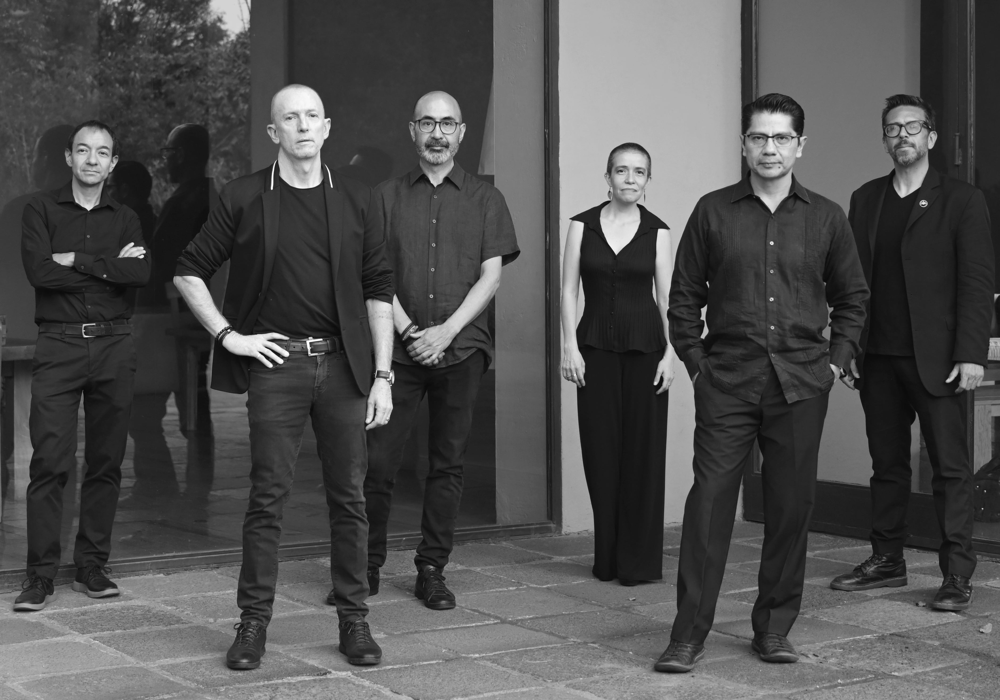

Con casi tres décadas de trayectoria, Ónix Ensamble es un referente
obligado de la música contemporánea en México y el extranjero. Fundado
por Alejandro Escuer, el ensamble se distingue por su compromiso con el
estreno y difusión de obras de compositores vivos, logrando una
identidad sonora única que fusiona el rigor académico con una estética
audaz. Han sido galardonados con múltiples apoyos de instituciones como
la Fundación Rockefeller, el Fonca y el programa México en Escena. Su
discografía, que incluye títulos como *Equinox*, documenta su estrecha
colaboración con figuras como Gabriela Ortiz. Ónix se ha presentado en
foros internacionales de prestigio, desde el Festival Internacional
Cervantino hasta escenarios en Nueva York, París y Tokio, consolidándose
como un ensamble de virtuosos dedicados a expandir el canon musical
contemporáneo a través de la excelencia interpretativa y la innovación
constante.

::: logos

:::

## VIE | NOV 20, 19:00 h - Cepromusic

Pabellón Escénico, Jardín Escénico

### Programa

**Andrea Siano**

-   *Embrace The World* (2025)\*\* `\hfill `{=tex}13'

**David Tellez**

-   *Valle de la Luna* (2020) `\hfill `{=tex}4'

**Pietro Dossena**

-   *Uncluttered* (2020)\*\* `\hfill `{=tex}6'

**Vito Palumbo**

-   *Seeds of Light* (2023) `\hfill `{=tex}15'

**Charles M. Champi**

-   *Denn Bleiben ist nirgends* (2015)\* `\hfill `{=tex}7'

**Tamara Miller**

-   *Digressing* (2021) `\hfill `{=tex}6'

**Ensamble Cepromusic**

Director invitado

Maximiliano Trigo, **flauta** | Arielle Amezcua, **oboe** | Gabriel
Padilla, **clarinete** | Pablo Ramírez, **clarinete bajo** | Ángel
Flores, **fagot** | Alfredo Fenollosa, **corno** | Diego Velásquez,
**trompeta** | Xavier Frausto, **trombón** | Abraham Parra,
**percusión** | Bryan Flores, **percusión** | Francisco García,
**piano** | Dirén Checa, **violín** | Javier Regalado, **violín** |
Juanmanuel Flores, **violín** | Eduardo Cabrera, **viola** | Diego
Gutiérrez, **violonchelo** | Konstantin Evmenkin, **violonchelo** |
Alejandro Motta, **contrabajo** | Juan Cáceres Avitia, **coordinador de nuevas tecnologías aplicadas a la creación musical**

*Beneficiarios del Programa de Residencias Artísticas en Grupos Estables del INBAL*

### Personas compositoras

#### Andrea Siano (Italia, 1997)


Compositor, pianista e intérprete originario de Puglia. Estudió
Composición y Piano en el Conservatorio de Bari y posteriormente
perfeccionó su formación en la Accademia Nazionale di Santa Cecilia de
Roma con Ivan Fedele y Alessandro Solbiati. Actualmente se especializa
en música electrónica en el Conservatorio de Lecce. Ha participado en
diversos proyectos colaborativos en el ámbito de conciertos y ha
recibido numerosos reconocimientos. A través de distintas presentaciones
en Italia y Europa, difunde su música, centrada principalmente en la
composición contemporánea, manteniendo asimismo un interés por
experiencias interdisciplinarias relacionadas con la poesía, la
pedagogía, el teatro y la improvisación experimental. Es profesor de
Práctica de lectura vocal y pianística en el Conservatorio *G. Rossini*
de Pesaro.

##### *Embrace The World*

El título se inspira en la filosofía kantiana, según la cual una
profunda crisis (*krisis*), entendida como una herida incurable, separa
nuestras representaciones interiores de las cosas tal como son en sí
mismas (el mundo nouménico). Esta fractura no solo afecta a la relación
entre el sujeto y la realidad externa, sino también a la relación íntima
del yo consigo mismo. En este contexto, la idea de *mundo* se convierte
en la tensión ideal hacia la síntesis de todos los conocimientos
externos. El ser humano vive y experimenta lo que le rodea porque posee
las herramientas racionales (*logos*) para describirlo. Sin embargo, es
en el *gran abrazo*, inspirado en este camino también por las místicas
visiones poéticas de Sri Aurobindo, donde se realiza el gesto de total
abandono hacia la realidad, descubriendo que interiormente "todo es no
nacido, impalpable, eterno". En el plano musical, la obra proyecta esta
trayectoria especulativa dentro de una rigurosa arquitectura formal. La
pieza se abre con un primer y gran arco temporal. Aquí el magma sonoro
inicial se perfila gradualmente en líneas y figuras geométricas
distintas, dando vida a verdaderas *islas de sonidos* y microtexturas
granulares en las cuerdas. En la parte central se activa una densa
relectura dialógica. A través de motivos, resonancias del piano y
complejos campos armónicos aleatorios, los elementos expuestos se ponen
en mutua relación. La materia musical se condensa progresivamente hasta
alcanzar un punto de máxima saturación acústica. De las ruinas de esta
saturación tímbrica se prepara la llamada *ostinata* de la trompeta, que
emerge como un faro formal y conduce al oyente hacia la coda. En esta
última sección se abren intensos y vibrantes destellos melódicos,
capaces de realizar una síntesis definitiva de toda la experiencia de
escucha.

#### David Tellez (México, 1995)


Egresado de la Escuela Superior de Música del INBAL, ha fortalecido su
formación con Jorge Torres, Georgina Derbez, Arturo Márquez, Frédéric
Durieux y Panayiotis Kokoras, entre otros. Su música se ha interpretado
en el Munal, el MUAC, la Sala Nezahualcóyotl y el Palacio de Bellas
Artes, por instrumentistas y orquestas como Ludwig Carrasco, Ensemble
Dal Niente, Quinteto de Alientos de la Ciudad de México, Cepromusic,
Orquesta Juvenil Universitaria Eduardo Mata y Orquesta Sinfónica
Nacional. En 2020 fue becario de la Cátedra Extraordinaria Arturo
Márquez. En 2024 fue seleccionado en el Programa Permanente de
Fortalecimiento a Jóvenes Compositores del Cepromusic y ganador del
concurso Internacional de Composición para el Quinteto de Alientos de la
Ciudad de México.

##### *Valle de la Luna*

El 8 de octubre de 1963 falleció en la Ciudad de México la artista
española Remedios Varo. Con ella se inmortaliza un legado pictórico
dominado por la fantasía de la magia, el misticismo de los símbolos
medievales y los enigmas del esoterismo y la alquimia. Tomando como
punto de partida una obra luminosísima de la pintora: *Valle de la
Luna*, la exploración sonora de esta pieza se construye con base en el
afecto que causa el cuadro en la percepción, sin tratar, en lo absoluto,
de generar una correspondencia descriptiva, ni mucho menos, puesto que
sería lejano ante la abstracción musical. La apuesta es hacia el color
instrumental, donde se irán tiñendo todos los presagios, todas las
apariciones y los paisajes de noches perdidas, en las que se renuncie al
día tal y como lo hubiera hecho Novalis: "Pero me vuelvo hacia el valle,
a la sacra, indecible, misteriosa noche".

#### Pietro Dossena (Italia, 1979)


Compositor y artista multimedia. Fue primer premio de Composición en el
Conservatorio de Milán, galardonado en el Prix Luigi Russolo y Premio
Arnaldo Rancati del Ayuntamiento de Milán. Es Doctor en Musicología por
la Universidad de Padua y ha realizado estancias de investigación en la
University of California y la Bibliothèque Nationale de París. Es
profesor titular en el Conservatorio de Sassari. Sus obras han sido
interpretadas por Schallfeld Ensemble, Divertimento Ensemble y Nemø, en
festivales de Barcelona, Darmstadt, Graz, Londres, Madrid, Miami, Nueva
York y Zúrich. Entre sus proyectos destacados se cuentan: *Beauty Cage*,
para ensamble espacializado y electrónica, estrenada en Graz;
*Uncluttered*, para ensamble, interpretada por Nemø en Gante y *Traces*,
performance para clarinete, sintetizador modular y vídeo en tiempo real,
presentada en Zúrich, Locarno, Estambul, Miami y Trieste.

##### *Uncluttered*

Fue concebida como un objeto de diseño italiano, o como una habitación
cuidadosamente amueblada: líneas transparentes, detalles precisos,
matices delicados, referencias cruzadas entre categorías sonoras
recurrentes. La idea central fue rechazar todo lo superfluo, reduciendo
significativamente el abanico de posibilidades compositivas, comenzando
por las clases de alturas. Antiexpresionista en su estilo, *Uncluttered*
es, sin embargo, expresiva: está profundamente influenciada por un poco
conocido ensayo de Edgar Allan Poe, "The Philosophy of Furniture", en el
que Poe describe su habitación ideal como "una pequeña cámara no
ostentosa en la que no se puede encontrar defecto alguno en su
decoración". Lo que fascina e inquieta en ese espacio ---su capacidad de
evocar, pese a la claridad racional, una perturbadora sensación de lo
desconocido--- es también el horizonte poético de esta música.

#### Vito Palumbo (Italia, 1972)


Han interpretado sus piezas la Sinfónica de Londres, el Ensemble
Intercontemporain, la Sinfónica de Helsingborgs, la Sinfónica de Gävle,
la Filarmónica de Berlín del Cuarteto de Ateneo, la Sinfónica de la RAI,
la Filarmónica Estatal de Oradea, Norrbotten NEO, Cepromusic,
AuditivVokal Dresden y la Camerata de Berna. A partir de experimentos
posmodernos en el primer período, se centró en algunas formas de teatro
musical, explorando las posibilidades de la voz e investigando diversas
formas de emisión vocal mediante el estudio de los fonemas en muchas
obras dedicadas al teatro musical, junto con algunas influencias de sus
maestros Azio Corghi y Luciano Berio, en la investigación vocal. Su
producción en los últimos años se ha centrado en grandes obras
sinfónicas que representan toda su investigación en otras posibilidades
de los colores y texturas orquestales, pero también en una idea orgánica
de momentos formales interconectados e interdependientes, como una red
de conexiones neuronales.

##### *Seeds of Light*

> «Esta obra es un encargo del Ensemble Intercontemporain. En ella
> desarrollo la idea de la *iridiscencia sonora*, que consiste en
> calibrar un aura sonora sobre un impulso (luz sonora principal), lo
> cual representa el ataque transitorio bajo una lupa mediante una
> orquestación adecuada. La iridiscencia se crea proyectando esta *luz
> sonora* sobre texturas multicapa, lo que genera una reverberación
> artificial (tiempo de decaimiento) de diversos colores debido a las
> interferencias y refracciones que se producen alrededor del sonido
> principal, tal como sucede en el fenómeno óptico de la iridiscencia.
> En mi música actual intento investigar el sonido en diferentes
> componentes definidos jerárquicamente; tenemos un sonido principal
> que, para mí, representa lo que defino como *luz sonora* y que se
> proyecta hacia otras superficies de textura sonora situadas en segundo
> plano, que dan vida a una especie de sombra del sonido principal. Mi
> intención es crear un sonido casi tridimensional que se mueve en el
> espacio y cuyo componente temporal queda prácticamente suspendido.
> Considero mis obras más recientes, *pinturas* en las que se prioriza
> el posicionamiento preciso de los objetos sonoros en el espacio.
> Obviamente, todo esto debe transcurrir en el tiempo, pero en este
> contexto busco un tiempo no lineal, reticular, como si hubiera nodos
> dispersos en el espacio y la música se moviera no en una secuencia
> lineal, sino a través de esta red. La canción conecta con los colores
> y las luces de mi tierra, Puglia, rodeada por el mar, inmersa en el
> punto más emblemático del Mediterráneo».

#### Charles M. Champi (México, 1988)


Es compositor, violinista e investigador, y desde 2007 desarrolla una
práctica de investigación-creación que articula lenguaje musical propio
con pensamiento filosófico y crítico. Su obra aborda temas como el
colapso ambiental, la alienación laboral y las formas musicales del
poder. Ha compuesto piezas instrumentales, mixtas y escénicas,
presentadas en México, Europa y Asia y publicadas por BabelScores y
Diaphonia Edizioni. Ha trabajado con ensambles como Cepromusic, y ha
sido invitado a diversos festivales y coloquios internacionales. Es
egresado de la Facultad de Música de la UANL como violinista concertista
y maestro en Música por la UNAM. Actualmente es profesor de Composición
y Orquestación, y su investigación más reciente explora la posibilidad
de una música poscapitalista como modelo para imaginar nuevas formas de
vida colectiva.

##### *Denn Bleiben ist nirgends*

Está inspirada en las tres primeras elegías de *Elegías de Duino* de
Rainer Maria Rilke. Los pasajes seleccionados son una guía para que el
intérprete sepa de qué tratan las secciones. En su conjunto, la pieza
toma el tema de la entropía como se ve en los estados de la materia:
primero casi a cero grados Kelvin, luego sólido, líquido, gas y plasma.

#### Tamara Miller (Chile, 1992)


Compositora y música experimental radicada en Colonia. Su música se
caracteriza por su versatilidad, explorando diferentes áreas e intereses
desde un inconformismo persistente en su práctica. Su obra abarca desde
la música instrumental y orquestal hasta la instalación y la música
electrónica, centrándose en el ámbito performativo de la interpretación
musical en vivo. Su pieza orquestal *Recuerdo de ahora* ganó el Premio
Ossca de la Orchestra Sinfonica di Salerno Claudio Abbado y el premio
Compositores en Región-Fantasie Musik de la Elbland Philharmonie
Sachsen. Ha colaborado con ensambles y orquestas en Chile, Alemania y a
nivel internacional. Sus composiciones se han presentado en los
festivales Blurred Edges 2025, Münchner Biennale für Neues Musiktheater
2024, Frau\* Musica Nova 2023, MaerzMusik 2022 y Musica Strasbourg 2020.
Oriunda de Santiago, estudió Composición en la Universidad de Chile en
2010 y realizó una maestría en la Hochschule für Musik Carl Maria von
Weber Dresden, seguida de otra Maestría en Composición electrónica en la
Hochschule für Musik und Tanz de Colonia.

##### *Digressing*

Es un cambio constante de momentos, un intercambio entre materiales
sonoros, sin una narrativa o transición necesarias. Se basa en el
funcionamiento del hilo de pensamiento, donde la desviación de un tema,
idea o pensamiento a otro es permanente y, a veces, incontrolable. Como
dice la definición de divagar: desviarse, especialmente del tema
principal de atención o del curso de la argumentación.

------------------------------------------------------------------------

### Intérpretes

#### Cepromusic

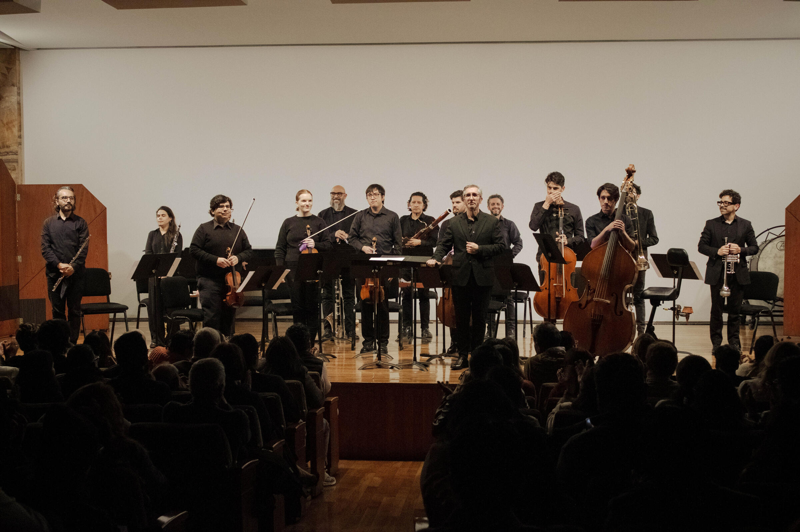

El Centro de Experimentación y Producción de Música Contemporánea
(Cepromusic), creado en 2012, es un espacio en el que convergen
actividades artísticas y académicas en favor de la creación, desarrollo
y difusión de la música contemporánea en México. Además de sus
temporadas regulares en el Palacio de Bellas Artes, el Ensamble
Cepromusic ha realizado diez giras internacionales por Alemania,
Colombia, Escocia, España, Inglaterra, Brasil y Estados Unidos; así como
residencias artísticas y académicas en Colombia, España, Estados Unidos,
México y Reino Unido. En 2018 fue invitado al Festival de Verano de
Darmstadt. El Cepromusic ha tenido residencias y colaboraciones con
compositores e intérpretes como Anna Göckel, Chris Cogburn, Christian
Wolff, Dafne Vicente, Irvine Arditti, James Dillon, John Butcher, Joshua
Fineberg, Kaija Saariaho, Katalin Károlyi, Klaus Lang, Peter Ablinger,
Sigma Project Quartet, Susan Platts, Tiffany DuMouchelle, Tony Arnold,
UMS'n JIP y Ute Wassermann, entre otros. Además de su decidida vocación
latinoamericana, el Ensamble Cepromusic es el instrumento de gran parte
de los compositores mexicanos contemporáneos, habiendo colaborado,
encargado, interpretado y grabado a compositores nacionales de varias
generaciones. El ensamble colabora habitualmente con otras disciplinas
como la fotografía, el video, el teatro, el cine silente, la danza y la
multimedia, y cuenta con tres producciones discográficas. Desde su
creación el ensamble ha ejecutado cuatrocientos conciertos en los que ha
interpretado más de ochocientas obras y trescientos estrenos.

::: logos

:::

## VIE | NOV 20, 19:00 h - Cuarteto Ruvalcaba

Xico. Antigua Sede del Senado

### Programa

**Daniel Cui**

-   *樗栎 \[Chu-li\]* (2026)\*\* `\hfill `{=tex}12'

**Eduardo Viñuela**

-   *Mi ciudad está triste* (2022) `\hfill `{=tex}8'

**Alejandro Ariza**

-   *Sobre un canino llamado "pegamento"* (2025)\* `\hfill `{=tex}8'

**Joselyn Vargas**

-   *Jabbah* (2025)\* `\hfill `{=tex}9'

**Cuarteto Ruvalcaba**\
Fernando Vizcayno, violín I\
Alejandro Serna, violín II\
Roberto Campos, viola\
Rodolfo Jiménez, violonchelo

### Personas compositoras

#### Daniel Cui (China, 1998)


Es un compositor cuya música mezcla historia, filosofía y perspectivas
globales adquiridas en China, Australia y Estados Unidos. En su obra
para orquesta, ensambles de cámara y vocales y medios electroacústicos
explora la tensión entre la disciplina externa y la libertad interna.
Sus composiciones se interpretan internacionalmente por grupos como Wild
Up, San Francisco Contemporary Music Players, Mivos Quartet y
Switch-Ensemble, así como por las sinfónicas de Tesalónica y de Albany.
Ha participado en los festivales Hear Now LA, CAMPGround 24 y MGMC.
Estudia el Doctorado en Composición en la UC San Diego con Lei Liang.
Posee licenciaturas por la Universidad de Indiana y el Conservatorio de
Sídney.

##### *樗栎 (Chu-li)*

El título viene de la antigua parábola de Zhuangzi del árbol inútil.
Este cuarteto de cuerdas explora la tensión entre la rígida estructura
social y la preservación inherente de la naturaleza. Mientras las voces
se fracturan por el sofocante peso de la conformidad mecánica, adquieren
la liberación radical de ser consideradas funcionalmente inútiles.
Guiada por el ritmo natural de la respiración, la obra culmina en una
vibrante celebración de una indómita simetría, creciendo de modo
orgánico hasta una resonancia de autonomía espiritual.

#### Eduardo Viñuela (México, 1976)


Su música se ha presentado en el Foro Internacional de Música Nueva
Manuel Enríquez, las Jornadas INBAL-SACM y el Festival Aires Nacionales
y ha sido interpretada por Irvine Arditti, ensemble recherche, Omar
Hernández-Hidalgo, Gerardo Aponte Cupido y el Cuarteto Aurora, entre
otros. Se han estrenado obras suyas en escenarios de la Ciudad de
México, Nueva York, Chicago y La Haya. Dentro de sus más recientes
trabajos se encuentra el desarrollo de una técnica de composición con el
uso de las teorías matemática Teoría de Grafos, la Combinatoria y las
Estructuras de Incidencia. Es miembro de la Society for Music Theory y
de la Sociedad de Autores y Compositores de México.

##### *Mi ciudad está triste*

La obra fue escrita en homenaje a todas aquellas ciudades que han tenido
que soportar la desolación de una guerra. La obra toma como punto de
partida el poema homónimo de la escritora palestina Fadwa Tuqan:

> «... sin ecos y sin rastros, los niños, las canciones, se perdieron.
> Desnuda, con los pies ensangrentados, la tristeza se arrastra en mi
> ciudad; el silencio domina mi ciudad, un silencio plantado como monte,
> oscuro como noche...»

El discurso sonoro es interrumpido constantemente por "un terrible
silencio, que transporta el peso de la muerte y la derrota". No
obstante, se debe de mantener la lucha y la esperanza, razón por la cual
se utiliza un fragmento de la antífona *O rubor sanguinis* de Hildegard
von Bingen en la que la sangre que desciende es convertida en flor. En
palabras de la poetisa: "Solo quiero morir en mi tierra, que me
entierren en ella para resucitar siendo hierba en mi tierra, resucitar
siendo flor que deshoje un niño crecido en mi patria".

#### Alejandro Ariza (México, 2001)


Nacido en Celaya. Realizó estudios de bachillerato musical con
especialización en piano en el Conservatorio de Música de Celaya. Inició
su formación en composición en 2022 bajo la guía de Guillermo Diego.
Actualmente cursa el segundo año de la Licenciatura en Composición en la
Facultad de Música de la UNAM (FaM), bajo la tutoría de Gabriela Ortiz.
Su obra ha sido interpretada en el Foro Internacional de Música Nueva
Manuel Enríquez, el Festival de Música de Cámara de Atlixco y el
Festival Yuuban, entre otros. Ha acumulado logros a nivel estudiantil,
nacional e internacional, entre los que destacan el Concurso de Música
de Cámara Femca, mención honorífica en la convocatoria latinoamericana
del Cuarteto Atanor y obra electroacústica ganadora por los 25 años del
LIMME de la FaM.

##### *Sobre un canino llamado "pegamento"*

Explora la fricción, la energía y la condición rítmica del cuarteto de
cuerdas a partir de gestos influenciados por el rock, el metal y ciertos
rasgos de la estética del shoegaze. La obra desarrolla un vocabulario
sonoro en que el ruido funciona como un elemento percusivo, contrastado
por una atmósfera de armónicos que aporta suspensión y ligereza. Aunque
el título sugiere una figura aparentemente doméstica, su presencia es
deliberadamente irónica, no propone un programa narrativo. El resultado
es una pieza en la que el cuarteto se aproxima, por momentos, a la
intensidad de una banda eléctrica sin renunciar a su naturaleza
acústica.

#### Joselyn Vargas (México, 1996)


Compositora, pianista y docente mexicana originaria de Hermosillo. Es
maestra en Música con énfasis en Composición por la Universidad
Veracruzana donde estudió con José Saldaña y Emil Awad. Inició su
formación profesional en la Universidad de Sonora, donde se desarrolló
como pianista con Pedro Vega y estudió composición con Marco Encinas. Ha
participado en los festivales Internacional Camerata 21 en Xalapa y
Cultural Álamos Pueblo Mágico 2023. Su música ha sido interpretada por
la OFUNAM dentro del programa Jazz Sinfónico Mexicano, bajo la dirección
de Vince Mendoza. En 2025 fue seleccionada para el Berlin Transatlantic
Composers Workshop en Alemania, así como para el Score Production
Workshop en Joy Music House en Nueva York. En 2026 fue seleccionada para
asistir al So Percussion Summer Institute en la Universidad de Princeton
y fue admitida en el Emerging Composers Intensive en Hidden Valley Music
Seminars, en California. Es docente independiente, imparte clases de
piano, teoría musical, armonía, composición y arreglos.

##### *Jabbah*

Nombrada a partir de una estrella de la constelación de Escorpio, es una
obra que reflexiona sobre el viaje humano a través de lo inesperado. Al
igual que las estrellas que iluminan caminos desconocidos, esta obra
busca evocar resiliencia, transformación y belleza en medio de los
altibajos de la vida. El cuarteto de cuerdas se despliega aquí como un
microcosmos de contrastes: momentos de calma introspectiva entrelazados
con estallidos de energía y tensión. Las texturas y dinámicas de los
instrumentos se combinan para pintar un paisaje sonoro en constante
evolución, representando la capacidad de adaptarse frente a la
incertidumbre. La estructura de *Jabbah* refleja los giros impredecibles
del recorrido, con pasajes que sugieren preguntas sin respuesta y que
eventualmente encuentran claridad y resolución. Es una música que invita
a cada oyente a descubrir su propia constelación interior, navegando
entre la oscuridad y la luz. Esta obra no es solo un tributo a los
misterios del cosmos, sino también una exploración de la experiencia
humana: nuestra lucha por seguir adelante, por brillar y encontrar
nuestro lugar en el universo, incluso cuando el camino no está claro.

------------------------------------------------------------------------

### Intérpretes

#### Cuarteto Ruvalcaba


Ganó el Concurso Nacional de Cuartetos de Cuerda Cuarteto
Latinoamericano. Su repertorio abarca distintas épocas y estilos
musicales, con un énfasis especial en el repertorio mexicano y
latinoamericano. Se ha presentado en la Sala Manuel M. Ponce del Palacio
de Bellas Artes, la Sala Carlos Chávez, el Museo Nacional de Arte y el
Centro Cultural San Pablo y el Auditorio Mateo Herrera, entre otros
recintos. Ha participado en el Festival Artístico de Otoño, realizó una
residencia en la Cátedra Eduardo Mata de la UNAM y formó parte del
proyecto Raíces y Resonancias. Ha tomado clases magistrales con el
Cuarteto Penderecki, el Cuarteto Latinoamericano, el Trío Maisky, el
Ensamble Curtis, Scott Yoo, Jorge Risi, Arón Bitrán y Felicia Moye. En
2020 grabó la banda sonora de la película *El hijo de Monarcas*,
dirigida por Alexis Gambis, que ha recibido varios premios
internacionales. Ha colaborado con los solistas mexicanos Pablo Garibay,
Miguel Ángel Villanueva e Irasema Terrazas. El nombre del cuarteto honra
la memoria de Higinio Ruvalcaba (1905-1976), destacado violinista y
compositor mexicano, integrante del Cuarteto Léner.

::: logos

:::

## SÁB | NOV 21, 12:00 h - Cuarteto de Bellas Artes: Enríquez 100

Sala Manuel M. Ponce, Palacio de Bellas Artes

---

**Jornadas INBAL-SACM 2026. Integral de los cuartetos de cuerda de Manuel Enríquez**

### Programa

**Manuel Enríquez**

-   Cuarteto de cuerda núm. 1 (1957) `\hfill `{=tex}13'

    -   *Enérgico*
    -   *Tranquilo*
    -   *Festivo*

-   Cuarteto de cuerda núm. 2 (1967) `\hfill `{=tex}12'

    -   I - II - III

-   Cuarteto de cuerda núm. 3 (1973) `\hfill `{=tex}12'

-   Cuarteto de cuerda núm. 4 (1984) `\hfill `{=tex}14'

    -   I - II - III

-   Cuarteto de cuerda núm. 5, *Xopan Cuícatl* (1988) `\hfill `{=tex}14'

**Cuarteto de Cuerdas de Bellas Artes**\
Ilya Ivanov, violín\
Carlos Quijano, violín\
Félix Alanís, viola\
Manuel Cruz, violonchelo

*En colaboración con la Sociedad de Autores y Compositores de México.*

### Personas compositoras

#### Manuel Enríquez (México, 1926-1994)


Originario de Ocotlán, Jalisco, fue una figura fundamental de la
vanguardia musical en México. Se formó con Áurea Corona y Miguel Bernal
Jiménez, perfeccionándose después en la Juilliard School con Ivan
Galamian y Peter Mennin. En 1961, gracias a la beca Guggenheim,
incursionó en la música electrónica en Columbia y Princeton bajo la guía
de Stefan Wolpe. Como violinista, fue concertino de la Sinfónica de
Guadalajara y fundó el célebre Cuarteto México, con el que realizó giras
por Europa y América. Su labor docente y administrativa fue vasta:
dirigió el Conservatorio Nacional y el Cenidim, donde impulsó la
investigación electroacústica y virreinal. En 1979 fundó el Foro
Internacional de Música Nueva (que hoy lleva su nombre), espacio vital
para la difusión de la creación contemporánea. Distinguido como Creador
Emérito y miembro de la Academia de Artes, su legado permanece como
pilar de la identidad musical mexicana del siglo XX.

##### Cuartetos de cuerda núms. 1 a 4

Los cuatro Cuartetos de Cuerdas de Manuel Enríquez, escritos a lo largo de cuatro décadas, muestran de manera clara varias de las técnicas de composición utilizadas por Enríquez a lo largo de su evolución estilística: politonalidad y atonalidad sustentadas en formas clásicas; elementos rítmico-melódicos de corte nacionalista; abandono progresivo de formas tradicionales, tanto a nivel de la obra entera como de los movimientos individuales; apertura de ciertos parámetros; técnicas aleatorias; notación gráfica y semigráfica y la recuperación de ciertos elementos tradicionales, transformados, que Enríquez hace a partir de los años 1980. Estas obras muestran también la incorporación y el desarrollo gradual de los motivos rítmico-melódicos y de los elementos expresivos que conforman el lenguaje característico de Enríquez. Pero de manera más significativa aún, los Cuartetos muestran el lirismo llevado al extremo, la expresión de un dramatismo poco común en la música mexicana que subyace como una constante en toda la obra de Enríquez y al servicio de la cual se encuentran técnicas composicionales y elementos estilísticos.

Los dos movimientos exteriores del primer Cuarteto adoptan las tradicionales formas sonata y rondó A-B-A-C-A, que con la adición en ambos casos de una introducción y una coda con el mismo material se transforman en formas arco. A pesar de sus ritmos vivos, la alternancia de 6/8 y 5/8 y el desplazamiento de los acentos, rasgos que emparientan a este Cuarteto con muchas obras de estilo nacionalista en México, el uso constante de intervalos de gran tensión e inestabilidad en la construcción de las melodías, elemento estilístico característico de toda la producción de Enríquez, lo transforma en una obra altamente personal. En el segundo movimiento el tipo de expresividad que se logra en los temas básicos mediante este recurso se ve realzado en el fondo inexpresivo y casi mecánico sobre el cual ambas melodías están colocadas. Este es un procedimiento que Enríquez utiliza constantemente y con gran habilidad en la mayor parte de sus obras.

El segundo Cuarteto de Cuerdas es, junto con *Ambivalencia* para violín y violonchelo del mismo compositor, la primera obra mexicana en la que se utiliza la escritura gráfica. Con ello, las alturas y ritmos específicos de algunas secciones y, hasta cierto punto, el tempo y la forma, se dejan al azar o a la decisión de los intérpretes. Este Cuarteto, en el que encontramos elementos derivados de la música electrónica, conserva una estructura en tres movimientos: dos de *tempo* vivo y un movimiento central lento, bipartita. En este movimiento, particularmente intenso, predominan los matices *p* a *pp*. Una de sus secciones consiste enteramente en un tejido de melodías de intervalos de gran lirismo. La segunda parte del tercer movimiento está formada por elementos motívicos que nos remiten a movimientos anteriores, lo que podría constituir una reminiscencia de los principios cíclicos de construcción formal.

En el Cuarteto III, Enríquez abandona la estructura en varios movimientos para incorporar en uno solo secciones de gran actividad instrumental y dinámica, así como secciones de dinámica y *tempi* más suaves. A nivel general, el tercer Cuarteto tiene una gran forma arco en la que la parte central es una sección abierta en cuanto a estructura, tempo y ritmo. Internamente el Cuarteto se estructura con base en tensiones y distensiones que yuxtaponen segmentos de intensidad manifiesta con segmentos aparentemente *senza espressione* y *senza movimento* que no están exentos de gran tensión. En este Cuarteto reaparecen, entrelazados o por secciones, elementos característicos del lenguaje de Enríquez, como son los *ostinati* rítmico-armónicos; los arpegios repetidos en las cuatro cuerdas; las *cascadas* de sonidos cortos; las superposiciones de sonidos *tenuti*, *senza vibrato*; y la oposición de dos planos expresivos diferentes. Ejemplo de este último elemento es el final del Cuarteto III, que está estrechamente emparentado con el final del último movimiento del Cuarteto IV y encuentra sus variantes en los finales del segundo y el tercer movimiento de este mismo cuarteto. Esta oposición de planos expresivos paralelos, diferentes e indiferentes entre sí, es quizá el recurso expresivo más característico de Enríquez y constituye el elemento unificador del cuarto Cuarteto, en el que la oposición se da constantemente y de diferentes maneras: en valores rítmico-temporales aumentados o disminuidos, en dos instrumentos contra los otros dos, a nivel de toda una sección o a nivel motívico.

El Cuarteto IV, en el que Enríquez retoma la estructura en tres movimientos, es una de las obras más logradas del compositor. En él, los diferentes motivos que conforman el lenguaje de Enríquez reciben un tratamiento más amplio y muchos de ellos constituyen por sí solos el elemento a partir del cual toda una sección se desarrolla. Finalmente, hay que hacer notar en este Cuarteto una revaloración del elemento melódico —y, por lo tanto, lírico— que se da incluso en las secciones abiertas (por oposición a obras anteriores en las que este tipo de secciones están constituidas por eventos sonoros muy cortos), así como la presencia de elementos musicales mexicanos, presencia que se deja sentir en las citas de la *Sinfonía India* de Carlos Chávez.

\hfill Leonora Saavedra

##### Cuarteto de cuerda núm. 5, *Xopan Cuícatl*

*Xopan Cuícatl*, cantos de primavera en náhuatl, es el último de los cinco cuartetos de cuerda de Manuel Enríquez. Compuesta en 1988, la obra establece un diálogo entre la memoria del mundo prehispánico y el lenguaje musical contemporáneo. Enríquez no busca reconstruir una música indígena antigua, sino evocar su atmósfera mediante el timbre, la textura y el gesto sonoro. La escritura alterna pasajes de gran precisión con momentos de libertad, explorando las posibilidades expresivas de las cuatro cuerdas y creando un discurso de contrastes, tensiones y transformaciones constantes. El título sugiere una imagen de renovación: la primavera como metáfora de una memoria que vuelve a florecer, transformada por la sensibilidad de un compositor mexicano del siglo XX. La obra está dedicada al compositor y director estadounidense Joel Thome.

------------------------------------------------------------------------

### Intérpretes

#### Cuarteto de Cuerdas de Bellas Artes


Se fundó en Xalapa en 2015. Su repertorio incluye tanto a compositores
fundamentales como Haydn, Mozart y Beethoven, como a autores del siglo
XX y XXI, entre ellos Ravel, Bartók y Shostakovich. El Cuarteto concede
especial relevancia a la música latinoamericana, particularmente a la
obra de compositores mexicanos, la cual ha presentado en el Foro
Internacional de Música Nueva Manuel Enríquez, el Festival Expresiones
Contemporáneas y el Festival NUNTEMPA. Sus integrantes realizaron
estudios de posgrado de manera individual y, como ensamble, cursaron la
Maestría en Ejecución en Cuarteto de Cuerdas en la Universidad de
Victoria, Canadá, bajo la tutela del Lafayette String Quartet. Además,
ha recibido asesorías artísticas de los cuartetos Latinoamericano,
Penderecki, American, St. Petersburg, Dover, Arianna y José White, así
como de músicos como James Ehnes, Paul Katz, Ivo Jan Van der Werff,
Gerald Stanick y Alan Durbecq. El Cuarteto ha impartido seminarios y
clases magistrales en Brasil, Costa Rica, Estados Unidos, Canadá y
España, además de diversas universidades y ciudades de México. Ha sido
galardonado con distinciones entre las que destacan el Premio Manuel M.
Ponce del Festival de Música de Cámara de Aguascalientes, el Premio Raíz
México y el Primer Lugar del Concurso Nacional de Música de Cámara Mateo
Oliva, entre otros reconocimientos. El Cuarteto se ha presentado como
solista con las orquestas Sinfónica de Xalapa, de Cámara de Bellas Artes
y Sinfónica de Heredia, entre otras. Asimismo, ha participado en los
festivales internacionales Quartet Fest West, en Canadá, de Cuerdas de
la Universidad Nacional de Costa Rica, Internacional de Música de
Morelia y de Música de Cámara de San Miguel de Allende. Algunas de sus
grabaciones se han difundido en radio y han formado parte de filmes
independientes y cortometrajes.

::: logos

:::

## SÁB | NOV 21, 17:00 h - Ensamble Sonus

Sala Manuel M. Ponce, Palacio de Bellas Artes

### Programa

**Pascal Dusapin**

-   *By the Way* (2014)\*\* `\hfill `{=tex}13'

**Sofia Gubaidulina**

-   *Dots, Lines and Zigzag* (1976)\*\* `\hfill `{=tex}12'

**Poul Ruders**

-   *Throne* (1988)\*\* `\hfill `{=tex}12'

**David Bennett Thomas**

-   *Edifice* (2008) `\hfill `{=tex}10'

**Uriel Imanol Pacheco**

-   *Sodoma* (2021)\* `\hfill `{=tex}8'

**Krzysztof Penderecki**

-   Tres miniaturas para clarinete y piano (1956) `\hfill `{=tex}4'
    -   *Allegro*
    -   *Andante cantabile*
    -   *Allegro ma non troppo*

**Ensamble Sonus**\
Pablo Ramírez Márquez, clarinete y clarinete bajo\
Pablo Miró Cortez, piano

### Personas compositoras

#### Pascal Dusapin (Francia, 1955)


Es uno de los compositores franceses más destacados de la música
contemporánea. Su catálogo abarca obras de cámara, sinfónicas, vocales y
escénicas, y se distingue por una escritura de gran exigencia formal,
imaginación sonora y fuerte identidad expresiva. Cercano en su formación
al entorno intelectual de Iannis Xenakis, Dusapin desarrolló un lenguaje
propio, atento al gesto, al color, a la tensión y la energía del sonido.
Su música evita los moldes convencionales y propone una escucha intensa,
basada en la vitalidad del trazo sonoro y en la construcción de formas
orgánicas. Su obra ha sido difundida internacionalmente por solistas,
ensambles y orquestas de primer nivel y ocupa un lugar central en la
creación musical europea de las últimas décadas.

##### *By the Way*

Reúne cinco piezas para clarinete y piano en las que Dusapin explora una
escritura concentrada, móvil y de gran refinamiento tímbrico. La obra
articula gestos breves, trayectorias flexibles y contrastes de energía
dentro de un discurso fragmentario pero orgánico, donde ambos
instrumentos construyen un espacio de tensión, resonancia y color. Lejos
de un desarrollo temático tradicional, estas piezas proponen una escucha
atenta al perfil del sonido, al impulso del trazo musical y a la
relación cambiante entre continuidad e interrupción. Por su economía de
medios, precisión expresiva y riqueza de matices, *By the Way*
constituye una muestra representativa del lenguaje camerístico de
Dusapin. La obra figura en el catálogo de Salabert/Durand y en la base
de IRCAM y fue un encargo del ensamble Accroche Note de Estrasburgo.

#### Sofia Gubaidulina (Rusia, 1931 -- Alemania, 2025)


Fue una de las compositoras más importantes de música contemporánea de
los siglos XX y XXI. Nacida en Chístopol, en la antigua Unión Soviética,
desarrolló un lenguaje profundamente personal, caracterizado por la
exploración tímbrica, la intensidad espiritual y una concepción del
sonido como proceso expresivo y simbólico. Su obra abarca música de
cámara, sinfónica y concertante, y ha sido interpretada
internacionalmente por solistas, ensambles y orquestas de gran
prestigio. En su catálogo, el uso de combinaciones instrumentales
inusuales y la atención al color sonoro ocupan un lugar central.

##### *Dots, Lines and Zigzag*

Condensa varios rasgos esenciales del lenguaje de Gubaidulina. En esta
obra, la compositora convierte el gesto musical en trazo: puntos, líneas
y quiebres se transforman en materia sonora viva. Lejos de un discurso
narrativo tradicional, la pieza articula tensión, silencio, impulso y
resonancia mediante una escritura concentrada, de gran refinamiento
tímbrico y fuerte exigencia expresiva para ambos intérpretes. El
clarinete bajo despliega una voz oscura, flexible y profundamente
física, mientras el piano prolonga, confronta o interrumpe ese recorrido
con precisión casi gráfica. El resultado es una obra breve e intensa,
representativa del pensamiento sonoro de Gubaidulina y de su capacidad
para convertir lo abstracto en experiencia musical de gran fuerza. La
obra fue escrita en 1976 para clarinete bajo y piano; un encargo de Emma
Kovárnová y Josef Horák.

#### Poul Ruders (Dinamarca, 1949)


Su catálogo abarca música de cámara, sinfónica y escénica y su obra se
distingue por una escritura de gran fuerza expresiva, claridad formal y
riqueza tímbrica. Su lenguaje integra tensión dramática, imaginación
sonora y un tratamiento altamente personal del color instrumental, capaz
de articular contrastes intensos dentro de estructuras rigurosamente
construidas. En su música conviven energía, refinamiento, densidad y una
marcada capacidad para generar atmósferas de gran intensidad poética.
Sus obras han sido interpretadas internacionalmente por solistas,
ensambles y orquestas de primer nivel y ocupan un lugar relevante dentro
de la creación musical europea contemporánea.

##### *Throne*

Compuesta por encargo del clarinetista sueco Håkan Rosengren, *Throne*
está concebida como una forma de arco y puede entenderse, en palabras
del propio compositor, como "una larga línea de clarinete", reflejada y
prolongada por el piano. La obra despliega una tensión continua entre
impulso, resonancia y contención, dentro de una escritura de gran
concentración tímbrica y expresiva. Ruders la describió como un poema
abstracto sobre la transitoriedad de la vida, y en su portada asoció el
título con una serie de imágenes que van de la elevación y la gloria a
la fragilidad, el declive y la nada. El resultado es una pieza breve e
intensa, de gran densidad sonora y fuerte carga simbólica.

#### David Bennett Thomas (Estados Unidos, 1969)


Compositor cuyo catálogo abarca música coral, vocal, de cámara y obras
para instrumentos de registro grave, con especial atención al clarinete
bajo y a combinaciones tímbricas poco convencionales. Su producción
revela un interés sostenido por el color instrumental, la claridad
formal y la construcción de discursos sonoros de fuerte identidad
expresiva. En su música convergen un refinado cuidado por la textura, un
sentido preciso del perfil melódico y rítmico y una atención especial a
las posibilidades tímbricas de cada formación. Su escritura combina
solidez estructural, imaginación tímbrica y una voz musical claramente
reconocible.

##### *Edifice*

El compositor construye una obra de gran concentración tímbrica y
estructural a partir del diálogo entre clarinete bajo y piano. Lejos de
una retórica expansiva, la pieza se desarrolla como una arquitectura
sonora de líneas tensas, resonancias profundas y contrastes de densidad,
donde ambos instrumentos participan en la formación gradual de un
discurso compacto pero dinámico. El título sugiere una idea de
construcción: un edificio sonoro levantado mediante capas de energía,
gesto y color. El clarinete bajo despliega una voz amplia, oscura y
flexible, mientras el piano aporta relieve, impulso y profundidad
armónica. El resultado es una obra breve e intensa, de fuerte presencia
formal y gran eficacia escénica, representativa del interés del
compositor por las combinaciones instrumentales poco frecuentes y por un
lenguaje camerístico de gran claridad expresiva.

#### Uriel Imanol Pacheco (México, 2000)


Compositor, productor musical y músico originario de Oaxaca. Finalizó
estudios de Composición en la Escuela Superior de Música del INBAL con
Georgina Derbez, Alejandro Romero y Josué Peregrina. En 2019 fundó
PlicAud-Records, productora audiovisual con la que ha grabado más de
doscientos videos y producido seis álbumes de estudio. Ha sido becario
del PECDA Oaxaca 2020 y 2022, Jóvenes Creadores como Creador con
trayectoria en 2025 y ganó los concursos de composición *Armando Luna*
en 2019 y Salvador Contreras en 2022. Fue finalista del Concurso
Nacional de Composición de Morelia 2022 y seleccionado para la Cátedra
Arturo Márquez 2023. Su música ha sido interpretada en Argentina, Chile,
Estados Unidos, Austria y México. Es ingeniero asistente de grabación en
la Sala Nezahualcóyotl y asistente de producción y bibliotecario del
Cepromusic.

##### *Sodoma*

Aborda el exceso y el descontrol desde lo prohibido y lo profano,
derivando en una experiencia agitada, violenta y percusiva.

#### Krzysztof Penderecki (Polonia, 1933-2020)


Fue uno de los compositores y directores de orquesta más influyentes de
la música contemporánea europea. Su obra abarca repertorio sinfónico,
coral, escénico y de cámara, y se distingue por una intensa imaginación
sonora, un profundo sentido dramático y una constante transformación de
lenguaje a lo largo de su trayectoria. Figura central de la vanguardia
de la segunda mitad del siglo XX, desarrolló una escritura marcada por
la exploración tímbrica, la tensión expresiva y la fuerza del gesto
musical. Con el tiempo, su catálogo incorporó también una relación más
visible con la tradición, sin perder densidad ni personalidad. Sus obras
han sido interpretadas por los principales ensambles y orquestas del
mundo, y ocupan un lugar fundamental en la historia musical de los
siglos XX y XXI.

##### Tres miniaturas para clarinete y piano

Muestran una faceta concentrada y sumamente eficaz de la escritura
camerística de Penderecki. A partir de formatos breves, la obra condensa
contraste, claridad gestual y una gran vivacidad rítmica. Los tres
movimientos construyen una secuencia equilibrada entre impulso, lirismo
y brillantez final, permitiendo al clarinete y al piano desplegar un
diálogo ágil, incisivo y expresivo. En esta partitura Penderecki revela
su capacidad para trabajar con economía de medios sin perder intensidad
ni carácter. La obra combina precisión formal, imaginación del trazo
musical y una fuerte presencia escénica, y constituye una aportación
particularmente atractiva al repertorio para clarinete y piano por su
concisión, variedad y eficacia de concierto.

------------------------------------------------------------------------

### Intérpretes

#### Ensamble Sonus


Su propuesta articula exploración sonora rigurosa con un repertorio que
abarca obras del siglo XIX al XXI, privilegiando la dotación
clarinete/clarinete bajo y piano. El dúo, integrado por Pablo Miró y
Pablo Ramírez, rescata obras poco interpretadas e incorpora estrenos y
repertorio contemporáneo en distintos foros. Sonido, idea y presencia
definen la identidad artística del ensamble. Cada programa se investiga
con rigor y se presenta con convicción interpretativa, fuerza tímbrica y
con presencia escénica plena.

Pablo Ramírez es clarinetista, compositor y diseñador sonoro, egresado
de la Escuela Superior de Música del INBAL (ESM). Fue músico residente
de la Compañía Nacional de Teatro y actualmente es docente y
clarinetista bajo residente en el Cepromusic.

Pablo Miró es Doctor en Música por la Universidad de Montreal, pianista
con trayectoria en Europa y América y profesor de Piano y Música de
Cámara en la ESM.

## SÁB | NOV 21, 19:00 h - CLAUSURA: Tambuco

Sala Principal, Palacio de Bellas Artes

**Concierto de clausura**

------------------------------------------------------------------------

### Programa

**Marcela Rodríguez**

-   *De las nocturnas aves* (2026)\* `\hfill `{=tex}15'
    -   *Divertimento*
    -   *Lento*
    -   *Acelerado*

**Alejandro Cardona**

-   *Kumbes Kumba Kumbé (toques cimarrones II)* (2026)\*
    `\hfill `{=tex}15'

**Manuel Enríquez**

-   *Políptico* (1983) `\hfill `{=tex}12'

**Federico Ibarra**

-   *La chute des anges* (1983) `\hfill `{=tex}13'

**Kaija Saariaho**

-   *Trois rivières* (1994) `\hfill `{=tex}15'

**Tambuco Ensamble de Percusiones**\
Ricardo Gallardo, director artístico\
Alfredo Bringas\
Miguel González\
Raúl Tudón

### Personas compositoras

#### Marcela Rodríguez (México, 1951)


Cuenta con varios conciertos sinfónicos para instrumento y orquesta: dos
conciertos de piano, guitarra, dos de percusiones, violonchelo, dos de
flautas dulces, para violín y orquesta, y obras orquestales y de cámara.
Sus conciertos han sido estrenados por las orquestas más importantes de
México. Ha compuesto música para teatro y danza. A nivel internacional,
sus obras han sido interpretadas en el Carnegie Hall de Nueva York, y
por las orquestas Sinfónica Simón Bolívar de Venezuela y Sinfónica de
Atenas, entre otras. Su ópera *Las cartas de Frida* se presentó todo
2011 en la Ópera de Heidelberg, Alemania, y en 2013 se estrenó en
México. Pertenece desde 1994 al Sistema de Creadores. Ha organizado
varios encuentros de música mexicana en el extranjero como Mexartes en
Alemania, y el Festival Puentes con México y España, entre otros.

##### *De las nocturnas aves*

Fue concebida originalmente como un homenaje a Tambuco, con motivo del
30 aniversario del ensamble. La obra nació como un Divertimento para
cuatro marimbas y, posteriormente, a partir del diálogo entre la
compositora y Ricardo Gallardo, se amplió hasta convertirse en una
composición en tres movimientos: *Divertimento*, *Lento* y *Acelerado*.
El primer movimiento conserva el carácter festivo y lúdico sugerido por
su título. La escritura para cuatro marimbas explora las posibilidades
melódicas, rítmicas y contrapuntísticas de este instrumento, cuya
riqueza tímbrica permite a la percusión asumir un papel simultáneamente
armónico, melódico y polifónico. El segundo movimiento incorpora
materiales provenientes de *Mural*, concierto para Tambuco y orquesta
sinfónica. Rodríguez retoma aquí un tema de Tomás Luis de Victoria
sometiéndolo a un proceso de variación y transformación. Las cuatro
marimbas son ejecutadas con arco, acompañadas por platillos suspendidos,
creando un universo sonoro de resonancias prolongadas y una particular
cualidad contemplativa. La referencia a Victoria establece, así, un
puente entre la tradición musical y una exploración contemporánea del
timbre y la resonancia. En el último movimiento de la obra, el proceso
de transformación adquiere una dimensión esencialmente tímbrica. Las
cuatro marimbas van cediendo gradualmente su identidad sonora a cuatro
*temple blocks*. El tránsito de un instrumento de resonancia prolongada
y definida hacia otro de ataque seco y percusivo modifica
progresivamente el carácter del discurso musical y acentúa su impulso
acelerado. La obra puede entenderse, en este sentido, como un recorrido
de transformación: de la celebración inicial a la introspección y,
finalmente, hacia una creciente concentración de energía. A través de
las marimbas, los arcos, los platillos suspendidos y los *temple
blocks*, Marcela Rodríguez construye un espacio donde la percusión
trasciende su dimensión estrictamente rítmica para convertirse en
materia melódica, armónica, resonante y expresiva. Dedicada a Tambuco,
la obra es también testimonio de una relación creativa sostenida entre
compositora e intérpretes, en la que la exploración del instrumento y la
colaboración artística forman parte esencial del proceso de creación.

#### Alejandro Cardona (Costa Rica, 1959)


Compositor y guitarrista. Comenzó tocando diversas músicas populares y
tradicionales. Estudió composición con Luis Jorge González. Sus estudios
superiores se llevaron a cabo en la Universidad de Harvard con Leon
Kirchner, Ivan Tcherepnin y Curt Cacioppo, la Escuela Superior de Artes
de Utrecht, Países Bajos, donde concluyó la maestría, así como en la
Facultad de Música de la UNAM, donde terminó sus estudios doctorales. Ha
vivido y trabajado durante los últimos cuarenta y dos años entre Costa
Rica y México. Fue maestro de Teoría y Composición en la Universidad
Nacional de Costa Rica. Trabaja como compositor independiente y
productor de grabaciones de su música. Ha participado en foros y
festivales internacionales y su música ha sido interpretada y grabada en
América y Europa. En Costa Rica ha sido cuatro veces Premio Nacional
Aquileo J. Echeverría en Música y su obra orquestal, *Son mestizo II,*
formó parte de disco ganador de un Grammy Latino, *Música de
Compositores Costarricenses Vol. 2*, grabado por la Orquesta Sinfónica
Nacional de Costa Rica.

##### *Kumbes Kumba Kumbé (toques cimarrones II)*

Esta obra fue compuesta expresamente para el Ensamble de Percusión
Tambuco. Forma parte de una serie de piezas para percusión que son una
*reflexión sonora* sobre la resistencia africana en Latinoamérica y el
Caribe, en particular el cimarronaje, un ejemplo sobresaliente de
dignidad y lucha, que desafía una situación radical de
desterritorialización y mutilación cultural y humana. Es uno de los
intentos más vigorosos de construcción de sentido existencial colectivo:
los reductos (palenques, cumbes, quilombos, etc.) que establecieron los
cimarrones fueron constituidos por africanos de diferentes etnias,
pueblos, grupos lingüísticos, posiciones sociales y géneros, en un
proceso complejo de interacción y cohesión a partir de lo que podríamos
llamar fragmentos existenciales, sociales y culturales, con diversos
grados de continuidad con respecto al referente de origen. Así, la
música de esta obra, que incorpora mundos sonoros de origen africano y
afroamericano ---en un contexto de contradicciones, roces y
desencuentros todavía vigentes en nuestras sociedades--- propone una
metáfora y un diálogo sociomusical que busca crear una suerte de nueva
*territorialización* a partir del mundo sonoro emergente. Tiene tres
secciones que se podrían denominar, a partir de la tímbrica dominante de
cada una, toques de metal, toques de semilla y madera y toques de cuero
(tambor). Estos mundos tímbricos se acumulan como resonancias a través
de la obra, así como se han acumulado históricamente en nuestra
sensibilidad musical. El título proviene de tres palabras que se
originan en grupos bantúes de África Central: *kumbes, kumba, kumbé.
Kumbes* (o *cumbes*), se refiere a los refugios/comunidades organizadas
por cimarrones en diversas partes de Latinoamérica y el Caribe. Los
españoles daban este nombre a los africanos que vivían en Bata (Guinea
continental española, actualmente Guinea Ecuatorial). *Kumba* (o
*cumba*) significa rugir, griterío o escándalo festivo. *Kumbé* (*cumbé*
o *nkumba*) fue usado genéricamente en la América de los siglos XVII y
XVIII para denominar un "baile de negros" (posiblemente un antecesor de
la cumbia). *Nkumba* se refiere al ombligo o a bailar ombligo con
ombligo y se asocia, también, con la rumba congoleña (un género que
reincorpora en África ciertas transformaciones musicales de africanos en
las Américas). Según el investigador cubano Fernando Ortiz, *kumba*,
*kumbé* y *kumbí* significan tambores o bailes.

#### Manuel Enríquez (México, 1926-1994)


Originario de Ocotlán, Jalisco, fue una figura fundamental de la
vanguardia musical en México. Se formó con Áurea Corona y Miguel Bernal
Jiménez, perfeccionándose después en la Juilliard School con Ivan
Galamian y Peter Mennin. En 1961, gracias a la beca Guggenheim,
incursionó en la música electrónica en Columbia y Princeton bajo la guía
de Stefan Wolpe. Como violinista, fue concertino de la Sinfónica de
Guadalajara y fundó el célebre Cuarteto México, con el que realizó giras
por Europa y América. Su labor docente y administrativa fue vasta:
dirigió el Conservatorio Nacional y el Cenidim, donde impulsó la
investigación electroacústica y virreinal. En 1979 fundó el Foro
Internacional de Música Nueva (que hoy lleva su nombre), espacio vital
para la difusión de la creación contemporánea. Distinguido como Creador
Emérito y miembro de la Academia de Artes, su legado permanece como
pilar de la identidad musical mexicana del siglo XX.

##### *Políptico*

En esta obra, Enríquez explora la percusión como un universo de
posibilidades tímbricas, texturales y expresivas. La obra está
estructurada en tres movimientos que se interpretan ininterrumpidamente,
concebidos como diferentes perspectivas de un mismo espacio sonoro. Uno
de sus principales rasgos es la experimentación politímbrica: una amplia
diversidad de instrumentos ---membranas, metales, maderas y otros
objetos sonoros--- permite establecer contrastes, diálogos y
transformaciones de color. Dentro del discurso colectivo, Enríquez abre
espacios para solos y participaciones individuales, poniendo de relieve
tanto la personalidad de cada intérprete como las múltiples formas de
producir y articular el sonido. La obra refleja también la apertura de
Enríquez hacia formas más flexibles y lenguajes abiertos, en los que el
intérprete participa activamente en la configuración del resultado
musical. La estructura, por tanto, no se limita a organizar alturas y
ritmos; incorpora el timbre, el gesto, el silencio, la resonancia y la
dimensión física de la ejecución como elementos compositivos.
*Políptico* constituye así una muestra significativa de la búsqueda de
Enríquez por ampliar los límites de la escritura musical y descubrir, a
través de la percusión, nuevas relaciones entre sonido, espacio, tiempo
e interpretación.

#### Federico Ibarra Groth (México, 1946)


Es una figura central en la música contemporánea mexicana. Formado en la
Escuela Nacional de Música de la UNAM, complementó sus estudios en París
bajo la tutela de Jean-Étienne Marie, lo que marcó su acercamiento a la
vanguardia europea. A lo largo de su carrera ha compuesto más de una
decena de óperas, entre ellas *Orestes Parte*, *El pequeño príncipe* y
*Alicia*, así como sinfonías, conciertos y obras de cámara que revelan
una voz artística comprometida con la exploración filosófica y emocional
del sonido. Su labor ha sido reconocida con el Premio Nacional de
Ciencias y Artes, la Medalla Mozart y el Premio Universidad Nacional,
entre otros. Como docente ha formado generaciones de compositores desde
el Taller Piloto de Composición de la UNAM, donde su enseñanza se nutre
de una práctica creativa constante. Ibarra no solo ha enriquecido el
repertorio musical mexicano, sino que ha contribuido a la consolidación
de una estética propia, profundamente reflexiva y humanista. Su obra
invita a escuchar con atención, a pensar con el oído y a sentir con la
razón.

##### *La chute des anges*

Ocupa un sitio singular dentro de la obra de Federico Ibarra, pues
constituye, según sus propias palabras, "hasta este momento, la única
que he dedicado exclusivamente a las percusiones solas". Ante la
composición de la obra, Ibarra se planteó diversas posibilidades:
abordar los instrumentos de manera concreta, como en *Ionisation* (1931)
de Edgard Varèse; seguir una concepción estructuralista, como en
*Toccata* (1942) de Carlos Chávez, o continuar la exploración de las
posibilidades instrumentales que había caracterizado a buena parte de la
música para percusión de los años setenta. Finalmente, eligió una vía
menos explorada: el tratamiento de las percusiones de manera lírica,
versando sobre un asunto poético. La inspiración surgió de la
contemplación de un pequeño grabado en el Museo del Louvre y dio origen
a tres piezas relacionadas por una línea argumental flexible, basada en
el mito bíblico de la caída de los ángeles: *L'ordre* (El orden),
*L'appel* (El llamado) y *La lutte et la chute* (La lucha y la caída).
Más que ilustrar literalmente el relato, Ibarra propone un espacio
abierto a la imaginación y la subjetividad. Como él mismo señala, la
obra permite "una interpretación o relectura totalmente libre y
subjetiva" del mito. La percusión deja así de ser únicamente ritmo y
energía para convertirse en materia poética, gesto, resonancia y
expresión. *La chute des anges* revela, en este sentido, una faceta
particular de la creación de Ibarra: la búsqueda de una dimensión lírica
en un universo sonoro tradicionalmente asociado con la fuerza, la
precisión y el ritmo.

#### Kaija Saariaho (Finlandia, 1952 -- Francia, 2023)


Fue una voz destacada de su generación de compositores, tanto en su país
natal como en el mundo entero. Estudió composición en Helsinki, Friburgo
y París, donde residió desde 1982 hasta su muerte. Sus estudios e
investigaciones en el IRCAM, el centro parisino de experimentación
electroacústica, tuvieron una gran influencia en su música, y sus
características texturas exuberantes y misteriosas se crearon a menudo
combinando la interpretación en vivo con la electrónica. Expandió
gradualmente su expresión musical a una gran variedad de géneros, y sus
piezas de cámara y música coral se han convertido en piezas clave de
conjuntos instrumentales y vocales, respectivamente.

##### *Trois rivières*

En esta obra Saariaho transforma la percusión en materia sonora: un
territorio donde el ritmo, el timbre, la resonancia y el silencio se
encuentran en constante movimiento. Compuesta entre 1993 y 1994, la obra
pertenece a una etapa fundamental de la exploración de Saariaho sobre
las relaciones entre el sonido acústico y la electrónica. El título
*Trois rivières* puede entenderse como una metáfora de la propia
estructura sonora de la obra. Como corrientes que se encuentran, se
separan y vuelven a confluir, los sonidos se transforman continuamente:
un ataque se prolonga en resonancia, una textura se disuelve en otra y
el ritmo emerge gradualmente de la materia tímbrica. La presencia de la
voz añade una dimensión poética. Los cuatro percusionistas recitan
fragmentos de un poema de Li Po (701--762), *Noche de luna sobre el
río*, en traducción francesa. La palabra deja así de ser únicamente
lenguaje para convertirse también en sonido, respiración y resonancia,
integrándose en el universo instrumental. En *Trois rivières* Saariaho
no busca representar un paisaje acuático, sino crear una experiencia de
fluidez: una música que, como el agua, nunca permanece idéntica a sí
misma. El oyente es invitado a abandonar la escucha del acontecimiento
aislado para percibir el sonido como un continuo, como una corriente que
se transforma mientras avanza.

------------------------------------------------------------------------

### Intérpretes

#### Tambuco Ensamble de Percusiones de México


Con más de treinta años de una exitosa trayectoria internacional y el
registro discográfico de un repertorio original, Tambuco ha celebrado
una carrera muy aclamada y se ha establecido entre los mejores ensambles
de nuestros días. Públicos diversos en todo el mundo han disfrutado la
musicalidad de Tambuco en conciertos dedicados a mostrar el vasto
universo de la música para percusiones. Tambuco, fue fundado en 1993 por
cuatro distinguidos músicos mexicanos y está considerado como uno de los
grupos más finos e innovadores en el mundo. Sus integrantes rehúsan ser
etiquetados con un solo estilo. Desarrollan un repertorio de música
contemporánea de concierto donde el gran colorido de las percusiones del
mundo habla con el idioma musical de los compositores de vanguardia. La
única constante es el deseo de alcanzar la excelencia artística a través
de ejecuciones virtuosísticas y gran nivel interpretativo, utilizando
todos los medios concebibles o inconcebibles para dar forma a una música
única en carácter.

Ha recibido importantes reconocimientos de instituciones
internacionales; entre ellos, destaca el prestigiado premio Japan
Foundation Award for Arts and Culture, máxima distinción que el gobierno
japonés confiere a un artista. Ha ofrecido conciertos en Estados Unidos,
Canadá, México, Reino Unido, Francia, Alemania, Austria, Italia, España,
Portugal, Hungría, Líbano, Egipto, Arabia Saudita, Omán, Cuba, Costa
Rica, Colombia, Venezuela, Perú, Brasil, Argentina, Uruguay, China,
Vietnam, Malasia, Singapur, Indonesia, Taiwán, Japón y Australia.

El ensamble ha colaborado con Keiko Abe, Stewart Copeland, Eduardo Mata,
Gustavo Dudamel, Yannick Nézet-Séguin, Kronos Quartet, The Michael Nyman Band,
TM Plus, y las orquestas Los Angeles Philharmonic, Dallas Symphony,
Philharmonique de Montpellier, Filarmónica de la Ciudad de México, Sinfónica do
Estado de Sao Paulo, Filarmónica de Jalisco, de Catania y Santa Barbara
Chamber, entre muchos otros. Ha grabado once discos. Su álbum *Carlos Chávez
Complete Chamber Music* recibió tres nominaciones al Grammy: Mejor Álbum de
Música Clásica, Mejor Ensamble de Cámara y Mejor Álbum Latino de Música
Clásica. Su disco *Rítmicas* fue elegido por Audiophile Audition como uno de
los mejores CD del año. Grabó también con Kronos Quartet en su álbum *Nuevo*,
nominado al Grammy y grabó, con el compositor Thomas Newman, la música para la
película de James Bond, *Spectre*, así como dos álbumes para el sello japonés
Meister Music, ambos merecedores del reconocimiento Record Geijutsu.

\part{CONCIERTOS EN LOS ESTADOS}

## VIE | NOV 6, 20:00 h - Xalapa: OSX

Sala Principal, Centro Cultural Tlaqná\
Xalapa, Veracruz

### Programa

**Frida V. de la Sota**

- *Ticuán*, tres relatos para orquesta (2022) \hfill 10'
  - *Ciudad laberinto*
  - *Caravana migrante*
  - *Población flotante*

**Gustav Mahler**

- *Des Knaben Wunderhorn (Lieder)* \hfill 40'

[**Gabriela Flores**, mezzosoprano; **Armando Gama**, barítono]{.solista}

**Orquesta Sinfónica de Xalapa**\
Martin Lebel, director

### Personas compositoras

#### Frida V. de la Sota (México, 1986)

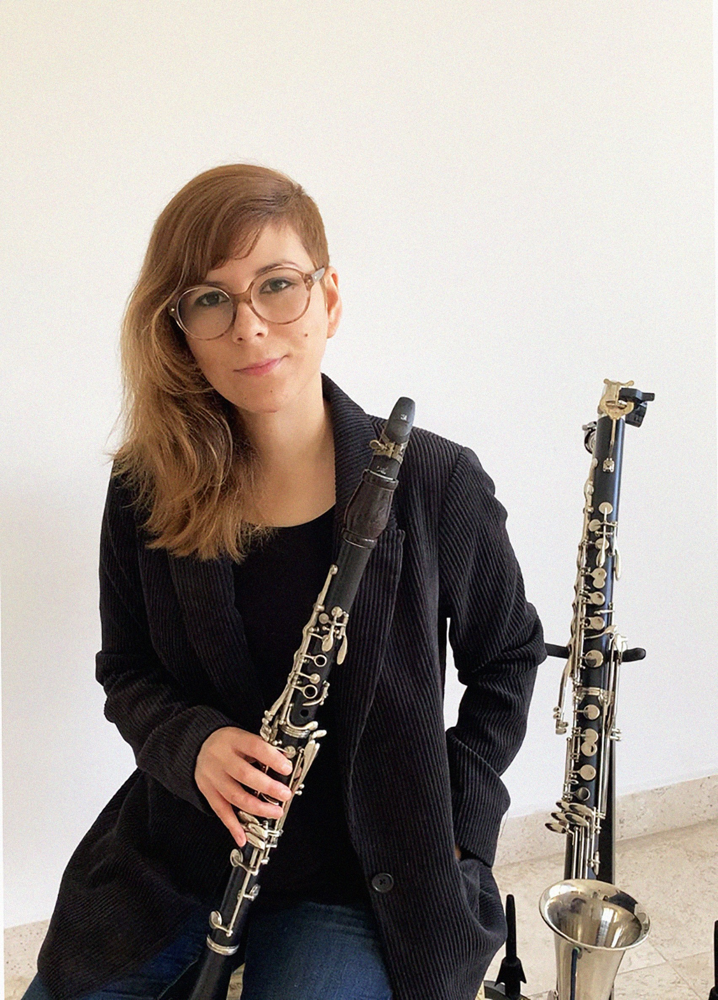

Originaria de Ensenada. Su obra formal abarca desde la música de cámara, como
*Tyche* escrita para Baja Sunset Trio, hasta la escritura sinfónica. En 2026
estrenó en Ensenada *Hulu*, fantasía para clarinete bajo y orquesta, resultado
del PECDA Baja California 2025. Su pieza *Elegía de una pandemia* es una de sus
composiciones más reconocidas y forma parte del repertorio estable de la
Orquesta de Baja California. Ha sido seleccionada en dos ocasiones por el
Festival Aires de la UNAM y ha participado en Forum Wallis en Suiza y Muslab en
Ecuador, entre otros. Hizo la música para el corto *Amor Ice*, el cual ganó
mejor cortometraje el Festival de Guanajuato 2023.

##### *Ticuán*, tres relatos para orquesta

Obra para orquesta inspirada en Tijuana y su contexto fronterizo-migratorio.
Ticuán, nombre prehispánico del cerro Tortuga, se divide en tres movimientos:
*Ciudad laberinto* (paisaje urbano contrastante), *Caravana migrante* (marcha
que evoca el caminar de las caravanas) y *Población flotante* (habitantes en
tránsito esperando cruzar la frontera). La obra fusiona música norteña (tarola,
contrabajo punzado), ritmos originarios (sonaja, tarola sin entorchado, corno
como cuerno ritual), jazz (piano con séptimas y novenas) y música occidental.
Los alientos son protagónicos. La repetición de temas atraviesa todas las
familias instrumentales. Sin tonalidad fija ni modo. Escrita para la Orquesta
de Baja California.

---

### Intérpretes

#### Orquesta Sinfónica de Xalapa (OSX)

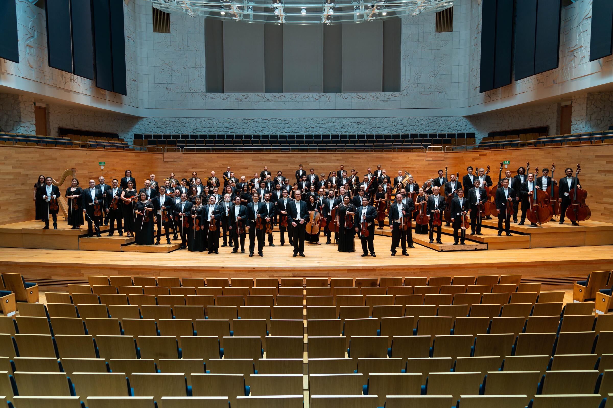

Fundada en 1929, se distingue por ser vehículo del compromiso cultural del
Gobierno de Veracruz y, desde 1975, de la Universidad Veracruzana. Desde hace
muchos años se ha convertido en una de las orquestas más reconocidas en el
país. Actúa con frecuencia en ciudades de la entidad como Orizaba, Córdoba,
Coatzacoalcos, Boca del Río, Veracruz y Poza Rica, así como del país, tocando en la
Ciudad de México, Puebla, Cuernavaca, San Luis Potosí, Aguascalientes,
Guadalajara, Monterrey, Villahermosa, Tampico y Morelia y en foros tan
importantes como el Palacio de Bellas Artes, la Sala Nezahualcóyotl, la
Catedral Metropolitana y la Iglesia de Santo Domingo, en Oaxaca. En el ámbito
nacional, la OSX ha sido sede de importantes acontecimientos entre los que
destacan el Festival y Concurso Internacional de Violonchelo Pablo Casals 1959, que reunió a músicos de la talla del propio Casals, Heitor Villa-Lobos, André
Navarra, Zara Nelsova y Mstislav Rostropovich, y en el ámbito internacional la
OSX ha representado a México en el Festival Europalia 1993 y ha realizado giras
internacionales como la de 2004 por Bélgica, Países Bajos, Luxemburgo y Alemania y
la de 2010, en Guatemala. A lo largo de su historia ha sido dirigida por Juan
Lomán, José Yves Limantour, Luis Ximénez Caballero, Francisco Savín, Fernando
Ávila, Luis Herrera de la Fuente, José Guadalupe Flores, Enrique Diemecke,
Carlos Miguel Prieto, Fernando Lozano y Lanfranco Marcelletti, entre otros.
Desde 2020 la OSX vive una nueva etapa bajo la dirección de Martin Lebel, quien
se ha propuesto acrecentar el acervo y el prestigio musical de la orquesta,
invitando a nuevos y reconocidos talentos artísticos y directores huéspedes que
brinden frescura y dinamismo a la organización.

### Dirección

#### Martin Lebel

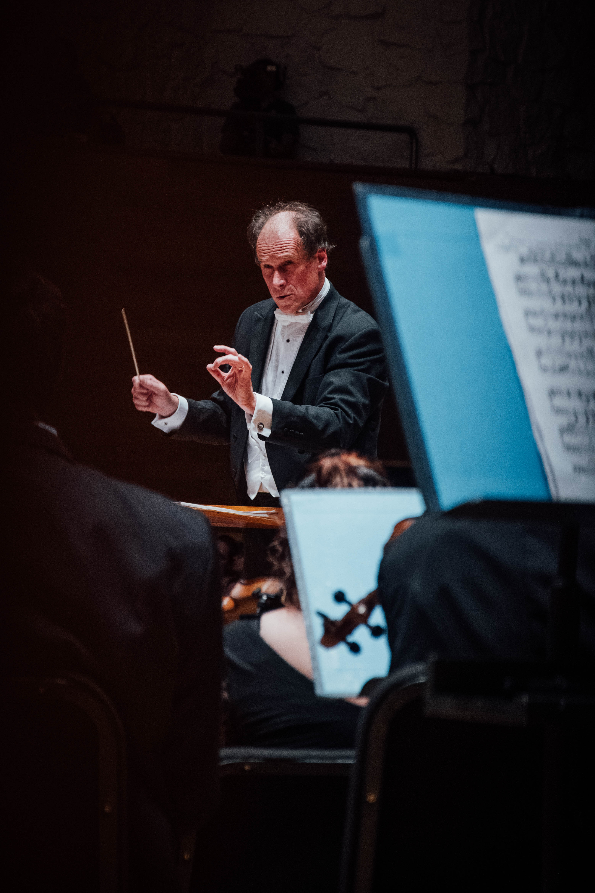

Nació en Francia. Desde 2020 es director titular de la Orquesta Sinfónica de
Xalapa. Anteriormente fue director de la Orquesta Filarmónica de Montevideo,
Uruguay. En 2009, fue nombrado director de la Orquesta de Karlovy Vary en la
República Checa, y en 2014 fue distinguido como ciudadano honorario de dicha
ciudad y hoy día es su director honorario. En 2003 obtuvo el primer gran premio
de dirección en el Concurso Internacional *Prokofiev* en San Petersburgo,
Rusia. Además de su labor con varias orquestas en Francia, ha dirigido en Rusia
a la Orquesta Sinfónica de Ural. En la República Checa colaboró con las
orquestas de Zlin y Pardubice, así como con la Filarmónica de Praga. Su
trayectoria incluye también a la Filarmónica de Szczecin y la Filarmónica
Lodzka en Polonia y las orquestas Metropolitana de Lisboa en Portugal, de
Tesalónica en Grecia, de Porto Alegre en Brasil y la Sinfónica de Salta en
Argentina. En México, ha estado al frente de la Orquesta Filarmónica de la
UNAM, la Orquesta Sinfónica Nacional, la Orquesta Filarmónica de la Ciudad de
México y la Orquesta Filarmónica de Jalisco. Su capacidad para dirigir
múltiples obras de memoria le otorga una versatilidad única en el podio.

::: logos
.ai>){recorte="0 0.2 0.5 0.65" realce=0.3}
.ai>){pagina=3 recorte="0 0 0.45 0.5"}
:::

## LUN | NOV 9, 19:00 h - Morelia: Ensamble Danaus

Centro Mexicano para la Música y las Artes Sonoras\
Morelia, Michoacán

### Programa

**Andrea Sarahí**

- *Baratillo* (2025) \hfill 8'

**Luis Jaime Cortez**

- *Sette deviazioni felliniane [nel modo di Nino Rota]* (2025) \hfill 12'

**Charly Daniels**

- *Acumulaciones* (2024) \hfill 15'

**Johanna Doderer**

- *Raunacht* (2020-2022)\*\* \hfill 10'

**Manuel Enríquez**

- *Pentamúsica* (1963) \hfill 13'
  - *Discusión*
  - *Fagot obbligato*
  - *Jazzeando*
  - *Con ternura*
  - *Scherzo*

**Ensamble Danaus**\
David Ricardo Ramírez González, flauta\
Monserrat García Campo, oboe\
Rocío Citlalli Rosas Islas, clarinete\
Jenny Yuth Cárdenas Moreno, corno\
Everardo Gastélum Anduaga, fagot

### Personas compositoras

#### Andrea Sarahí (México, 1996)


Compositora interesada en explorar la música como una forma de pensamiento y
transformación. Su obra parte de lo personal para conectar con lo colectivo,
abordando temas como la fantasía, el paisaje sonoro, la desigualdad y la
violencia. Dentro de su catálogo se encuentran obras para solistas, ensambles
de cámara, orquesta electrónica y electroacústica. Su trabajo ha sido
interpretado por las orquestas Sinfónica Nacional y OFUNAM y ha colaborado con
los directores Julia Cruz, José Luis Castillo y Ludwig Carrasco. Se ha formado
con Gabriela Ortiz, María Granillo, Arturo Márquez y Derek Bermel. En 2003
lanzó su álbum *Calladita: cinco obras sobre la violencia*, donde aborda este
tema invitando a la reflexión desde distintas perspectivas sonoras. Actualmente
cursa la Maestría en Composición en la UNAM.

##### *Baratillo*

Esta obra está inspirada en los mercados de la Ciudad de México. En su inicio
representa el barullo del mercado, la multitud de elementos y colores, el
incesante movimiento. En la segunda parte, más lenta, se relaciona con el
esoterismo presente en mercados como el de Sonora con su palpable misticismo.
Posteriormente se retoma el barullo y el movimiento, el perpetuo caminar hacia
adelante del que formamos parte al entrar en un mercado en la ciudad.

#### Luis Jaime Cortez (México, 1962)


Compositor y musicólogo. Autor de los libros *Tabiques rotos: siete ensayos
musicológicos*, *Mario Lavista: textos en torno a la música* y *Favor de no
disparar sobre el pianista*, novela biográfica de Silvestre Revueltas, entre
decenas de artículos y ensayos. Es autor de las óperas *La tentación de San
Antonio* y *Luna*, además de la sinfonía *Lluvias*, a partir de un poema de
Saint-John Perse, y de una numerosa obra camerística. Realizó una intervención
orquestal de canciones de Chucho Monge, que grabó con el tenor Francisco
Araiza. Es miembro honorario del Sistema Nacional de Creadores. Fue director
del Cenidim y rector del Conservatorio de las Rosas. Actualmente es miembro del
consejo académico del Doctorado en Artes del Centro Nacional de las Artes e
investigador del Cenidim.

##### *Sette deviazioni felliniane (nel modo di Nino Rota)*

*Deviazioni* es una especie de equívoco divertido, cinematográfico, en clave
felliniana. Pero ¿cómo separar a Fellini de Rota? ¿Cómo sonarían sus imágenes
sin esa música irónica, sentimental sin complejos, de sutiles estructuras
escondidas? Imaginé escenas con la cámara en mano. Lo demás fue natural: el
quinteto de alientos es el ensamble más entrañablemente felliniano. Y mis
amigas y amigos de Danaus parecen un surgimiento de *8 y ½*.

#### Charly Daniels (México, 1985)


Se ha enfocado principalmente en la composición de música de cámara y
orquestal. Ha obtenido numerosos premios y distinciones, entre ellos los
primeros lugares en el Primer Concurso de Composición Orquestal de Morelia 2022
y 2025 y el Premio Nacional de Composición Orquestal Raíces 2021 y en el
concurso internacional de composición sinfónica Future Symphony Competition en
Lituania, 2020, así como el Premio a la Excelencia en la Competencia
Internacional de Composición Orquestal Premios a la Creación Artística en
Hangzhou, China 2021. Su música de cámara ha sido interpretada en los
festivales Penn State New-Music and Symposium, de Música Nueva de Hangzhou,
Music Mexico Symposium en la Universidad de Dartmouth, Internacional
Cervantino, Cultural de Zacatecas, de Música de Morelia y el Foro Internacional
de Música Nueva *Manuel Enríquez*.

##### *Acumulaciones*

En esta obra la forma y los desarrollos son derivados del concepto de la
acumulación. La primera sección consiste en una serie de frases que se repite
idéntica cuatro veces, salvo por el hecho de que la primera vez solo tocan dos
instrumentos, es decir un dueto; en la segunda vuelta se incorpora un nuevo
instrumento formando un trío, después un cuarteto y, finalmente, un quinteto. De
este modo la forma es derivada de una acumulación progresiva de capas
melódicas. En la segunda sección escuchamos una serie de camas armónicas
derivadas de la acumulación gradual de notas largas que van tocando cada uno de
los instrumentos uno por uno. Más adelante, esto evoluciona a un tratamiento de
cánones al unísono en *stretto*, donde más que una textura inteligible, se
busca la formación de una masa sonora densa. En este sentido podríamos hablar,
no tanto de contrapunto imitativo, sino de contrapunto acumulativo.

#### Johanna Doderer (Austria, 1969)


Compositora residente en Viena, nació en Bregenz y se formó con Beat Furrer en Graz; posteriormente estudió composición y teoría musical con Erich Urbanner y composición para cine y medios con Klaus Peter Sattler en Viena. El eje central de su obra es la ópera. Además de numerosas piezas de música de cámara, ha escrito obras para orquesta. Sus composiciones se interpretan en todo el mundo. Tras lidiar con las técnicas de la música contemporánea durante muchos años, ha encontrado su propio lenguaje compositivo, el cual no excluye la tonalidad. La música de Doderer se ha consolidado en los grandes centros musicales del mundo junto a los repertorios clásicos y contemporáneos.

##### *Raunacht*

Las Rauhnacht son doce noches comprendidas entre las festividades religiosas de Navidad y la Epifanía. Son doce noches en las que pueden tener lugar rituales y se procesa el pasado y se conjura el futuro del año venidero mediante rituales (velas, deseos, oraciones, búsquedas de visión, quema de incienso, etcétera). La Rauhnacht es una antigua tradición de la región alpina. Este quinteto de alientos en un solo movimiento se desarrolla en poco menos de diez minutos, comenzando con un solo de flauta solitario, una rápida y animada niebla en espiral de cinco voces que, junto a momentos melódicamente bellos que pueden haber sido tomados de la naturaleza, crea arreglos sonoros modernos y exigentes cuya intensidad puede tanto disuadir como atraer a los oyentes. Lo que queda es la impresión de una obra autónoma de gran transparencia y comunicación densa que está abierta al oyente.

#### Manuel Enríquez (México, 1926-1994)

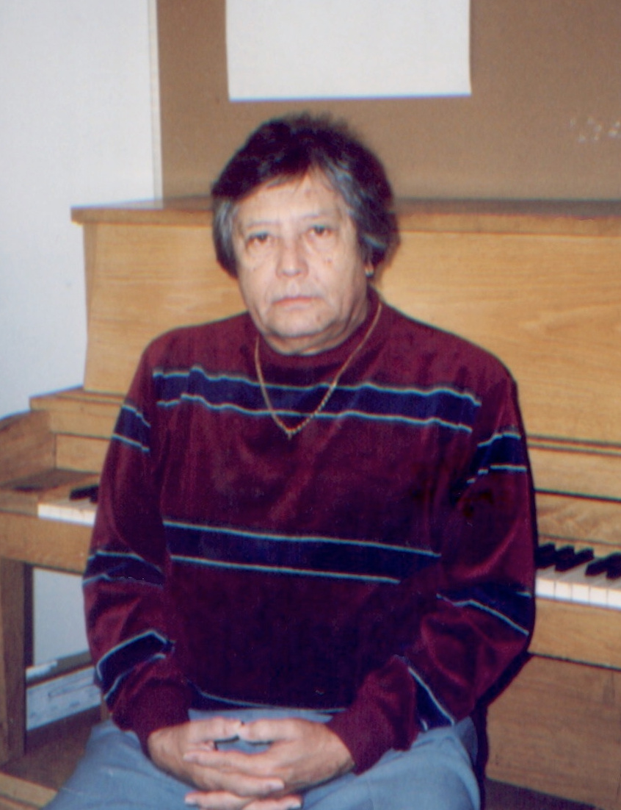

Originario de Ocotlán, Jalisco, fue una figura fundamental de la vanguardia
musical en México. Se formó con Áurea Corona y Miguel Bernal Jiménez,
perfeccionándose después en la Juilliard School con Ivan Galamian y Peter
Mennin. En 1961, gracias a la beca Guggenheim, incursionó en la música
electrónica en Columbia y Princeton bajo la guía de Stefan Wolpe. Como
violinista, fue concertino de la Sinfónica de Guadalajara y fundó el célebre
Cuarteto México, con el que realizó giras por Europa y América. Su labor
docente y administrativa fue vasta: dirigió el Conservatorio Nacional y el
Cenidim, donde impulsó la investigación electroacústica y virreinal. En 1979
fundó el Foro Internacional de Música Nueva (que hoy lleva su nombre), espacio
vital para la difusión de la creación contemporánea. Distinguido como Creador
Emérito y miembro de la Academia de Artes, su legado permanece como pilar de la
identidad musical mexicana del siglo XX.

##### *Pentamúsica*

El primer movimiento de *Pentamúsica* tiene como fundamento un equilibrado
diálogo a cinco voces en el que la materia prima está formada por breves
motivos que van apareciendo consecutivamente en los distintos instrumentos. En
el segundo movimiento, los otros cuatro instrumentos proveen un discurso
disjunto y fragmentario que sirve como sustento de una larga y sinuosa melodía
en el fagot. En la segunda parte de este movimiento se escucha un
acompañamiento reiterado que se basa en un motivo de cinco notas. El título del
tercer movimiento, *Jazzeando*, es evidente en sí mismo, y el elemento
jazzístico (sustentado, lógicamente, en una discreta dosis de blues) está
presente tanto en los ritmos y las armonías como en los giros instrumentales.
El cuarto movimiento es más corto que los otros, y aquí el compositor plantea
breves solos para los instrumentos, comenzando con el oboe, seguido por el
fagot, la flauta, el clarinete y el corno. En el *Scherzo* final una llamada
del corno convoca a los demás.

---

### Intérpretes

#### Ensamble Danaus

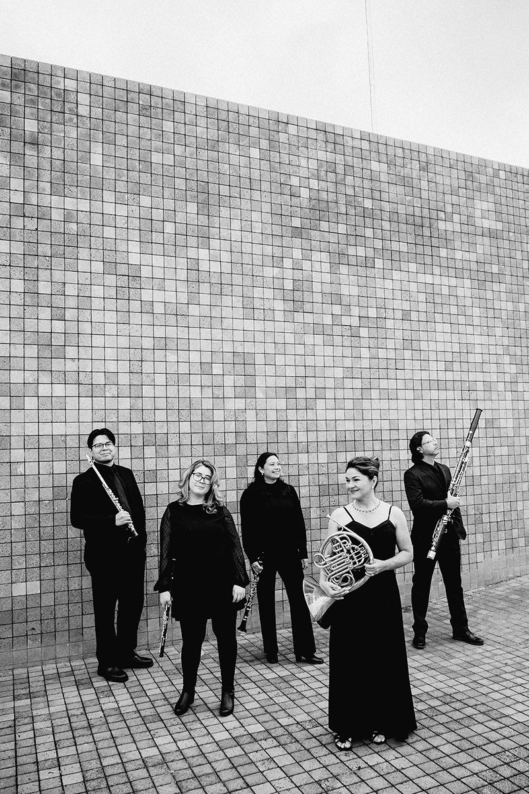

*Danaus plexippus* es el nombre científico de la mariposa monarca, símbolo del
estado de Michoacán y nombre que toma el ensamble por ser orgullosamente
michoacano. Son el principal representante de quintetos de alientos en el
estado, referente a nivel nacional por su calidad artística y su labor de
difusión de la música mexicana de concierto. Este grupo se forma ante la
necesidad de sus integrantes por crear interés hacia la música de cámara, así
como mantener viva la producción de música y conciertos de quinteto de alientos
y colaborar con compositores nacionales e internacionales. Ha participado en
los festivales Fica 21 de Veracruz, *Ortiz Tirado* en Álamos, Aires de la UNAM,
de Música *Bernal Jiménez* en Morelia, Cultural Zacatecas y el Foro
Internacional de Música Nueva *Manuel Enríquez*, entre otros.

::: logos

:::

## MAR | NOV 10, 17:00 h - Monterrey: Q-SION, percusiones

Sala Chopin, Escuela Superior de Música y Danza\
Monterrey, Nuevo León

### Programa

**Jesús Bernal Cabello**

- *Estás* (2021)\* \hfill 9'

**Daniel Muñoz-Alférez**

- *Ternasonantia* (2025)\* \hfill 5'

**Charles M. Champi**

- *The Freytag Set* (2022)\* \hfill 13'

**Germán L. Vargas**

- *Is the Closest Star Closed?* (2023)\* \hfill 7'

**Rodrigo Zárate Marfil**

- *Tlaltecuhtli* (2025) \hfill 11'

**Manuel Enríquez**

- *Políptico* (1983) \hfill 15'

**Kaija Saariaho**

- *Trois Rivières* (1998)\*\* \hfill 15'

**Q-SION Ensamble de Percusiones**\
Gustavo Villegas Gámez\
Eusebio Alejandro Sánchez González\
Celina Hernández Montalvo\
Alondra María Ayala González\
Abel Gerardo Gómez Rodríguez\
Samuel Alejandro Reyes Guzmán\
Rodrigo Zárate Marfil

### Personas compositoras

#### Jesús Bernal Cabello (México, 1995)

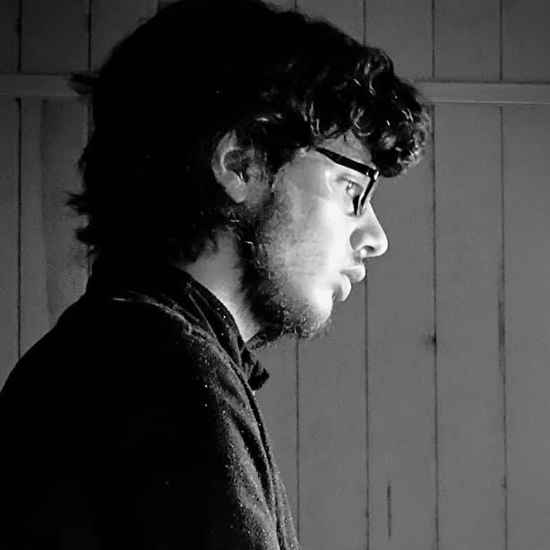

Nació en la Ciudad de México. Egresó del Conservatorio Nacional de Música,
donde estudió con Armando Luna, Juan Fernando Durán e Itziar Fadrique y tomó
clases con Juan Cristóbal Cerrillo. Entre 2016 y 2018 asistió como oyente al
Laboratorio de Creación Musical de Julio Estrada. En 2023 recibió la beca
Jóvenes Creadores del SACPC para componer *El clave mal temperado*. Es
integrante del Proyecto Ars Nova, con el que ha participado en el álbum *Maja
Bhuta* para violín solo, en el ciclo *Re-Cordare* de Anna Margules y en los
proyectos *Música comunitaria* y *Habitar la ruina*, ambos apoyados por
Ibermúsicas. Desde 2023 trabaja como dibujante musical en el Cenidim y cursa la
maestría en la UNAM con el proyecto *Al féretro elegante*, en colaboración con
Tramas. Actualmente desarrolla *Astrolabio cromático* con apoyo del SACPC.

##### *Estás*

El título de la obra es un acertijo. La obra parte de la idea de que todo
sonido es producto de una acción física y, a partir de allí, explora
exhaustivamente distintos tipos de contacto entre las manos y las membranas de
los instrumentos (timbales y bombo). La obra en sí misma busca la interacción
escénica del instrumento con el ejecutante, algo dejado de largo durante los
conciertos convencionales.

#### Daniel Muñoz-Alférez (México, 1983)

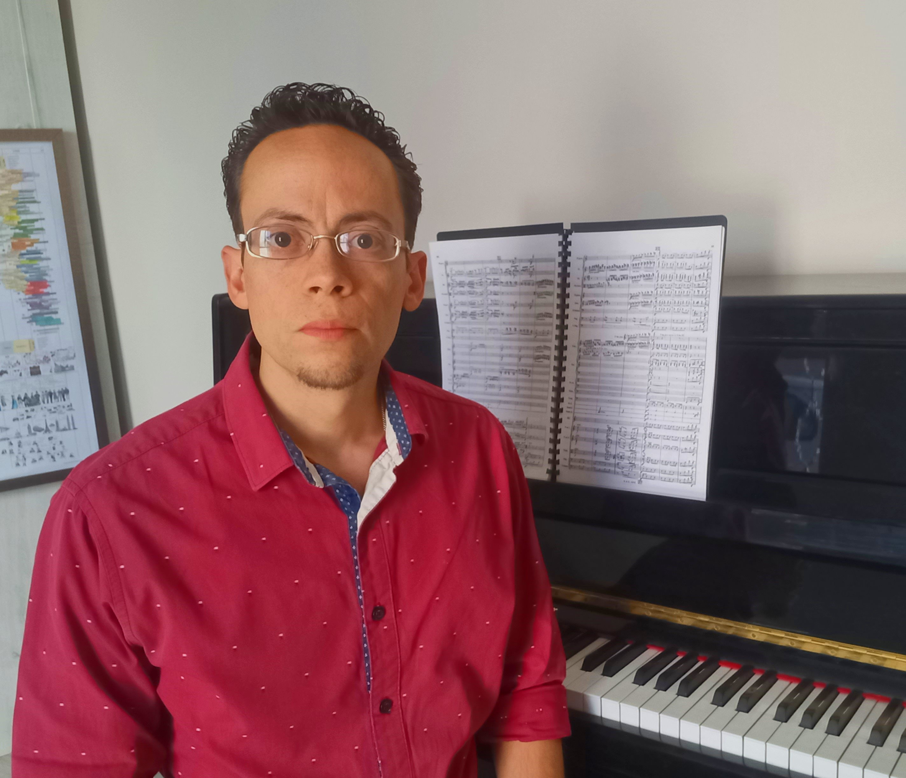

Originario de Querétaro, inició su formación musical desde temprana edad,
influenciado por su padre y su hermano. Comenzó en el piano y posteriormente en
el órgano tubular, desarrollando tanto la interpretación como la improvisación,
lo que lo llevó a la composición. Con más de tres décadas de trayectoria, ha
incursionado en la música académica, el jazz, proyectos cinemáticos y música
comercial. Es egresado en composición por el London College of Music de la
University of West London. Ha complementado su formación con Axel Retif e
Ignacio Baca Lobera y ha trabajado como docente y productor musical, además de
ofrecer servicios de ingeniería de audio.

##### *Ternasonantia*

Terna, refiriéndose a la propuesta de tres posibles líderes, y sonancia, resultado sonoro del grupo, juntos forman el título y la descripción
de la pieza. La interacción entre los acentos binarios y no binarios y la
mezcla de rítmicas libres y específicas, desarrollan la sensación del pulso
controlado, pero, deliberadamente retado por la expresión libre que más que
pelear, enriquece la textura. Aunque algunos otros elementos son introducidos,
sirven más como decoración a esa atmósfera sin convertirse en el centro de
atención. Una coda meditativa borra los rastros del diálogo entre el ritmo
controlado y el libre, llevando todo a un final inesperado.

#### Charles M. Champi (México, 1988)

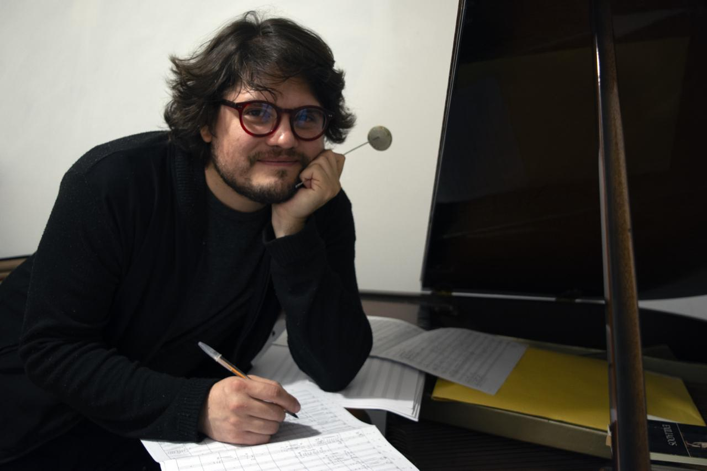

Ha asistido a cursos y clases con Carola Bauckholt, Franck Bedrossian, Peter
Ablinger, Clara Iannotta e Isabel Mundry. Ha participado en los festivales
Mixtur 2016 en Barcelona, BTzM 2017 en Austria, ManiFeste 2021 en Francia,
Tchaikovsky City 2024 en Rusia y Barcelona Modern 2025. Su música ha sido
interpretada en México, Francia, Alemania, Italia, Portugal, Rusia, España y
Corea del Sur por agrupaciones como Achrome Ensemble, Cepromusic, Ensemble
InterContemporain, Kommas Ensemble, Low Frequency Trio, Manufaktur für Aktuelle
Musik, Retro Disco, Taller Sonoro y Trío Siqueiros. Su trabajo se centra en la
filosofía de la música, especialmente en la relación entre música y lenguaje.
Realizó la Maestría en Composición en la UNAM con Pablo Silva y actualmente
publica con Babel Scores. Es fundador y coordinador del Ensamble Piñata en
llama.

##### *The Freytag Set*

Se basa en la pirámide de Freytag para analizar las obras de teatro de
Shakespeare. Freytag define una función para los cinco actos de la tragedia, lo
cual resultó interesante al momento de componer la pieza, ya que esta
estructura difiere de la forma aristotélica de tres partes y se vincula con un
autor de gran relevancia personal. Se establecen así cinco momentos: un estado
inicial, una complicación, un clímax, una relajación y un nuevo estado. En esta
obra no hay una narrativa explícita, pero sí relaciones formales entre los
distintos eventos sonoros, donde el drama surge de su interacción. La obra fue
finalista en el Concurso de Composición para Cuarteto de Percusiones del
Ensamble Safa en 2022.

#### Germán L. Vargas (México, 1989)


Graduado con mención honorífica de la Licenciatura en Composición musical por
la Universidad Autónoma de Querétaro, estudió con Ignacio Baca Lobera y Juan
José Bárcenas. Paralelamente asistió a cursos y talleres impartidos por Michael
Pisaro, Germán Romero, José Luis Hurtado, Juan Sebastián Lach, Javier Torres
Maldonado y Marisol Jiménez. Su trabajo incluye obras para solista, ensamble,
orquesta, música mixta y acusmática, interpretadas en México, Costa Rica,
Argentina, Polonia, Portugal y España. Su música ha sido presentada por
intérpretes y agrupaciones como Wilfrido Terrazas, José Manuel Alcántara, Iván
Manzanilla, Josetxo Silguero, Low Frequency Trio, Duplum, Ensamble
Noodus-Cromano, Liminar, Cepromusic, Nosense Ensamble Vocal, Cuarteto 8xRadio,
Ludwig e Irene Carrasco, la Orquesta Filarmónica de Querétaro y Vertixe Sonora.

##### *Is the Closest Star Closed?*

¿Está cerca la estrella más cercana? Es una exploración sonora de la distancia
percibida, física, emocional y cósmica. El título sugiere una paradoja: lo que
parece cercano puede ser inalcanzable, mientras lo distante puede resonar
íntimamente en nosotros. La obra propone un diálogo entre dos percusionistas
que orbitan entre sí, creando un espacio donde proximidad y lejanía se
redefinen mediante timbre, resonancia y silencio. Los materiales, metales,
membranas, maderas y texturas extendidas actúan como cuerpos celestes que
emiten pulsos y sombras sonoras. El lenguaje rítmico alterna entre tensión y
momentos suspendidos donde el tiempo parece dilatarse. La interacción es
rítmica, espacial y energética, exigiendo escucha y precisión. Más que
representar una estrella, la obra cuestiona nuestra noción de cercanía y
distancia. La percusión es también eco, aliento y luz dentro del silencio.

#### Rodrigo Zárate Marfil (México, 1989)

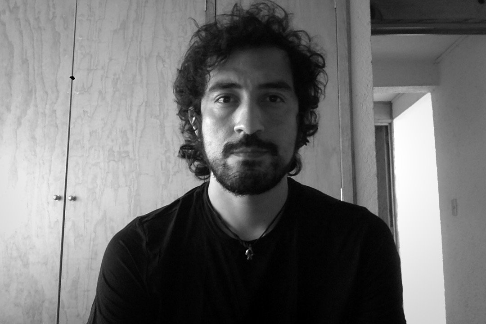

Es un compositor y percusionista especializado en música para escena, danza
contemporánea y proyectos interdisciplinarios. Su práctica se sitúa en el cruce
entre sonido, cuerpo y tecnología, donde la música electroacústica, los
sistemas electrónicos en tiempo real y el espacio escénico funcionan como
elementos dramatúrgicos. Su trabajo concibe el sonido más allá del
acompañamiento: como un elemento central en la construcción de la obra, un
organismo activo dentro del acontecimiento escénico. El sonido dialoga con el
movimiento, la imagen y el espacio, generando paisajes que amplían la
experiencia coreográfica. Mediante live electronics, procesamiento en tiempo
real y composición espacial, desarrolla universos sonoros sensibles que
responden al cuerpo en escena y a procesos colaborativos.

##### *Tlaltecuhtli*

Utilizando como elemento principal el sonido de una laja de piedra al ser
golpeada y frotada con diversos objetos, la pieza se divide en dos movimientos
y explora distintas velocidades de pulsos simultáneos mediante líneas métricas
individuales para cada integrante. En el primer movimiento se investigan
timbres al golpear la piedra con rocas y frotar metales y vidrio. El material
se organiza en bloques que alternan entre secciones rítmicas y texturas
continuas, manteniendo un pulso común en todo el ensamble. En el segundo
movimiento surgen pulsos independientes: cada ejecutante acelera y desacelera
su propio tiempo, generando una masa sonora que se sincroniza y desfasa,
formando gestos a través de la interacción. Los sonidos son claros para
distinguir las distintas capas temporales.

#### Manuel Enríquez (México, 1926-1994)


Originario de Ocotlán, Jalisco, fue una figura fundamental de la vanguardia
musical en México. Se formó con Áurea Corona y Miguel Bernal Jiménez,
perfeccionándose después en la Juilliard School con Ivan Galamian y Peter
Mennin. En 1961, gracias a la beca Guggenheim, incursionó en la música
electrónica en Columbia y Princeton bajo la guía de Stefan Wolpe. Como
violinista, fue concertino de la Sinfónica de Guadalajara y fundó el célebre
Cuarteto México, con el que realizó giras por Europa y América. Su labor
docente y administrativa fue vasta: dirigió el Conservatorio Nacional y el
Cenidim, donde impulsó la investigación electroacústica y virreinal. En 1979
fundó el Foro Internacional de Música Nueva (que hoy lleva su nombre), espacio
vital para la difusión de la creación contemporánea. Distinguido como Creador
Emérito y miembro de la Academia de Artes, su legado permanece como pilar de la
identidad musical mexicana del siglo XX.

##### *Políptico*

Es una obra para ensamble de percusiones situada en el contexto de la música
contemporánea de México de finales del siglo XX. En esta pieza Enríquez
demuestra una escritura rigorosa y controlada, maneja con precisión
secuencias, instrumentación y dinámicas dentro de la partitura. Aunque comparte
con otras obras del ámbito percusivo una preocupación por la exploración
sonora, *Políptico* se distingue por su estructura detallada y dominio formal,
donde cada elemento está cuidadosamente organizado para lograr una expresividad
específica dentro de un lenguaje percutivo moderno. La obra pertenece a una
etapa madura de Enríquez en la que combina técnicas contemporáneas con una
escritura clara y exigente para los intérpretes, aportando así una contribución
significativa al repertorio mexicano para percusiones.

#### Kaija Saariaho (Finlandia, 1952 -- Francia, 2023)


Fue una voz destacada de su generación de compositores, tanto en su país natal
como en el mundo entero. Estudió composición en Helsinki, Friburgo y París, donde
residió desde 1982 hasta su muerte. Sus estudios e investigaciones en el IRCAM,
el centro parisino de experimentación electroacústica, tuvieron una gran
influencia en su música, y sus características texturas exuberantes y
misteriosas se crearon a menudo combinando la interpretación en vivo con la
electrónica. Expandió gradualmente su expresión musical a una gran variedad de
géneros, y sus piezas de cámara y música coral se han convertido en piezas
clave de conjuntos instrumentales y vocales, respectivamente.

##### *Trois Rivières*

Es una obra que refleja su característico interés por la exploración del timbre
y las texturas sonoras. La pieza está estructurada en tres movimientos que
evocan el fluir y la convergencia de ríos, utilizando técnicas contemporáneas
como microtonalidad, heterofonía y capas sonoras superpuestas. Saariaho combina
instrumentos acústicos con efectos tímbricos complejos, logrando un paisaje
sonoro que alterna momentos de calma etérea y densidad intensa, donde cada
sonido adquiere significación propia. La obra no busca la melodía tradicional, sino un diálogo entre colores y movimientos internos del sonido, característica
central de la compositora finlandesa. *Trois Rivières* ejemplifica su enfoque
poético y sensorial, mostrando cómo la música contemporánea puede transformar
la percepción del tiempo, el espacio y la energía musical en un flujo continuo,
evocando la naturaleza y el agua como símbolos sonoros.

---

### Intérpretes

#### Q-SION

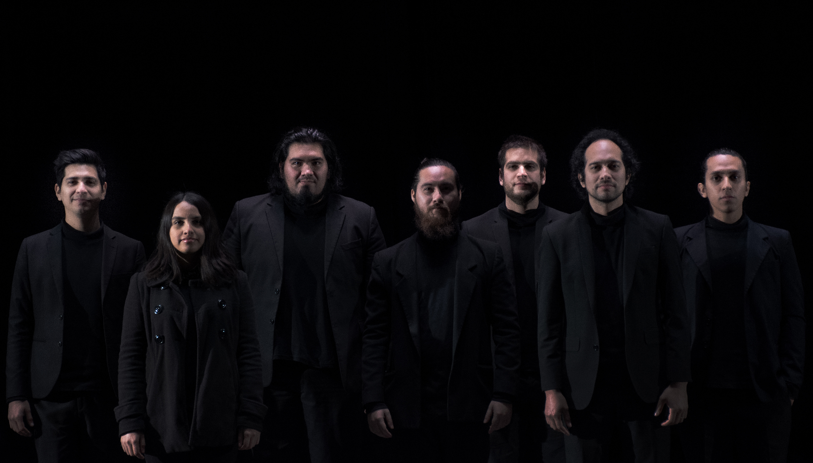

Ensamble de percusión contemporánea fundado en 2018 en Nuevo León. Integrado
por nueve percusionistas y un artista sonoro, se distingue por su enfoque en la
tecnología, la interdisciplina y la creación de nuevo repertorio. Ha
comisionado más de cincuenta obras y cuenta con un acervo de más de ciento
cincuenta instrumentos, incluyendo elementos de postlutería y culturas no
occidentales. Ha participado en los festivales PASIC de Estados Unidos, FIMNME
e Internacional Santa Lucía. Su actividad incluye conciertos educativos,
proyectos audiovisuales, performance y colaboración con artistas visuales,
dancísticos y escénicos. Q-SION ha recibido apoyos de Conarte, Ibermúsicas y la
Secretaría de Cultura de México, y ha sido reconocido por su trabajo de gestión
cultural y compromiso con las comunidades.

::: logos

:::

## MAR | NOV 10, 19:30 h - Guadalajara: Dúo Gasparini-Monnet

Martes de Música\
Sala Higinio Ruvalcaba, Ex Convento del Carmen\
Guadalajara, Jalisco

---

### Programa

**György Kurtág**

- *Kafka Fragments*, Op. 24 (1987)

**Leonardo Coral**

- *Orígenes* (2014)
  - *Arcaico y profundo*
  - *Misterioso*
  - *Canto*
  - *El perpetuo fluir*

**Gonzalo Macías**

- *Cliché* (2014)

**Manuel de Falla**

- *Siete canciones populares españolas* (selección)

**Johann Sebastian Bach**

- *Erbarme dich*

**Ruggero Leoncavallo**

- *Qual fiamma avea nel guardo!... Stridono lassù*

**Richard Strauss**

- *Morgen!*

**Maurice Ravel**

- *Pièce en forme de habanera*

**Dúo Gasparini-Monnet**\
Noemi Gasparini, violín\
Makeda Monnet, soprano\
Miguel Ángel Valdés-Brito Pérez, piano

### Personas compositoras

#### György Kurtág (Rumanía, 1926)

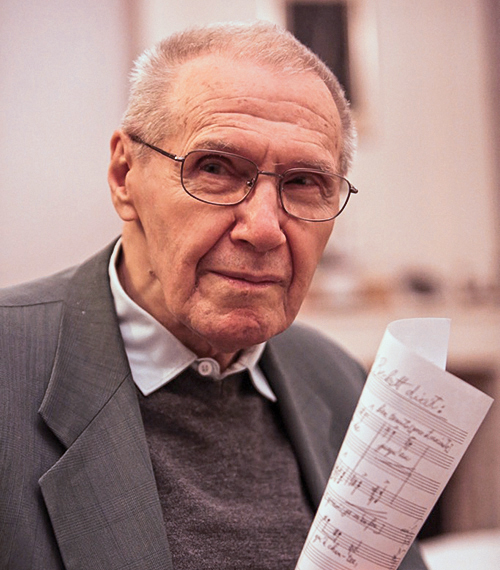

Compositor húngaro considerado una de las figuras más importantes de la música
contemporánea europea, conocido por su estilo conciso, expresivo y
profundamente introspectivo. Estudió en la Academia de Música *Franz Liszt* de
Budapest, donde más tarde fue también profesor. Durante su carrera desarrolló
un lenguaje musical muy personal, influido por Béla Bartók y Anton Webern,
caracterizado por piezas breves pero intensas, con gran atención al detalle y
al silencio. Entre sus obras más destacadas se encuentra *Játékok* (Juegos),
una colección de piezas para piano que comenzó en la década de 1970, así como
su ópera *Fin de partie*, basada en la obra de Samuel Beckett, estrenada en
2018. Kurtág ha recibido numerosos premios internacionales y es reconocido por
su contribución única a la música de los siglos XX y XXI.

##### *Kafka Fragments*, Op. 24

Esta obra es la más extensa que Kurtág haya compuesto hasta la fecha. Se trata de
un ciclo para soprano y violín, basado en textos de Franz Kafka, extraídos de
su diario y cartas, así como de *Preparativos de boda en el campo*. Un único
fragmento, de Elias Canetti, constituye una excepción. Está dedicado a la
memoria del gran poeta húngaro János Pilinszky y recuerda al cuarto de sus
*lieder* sobre poemas de Pilinszky; mediante su ritmo abrupto, salpicado de
silencios, la música representa el andar vacilante e inestable de un niño
pequeño, una metáfora particularmente impactante de la imposibilidad de contar
una historia, o incluso de hablar. Estos fragmentos, acertadamente titulados
*unas pocas palabras, a lo sumo unas pocas frases*, crean microcosmos cuya
yuxtaposición jamás alcanzará la plenitud de la narración.

#### Leonardo Coral (México, 1962)

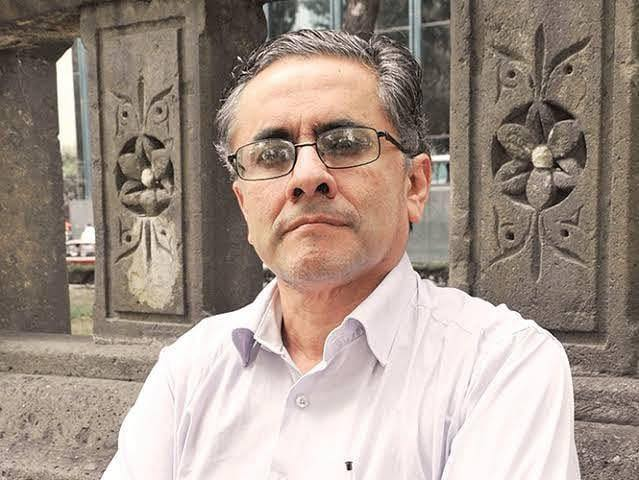

Estudió con Federico Ibarra en la UNAM. Obtuvo la maestría con la obra *Ciclo
de vida y muerte*, con la asesoría de María Granillo. Sus creaciones se han
tocado en México, Europa, Estados Unidos, Canadá, Asia, Australia y
Latinoamérica. Es miembro del SNCA. Hay 41 discos con su música. Diversas
orquestas y ensambles han presentado su trabajo: OFUNAM, OSN, OSEM, OFCM, OCBA,
OSUANL, OSUG, OSIDEM, OBC, OSEP, Cepromusic, Ónix, Cuarteto Latinoamericano,
Tambuco, Camerata de las Américas, Cuarteto de la Ciudad de México, Duplum,
Cuarteto Arcano, Cello Alterno y Zikluz. Así como destacados solistas: Tere
Frenk, Mauricio Náder, Krisztina Deli, Juan Carlos Laguna, Gonzalo Gutiérrez,
Omar Hernández, Ignacio Mariscal, Fernando Domínguez, Luis Humberto Ramos, Omán
Kaminsky, Alejandro Escuer, Judith Reyes, Hugo Ticciati, Cuauhtémoc Rivera,
Nana Babayeva, Rodrigo Garibay y han dirigido sus obras José Areán, Rodrigo
Cadet, José Luis Castillo, Andrés Cárdenes y Félix Carrasco.

##### *Orígenes*

Es una obra de gran virtuosismo y forma parte de *Orígenes, formas y estampas
quijotescas*. Las piezas que constituyen esta serie son: *Estampas Quijotescas
IV. Manteamiento de Sancho Panza, II. Dulcinea del Toboso VI. Batalla entre Don
Quijote y el Caballero de la Blanca Luna; Preludios para piano 2a. serie I.
Onírico XII. Ráfaga; Orígenes para violín IV. El perpetuo fluir, Sonata para
piano No. 7 III. Vivo con fuoco*.

#### Gonzalo Macías (México, 1958)

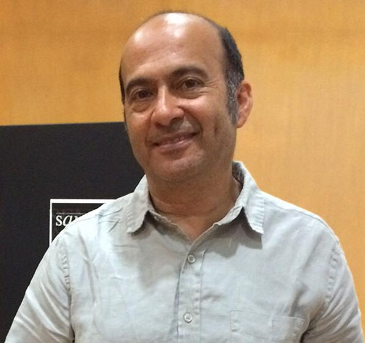

Nació en Tlaxcala. Estudió piano con Isaías Noriega de la Vega y Jorge Suárez y composición con Federico Ibarra. En 1988, como becario del gobierno francés, estudió composición con Sergio Ortega, análisis con Betsy Jolas, orquestación con Gérard Grisey y música electroacústica con Michel Zbar. En 1992 recibió la Medalla Mozart del Instituto Cultural Domecq de la Ciudad de México. Su música se ha publicado en Ediciones Mexicanas de Música y se ha estrenado en el Foro Internacional de Música Nueva *Manuel Enríquez* y el Festival Internacional Cervantino. Igualmente, ha participado en la composición de música para teatro, colaborando con directores como David Olguín, Jorge Vargas, Ludwig Margules y Javier Malpica. Ha sido miembro del Sistema Nacional de Creadores de Artes. Desde 2023 se dedica de tiempo completo a la composición, concluyendo un periodo de más de cuarenta años de enseñanza de la música.

##### *Cliché*

Muchas veces las primeras ideas que surgen al comenzar la composición de una pieza son rápidamente dejadas de lado, porque nos parecen triviales y poco interesantes. Pero ¿qué pasaría si en vez de realizar esta labor de limpieza prudente y juiciosa, permitiéramos que estos lugares comunes, esa especie de citas musicales escuchadas mil veces, se volvieran el material de base para la composición de una pieza?

---

### Intérpretes

#### Dúo Gasparini-Monnet


Integrado por **Noemi Gasparini**, violín, y **Makeda Monnet**, soprano,
el dúo ha participado en los festivales *Pablo Casals*, Clásico de
Villars, en Suiza, y Schiermonnikoog, en los Países Bajos. También en
proyectos de ópera y teatro, así como en propuestas de carácter no
convencional, entre ellas una colaboración con la equilibrista
Tatiana-Mosio Bongonga.

Noemi Gasparini ha actuado como solista con las orquestas del País
Vasco, Colonne de París y Paris Rive Droite. Realizó sus estudios en la
Manhattan School of Music y obtuvo una maestría en el Conservatoire
National Supérieur de Paris. En 2024 participó en *313*, pieza para
violín solo compuesta e interpretada junto con la cantante española
Silvia Pérez Cruz, así como en proyectos con Flor de Toloache, mariachi
femenino de Nueva York, y Jarana Beat, banda méxico-afroamericana
radicada en Nueva York.

Makeda Monnet ha sido solista con la Berliner Philharmoniker y la
Philharmonie de Paris. Recibió los premios del CRR de París y de Canto
del Conservatoire National Supérieur de Paris. En 2021 interpretó
*Estrella de la mañana*, de A. Nante, en el Victoria Hall de Ginebra, y
*Carte Noire Nommée Désir*, de R. Chaillon.

::: logos


{recorte="0.19 0.09 0.465 0.215"}
{recorte="0.465 0.09 0.68 0.215"}

:::

## JUE | NOV 12, 19:00 h - Morelia: Asako Arai, flauta

Centro Mexicano para la Música y las Artes Sonoras\
Morelia, Michoacán

**Compositoras en música electrónica**

---

### Programa

**Asha Srinivasan**

- *Alone, Dancing* (2003)\*\* \hfill 10'

**Carole Chargueron**

- *Flautillería* (2021) \hfill 8'

**Eve Beglarian**

- *Can I have it without begging* (2018)\*\* \hfill 10'

**Georgina Derbez**

- *Tonada de la luna llena I* (2020) \hfill 7'

**Kaija Saariaho**

- *NoaNoa* (1992) \hfill 10'

**Asako Arai**, flauta

### Personas compositoras

#### Asha Srinivasan (Estados Unidos, 1980)


Compositora indoestadounidense que combina su formación musical occidental con su herencia india para crear un lenguaje compositivo. Su música ha sido presentada en diversos escenarios y analizada en trabajos académicos. En 2019 recibió un encargo del programa NewMusic Initiative de East Carolina University. Su obra *Dviraag* fue premiada en el Festival Internacional de Composición de Tailandia 2011 y ganó el concurso del Flute New Music Consortium 2015. En 2012 el grupo Alarm Will Sound estrenó *Svara-lila* en el Mizzou International Composers Festival. Sus obras han sido grabadas por MSR Classics, Ablaze Records, Mark Records, Beauport Classical y Seamus CD Series. Fue miembro del consejo del American Composers Forum 2016--2018 y jurado del National Endowment for the Arts en 2017--2018. Posee un doctorado de la University of Maryland y una Maestría en Música del Peabody Conservatory. Actualmente es profesora asociada de música en Lawrence University.

##### *Alone, Dancing*

Existen dos versiones de esta obra, la primera para flauta y electrónica y la segunda para clarinete y electrónica. Acerca de esta pieza, la compositora dice:

> «Con una danza lánguida, ella despierta al día. Bailando sola, sin ritmo, como en un sueño, hasta alcanzar plena consciencia. Bailando al compás de una métrica extraña, con un compañero imaginario. Al principio firme, pero pronto frenética, a medida que ella se ve consumida por su salvaje danza de fantasía. Ella gira como el viento impetuoso, aparentemente fuera de control, hasta desplomarse triunfalmente en el suelo».

#### Carole Chargueron (Francia, 1966)


Obtuvo la Licenciatura y Maestría en Musicología, tras lo cual ingresó a la clase de música electroacústica en Niza. Viajó a Estados Unidos para estudiar en CalArts con Morton Subotnick. Se tituló en Composición electroacústica en el CNSMD de Lyon. Reside en México desde 1998. Es responsable del Taller de electroacústica de la Escuela Superior de Música y fue coordinadora de la Academia de Composición de dicha institución. Fue docente del diplomado transdisciplinario del Cenart Tránsitos. Fue coorganizadora del festival de música electroacústica Sismo 04. Obtuvo becas del Fonca e Ibermúsicas. Sus piezas se han tocado en festivales en México y en varios países del mundo. Está interesada en componer música electroacústica mixta, piezas acusmáticas, reflexionar sobre la música con su relación con el espacio y como arte escénico. Es parte del Sistema Nacional de Creadores de Arte.

##### *Flautillería*

Paisaje sonoro ficticio. Una tarde en la Ciudad de México. Flautista deambulando. Marimbas y organillos, palabras efímeras captadas, testimonios de los oficios, camote gritando al horizonte... Desde el diálogo hasta la apropiación de los sonidos de la calle.

#### Eve Beglarian (Estados Unidos, 1958)

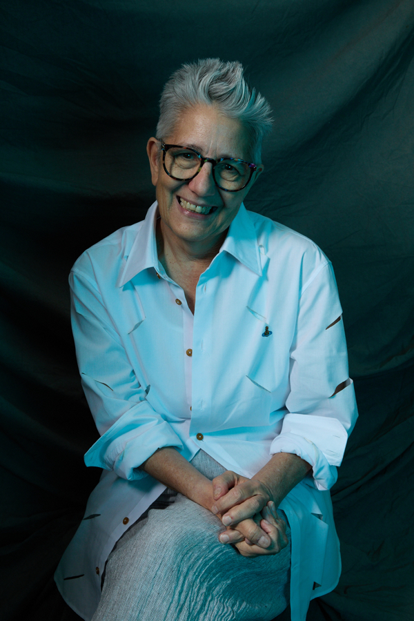

Compositora, intérprete y productora de audio. Su música de cámara, coral y orquestal ha sido encargada e interpretada ampliamente por Los Angeles Master Chorale, Bang on a Can, Chamber Music Society of Lincoln Center, California EAR Unit, The Orchestra of St. Luke's, Relâche, The Paul Dresher Ensemble, Sequitur y The American Composers Orchestra, entre muchos otros.

##### *Can I have it without begging*

Desde la década de los años ochenta, he estado creando periódicamente piezas para diversos conjuntos e instrumentación, inspiradas en las maravillosas canciones profanas de Guillaume de Machaut. He llamado a este proyecto *Machaut in the Machine Age*. *Can I have it without begging* es la séptima pieza de esta serie y toma como punto de partida la Balada núm. 19, *Amours me fait desirer* de Machaut. Fue comisionada por la National Flute Association en 2018.

#### Georgina Derbez (México, 1968)


Fue escogida por el Utopik Ensamble de Francia para representar a México en un concierto dedicado a la música contemporánea mexicana. Su catálogo comprende obras para solos, dúos, tríos, cuarteto de cuerdas, ensambles de cámaras y orquesta sinfónica. Sus obras han sido tocadas en Francia, Alemania, España, Brasil, Italia, Países Bajos, Dinamarca, Japón, Canadá y Estados Unidos. Becaria del Sistema Nacional de Creadores de Arte por cuarta ocasión, funge como maestra de Composición, Análisis y Orquestación en la Escuela Superior de Música del INBAL. Su educación musical la realizó con Marta García Renart y Ana María Tradatti en piano, y con Arturo Márquez y Ana Lara en composición, complementando con cursos de Toshio Hosokawa, Klaus Huber, Mauricio Sotelo, José Manuel López López, Brian Ferneyhough, Chaya Czernowin y Theo Loevendie.

##### *Tonada de la luna llena I*

Esta pieza toma como fuente de inspiración la obra del venezolano Simón Díaz, *Tonada de la luna llena*, y especialmente la versión de Caetano Veloso. Consiste en dos movimientos que se pueden tocar individualmente. A pedido de Asako Arai, escribí el primer movimiento de este díptico sin usar ninguna técnica extendida, de manera que sus alumnos avanzados pudieran abordarla. Sin embargo, escucharemos en la parte electrónica muchos sonidos que justamente emulan las técnicas extendidas, de forma que ambas partes se complementan. Todo el material de la electrónica proviene también de sonidos producidos por la flauta. La electrónica está sobre todo para colorear al instrumento, teniendo algunos momentos donde hace eco al material de esta. Dada la naturaleza de la fuente de inspiración, el resultado es particularmente lírico. Las piezas fueron compuestas entre septiembre y noviembre de 2020 con el apoyo del SNCA y están dedicadas a Asako Arai.

#### Kaija Saariaho (Finlandia, 1952 -- Francia, 2023)


Fue una voz destacada de su generación de compositores, tanto en su país natal como en el mundo entero. Estudió composición en Helsinki, Friburgo y París, donde residió desde 1982 hasta su muerte. Sus estudios e investigaciones en el IRCAM, el centro parisino de experimentación electroacústica, tuvieron una gran influencia en su música, y sus características texturas exuberantes y misteriosas se crearon a menudo combinando la interpretación en vivo con la electrónica. Expandió gradualmente su expresión musical a una gran variedad de géneros, y sus piezas de cámara y música coral se han convertido en piezas clave de conjuntos instrumentales y vocales, respectivamente.

##### *NoaNoa*

El título quiere decir *fragante* y refiere a un grabado en madera de Paul Gauguin. *NoaNoa* también se refiere a un diario de viaje del mismo Gauguin, escrito durante su visita a Tahití en los años 1891-1893. Los fragmentos de texto que se encuentran en la pieza de Saariaho vienen de este libro. La parte electroacústica para esta pieza se desarrolló en el Institut de Recherche et Coordination Acoustique/Musique (IRCAM).

---

### Intérpretes

#### Asako Arai

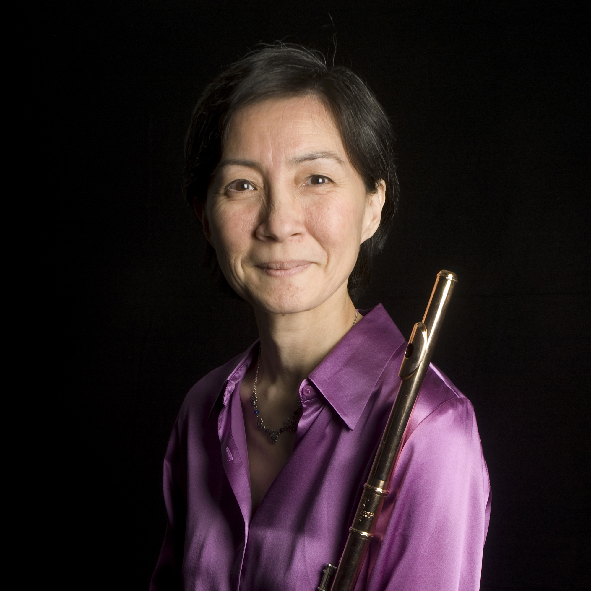

Doctora en artes musicales, es flautista del Quinteto de Alientos de la Ciudad de México y de diversos ensambles de cámara. Ha grabado varios discos para Dorian, Spartacus, Global, Soundspells, Quindecim y Urtext. Su más reciente CD para Albany Records es *Without Borders* y contiene obras comisionadas para flauta y piano. Se ha presentado como solista con la Orquesta Filarmónica de Hong Kong, el Cuarteto de Cuerdas Emerson, La Camerata y la OFUNAM. Ha recibido becas del programa Creadores Escénicos con Trayectoria del Fonca y del Fideicomiso para la Cultura México/Estados Unidos para promover la creación y difusión de obras mexicanas. Ha estrenado varias obras del repertorio contemporáneo para flauta en los festivales Internacional Cervantino y Foro Internacional de Música Nueva *Manuel Enríquez* que le ha valido elogios de crítica y público. Es profesora de flauta y música de cámara en la Escuela Superior de Música. Entre sus maestros se encuentran Samuel Baron, John Wion, Timothy Wilson y Keith Underwood.

::: logos

:::

## VIE | NOV 13, 19:00 h - Morelia: Julio I. Cervantes, guitarra

Centro Mexicano para la Música y las Artes Sonoras\
Morelia, Michoacán

### Programa

**Guadalupe Perales**

-   *Del desapego y la impermanencia* (2022) `\hfill `{=tex}8'

**Erika Vega**

-   *Y sueña que su sueño se repite* (2016)\*\* `\hfill `{=tex}7'

**Mizky Bernal Miranda**

-   *Tres-Cuatro* (2025)\*\* `\hfill `{=tex}6'

**Pedro Castillo Lara**

-   *Capricho* (2006)\*\* `\hfill `{=tex}7'

**Rosalba Quindici**

-   *Preludio* (2015)\*\* `\hfill `{=tex}3'

**Arturo M. Zanabria**

-   *Cauchemar* (2021) `\hfill `{=tex}6'

**Panayiotis Kokoras**

-   *Slide* (2002)\*\* `\hfill `{=tex}9'

**Hebert Vázquez**

-   *Ángel del abismo* (2013) `\hfill `{=tex}7'

**Julio Isaac Cervantes**, guitarra

### Personas compositoras

#### Guadalupe Perales (México, 1992)


Maestra en Composición por el Conservatorio de Música de Tianjin, China.
Interesada en la música electroacústica, el timbre, en las
colaboraciones y creaciones colaborativas, así como en la música y
cultura china de manera muy especial. Es cofundadora, arreglista e
intérprete de pipa (laúd chino) en el dúo Jiemei (Hermanas) donde junto
con Angélica Gómez Barrientos se dedica a la promoción de la música
tradicional china en México. Desde 2021 es integrante de la colectiva
Las Montoneras, dedicada a la difusión y promoción del quehacer musical
de mujeres mexicanas, en la que se desempeña como compositora y
coconductora del programa de radio *Nada clásicas*, de Opus 94. Fungió
como coordinadora de Female FEC Artists: mujeres compositoras,
intérpretes y artistas sonoras, así como de la sede Ciudad de México del
Festival Expresiones Contemporáneas de 2020 a 2022. Fue representante de
México en el 67º International Rostrum of Composers organizado por el
International Music Council.

##### *Del desapego y la impermanencia*

Dedicada a Nayeli Bernabé, esta obra es una exploración íntima que se
deriva de la reflexión en torno al dolor, al sufrimiento y el proceso
del desapego. De carácter meditativo y contemplativo, la obra se percibe
como una nube sonora que nos incita a la escucha con una actitud
reflexiva.

#### Erika Vega (México, 1987)


Compositora y violinista que explora activamente temas de
representación, interpretación, percepción y memoria, reflexionando con
frecuencia sobre cuestiones sociales y políticas. Su práctica musical
abarca la improvisación libre, la música de concierto, danza
contemporánea, medios audiovisuales y teatro musical. Ha escrito obras
para los ensambles Elision, Cepromusic y Curious Chamber Players, el
cuarteto Sigma Project, el Aleph Guitar Quartet, la Filarmónica de Los
Ángeles, la Royal Liverpool Philharmonic y el ensamble Proxima Centauri.
Estudió en la UNAM, en la BUAP y en el Royal Conservatory de Bruselas.
Es doctora por la Universidad de Oxford. Actualmente es miembro del
Sistema Nacional de Creadores de Arte en México, reside entre Oxford y
Bruselas y se desempeña como curadora de The World's Music en Oxford,
además de contribuir a la investigación académica en torno a la
intersemiótica músico-literaria.

##### *Y sueña que su sueño se repite*

Inspirada en el fragmento del poema *Muerte sin fin* de José Gorostiza:
«un instante, no más no más que el mínimo / perpetuo instante del
quebranto». La obra se construye como un laberinto sonoro, evocando la
imagen joyceana del laberinto de la conciencia, donde el pensamiento,
como el sueño, no avanza en línea recta, sino que se repliega, se
disgrega. Así como en *Muerte sin fin* la narrativa se dispersa y
retorna, en *Y sueña que su sueño se repite* el tiempo musical se
fragmenta y se repite, no para llegar a un destino, sino para habitar el
desvío. Los armónicos de la guitarra, esos sonidos frágiles, casi
espectrales, funcionan como sombras de un instante que no puede
poseerse, solo vislumbrarse. Su repetición evoca la memoria del sueño,
pero también su constante disolución. Más que contar una historia, esta
obra se deja habitar como un espacio mental: un sueño que se repite
dentro del sueño mismo. Un laberinto donde cada retorno es distinto,
aunque parezca el mismo.

#### Mizky Bernal Miranda (Bolivia, 1991)


Compositora, instrumentista y artista sonora con una Maestría en Arte
sonoro. Su trabajo se centra en la exploración de la música
contemporánea y experimental. Su música ha sido difundida por distintas
emisoras, festivales, en colaboración con diversos solistas, ensambles y
orquestas de renombre. En 2025 participó como compositora invitada en el
Festival Internacional De Arte Sonoro de TSONAMI en Chile, del 5º
International Workshop for Young Composers AntiquaNova en Argentina, el
Festival Für Zeitgenössische Iberoamerikanische Musik de Suena Festival
en Viena, en el concierto *Meditaciones* del Conservatorio Profesional
de Música de Salamanca, España, en el Acto de Sonar del Festival de
Música Contemporánea de Colombia, la International Computer Music
Conference en Boston, en el Darmstädter Ferienkurse en Alemania y en el
XXII Festival Internacional de Música Contemporánea PUCV-Darwin Vargas
en Chile.

##### *Tres-Cuatro*

Es una pieza para guitarra preparada compuesta originalmente en 2018
para cuarteto de guitarras y recompuesta en 2025 para guitarra sola. La
obra conserva en su título la huella de ambas versiones: el cuatro
señala su origen colectivo, mientras que el tres remite a las tres
cuerdas entorchadas, cuya sonoridad áspera, densa y resonante se vuelve
núcleo constructivo de la nueva escritura. La obra articula texturas
inestables, espectros abrasivos y zonas de fricción sonora que
convierten el color en forma y la materia en estructura. En este sentido
la versión de 2025 constituye una recomposición radical de su lógica
sonora. Uno de sus rasgos más singulares es que el guitarrista anuncia
en voz alta las partes de la obra, incorporando la palabra como gesto
performativo y estructural. La obra invita, así, a una escucha en la que
el sonido expone su propia arquitectura.

#### Pedro Castillo Lara (México, 1974)


Compositor, director y gestor cultural. Su obra abarca música
instrumental, electroacústica y mixta, con presentaciones en América y
Europa. Se formó en México y Francia, y obtuvo una Maestría en
Composición en la Universidad París 8 y estudios en Cevran, Miromesnil y
Nanterre. Fundador del proyecto internacional Muslab, ha impulsado la
difusión de la música electroacústica en colaboración con más de treinta
instituciones. Ha dirigido el Ensamble Muslab, Voces Latinas de París y
la orquesta de la UAM Xochimilco, explorando repertorios que van del
canto gregoriano a la creación contemporánea. Su trabajo se caracteriza
por una búsqueda poética del sonido como espacio de pensamiento, cuerpo
y resonancia. Miembro del Sistema Nacional de Creadores de Arte, combina
creación, dirección y pedagogía en una visión transdisciplinaria que
articula tradición, tecnología y transformación social.

##### *Capricho*

Es la primera obra para guitarra sola del compositor, compuesta en 2006
como resultado de un encargo de Mario Mary para el ciclo Música por
ordenador de la Universidad París 8. La pieza propone un cruce entre la
libertad estructural del capricho clásico, la fuerza rítmica del
flamenco y la gestualidad física de la música contemporánea. Con una
escritura precisa, cada gesto instrumental es explorado como impulso
expresivo. No se trata de narrar, sino de articular una dramaturgia
sonora tensa y vital, construida a partir de texturas contrastantes,
dinámicas extremas y silencios cargados. Estrenada por Bertrand
Chavarría en París y posteriormente interpretada por José Benítez en
España, *Capricho* se proyecta como una obra que abre el catálogo del
compositor con una afirmación estética clara y una voz propia dentro del
repertorio contemporáneo para guitarra.

#### Rosalba Quindici (Italia, 1976)


Su obra abarca desde la música instrumental y vocal hasta el teatro
musical, caracterizada por una exploración personal de la dimensión
sinestésica (que incluye la danza), de la cual crea y organiza los
diversos componentes. Su investigación compositiva se centra
particularmente en la construcción de la escucha fenomenológica y la
experimentación personal con el timbre en la voz y los instrumentos. Su
música es interpretada regularmente por importantes instituciones y en
los festivales Musikfestival Bern, Bienal de Múnich, Verso Traiettorie
de Parma, Nuova Consonanza de Roma y Rondò de Milán, entre otros.
Licenciada en Piano, Composición y Filosofía, profundizó sus estudios en
Italia con Corghi, Gervasoni y Sciarrino y realizó un doctorado en
fenomenología en la Universidad Federico II de Nápoles y en Suiza con
Dayer.

##### *Preludio*

Marca el primer paso de la exploración personal de Quindici sobre la
guitarra clásica, centrándose en particular en las posibilidades del
sonido continuo. La compositora ha trabajado el potencial tímbrico de la
guitarra adoptando una especie de *suspensión* del estilo de
interpretación convencional del instrumento. De hecho, la guitarra se
sostiene verticalmente entre las piernas del intérprete, con el diapasón
frente a él, y se toca no solo con los dedos, sino también con un arco
de violonchelo. El uso del arco, además de producir una calidad tímbrica
distinta, permite la creación de un sonido continuo que se opone
dialécticamente a la naturaleza discontinua de los sonidos tradicionales
pulsados del instrumento. Formalmente, sin embargo, la obra se
estructura en torno a una polifonía de gestos, que se repiten
cíclicamente, basada en notas repetidas, pizzicato, trinos y glissandos
armónicos.

#### Arturo M. Zanabria (México, 1993)


Su trayectoria está respaldada por 17 premios nacionales e
internacionales en las áreas de composición, guitarra y música de
cámara. Entre los reconocimientos más destacados se encuentran el Premio
de la Juventud 2022, otorgado por el Gobierno de la Ciudad de México y
el Premio Nacional de Composición Orquestal Raíces en 2020. Realizó
estudios de Composición y Guitarra en la Facultad de Música de la UNAM,
donde obtuvo el título con honores en ambas licenciaturas. En 2018 fue
beneficiario de la beca de la Fondation Turquois para estudiar guitarra
durante un año en el Principado de Mónaco. En 2019 recibió la beca de la
Cátedra Extraordinaria Arturo Márquez de composición musical, y en 2024
obtuvo la beca Jóvenes Creadores del Fonca. Es docente en la FaM y
miembro del Cuarteto Kuikani, Xika ensamble y el Dúo Xalpa.

##### *Cauchemar*

> «Es una obra que busca evocar una sensación inquietante, inspirada en
> una serie de pesadillas experimentadas durante un periodo específico
> de mi vida. La pieza propone una transmediación de dichas vivencias
> oníricas mediante la exploración tímbrica de la guitarra, empleando un
> arco de violín y una *scordatura* inusualmente grave».

#### Panayiotis Kokoras (Grecia, 1974)


Es catedrático de Composición y director del CEMI de la Universidad del
Norte de Texas. Su música se ha interpretado en más de mil conciertos
por todo el mundo a cargo de reconocidos conjuntos, orquestas y
solistas. Sus composiciones utilizan el sonido como única unidad
estructural. Su concepto de *textura musical holófona* describe su
objetivo de que cada sonido independiente (*fono*) contribuya por igual
a la síntesis del todo (*holos*). Tanto en la escritura instrumental
como en la electroacústica, su música se caracteriza por un virtuosismo
sonoro, una escritura hiperidiomática que enfatiza la producción precisa
de diversas posibilidades sonoras y la correcta distinción entre un
timbre y otro para transmitir las ideas y la estructura musical de la
pieza. Su producción compositiva también se nutre de la investigación
musical en estrategias de recuperación de información musical, técnicas
extendidas, sonido táctil, hiperidiomaticidad, robótica, sonido y
conciencia.

##### *Slide*

> Los colores (sonidos) no se usan porque sean fieles a la naturaleza,
> sino porque son necesarios para la imagen particular (composición).\
> 
> \hfill Wassily Kandinsky (1912)

*Slide* es una pieza para guitarra clásica y electrónica que explora las
características inusuales del lenguaje sonoro de la guitarra. Utilizando
técnicas como rascar, golpear y romper cuerdas y combinándolas con
objetos poco convencionales como *slides* de latón o vidrio, baquetas o
cepillos de metal, el compositor crea un sonido único y detallado. Cada
momento es cuidadosamente elaborado para crear una estructura dramática
coherente, donde cada gesto justifica al siguiente y al anterior,
uniendo frases, secciones y la composición misma. Con la ayuda de
herramientas digitales, se aíslan y transforman fragmentos de sonido
para revelar momentos que el oído difícilmente percibiría normalmente.

#### Hebert Vázquez (Uruguay, 1963)


Estudió composición con Mario Lavista, Lukas Foss, Leonardo Balada y
Stephen Chatman. Posee un Doctorado en Composición por parte de la
Universidad de la Columbia Británica (Canadá). Ha obtenido varios
premios y distinciones nacionales e internacionales a lo largo de su
carrera, entre los que destaca una beca de la John Simon Guggenheim
Memorial Foundation 2008, una nominación a los 18th Annual Latin GRAMMY
Awards en la categoría de mejor obra/composición clásica contemporánea
en 2017 y la presea Vasco de Quiroga, otorgada por la UMSNH en 2018. Ha
sido miembro del Sistema Nacional de Creadores de Arte en cuatro
ocasiones, de 1999 a la fecha. Su obra, interpretada en Europa, América
y Asia, ha sido grabada por el Cuarteto Arditti, el Ensemble Nomad, el
dúo Damiana, Ónix Ensamble, Ensamble 3 y los guitarristas Norio Sato,
Gonzalo Salazar y Juan Carlos Laguna, principalmente para las disqueras
Urtext y Quindecim Records.

##### *Ángel del abismo*

> «Habrá sido alrededor de 2011, en uno de mis viajes a Tokio, cuando el
> guitarrista Norio Sato, con quien colaboro intensamente desde hace
> varios años y a quien está dedicada la pieza, me preguntó si tenía
> algo escrito para guitarra y electrónica. Aunque le dije que no y él
> no insistió en el asunto, la idea me quedó rondando en la cabeza. Al
> fin, en 2013, me decidí a materializarla, gracias al apoyo de mi amigo
> Rodrigo Sigal, quien generosamente me abrió las puertas del CMMAS, y
> de la invaluable asistencia técnica de Jorge Alba. Si bien en el
> Apocalipsis se hace referencia a Abadón, el ángel del abismo sin
> fondo, yo estoy pensando en Beatriz, la de la *Divina Comedia*, quien
> ayuda a Dante a ascender al paraíso, después de que el poeta
> recorriera los nueve círculos del infierno, así como el purgatorio, en
> compañía de Virgilio».

------------------------------------------------------------------------

### Intérpretes

#### Julio Isaac Cervantes


Estudió la Licenciatura en Música en la Facultad de Artes de la UMSNH
bajo la tutela de Eva Pleskova y Hebert Vázquez. También con Horacio
Uribe, Alejandro Escuer, Luis Jaime Cortez y Gonzalo Salazar. Se ha
presentado en los festivales Internacional Pa'lo Escrito, Aires en
2023-2025, Expresiones Contemporáneas y Visiones Sonoras, así como en el
Foro Internacional de Música Nueva Manuel Enríquez (FIMNME). Su obra se
ha interpretado en Aires-2019, Laboratorio Sonoro Centro Occidente,
FIMNME, Panel de Lectura Sigma Project Quartet-Festival Callejón del
Ruido y en el Festival Internacional de Arte Sonoro Monteaudio21. Fue
ganador del Primer Encuentro Nacional de Arte y Cultura Somos
Universitarios de la UAQ en 2014 y del Concurso de Composición de Música
para Guitarra 2015. Ha sido becario del Programa Acompañarte y de
Resiliencia Sonora. Recibió el reconocimiento a la Excelencia Académica
Coparmex 2019.

::: logos

:::

## VIE | NOV 13, 19:00 h - Monterrey: Eusebio Sánchez, percusiones

Sala Chopin, Escuela Superior de Música y Danza\
Monterrey, Nuevo León

### Programa

**Kaija Saariaho**

- *Six Japanese Gardens* (1993-1995) \hfill 16'
  - *Dry Mountain Stream*
  - *Many Pleasures (Garden of the Kinkaku-ji)*
  - *Moss Garden of the Saiho-ji*
  - *Rock Garden of Ryoan-ji*
  - *Stone Bridges*
  - *Tenju-an Garden of Nanzen-ji Temple*

**Valeria Rubí**

- *Scottisch* (2020)\* \hfill 7'

**Rocío Cano Valiño**

- *Antanáklasi III* (2019)\*\* \hfill 8'

**Itzá García**

- *(Des) Balance* (2016-2017) \hfill 14'

**Hilda Paredes**

- *Tzolkin* (2001)\*\* \hfill 15'

**Eusebio Sánchez**, percusiones

### Personas compositoras

#### Kaija Saariaho (Finlandia, 1952 -- Francia, 2023)


Fue una voz destacada de su generación de compositores, tanto en su país natal como en el mundo entero. Estudió composición en Helsinki, Friburgo y París, donde residió desde 1982 hasta su muerte. Sus estudios e investigaciones en el IRCAM, el centro parisino de experimentación electroacústica, tuvieron una gran influencia en su música, y sus características texturas exuberantes y misteriosas se crearon a menudo combinando la interpretación en vivo con la electrónica. Expandió gradualmente su expresión musical a una gran variedad de géneros, y sus piezas de cámara y música coral se han convertido en piezas clave de conjuntos instrumentales y vocales, respectivamente.

##### *Six Japanese Gardens*

Obra para percusión y electrónica inspirada en los jardines que la compositora visitó en Kioto durante el verano de 1993. La pieza reúne seis *impresiones* sonoras de estos espacios, concebidas no como descripciones literales, sino como reflexiones musicales sobre el ritmo, el tiempo y la contemplación asociados a la estética de los jardines japoneses. La obra está dividida en seis movimientos, cada uno dedicado a un jardín distinto y centrado en un tratamiento particular del material rítmico. A lo largo de la pieza, Saariaho explora la transformación gradual del ritmo: desde gestos simples que presentan la instrumentación hasta complejas polirritmias, ostinatos y contrastes entre secciones rítmicas y materiales más tímbricos o colorísticos. La instrumentación de percusión se mantiene deliberadamente reducida para resaltar la evolución de estos procesos rítmicos, mientras que la electrónica amplía el paisaje sonoro mediante sonidos naturales, cantos rituales y percusiones.

#### Valeria Rubí (México, 1991)


Es compositora, productora de radio y productora general de Nosotras Sonamos Radio. Desde 2013 colabora en Radio Nuevo León como productora y conductora de programas como *Tempo Rubato*, *Sala de Conciertos* y *Posmo*, además de producir *Tetralemas*, *Clásicos en el Cine* y *Radiolectura*. Su música ha sido interpretada en escenarios de Monterrey, Guadalajara, San Luis Potosí y Ciudad de México, y ha participado en los festivales de Música Nueva Monterrey (2016, 2022), de Composición UANL y Ella es Música de Radio IMER. Ha trabajado con el Trio Siqueiros, el Quinteto Naui y Gustavo Villegas. Es fundadora de la Colectiva Tsunami, con quien grabó *Tsunami Sonoro* en 2022, y actual presidenta del Colegio Neolonés de Compositores, promoviendo la música de concierto en Nuevo León.

##### *Scottisch*

La obra es una composición experimental para instrumentos reciclados (latas, plástico y cartón), cinta y procesamiento en vivos. Basada en el chotis, toma elementos rítmicos y formales de este género tradicional, reinterpretándolos mediante texturas percusivas y electrónica en tiempo real. Cada instrumento es manipulado para crear sonidos opacos, modulados a través de Ableton Live con efectos como reverberación, delay y eco, ofreciendo un diálogo entre lo acústico y lo digital. La pieza permite al intérprete explorar libremente la sonoridad y los procesos electrónicos, generando un paisaje tímbrico único. No ha sido estrenada públicamente; se presentó únicamente en conciertos virtuales durante la pandemia como parte del proyecto *Horizontes Tímbricos*, apoyado por CEIIDA UANL.

#### Rocío Cano Valiño (Argentina, 1991)


Nacida en Buenos Aires y radicada en Lyon, Francia. Su producción se centra en obras instrumentales, mixtas y electroacústicas que exploran timbre, pulsación y combinaciones rítmicas a través de un lenguaje sonoro contemporáneo. Es cofundadora y miembro del comité artístico del Ensemble Orbis en Lyon, con el que colabora y para el que ha creado diversas piezas. Su música ha sido interpretada por agrupaciones como Proxima Centauri, HANATSU miroir, Paramirabo, Ensemble Ars Nova, Q-SION y otras formaciones internacionales. Ha recibido encargos y apoyos de instituciones como Radio France, Festival Présences, Ministère de la Culture de Francia, GRM, Ibermúsicas y el Fondo Nacional de las Artes de Argentina, entre otros, y ha obtenido premios en concursos internacionales de música electroacústica y composición.

##### *Antanáklasi III*

Forma parte del ciclo *Antanáklasi*, inspirado en el cuadro *Al espejo* de la artista argentina Gabriela Aberastury. El título significa reflejo en griego y cada obra del ciclo explora la relación entre objeto y reflejo a través de instrumentos solistas con o sin electrónica. En esta tercera pieza, escrita para percusión y electrónica, se refleja la división vertical del cuadro: un lado prismático y tridimensional frente a otro bidimensional de líneas imprevisibles. Musicalmente, esto se traduce en la imitación y transformación de materiales, donde los gestos percusivos son capturados y procesados electrónicamente, creando un juego de reflejos sonoros. La obra explora también el intercambio de roles entre objeto y reflejo, generando una percepción constante de ambigüedad y transformación en el tiempo, diálogo entre lo acústico y lo electrónico, y un paisaje sonoro que invita a la contemplación y la reinterpretación visual a través del sonido.

#### Itzá García (México, 1993)


Compositora radicada en Nueva York cuyo trabajo explora la relación entre tiempo, interacción social y tecnología en la música contemporánea. Su práctica combina instrumentos acústicos, tecnologías aumentadas y aprendizaje automático, investigando cómo la sonoridad puede transformarse mediante datos y procesos tecnológicos. Su obra ha sido interpretada por JACK Quartet, Ensemble Musikfabrik, Yarn/Wire, Talea Ensemble y Cepromusic. Ha recibido apoyos como la beca Conacyt, residencias en el Atlantic Center for the Arts y Zurich University of the Arts, y reconocimientos en innovación sonora. Actualmente cursa un Doctorado en Composición en The Graduate Center, CUNY, y es cofundadora del festival Overdrive, dedicado a música electrónica y experimental.

##### *(Des) Balance*

Explora la riqueza tímbrica del platillo a través de su interacción con electrónica en tiempo real. La obra divide la superficie del platillo en *rim*, *bow* y *bell*, empleando técnicas de apagado parcial, sostenido y rebote de baqueta para generar sonidos granulares y metálicos. La electrónica amplía y transforma estos gestos, produciendo ataques en reversa, nubes de granulación y resonancias armónicas que se mezclan con el timbre natural del instrumento. La pieza juega con la transición entre sonidos largos y cortos, *acelerandos* y *rallentandos* de granulación, creando un flujo continuo donde el platillo se convierte en fuente sonora dinámica y expresiva, mientras la interacción con la electrónica genera un paisaje acústico en constante transformación y exploración del color sonoro.

#### Hilda Paredes (México, 1957)

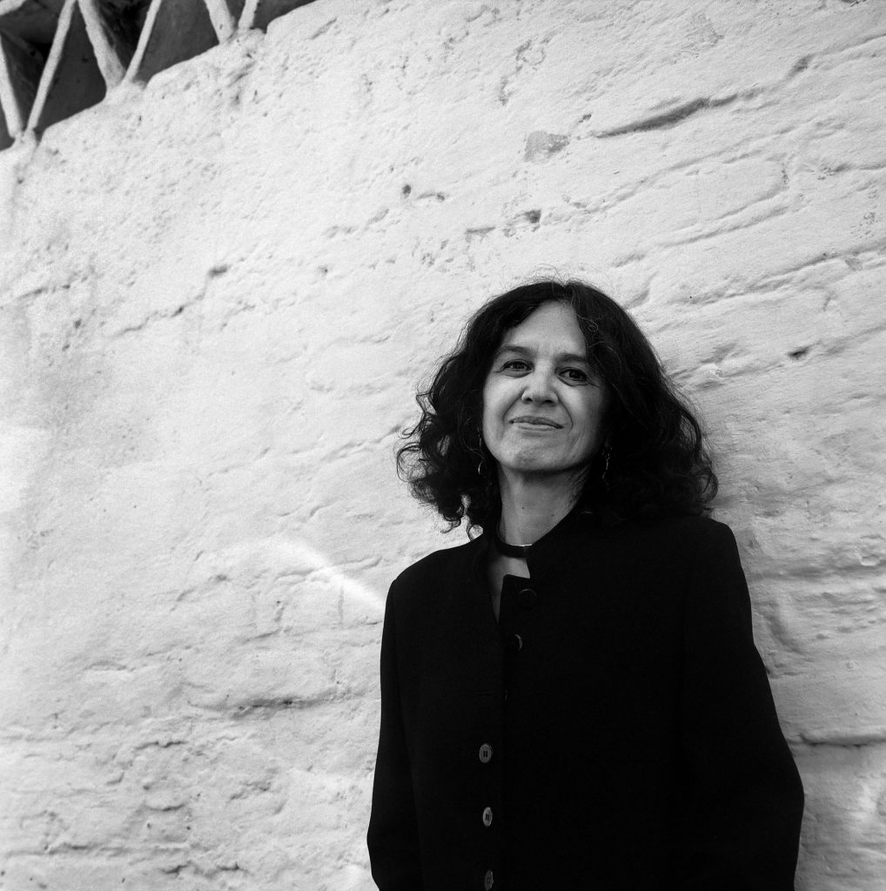

Su obra se caracteriza por una exploración profunda del timbre, el ritmo y la relación entre instrumentos acústicos, electrónica y voz, integrando con frecuencia referencias culturales y literarias. Realizó estudios de Composición en México y posteriormente en el Guildhall School of Music and Drama en Londres, ciudad donde ha desarrollado gran parte de su carrera. Su música ha sido interpretada por destacados ensambles y orquestas internacionales y presentada en festivales y foros especializados en música contemporánea. El catálogo de Paredes incluye obras de cámara, orquestales, vocales, electroacústicas y óperas, en las que combina investigación sonora con un fuerte sentido expresivo. Su trabajo ha contribuido de manera significativa a la proyección de la creación musical mexicana en el ámbito internacional.

##### *Tzolkin*

Es una obra para percusión sola inspirada en el calendario ritual maya del mismo nombre. Concebida como una pieza de carácter ceremonial, la obra explora la relación entre ritmo, tiempo y transformación sonora a través de ciclos rítmicos derivados de diferentes tradiciones culturales. La pieza se organiza en dos grandes secciones. La primera presenta un carácter meditativo construido a partir de ciclos de 13 pulsos, número asociado al sistema calendárico maya, donde los patrones rítmicos se repiten y gradualmente se transforman. La transición hacia la segunda sección está influida por la serie de Fibonacci, generando un proceso de expansión y cambio estructural. En la segunda parte, el discurso se vuelve más dinámico y virtuosístico mediante complejos ciclos rítmicos inspirados en principios de la música del norte de la India, donde las frases suelen repetirse tres veces antes de resolver en un nuevo ciclo.

---

### Intérpretes

#### Eusebio Sánchez


Es percusionista, concertista y productor, originario de Monterrey. Graduado con mención honorífica de la ESMDM y con Maestría en Percusión por la Universidad Alfonso X el Sabio de Madrid, también cursó Ingeniería en Producción musical en el Tecnológico de Monterrey. Ha sido becario de Cemex, Anglo Arts y City Music Foundation. Fundador del ensamble Q-SION y de la asociación Sol Sonoro, ha colaborado con compositores como Hilda Paredes, Alejandro Basulto y Martín Matalón. Su trabajo ha sido presentado en México, Reino Unido, Japón, Francia, España, Austria y Colombia. Entre sus proyectos destacan *Xilitla*, *El amor y la muerte*, *Ambivalencias* y Supersónica. Ha participado en los festivales PASIC, FIMNME y Fête de Morts. Reconocido por programas como EFCA, CEIIDA, PADID, OneBeat e Ibermúsicas, continúa impulsando la proyección internacional de la música mexicana de concierto.

::: logos

:::

## VIE | NOV 13, 19:30 h - Mérida: Carmen Maldonado, percusión teatral

Universidad de las Artes de Yucatán\
Mérida, Yucatán

### Programa

**Eduardo Rivas**

- *Extremidad ausente* (2025) \hfill 8'

**David Puc**

- *Artibeus jamaicensis* (2023) \hfill 10'

**Amaury León**

- *Agarrando señal* (2025)\*\* \hfill 5'

**Manuel López**

- *Homún* [2a versión] (2024) \hfill 8'

**Robert Constable**

- *Dies Irae* (1996) \hfill 10'

**Carmen Maldonado**, percusión teatral

### Personas compositoras

#### Eduardo Rivas (México, 1995)

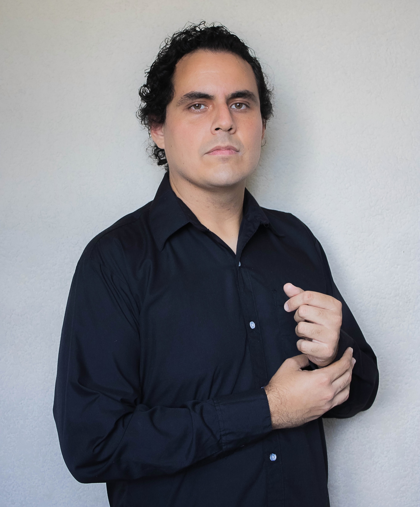

Compositor, improvisador y artista interdisciplinar de Mérida. Clarinetista formado con Paolo Dorio, ha sido músico invitado de la Sinfónica de Yucatán. Es licenciado y maestro en Artes Musicales por la UNAY, donde estudió con Javier Álvarez. Ha tenido revisión de obra, talleres y clases magistrales con Marcelo Toledo, Eva Zöllner, Heather Roche, Rodrigo Sigal, Juan Sebastián Lach Lau y Mauricio Valdés San Emeterio, entre otros. Su música la han interpretado los ensambles Zöllner-Roche y Sequenza Sur, en los festivales Aires Nacionales y Visiones Sonoras. Obtuvo la mención honorífica en el Primer Concurso Estatal de Composición *Daniel Ayala Pérez* con la obra *La luz empieza a vomitar*. Fue beneficiario de PECDA 2019 y Fortalecimiento a Jóvenes Creadores de Yucatán 2020. Su trabajo abarca creación, producción, docencia, difusión y aprendizaje, crítica de cultura, tecnología del arte y gestión.

##### *Extremidad ausente*

La obra explora el síndrome del miembro fantasma, una sensación persistente tras una amputación y su metáfora en la música. La música se presenta como una fantasía a través de la granulación de un material conductor, expandiéndose y contrayéndose tímbricamente, pero siempre hablando de algo ausente. Aunque la electrónica podría parecer el cuerpo perdido, la música difumina estos límites, cuestionando si la ausencia está en lo que se fue o en lo que queda. El título juega con la idea de la extremidad como límite y punto de no retorno, explorando la pulsión por lo perdido y la paradoja de lo que nunca se fue.

#### David Puc (México, 1995)

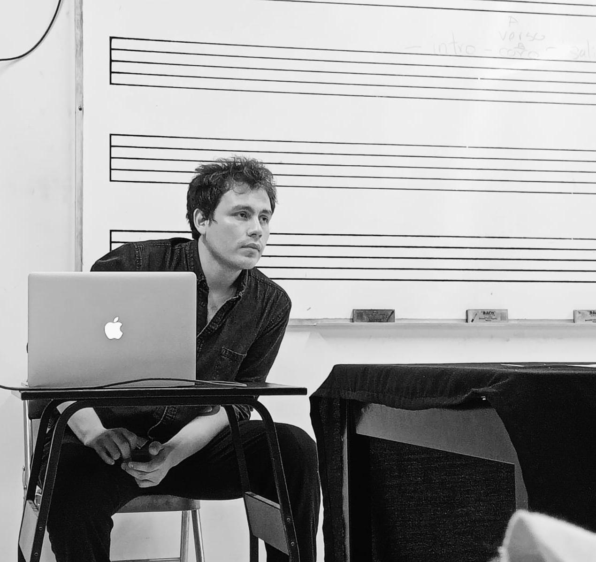

Compositor, artista sonoro e improvisador de Mérida. Es licenciado en Artes musicales con especialización en Composición por la UNAY. Su trabajo explora la música como acción, el sonido como flujo sensible, el ruido como táctica y la escucha como práctica vital. Se dedica a la interdisciplina, la creación colectiva, la improvisación libre, la música electroacústica y la escenofonía. Su música se ha presentado en festivales como Tsonami Arte Sonoro y Sur Aural. Actualmente forma parte del ensamble K'áak'náab y el colectivo Hifa. Trabaja en la Licenciatura en Danza contemporánea de la UNAY y realiza ensayos sobre metodología semiótica en el Cenidiap.

##### *Artibeus jamaicensis*

Cenote en español, dzonot en maya, es una especie de lago en cavernas interconectadas bajo la superficie de la península de Yucatán. Es ahí donde habita el *Artibeus jamaicensis*, una especie de murciélago pequeño y frugívoro que se encarga de polinizar el viejo y místico árbol, Ramón regenerando el espacio en caso de que la caverna colapse. La pieza es una inmersión en ese espacio sagrado desde la ecología acústica y la composición musical.

#### Amaury León (México, 1986)

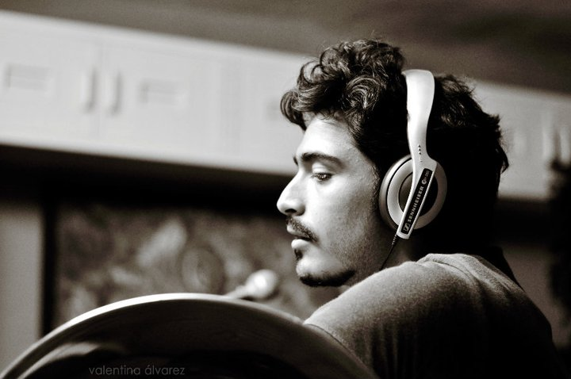

Inició estudios de Composición en la UNAY en 2007 y Tuba en 2012, experimentando luego con trompeta y bombardino. En 2014 creó el proyecto de música electrónica WiroWero. En 2017 compuso para la obra de teatro *Lunas mujeres que caminan bajo el agua* y su obra *Energy* apareció en el disco *Osmon* vol.7 de la Universidad de Tennessee. En 2018 se unió al teatro Oveja Negra, componiendo para *Morritz y el pequeño Mons* y *La niña de maíz y sal*. En 2019 estrenó *Bocanada* con la Universidad de Tennessee y *Blue Underworld* con la de Houston. En mayo estrenó *Río* con la Universidad de Tennessee. Actualmente cursa la Maestría en Artes, haciendo cruce entre arte y ciencias mientras experimenta improvisación junto a Carmen Maldonado.

##### *Agarrando señal*

Pieza experimental para percusionista con tarola y theremín que plantea un diálogo interno y como este se interrumpe por distracciones del mundo moderno a través de señales que dejamos pasar desde lo digital o señales que interactúan con nuestro campo energético. Este dueto acentúa y reflexiona un mundo que día a día se moldea y enfoca.

#### Manuel López (México, 1982)

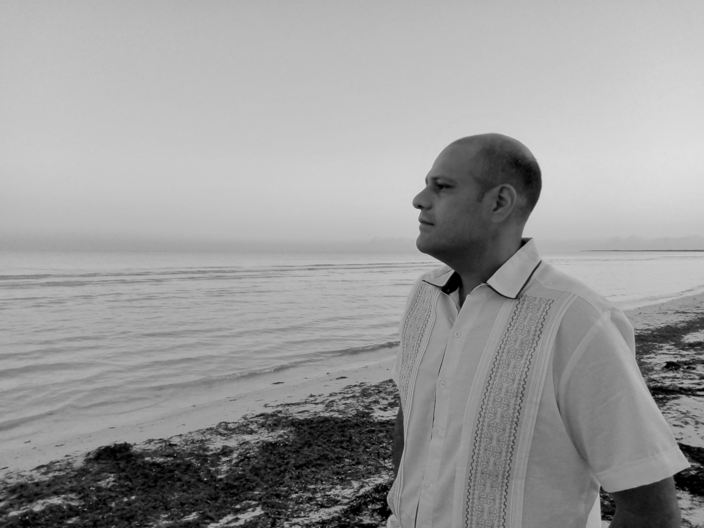

Compositor, docente y músico de Mérida. En 2016, obtuvo el segundo lugar en el Concurso de Composición del 150 Aniversario del Conservatorio Nacional con la obra *...Sabda...II* y en 2022 fue finalista en el Primer Concurso Internacional de Orquestación de la asociación francesa Coups de Vents. Su trabajo ha sido seleccionado en tres ediciones del Foro Internacional de Música Nueva *Manuel Enríquez* y sus partituras han sido interpretadas por agrupaciones como la Orquesta de Cámara de Bellas Artes, el Ensamble Tempus Fugit, el Cuarteto de Cuerdas Untref y la Orquesta Sinfónica de la UNAY. Ejerce una sólida labor académica y creadora en la UNAY, donde es profesor y cursa la Maestría en Artes musicales bajo la tutoría de Julio Estrada. Es director artístico de SequenzaSUR, ensamble de música contemporánea en residencia de la universidad.

##### *Homún* (2a versión)

Es una obra que hace alusión al cenote Homún, que juega con la fonética del nombre, los materiales que evocan sonidos del cenote y la propia convivencia con el espacio geográfico. En esta versión, la flauta es sustituida electrónicamente para convertirla en solo de multipercusión y electrónica.

#### Robert Constable (Estados Unidos, 1958)

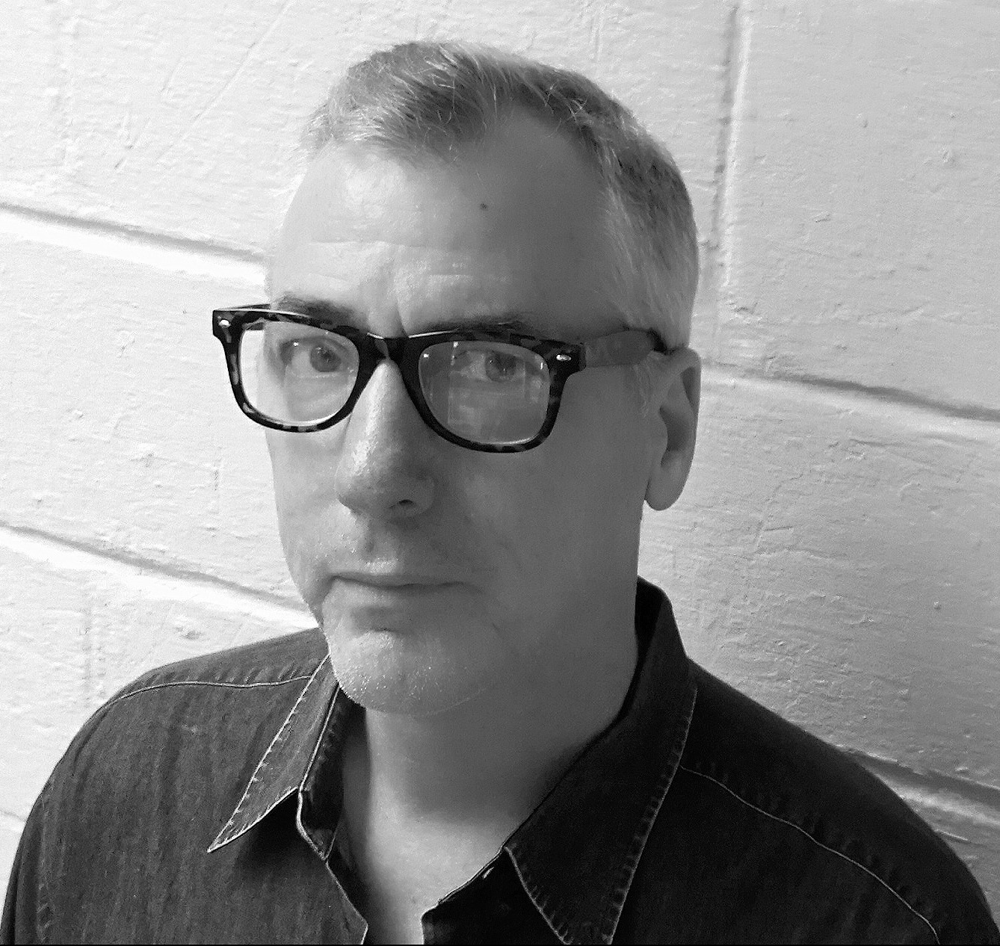

Lleva cincuenta años componiendo música y sus obras se han interpretado en todo el mundo. Formado en la Universidad del Sur de Florida y en la Escuela de Música Eastman, recibió una beca Fulbright para estudiar con György Ligeti en Alemania. De 1993 a 2005 participó activamente como director y miembro del Festival Bonk de Música Nueva en Tampa Bay. Recibió el encargo de componer una fanfarria para metales con motivo de la inauguración del nuevo Museo *Salvador Dalí*, en San Petersburgo, Florida. Es miembro del Hermitage Artist Retreat desde 2019. En 2023 creó el festival de música de vanguardia Mérida Clásica Moderna, cuyos primeros conciertos tuvieron lugar en 2024. Actualmente está finalizando la banda sonora del innovador documental de Miguel Ventura Herrera *Encontrando a Felipa Poot*.

##### *Dies Irae*

Obra teatral dramática coreografiada en la cual se incluyen imágenes para facilitar su aprendizaje. La composición está impregnada de percusión al estilo de las marchas militares.

---

### Intérpretes

#### Carmen Maldonado

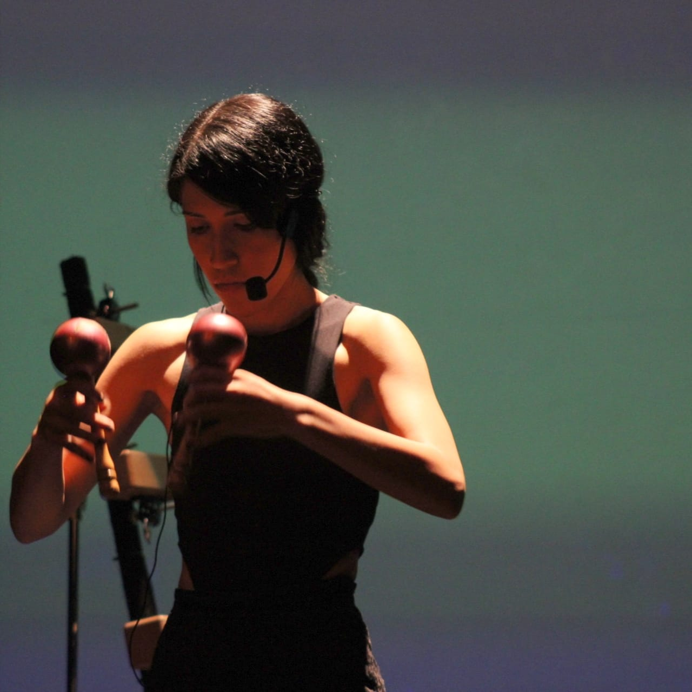

Percusionista mexicana interesada en entender el mundo mediante el arte y otras disciplinas. Con enfoque en la percusión teatral, crea imágenes a partir de las posibilidades tímbricas de objetos, a veces llamados instrumentos, caracterizando lo audible con gestos y movimientos. Trabaja con la memoria universal y su impacto bio-psico-sociocultural-espiritual. Realizó su Licenciatura en la Escuela de Música Vida y Movimiento del Centro Cultural Ollin Yoliztli. Desde 2008 ha incursionado en el repertorio solista, orquestal y de cámara en diferentes agrupaciones. Actualmente reside en Mérida y es intérprete de *Metamorfosis*, música teatral para percusiones. Fundadora del Colectivo Hifa, el dueto NóduloSA y equipos de trabajo experimentales involucrados en proyectos interdisciplinares entre arte y ciencia, forma parte del Ensamble Contemporáneo de la Universidad de las Artes de Yucatán en el área de percusiones, donde también es docente.

::: logos
{recorte="0 0 0.69 1"}
{recorte="0.74 0 1 1"}
:::

## SÁB | NOV 14, 17:00 h - Acapulco: Fabián Rangel

Centro Cultural Domingo Soler\
Acapulco, Guerrero

### Programa

**Feliza Ruiz**

- *Kintsugi* (2025)\* \hfill 7'

**Eunice Shanti**

- *Metamórfica* (2021) \hfill 4'

**Kat Farn**

- *Oiseaux du Paradis* (2025)\* \hfill 10'

**Héctor Ulises Vera**

- Estudio para violín (2025)\* \hfill 5'

**Gabriela Maravilla**

- *EE2* (2025) \hfill 6'

**Jorge Arturo Ángeles Lerma**

- Tres miniaturas (2024)\* \hfill 6'

**Edgar Guzmán**

- *Reboot* (2014) \hfill 10'

**Liliana Rodríguez Alvarado**

- *2021--2026* (2026)\* \hfill 6'

**Manuel Enríquez**

- *Móvil II* (1967) \hfill 8'

**Fabián Rangel**, violín

### Personas compositoras

#### Feliza Ruiz (México, 2000)

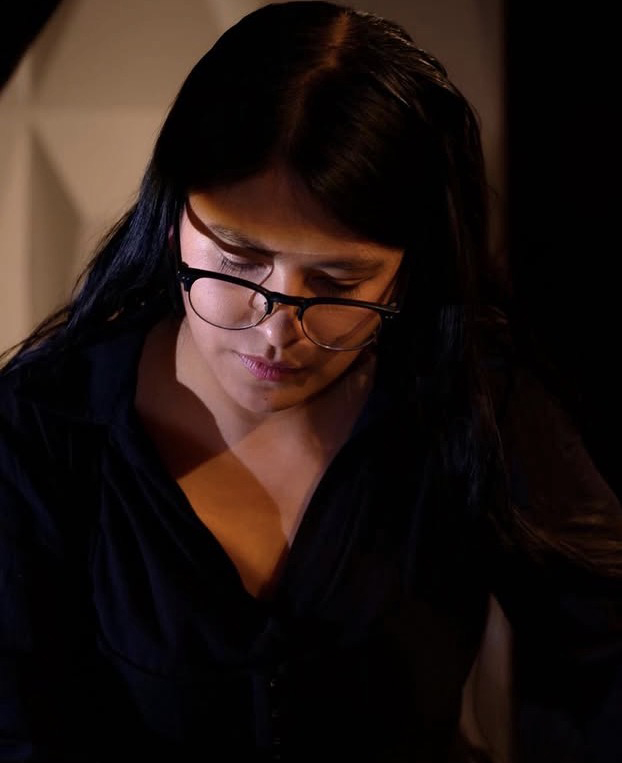

Compositora, pianista y gestora cultural. Formada en la Escuela Superior de Música bajo la cátedra de Mauricio García de la Torre y Carole Chargueron. Ganadora del segundo lugar en el Concurso Nacional de Composición de la Orquesta Filarmónica de Xalapa 2021. Es fundadora y actual coordinadora de producción de Filarmónica del Lago. Ha estudiado con Jorge Torres Sáenz, José Enrique González Medina, Juan Pablo Contreras, Alejandro Romero, Pierre Arnaud Le Guerinel y Daniel Fuentes-Berain. Su catálogo abarca obras para solista, música de cámara, coral, orquestal y electrónica. Su obra ha sido interpretada por el Ensamble de Música Nueva de la Facultad de Música de la UNAM, el Quinteto de Alientos de la Ciudad de México y la Banda Sinfónica de la UCLM de Cuenca, España. Ha participado en los festivales Aires, Mecánicas Inmersivas y En Fase.

##### *Kintsugi*

Obra para violín solo, inspirada en la canción *Como la cigarra* de María Elena Walsh. La obra recorre tres momentos importantes correspondientes con el concepto original de Walsh: la transformación continua y el permanente resurgimiento de uno mismo. El primer momento es una melodía inicial que inicia el tránsito; después una sección intermedia de suspensión y, por último, una sección en la que la melodía reaparece transformada, marcando, así, un ciclo.

#### Eunice Shanti (México, 1988)


Estudió piano y la Licenciatura en Filosofía en la Universidad de Guadalajara, y composición en el Conservatorio Nacional de Música con Itziar Fadrique y Juan Fernando Durán. En 2018 se incorporó al Laboratorio de Creación Musical impartido por Julio Estrada en la Facultad de Música de la UNAM. Ha tomado clases y seminarios con Cristian Morales Ossio, Peter Ablinger y Juan Cristóbal Cerrillo. Sus obras han sido presentadas en México, Canadá, España, Alemania y Polonia, y ha participado en diversos encuentros de música contemporánea, entre ellos el festival Diferencial-Música Nueva en el Cenart, el Seminario de Música Contemporánea de la UNAM, el Festival Aires, las Jornadas de Música Contemporánea de Nerja en España, el Festival Internacional [CON] TEMPO de España, el Mes de la Música Contemporánea en Berlín y el Evento Internacional Viento-Madera en Polonia.

##### *Metamórfica*

Basada en el elemento tierra, esta obra toma inspiración de las rocas metamórficas, cuyo nombre proviene del griego meta (cambio) y morphe (forma), aludiendo a su *cambio de forma*. Estas rocas, a través de procesos geológicos, experimentan profundas transformaciones estructurales y mineralógicas. De manera análoga, la pieza musical explora un viaje de transformación sonora, donde emergen nuevas texturas con cambios dinámicos y contrastes tímbricos; el violín se convierte en un símbolo del fenómeno morfológico de las rocas en constante metamorfosis.

#### Kat Farn (Reino Unido, 2004)

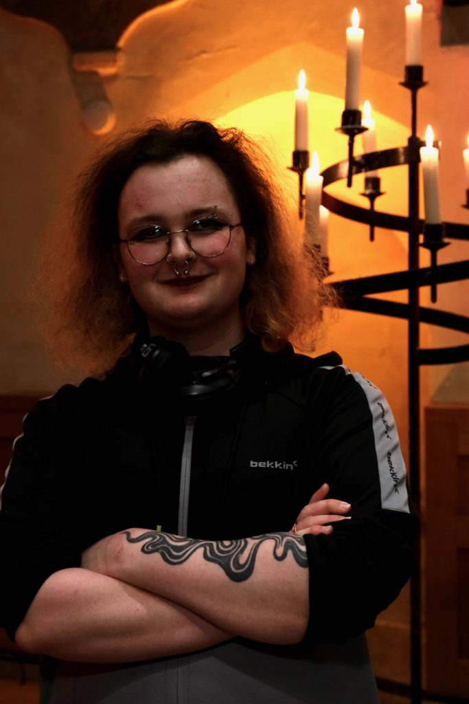

Organista, clavecinista, pianista y compositora originaria de Sheffield. Actualmente estudia composición en el Real Conservatorio de Birmingham. Su música ha sido interpretada por Radek Toplanský y Justin J. Murphy-Mancini, entre otros, así como por el RBC's Thallein Ensemble.

##### *Oiseaux du Paradis*

Está basada en la canción del mismo título de Maurice Ravel, y explora el material de una manera postespectral, acentuando los armónicos de las líneas cantadas. La pieza está escrita para un instrumento solista indeterminado y de ese modo la trasposición, ya sea en notas sencillas en octavas o la pieza entera, es aceptada. Las secciones serán tocadas en cualquier orden y repetidas cualquier número de veces, y no todas las secciones podrán ser oídas. De manera opcional, los intérpretes pueden incluir procesos electrónicos en vivo como se acomoden; la compositora no tiene preferencias y deja la decisión al intérprete.

#### Héctor Ulises Vera (México, 1985)

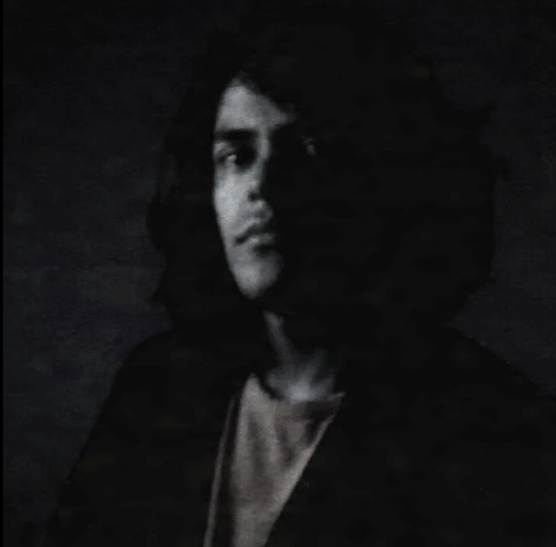

Nacido en la Ciudad de México. Estudió piano y composición en la UNAM. Fue ingeniero de grabación en diferentes estudios, actividad que lo motivó a profundizar en la música electroacústica. Participó en el colectivo de música experimental Ruido 13, enfocándose en la improvisación con la viola como instrumento principal. Su actividad como docente de alumnos con diversas discapacidades lo ha llevado a la exploración de partituras táctiles y auditivas para músicos ciegos y sordos, integradas con las nuevas tecnologías. Sus obras se han programado en diversos foros y festivales de México, Japón, Taiwán, Francia, Reino Unido, Portugal, Argentina y Canadá. Es cofundador y bajista de la banda de metal Voltax, con la que ha realizado grabaciones, además de presentarse en foros y festivales de América y Europa.

##### Estudio para violín

La intención de la composición de este estudio fue explorar el *caos* armónico y las diferentes sonoridades que se pueden generar con la distorsión provocada por la fuerte presión del arco sobre las cuerdas conjunto a la dinámica, la posición del arco entre el *molto sul ponticello* y el *molto sul tasto* y los sonidos flautados al pisar superficialmente las cuerdas. La noción de motivos melódicos o alturas definidas son sustituidos por secuencias de gestos que se forman entre la variación armónica y temporal de la distorsión y los sonidos flautados y airosos que puede generar el violín, de tal manera que los sonidos armónicos resultantes son muy susceptibles a los cambios sutiles existentes en distintas interpretaciones. Todo esto dentro de una estructura discursiva que juega entre la contención continua y los cambios abruptos de timbre e intensidad.

#### Gabriela Maravilla (México, 1994)


Filósofa por la UNAM bajo la asesoría de Axel Barceló, aplicó el estudio lingüístico de Sperber y Wilson a la notación musical. Licenciada en Composición por la Escuela Superior de Música donde estudió con Jorge Torres. Estudió con César Juárez-Joyner. Es egresada de la Maestría en Ópera experimental por la UNTREF de Argentina, donde fue becaria Conacyt-Cultura. Su música se ha tocado en México, Costa Rica, Alemania, Francia, Finlandia, España, Estados Unidos y Argentina. Ha presentado su trabajo sobre filosofía antigua en el Coloquio de Estudiantes de Letras Clásicas FFyL; de teoría y notación musical en Sepehismume, UACM y EdauTemus, FaM. Ha publicado en *Revista Interliteraria*, *Filosofía en la Red* y *Designio* de Colombia. Ha sido becaria del Fonca, jurado en Contigo a la Distancia, comisionada en Resiliencias Sonoras; es docente en la escuela autogestiva Mirabilia desde 2020.

##### *EE2*

Se trata de una pieza interactiva para violín y electrónica controlada por MAX/MSP. Esta pieza es abierta, lo que significa que hay muchos resultados posibles de ejecución y de la forma musical ante las posibilidades mostradas en la partitura. Es interactiva, ya que existe una reciprocidad de participación entre el ejecutante del violín y quien active el *patch* de MAX/MSP. Esto significa que se procurará que no haya una supremacía de un instrumento sobre el otro; se intenta que MAX/MSP funja como otro ejecutante. Por un lado, el *patch* anticipará al violín, el cual se guiará auditivamente a partir de las muestras arrojadas. En cierto modo esta pieza es una especie de guía sonora ante las acciones que realizará el violín: una especie de improvisación guiada a partir de lo establecido en los diferentes recuadros que le corresponden dentro de la partitura. También existe la posibilidad de que el violín intente anticipar la muestra que tocará el *patch* de MAX/MSP.

#### Jorge Arturo Ángeles Lerma (México, 1992)

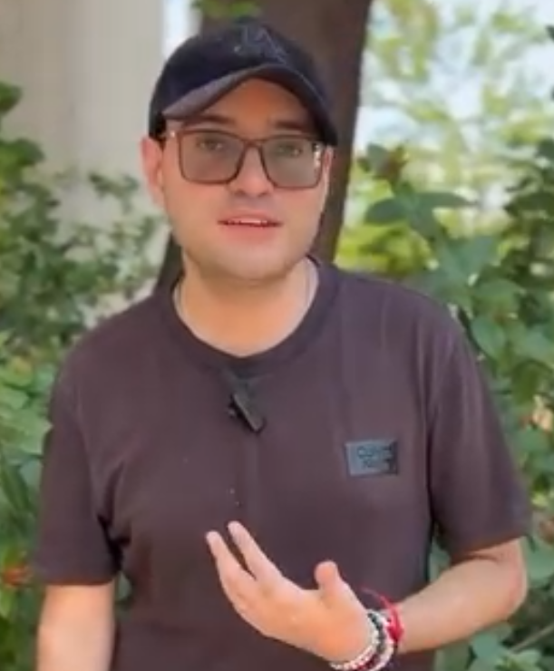

Nació en Chilpancingo. Realizó sus estudios musicales en el Conservatorio de las Rosas en Composición bajo la tutela de Horacio Uribe, Eduardo Solís, Juan Sebastián Lach Lau y Luis Jaime Cortez. Laboró como copista para la Sinfónica de Michoacán. Participó en dos ocasiones en el Festival *Miguel Bernal Jiménez*: la primera en 2013, como director en campanario en la obra de intervención sonora urbana del compositor Llorenç Barber y la segunda en 2014, como integrante de la Coral de las Rosas. Su obra ha sido transmitida por la Sociedad de Violas de Filadelfia en 2022, y ha sido interpretada por el Cepromusic en el marco del Foro Internacional de Música Nueva *Manuel Enríquez* en 2024 y 2025, y la Orquesta de Cámara del Tzintzuni en 2021.

##### Tres miniaturas

Tomando como inspiración la técnica japonesa de restauración llamada kintsugi y utilizando la forma clásica rápido-lento-rápido, esta pequeña obra se presenta en tres movimientos sin ninguna pausa entre ellos, formando así la totalidad de la obra, que, aunque fragmentada, sigue representando un todo completo.

#### Edgar Guzmán (México, 1981)


Compositor de música acústica de cámara, electrónica y mixta. Su producción incluye obras para solista, ensamble y orquesta, comisionadas por y dedicadas a diversos intérpretes, ensambles e instituciones como Los Angeles Philharmonic, International Contemporary Ensemble, Orquesta Sinfónica Mexiquense, Orquesta Sinfónica Juvenil de México, Ensamble Liminar, Ensamble de Música Contemporánea de la Universidad Autónoma de Baja California y solistas como Wilfrido Terrazas, Alexander Bruck, Rebekah Heller, Kivie Canh-Lipman y David Bowlin, entre otros. Su obra musical ha sido presentada en México, Estados Unidos, Canadá, Brasil, Argentina, Chile, Venezuela, Colombia, Austria, Francia, Polonia, Alemania, Suiza y Países Bajos.

##### *Reboot*

Término usado para describir el proceso de reiniciar una computadora o aparato electrónico. A veces reiniciar es necesario para recuperar algo que estaba incorrecto en los drivers o el hardware.

#### Liliana Rodríguez Alvarado (México, 1989)


Nació en Torreón, estudió Composición en el Conservatorio de las Rosas bajo la tutela de Juan Sebastián Lach y Eduardo Solís Marín. Su música es concebida desde la improvisación, la significación de números, la poesía, los objetos como instrumento, el silencio con la contemplación, la electrónica simple (sinusoidales) con batimentos y la microtonalidad.

##### *2021 -- 2026*

La obra contiene elementos tradicionales y de la actualidad. La escritura, la agógica y los elementos armónicos son tradicionales; sin embargo, la interpretación, sonoridades, lectura de texto e improvisación son elementos de la cultura sonora contemporánea.

#### Manuel Enríquez (México, 1926-1994)


Originario de Ocotlán, Jalisco, fue una figura fundamental de la vanguardia musical en México. Se formó con Áurea Corona y Miguel Bernal Jiménez, perfeccionándose después en la Juilliard School con Ivan Galamian y Peter Mennin. En 1961, gracias a la beca Guggenheim, incursionó en la música electrónica en Columbia y Princeton bajo la guía de Stefan Wolpe. Como violinista, fue concertino de la Sinfónica de Guadalajara y fundó el célebre Cuarteto México, con el que realizó giras por Europa y América. Su labor docente y administrativa fue vasta: dirigió el Conservatorio Nacional y el Cenidim, donde impulsó la investigación electroacústica y virreinal. En 1979 fundó el Foro Internacional de Música Nueva (que hoy lleva su nombre), espacio vital para la difusión de la creación contemporánea. Distinguido como Creador Emérito y miembro de la Academia de Artes, su legado permanece como pilar de la identidad musical mexicana del siglo XX.

##### *Móvil II*

Es una composición musical para cualquier instrumento de cuerda frotada y electrónica. En esta ocasión se presenta con violín, instrumento con el que se ha popularizado su interpretación, probablemente debido a que el propio autor la interpretó en público y dejó registro de ella en una versión grabada en Madrid, en 1967, con el que fue su instrumento de formación. La obra consta de una hoja de símbolos gráficos y nueve módulos independientes entre sí. Cada módulo incluye diversos símbolos distribuidos en el espacio, que se combinan con indicaciones tradicionales para generar una serie de frases conformadas por *gestos*. Esta obra emplea una técnica composicional que requiere decisiones creativas del intérprete.

---

### Intérpretes

#### Fabián Rangel

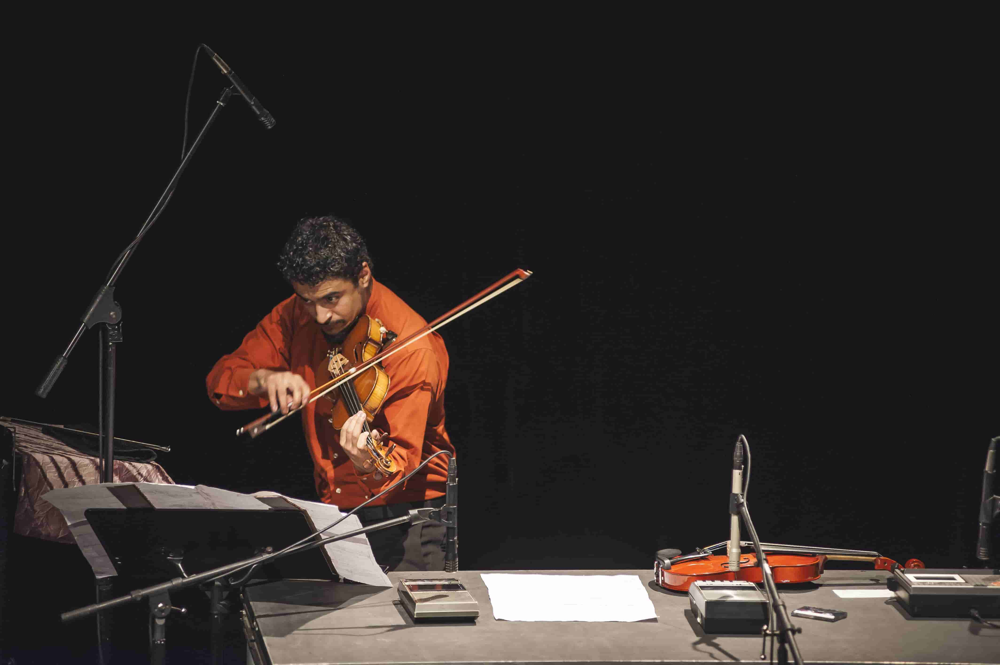

Violinista que se desenvuelve principalmente en la música contemporánea y experimental. Ha tocado con los ensambles Liminar, Templum, Generación Espontánea y Sonidero 13. Es director del proyecto Shilti desde 2013. Fue parte del Evolution Ensamble, que organizó el International Contemporary Ensamble, desde Nueva York. Participó en el 44 FIMNME. Estudió en la Escuela Vida y Movimiento del Centro Cultural Ollin Yoliztli, la Orquesta Escuela *Carlos Chávez* y la Escuela Superior de Música del INBAL (ESM). Fue integrante de las orquestas Sinfónica Juvenil del Estado de Veracruz, Sinfónica Mexiquense y Sinfónica Juvenil *Eduardo Mata*. Se ha presentado en México, Estados Unidos y Argentina. Estudió la licenciatura con Elwira Krengiel en la ESM y actualmente forma parte de la Orquesta Filarmónica de Acapulco.

::: logos

:::

## MIÉ | NOV 18, 19:00 h - Morelia: Electroacústica I

Centro Mexicano para la Música y las Artes Sonoras\
Morelia, Michoacán

### Programa

**Alejandra Hernández**

-   *Micrograma* (2025) `\hfill `{=tex}10'

**Andrea Sorrenti**

-   *Paseo intolerante* (2025) `\hfill `{=tex}5'

**Luigi Morleo**

-   *Carassio Nero Intermezzo* (2023)\* `\hfill `{=tex}4'

**Jorge Martínez Valderrama**

-   *Cuando el cauce recuerda* (2026) `\hfill `{=tex}5'

**Daniel Colorado**

-   *Nebula* (2026)\* `\hfill `{=tex}6'

**Elliot Hernández**

-   *Leviathan* (2024) `\hfill `{=tex}7'

**Iván Naranjo**

-   *Espacios en espacios* (2018) `\hfill `{=tex}10'

**Rod Ziq**

-   *2025* (2025) `\hfill `{=tex}6'

**Flavio Monteiro**

-   *Carmina Simulacra* (2024)\* `\hfill `{=tex}10'

**Alejandro Viramontes Nunura**

-   *Phi\$hing* (2023) `\hfill `{=tex}5'

*Las semblanzas de las personas compositoras y las notas al programa están en la pág. `\pageref{conc:mie-nov-18-electroacustica-i:personas-compositoras}`{=latex}.*


::: logos

:::

## JUE | NOV 19, 19:00 h - Morelia: Electroacústica II

Centro Mexicano para la Música y las Artes Sonoras\
Morelia, Michoacán

### Programa

**Iván Ferrer Orozco**

-   *Fourth Garden: Exodus - for piano* (2018)\*\* `\hfill `{=tex}10'

**Carole Chargueron**

-   *Canamayté* (2024)\* `\hfill `{=tex}15'

**Pamela Soria**

-   *Maschine Poesie (Máquina|Poesía)* (2024)\*\* `\hfill `{=tex}9'

**Tobías Álvarez**

-   *Son de materia* (2026) `\hfill `{=tex}7'

**Ana M.E.**

-   *Supernova* (2026)\* `\hfill `{=tex}6'

**Gustavo Arima**

-   *Escombros* (2024)\*\* `\hfill `{=tex}8'

**Héctor Bravo Benard**

-   *Interlude* (2022)\*\* `\hfill `{=tex}11'

*Las semblanzas de las personas compositoras y las notas al programa están en la pág. `\pageref{conc:jue-nov-19-electroacustica-ii:personas-compositoras}`{=latex}.*


::: logos

:::

\part{ACTIVIDADES ACADÉMICAS}

## SÁB | NOV 7, 12:00 h - Taller de trompeta

Laboratorio Escénico, Jardín Escénico

**Simon Höfele** (Alemania), ponente

---

## MAR | NOV 10, 11:00 h - Conferencia: El piano contemporáneo

Conservatorio Nacional de Música

*Estéticas y obras emblemáticas del siglo XX\
y primeras décadas del siglo XXI*

**Alberto Rosado** (España), ponente

::: logos

:::

---

## MAR | NOV 10, 17:00 h - Mesa redonda: Instalaciones sonoras

Casa Rafael Galván, UAM

*Apuntes para el futuro*

**Valeria Macías Rodríguez, Andrés Nuño de Buen y Hugo Solís**, ponentes

**Tito Rivas**, moderador

::: logos

.png>)
.png>)
.png>)
:::

---

## MIÉ | NOV 11, 10:00 h - Clase magistral: piano

Conservatorio Nacional de Música

**Alberto Rosado** (España), imparte

::: logos

:::

---

## MAR | NOV 17, 17:00 h - Presentación del libro *No me basta*

Lobby del Pabellón Escénico, Jardín Escénico

De Stefano Scodanibbio, con traducción de Sharbel Pimentel
(Ediciones Mexicanas de Música)

**Sharbel Pimentel**, **Ana Lara** y **Julio Estrada**, presentadores

**Luis Jaime Cortez**, moderador

::: logos
{realce="0.4"}
:::

---

## JUE | NOV 19, 10:00 h - Clase magistral: contrabajo y técnicas extendidas

Escuela Superior de Música

**Dario Calderone y Stefano Bassanese** (Italia), ponentes

::: logos

:::

\part{ECOS DEL FORO}

Conciertos fuera de las fechas del FIMNME 2026.

## VIE | OCT 30, 20:00 h - San Luis Potosí: OSLP

Centro Cultural Universitario Bicentenario\
San Luis Potosí

### Programa

**Axel Retif**

- *Noches negras* (2019-rev. 2022)

**Max Bruch**

- Concierto en sol menor núm. 1, Op. 26
  - *Preludio. Allegro moderato*
  - *Adagio*
  - *Finale. Allegro energico*

[**Román Shimalin Tsyganov**, violín]{.solista}

\
INTERMEDIO\

**Manuel de Falla**

- *Interludio* y *Danza* de *La vida breve*
- *Danza ritual del fuego* de *El amor brujo*

**Reveriano Soutullo - Juan Vert**

- *La leyenda del beso*. Intermedio

**Amadeo Vives**

- Fandango de *Doña Francisquita*

**Gerónimo Giménez**

- *La boda de Luis Alonso*

**Orquesta Sinfónica Universitaria\
de la Universidad Autónoma de San Luis Potosí**\
Alfredo Ibarra, director artístico

### Personas compositoras

#### Axel Retif (México, 1992)


Originario de Puebla. Su música se distingue por un carácter eléctrico,
dinámico y abrasivo, construyendo paisajes sonoros inmersivos a partir de una
sola idea musical. Desde su primer estreno en el Foro Internacional de Música
Nueva Manuel Enríquez en 2018, su obra ha sido interpretada en más de ciento
treinta conciertos en más de doce países. Entre sus colaboraciones recientes
destacan proyectos con Arditti Quartet, Splinter Reeds, Loadbang y Duo YonX. En
2023 representó a México y a Radio UNAM en el 69th International Rostrum of
Composers, organizado por el International Music Council bajo los auspicios de
la UNESCO. En noviembre de 2026 participará con una Artist Talk en el 31st
International Symposium on Electronic Emerging Art en Dubái, Emiratos Árabes
Unidos. Asimismo, ha impartido conferencias en instituciones y universidades de
Colombia, Estados Unidos, Irán, Malasia y México. Es director y editor de Tagma
Records, sello dedicado a la difusión de música contemporánea.

##### *Noches negras*

> «Desde una materia sonora densa, se despliega una oscuridad interior en la
> que el ser humano pierde sus certezas, sus deseos y la confianza en aquello
> que antes sostenía su vida. No se trata solo de una crisis emocional, sino de
> un tránsito espiritual: el momento en que el conocimiento externo, la razón y
> las formas visibles del mundo dejan de ser suficientes y el corazón queda
> expuesto ante su propia fragilidad. La obra entiende este tipo de noche como un
> camino de purificación. En ella, el ego se enfrenta a sus propios velos: el
> apego, la vanidad, el miedo, la duda y la ilusión de control. La oscuridad no
> aparece como abandono, sino como una prueba que despoja al ser de lo falso
> para abrirlo a una verdad más profunda».

---

### Intérpretes

#### Orquesta Sinfónica Universitaria de la Universidad Autónoma de San Luis Potosí (OSU)

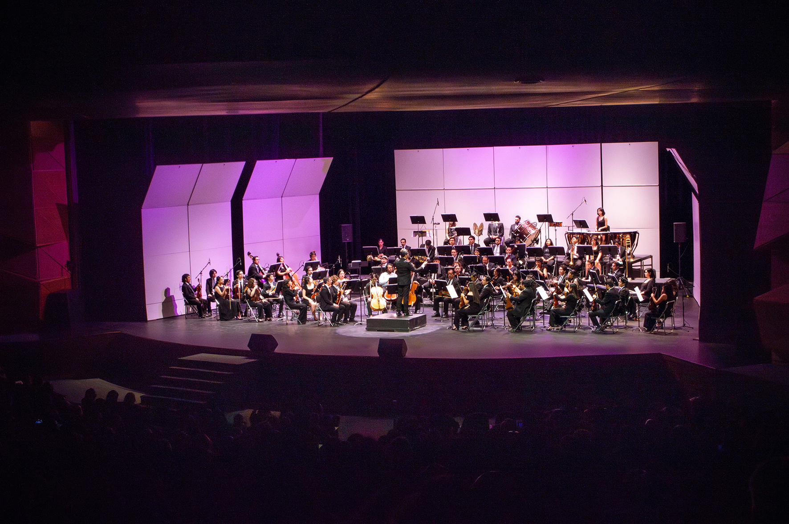

La OSU representa una de las agrupaciones musicales e institucionales más
emblemáticas del estado. Su antecedente se remonta a 1971, con la fundación de
la Orquesta de Cámara Universitaria, dirigida inicialmente por Francisco
Carreras Costajussa, posteriormente por José Luis Ortiz Díaz Infante y más
adelante por Rosendo Hernández Grimaldo. En 2008, en respuesta al talento
emergente de jóvenes músicos y al deseo de difundir la gran música universal en
la comunidad potosina, la agrupación evolucionó hacia la Sinfonietta
Universitaria. Tuvo su presentación inaugural el 22 de junio de 2009 en la
Plaza de los Fundadores, bajo la dirección de Gilberto Núñez Puente. Tras un
constante proceso de maduración artística, en 2014 se consolidó oficialmente
como Orquesta Sinfónica Universitaria. Integrada por más de setenta músicos, la
OSU ha logrado situarse como un referente cultural indispensable en la
región, formando nuevos públicos y rompiendo brechas generacionales a través de
la diversidad de sus propuestas. La orquesta ha colaborado con destacados
solistas, agrupaciones y directores invitados.

### Dirección

#### Alfredo Ibarra


Cuenta con una sólida y respetada trayectoria nacional e internacional. Ha sido
director artístico de la Sinfónica de Naucalpan, la Orquesta de la Escuela
Superior de Música, la Orquesta del Teatro de Aguascalientes, la Orquesta de la
Escuela de Música de la Universidad de Zacatecas y, durante una década, la Sinfónica de Michoacán. De igual forma, se ha desempeñado como titular de la
Orquesta Sinfónica del Estado de Puebla y del Coro de la UNAM. Desde 2013 es
director artístico de la Orquesta Sinfónica Universitaria de Universidad
Autónoma de San Luis Potosí.

::: logos
.pdf>){recorte="0.06 0.27 0.375 0.73"}
.pdf>){recorte="0.40 0.27 0.548 0.73"}
.pdf>){recorte="0.58 0.27 0.96 0.73"}
:::

## SÁB | NOV 28, 20:00 h - Ocotlán: Dúo Gasparini-Monnet

Fundación Cultural Rodolfo Morales\
Ocotlán de Morelos, Oaxaca

### Programa

**György Kurtág**

- *Kafka Fragments*, Op. 24 (1987)

**Leonardo Coral**

- *Orígenes* (2014)
  - *Arcaico y profundo*
  - *Misterioso*
  - *Canto*
  - *El perpetuo fluir*

**Gonzalo Macías**

- *Cliché* (2014)

**Manuel de Falla**

- *Siete canciones populares españolas* (selección)

**Johann Sebastian Bach**

- *Erbarme dich*

**Ruggero Leoncavallo**

- *Qual fiamma avea nel guardo!... Stridono lassù*

**Richard Strauss**

- *Morgen!*

**Maurice Ravel**

- *Pièce en forme de habanera*

**Dúo Gasparini-Monnet**\
Noemi Gasparini, violín\
Makeda Monnet, soprano\
Miguel Ángel Valdés-Brito Pérez, piano

### Personas compositoras

#### György Kurtág (Rumanía, 1926)


Compositor húngaro considerado una de las figuras más importantes de la música contemporánea europea, conocido por su estilo conciso, expresivo y profundamente introspectivo. Estudió en la Academia de Música *Franz Liszt* de Budapest, donde más tarde también fue profesor. Durante su carrera desarrolló un lenguaje musical muy personal, influido por Béla Bartók y Anton Webern, caracterizado por piezas breves pero intensas, con gran atención al detalle y al silencio. Entre sus obras más destacadas se encuentra *Játékok* (Juegos), una colección de piezas para piano que comenzó en la década de 1970, así como su ópera *Fin de partie*, basada en la obra de Samuel Beckett, estrenada en 2018. Kurtág ha recibido numerosos premios internacionales y es reconocido por su contribución única a la música de los siglos XX y XXI.

##### *Kafka Fragments*, Op. 24

Esta obra es la más extensa que Kurtág haya compuesto hasta la fecha. Se trata de un ciclo para soprano y violín, basado en textos de Franz Kafka, extraídos de su diario y cartas, así como de *Preparativos de boda en el campo*. Un único fragmento, de Elias Canetti, constituye una excepción. Está dedicado a la memoria del gran poeta húngaro János Pilinszky y recuerda al cuarto de sus *lieder* sobre poemas de Pilinszky; mediante su ritmo abrupto, salpicado de silencios, la música representa el andar vacilante e inestable de un niño pequeño, una metáfora particularmente impactante de la imposibilidad de contar una historia, o incluso de hablar. Estos fragmentos, acertadamente titulados *unas pocas palabras, a lo sumo unas pocas frases*, crean microcosmos cuya yuxtaposición jamás alcanzará la plenitud de la narración.

#### Leonardo Coral (México, 1962)


Estudió con Federico Ibarra en la UNAM. Obtuvo la maestría con la obra *Ciclo de vida y muerte*, con la asesoría de María Granillo. Sus creaciones se han tocado en México, Europa, Estados Unidos, Canadá, Asia, Australia y Latinoamérica. Es miembro del SNCA. Hay 41 discos con su música. Diversas orquestas y ensambles han presentado su trabajo: OFUNAM, OSN, OSEM, OFCM, OCBA, OSUANL, OSUG, OSIDEM, OBC, OSEP, Cepromusic, Ónix, Cuarteto Latinoamericano, Tambuco, Camerata de las Américas, Cuarteto de la Ciudad de México, Duplum, Cuarteto Arcano, Cello Alterno y Zikluz. Así como destacados solistas: Tere Frenk, Mauricio Náder, Krisztina Deli, Juan Carlos Laguna, Gonzalo Gutiérrez, Omar Hernández, Ignacio Mariscal, Fernando Domínguez, Luis Humberto Ramos, Omán Kaminsky, Alejandro Escuer, Judith Reyes, Hugo Ticciati, Cuauhtémoc Rivera, Nana Babayeva, Rodrigo Garibay y han dirigido sus obras José Areán, Rodrigo Cadet, José Luis Castillo, Andrés Cárdenes y Félix Carrasco.

##### *Orígenes*

Es una obra de gran virtuosismo y forma parte de *Orígenes, formas y estampas quijotescas*. Las piezas que constituyen esta serie son: *Estampas Quijotescas IV. Manteamiento de Sancho Panza, II. Dulcinea del Toboso VI. Batalla entre Don Quijote y el Caballero de la Blanca Luna; Preludios para piano 2a. serie I. Onírico XII. Ráfaga; Orígenes para violín IV. El perpetuo fluir, Sonata para piano No. 7 III. Vivo con fuoco*.

#### Gonzalo Macías (México, 1958)


Nació en Tlaxcala. Estudió piano con Isaías Noriega de la Vega y Jorge Suárez y composición con Federico Ibarra. En 1988, como becario del gobierno francés, estudió composición con Sergio Ortega, análisis con Betsy Jolas, orquestación con Gérard Grisey y música electroacústica con Michel Zbar. En 1992 recibió la Medalla Mozart del Instituto Cultural Domecq de la Ciudad de México. Su música se ha publicado en Ediciones Mexicanas de Música y se ha estrenado en el Foro Internacional de Música Nueva *Manuel Enríquez* y el Festival Internacional Cervantino. Igualmente, ha participado en la composición de música para teatro, colaborando con directores como David Olguín, Jorge Vargas, Ludwig Margules y Javier Malpica. Ha sido miembro del Sistema Nacional de Creadores de Artes. Desde 2023 se dedica de tiempo completo a la composición, concluyendo un periodo de más de cuarenta años de enseñanza de la música.

##### *Cliché*

Muchas veces las primeras ideas que surgen al comenzar la composición de una pieza son rápidamente dejadas de lado, porque nos parecen triviales y poco interesantes. Pero ¿qué pasaría si en vez de realizar esta labor de limpieza prudente y juiciosa, permitiéramos que estos lugares comunes, esa especie de citas musicales escuchadas mil veces, se volvieran el material de base para la composición de una pieza?

---

### Intérpretes

#### Dúo Gasparini-Monnet


Integrado por **Noemi Gasparini**, violín, y **Makeda Monnet**, soprano,
el dúo ha participado en los festivales *Pablo Casals*, Clásico de
Villars, en Suiza, y Schiermonnikoog, en los Países Bajos. También en
proyectos de ópera y teatro, así como en propuestas de carácter no
convencional, entre ellas una colaboración con la equilibrista
Tatiana-Mosio Bongonga.

Noemi Gasparini ha actuado como solista con las orquestas del País
Vasco, Colonne de París y Paris Rive Droite. Realizó sus estudios en la
Manhattan School of Music y obtuvo una maestría en el Conservatoire
National Supérieur de Paris. En 2024 participó en *313*, pieza para
violín solo compuesta e interpretada junto con la cantante española
Silvia Pérez Cruz, así como en proyectos con Flor de Toloache, mariachi
femenino de Nueva York, y Jarana Beat, banda méxico-afroamericana
radicada en Nueva York.

Makeda Monnet ha sido solista con la Berliner Philharmoniker y la
Philharmonie de Paris. Recibió los premios del CRR de París y de Canto
del Conservatoire National Supérieur de Paris. En 2021 interpretó
*Estrella de la mañana*, de A. Nante, en el Victoria Hall de Ginebra, y
*Carte Noire Nommée Désir*, de R. Chaillon.

::: logos


:::

## MAR | DIC 1, 20:00 h - Oaxaca: Dúo Gasparini-Monnet

Centro Cultural San Pablo\
Oaxaca, Oaxaca

### Programa

**György Kurtág**

- *Kafka Fragments*, Op. 24 (1987)

**Leonardo Coral**

- *Orígenes* (2014)
  - *Arcaico y profundo*
  - *Misterioso*
  - *Canto*
  - *El perpetuo fluir*

**Gonzalo Macías**

- *Cliché* (2014)

**Manuel de Falla**

- *Siete canciones populares españolas* (selección)

**Johann Sebastian Bach**

- *Erbarme dich*

**Ruggero Leoncavallo**

- *Qual fiamma avea nel guardo!... Stridono lassù*

**Richard Strauss**

- *Morgen!*

**Maurice Ravel**

- *Pièce en forme de habanera*

**Dúo Gasparini-Monnet**\
Noemi Gasparini, violín\
Makeda Monnet, soprano\
Miguel Ángel Valdés-Brito Pérez, piano

### Personas compositoras

#### György Kurtág (Rumanía, 1926)


Compositor húngaro considerado una de las figuras más importantes de la música contemporánea europea, conocido por su estilo conciso, expresivo y profundamente introspectivo. Estudió en la Academia de Música *Franz Liszt* de Budapest, donde más tarde fue también profesor. Durante su carrera desarrolló un lenguaje musical muy personal, influido por Béla Bartók y Anton Webern, caracterizado por piezas breves pero intensas, con gran atención al detalle y al silencio. Entre sus obras más destacadas se encuentra *Játékok* (Juegos), una colección de piezas para piano que comenzó en la década de 1970, así como su ópera *Fin de partie*, basada en la obra de Samuel Beckett, estrenada en 2018. Kurtág ha recibido numerosos premios internacionales y es reconocido por su contribución única a la música de los siglos XX y XXI.

##### *Kafka Fragments*, Op. 24

Esta obra es la más extensa que Kurtág haya compuesto hasta la fecha. Se trata de un ciclo para soprano y violín, basado en textos de Franz Kafka, extraídos de su diario y cartas, así como de *Preparativos de boda en el campo*. Un único fragmento, de Elias Canetti, constituye una excepción. Está dedicado a la memoria del gran poeta húngaro János Pilinszky y recuerda al cuarto de sus *lieder* sobre poemas de Pilinszky; mediante su ritmo abrupto, salpicado de silencios, la música representa el andar vacilante e inestable de un niño pequeño, una metáfora particularmente impactante de la imposibilidad de contar una historia, o incluso de hablar. Estos fragmentos, acertadamente titulados *unas pocas palabras, a lo sumo unas pocas frases*, crean microcosmos cuya yuxtaposición jamás alcanzará la plenitud de la narración.

#### Leonardo Coral (México, 1962)


Estudió con Federico Ibarra en la UNAM. Obtuvo la maestría con la obra *Ciclo de vida y muerte*, con la asesoría de María Granillo. Sus creaciones se han tocado en México, Europa, Estados Unidos, Canadá, Asia, Australia y Latinoamérica. Es miembro del SNCA. Hay 41 discos con su música. Diversas orquestas y ensambles han presentado su trabajo: OFUNAM, OSN, OSEM, OFCM, OCBA, OSUANL, OSUG, OSIDEM, OBC, OSEP, Cepromusic, Ónix, Cuarteto Latinoamericano, Tambuco, Camerata de las Américas, Cuarteto de la Ciudad de México, Duplum, Cuarteto Arcano, Cello Alterno y Zikluz. Así como destacados solistas: Tere Frenk, Mauricio Náder, Krisztina Deli, Juan Carlos Laguna, Gonzalo Gutiérrez, Omar Hernández, Ignacio Mariscal, Fernando Domínguez, Luis Humberto Ramos, Omán Kaminsky, Alejandro Escuer, Judith Reyes, Hugo Ticciati, Cuauhtémoc Rivera, Nana Babayeva, Rodrigo Garibay y han dirigido sus obras José Areán, Rodrigo Cadet, José Luis Castillo, Andrés Cárdenes y Félix Carrasco.

##### *Orígenes*

Es una obra de gran virtuosismo y forma parte de *Orígenes, formas y estampas quijotescas*. Las piezas que constituyen esta serie son: *Estampas Quijotescas IV. Manteamiento de Sancho Panza, II. Dulcinea del Toboso VI. Batalla entre Don Quijote y el Caballero de la Blanca Luna; Preludios para piano 2a. serie I. Onírico XII. Ráfaga; Orígenes para violín IV. El perpetuo fluir, Sonata para piano No. 7 III. Vivo con fuoco*.

#### Gonzalo Macías (México, 1958)


Nació en Tlaxcala. Estudió piano con Isaías Noriega de la Vega y Jorge Suárez y composición con Federico Ibarra. En 1988, como becario del gobierno francés, estudió composición con Sergio Ortega, análisis con Betsy Jolas, orquestación con Gérard Grisey y música electroacústica con Michel Zbar. En 1992 recibió la Medalla Mozart del Instituto Cultural Domecq de la Ciudad de México. Su música se ha publicado en Ediciones Mexicanas de Música y se ha estrenado en el Foro Internacional de Música Nueva *Manuel Enríquez* y el Festival Internacional Cervantino. Igualmente, ha participado en la composición de música para teatro, colaborando con directores como David Olguín, Jorge Vargas, Ludwig Margules y Javier Malpica. Ha sido miembro del Sistema Nacional de Creadores de Artes. Desde 2023 se dedica de tiempo completo a la composición, concluyendo un periodo de más de cuarenta años de enseñanza de la música.

##### *Cliché*

Muchas veces las primeras ideas que surgen al comenzar la composición de una pieza son rápidamente dejadas de lado, porque nos parecen triviales y poco interesantes. Pero ¿qué pasaría si en vez de realizar esta labor de limpieza prudente y juiciosa, permitiéramos que estos lugares comunes, esa especie de citas musicales escuchadas mil veces, se volvieran el material de base para la composición de una pieza?

---

### Intérpretes

#### Dúo Gasparini-Monnet


Integrado por **Noemi Gasparini**, violín, y **Makeda Monnet**, soprano,
el dúo ha participado en los festivales *Pablo Casals*, Clásico de
Villars, en Suiza, y Schiermonnikoog, en los Países Bajos. También en
proyectos de ópera y teatro, así como en propuestas de carácter no
convencional, entre ellas una colaboración con la equilibrista
Tatiana-Mosio Bongonga.

Noemi Gasparini ha actuado como solista con las orquestas del País
Vasco, Colonne de París y Paris Rive Droite. Realizó sus estudios en la
Manhattan School of Music y obtuvo una maestría en el Conservatoire
National Supérieur de Paris. En 2024 participó en *313*, pieza para
violín solo compuesta e interpretada junto con la cantante española
Silvia Pérez Cruz, así como en proyectos con Flor de Toloache, mariachi
femenino de Nueva York, y Jarana Beat, banda méxico-afroamericana
radicada en Nueva York.

Makeda Monnet ha sido solista con la Berliner Philharmoniker y la
Philharmonie de Paris. Recibió los premios del CRR de París y de Canto
del Conservatoire National Supérieur de Paris. En 2021 interpretó
*Estrella de la mañana*, de A. Nante, en el Victoria Hall de Ginebra, y
*Carte Noire Nommée Désir*, de R. Chaillon.

::: logos
{recorte="0.2 0.38 0.75 0.92"}

:::

\part{ENRÍQUEZ | 100}

## Coloquio Manuel Enríquez 100

### Presentación

#### Manuel Enríquez: el foro para un centenario

El centenario de Manuel Enríquez (del maestro Enríquez, como le decíamos en
argot de músicos) se nos presenta no solo como una oportunidad para celebrar al
gran personaje que fue, sino sobre todo para empezar a reconocerlo en su justa
medida. Reconocerlo es volver a conocerlo, o mejor: empezar a conocerlo sobre
unas bases nuevas, con iluminaciones alternativas. Han pasado tres décadas
desde su muerte y el mundo ha cambiado mientras tanto: ya podemos mirar con
ojos nuevos, con ojos no contaminados por la cotidianidad ni por la cercanía.
Siempre supimos que Enríquez era un gran artista, pero su figura adquiere hoy
nuevos brillos, dimensiones más altas. Podemos empezar a ser objetivos. No es
una afirmación que se origine en el entusiasmo. Lo que ocurre es que van
apareciendo argumentos y evidencias que no habíamos sopesado antes,
perspectivas originales que surgen con fuerza propia. La primera de ellas se
deriva de la constatación de que su música se escucha hoy actual, fresca,
retadora, original.

Enríquez sigue siendo nuestro contemporáneo. No le han pasado los años encima,
como ha ocurrido con otras vertientes de los vanguardismos. Su música es un
tesoro vivo. Sus partituras gráficas siguen sorprendiendo por su fuerza y por
la música que proponen desde el silencio de los trazos. Sus obras seriales, en
su heterodoxia, presentan un aire de familia con todas las otras: por encima de
las técnicas, una voz enlaza los gestos y texturas. Sorprende el trabajo con
técnicas extendidas (extendiéndolas antes de que se llamaran así); la destreza
ejemplar en la escritura de las percusiones; el hecho de que las obras no son
efecto gregario de otras vanguardias, sino compañeras estrictamente
contemporáneas de lo más radical de su momento. Eso se lo reconocieron sus
colegas de Nueva York, de París y de Varsovia.

Enríquez fue pionero indiscutible de la vanguardia en México, portando la
antorcha radicalista de Carrillo. Sus primeras obras preceden en casi una
década a la generación de Lavista y Estrada. Pasó por las versiones más
extremas del serialismo, desarrollando su propia versión deconstructiva. Fue
uno de los primeros en hacer electroacústica en México. Estuvo en París con la
generación de Boulez y en Nueva York con la generación de Stefan Wolpe y el
expresionismo abstracto. Pero también estuvo en el Otoño de Varsovia, donde
ocurrieron algunas de las audacias más extremas de la música del siglo XX. De
hecho se consideró durante algún tiempo que este Foro era una especie de
extensión y continuidad de aquel. Se le imagina a veces como un hombre del
poder y se le refiere así en algunos textos, pero esa es otra apreciación que
requiere correcciones. Sus puestos como funcionario, por llamarles así, fueron
en realidad menores: director del Cenidim, Coordinador de Música del INBAL,
asesor (uno de muchos) de Conaculta en los últimos años. No fue ni director del
INBAL ni secretario de nada. Enríquez no era un hombre funcional al sistema,
porque tenía demasiadas ideas: novedosas, creativas, deconstructivas. Y peor
aún: no tenía freno para expresarlas y para intentar hacerlas realidad en el
tiempo más corto posible. Su autoridad en México se originaba en el
reconocimiento internacional que recibía, pero a menudo se ha pensado
equivocadamente que la trama funcionaba más bien al revés. Hay que considerar
también que su autoridad se desprendía del hecho de que, ahí donde estuviera,
ocurría una tormenta eléctrica. Durante sus últimos dos años de vida fue
víctima de ataques violentísimos por parte de un sector del gremio musical, que
en la distancia vemos con claridad como arteros y desleales. Lo menciono aquí,
no por falta de prudencia, sino porque ese fue el contexto de su muerte y por
tanto el espacio de su reconocimiento inmediato.

El centenario nos empuja a pensar a Enríquez desde cero. Hemos minimizado sobre
todo su generosidad y su agudeza intelectual. Fue el primero en proponer un
programa de apoyo para compositores jóvenes. Fue el primero en poner la música
virreinal en perspectiva de realidad tangible. Desde su vanguardismo
cosmopolita, reconocía con sincera y profunda admiración las músicas
originarias de México, y emprendió acciones que serían, aún hoy, ejemplares. Y
sobre todo, antes de que fuera una circunstancia central, inició el
reconocimiento fáctico a las mujeres compositoras, tanto a sus colegas como a
las jóvenes, muchas de las cuales fueron surgiendo del entorno de sus
programas. Sus ideas para la renovación de la educación musical en México
siguen siendo una cuenta pendiente. Hay que decir que hemos sido *pizzicatos*
con él y que este centenario nos presenta la oportunidad de empezar a
compensarlo.

\hfill Luis Jaime Cortez

### Programa del Coloquio

Actividades académicas *in memoriam* en el marco del 48.º FIMNME.

**Curaduría**: Luis Jaime Cortez y Ana Lara, *Sonus Literatum*

#### MIÉ | NOV 18, 10:00 h - Conferencia: Luis Jaime Cortez

Biblioteca de las Artes, Cenart

Luis Jaime Cortez, **ponente**

Nonis Prado, **moderadora**

---

#### MIÉ | NOV 18, 11:30 h - Mesa 1: Un retrato de amigos

Biblioteca de las Artes, Cenart

Luis Jaime Cortez, Arturo Márquez, Federico Ibarra Groth, Marielena Arizpe y Antonio Russek, **participantes**

Ana Lara, **moderadora**

---

#### MIÉ | NOV 18, 13:00 h - Mesa 2: Sus intérpretes

Biblioteca de las Artes, Cenart

Álvaro Bitrán, Marisa Canales, Wendy Holdaway y José Luis Castillo, **participantes**

Maby Muñoz, **moderadora**

---

#### JUE | NOV 19, 10:00 h - Conferencia: Iracema de Andrade

Sala Manuel M. Ponce, Palacio de Bellas Artes

Iracema de Andrade, **ponente**

Luis Jaime Cortez, **moderador**

---

#### JUE | NOV 19, 11:30 h - Mesa 3: Entre disciplinas

Sala Manuel M. Ponce, Palacio de Bellas Artes

Álvaro Bitrán, Marisa Canales, Wendy Holdaway y José Luis Castillo, **participantes**

José María Serralde, **moderador**

---

#### JUE | NOV 19, 13:00 h - Mesa 4: El gestor

Sala Manuel M. Ponce, Palacio de Bellas Artes

Guillermo Contreras, Arón Bitrán, Aurelio Tello y Susana Enríquez, **participantes**

Marusia Pola, **moderadora**

---

#### JUE | NOV 19, 16:30 h - Conferencia: Leonora Saavedra

Sala Manuel M. Ponce, Palacio de Bellas Artes

Leonora Saavedra, **ponente**

Maby Muñoz, **moderadora**

```{=tex}
\printindex
```

## Sedes

### Ciudad de México

**Palacio de Bellas Artes**\
Av. Juárez y Eje Central Lázaro Cárdenas s/n, Centro Histórico, Ciudad de México

**Salón de Recepciones, Museo Nacional de Arte**\
Tacuba 8, Centro Histórico, Ciudad de México

**Jardín Escénico**\
Paseo de la Reforma 111, Bosque de Chapultepec, Ciudad de México

**Museo de Arte Carrillo Gil**\
Revolución 1608, San Ángel, Ciudad de México

**Conservatorio Nacional de Música**\
Presidente Masaryk 582, Polanco, Ciudad de México

**Escuela Superior de Música, INBAL**\
Fernández Leal 31, La Concepción, Coyoacán, Ciudad de México

**Museo Universitario Arte Contemporáneo, UNAM**\
Insurgentes Sur 3000, Ciudad Universitaria, Ciudad de México

**Sala Nezahualcóyotl, Centro Cultural Universitario, UNAM**\
Insurgentes Sur 3000, Ciudad Universitaria, Ciudad de México

**Anfiteatro Simón Bolívar, Colegio de San Ildefonso, UNAM**\
Justo Sierra 16, Centro Histórico, Ciudad de México

**Facultad de Música, UNAM**\
Xicoténcatl 126, Del Carmen, Coyoacán, Ciudad de México

**Casa Rafael Galván, UAM**\
Zacatecas 94, Roma Norte, Ciudad de México

**Xico. Antigua Sede del Senado**\
Xicoténcatl 9, Centro Histórico, Ciudad de México

**Universidad del Claustro de Sor Juana**\
José María Izazaga 92, Centro Histórico, Ciudad de México

**Biblioteca de las Artes, Cenart**\
Río Churubusco 79, Country Club, Ciudad de México

### En los estados

**Centro Mexicano para la Música y las Artes Sonoras (CMMAS)**\
Morelos Norte 485, Centro, Morelia, Michoacán

**Escuela Superior de Música y Danza de Monterrey**\
Padre Mier 1720 Pte., Obispado, Monterrey, Nuevo León

**Universidad de las Artes de Yucatán**\
Calle 55 núm. 435 entre 48 y 46, Centro, Mérida, Yucatán

**Centro Cultural Domingo Soler**\
La Quebrada 62, Centro, Acapulco, Guerrero

**Centro Cultural Universitario Bicentenario**\
Sierra Leona 550, Lomas 2da Sección, San Luis Potosí, San Luis Potosí

**Sala Principal, Centro Cultural Tlaqná**\
Av. de las Culturas Veracruzanas 1, Emiliano Zapata, Xalapa, Veracruz

**Ex Convento del Carmen**\
Av. Juárez 638, Centro, Guadalajara, Jalisco

**Fundación Cultural Rodolfo Morales**\
Morelos 108, Centro, Ocotlán de Morelos, Oaxaca

**Centro Cultural San Pablo**\
Hidalgo 907 e Independencia 904, Centro, Oaxaca, Oaxaca

## Créditos

### 48.º Foro Internacional de Música Nueva Manuel Enríquez

**José María Serralde Ruiz**\
*Coordinador Nacional de Música y Ópera*

**Eduardo Partida**\
*Coordinación de Programación*

**José Wolffer**\
*Asesor Artístico*

**Rodrigo Caravantes**\
*Productor Ejecutivo*

**Mariana Villanueva, Alejandro Tello, Diego Morábito**\
*Comisión de selección | Fase 1: Intérpretes*

**Mariana Villanueva, Arturo Villela, Jimena Maldonado**\
*Comisión de selección | Fase 2: Personas compositoras*

### Instituciones

**Centro de Experimentación y Producción de Música Contemporánea (Cepromusic), INBAL**\
José Luis Castillo, *director*

**Centro Cultural del Bosque y Jardín Escénico, INBAL**\
Arnaud Charpentier, *coordinador general*

**Museo Nacional de Arte, INBAL**\
Mireida Velázquez Torres, *directora*

**Conservatorio Nacional de Música**\
Gladys Andrea Zamora Pineda, *directora*

**Museo de Arte Carrillo Gil, INBAL**\
Valeria Macías, *directora*

**Universidad Nacional Autónoma de México**\
Leonardo Lomelí Vanegas, *rector*\
Rosa Beltrán Álvarez, *coordinadora de Difusión Cultural*\
José Julio Díaz Infante, *director general de Música*\
María Teresa Navarro Agraz, *directora de la Facultad de Música*\
Tatiana Cuevas Guevara, *directora del MUAC*\
José Areán, *director artístico de la OJUEM*

**Universidad Autónoma Metropolitana**\
Gustavo Pacheco López, *rector*\
Yissel Arce Padrón, *coordinadora general de Difusión*\
Hugo García Galván, *director de la Casa Rafael Galván*

**Senado de la República**\
Martha López Castillo, *coordinadora de Eventos Culturales*

**Universidad del Claustro de Sor Juana**\
Rafael Tovar López-Portillo, *rector*

**Centro Mexicano para la Música y las Artes Sonoras (CMMAS)**\
Rodrigo Sigal, *director*

**Escuela Superior de Música y Danza de Monterrey**\
Diana M. Farías Ortegón, *directora*\
José Miguel Vélez Lizaldi, *secretario académico de Música*

**Patronato de la Escuela Superior de Música y Danza de Monterrey, A.C.**\
Bárbara Herrera de Garza, *presidenta*\
Élida Ortiz Treviño, *directora*

**Universidad Veracruzana**\
Martín Gerardo Aguilar Sánchez, *rector*\
Roberto Aguirre Guiochín, *director general de Difusión Cultural*

**Universidad de las Artes de Yucatán**\
Domingo Rodríguez Semerena, *rector*\
Elías Puc Sánchez, *director de Artes Musicales*

**Centro Cultural Domingo Soler**\
Rodolfo Soto, *presidente del Patronato*

**Gobierno de Jalisco**\
Luis Gerardo Ascencio Rubio, *secretario de Cultura*\
José Luis Coronado Vázquez, *director general de Museos, Exposiciones y Galerías de Jalisco*

**Universidad Autónoma de San Luis Potosí**\
Alejandro Javier Zermeño Guerra, *rector*\
Martha Rocío Castillo Medellín, *División de Difusión Cultural*

**Fundación Cultural Rodolfo Morales A.C.**\
Alberto Morales Sánchez, *presidente*

**Fundación Alfredo Harp Helú Oaxaca**\
María Isabel Grañén Porrúa, *presidenta*

## Directorio

### Coordinación Nacional de Música y Ópera

**Graciela Martínez Corona**\
*Subcoordinadora*

**Ana Carmina Muñoz Osorio**\
*Subdirectora Administrativa*

**Itzel Zúñiga Alaniz**\
*Subdirectora de Difusión y Prensa*

**Jaime Ruiz Lobera**\
*Subdirector de Programación*

**Selene Sánchez Rendón**\
*Jefa de Logística*

**Javier González Gómez**\
*Editorial*

**Luigi Amara**\
*Cuidado editorial*

**Luis Novoa Sandoval**\
*Diseño Gráfico*

**María Asunción Martínez, Luz del Carmen Cabrera, Mónica Velázquez,
Karina Cardona, Salomón Chávez, Erica Domínguez, Patricia Guzmán, Elvira
Pérez, Karla Vargas, Pilar R. Monroy, Alberto Domínguez, Tomás Gamero, Pedro
Bautista, Julio C. Sánchez, Juana Márquez, Lourdes González, Juan Lorenzo
Bautista, Ricardo Becerril, Gisela Montiel, Marycarmen Sosa, Manuel Ricardo
Aguilar, Manuel César Rojas, Nahomi Rojas, Jessica García, Sandro Valdés,
Juan José Reyes**\
*Personal operativo*

### Gerencia del Palacio de Bellas Artes

**Jesús José Sánchez Herrera**\
*Coordinador de administración*

**Mariana Hernández Hernández**\
*Coordinadora de programación y proyectos especiales*

**José Rojas Patiño**\
*Coordinador editorial y de difusión*

**Federico Emery Othón**\
*Coordinador técnico*

**Silvia Gil Rivera**\
*Coordinadora de control de espectáculos*

**José López Quintero**\
*Coordinador de conservación y obras*

**Martha Marlenne Chávez Brizuela**\
*Coordinadora de relaciones públicas*

**Arturo Ricardo Murguía García**\
*Coordinador de seguridad y vigilancia*

### Coordinación técnica del Palacio de Bellas Artes

**Carlos Yañez Estrada**\
*Jefe de foro*

**Cristopher Arturo González Flores**, jefe de taller. **Sinohé Martínez
Paredes**\
*Taller de traspunte*

**Julio César Guerra Picazo**, jefe de taller. **Jesús Dionisio Salinas del
Castillo, Gabriel García Hernández, Sergio Meléndez Ensástiga, Luis Alejandro
García Herrera, Daniel Samaniego Alvarado, Karla Magali Gutiérrez Cervantes,
Carlos Flores López, Héctor Reyes Montero, Carlos Jafeth Campos Lara, Ricardo
Lugo Acevedo, Felipe Sosa Rodríguez, Emerson Escander Guerrero Peña, Claudio
Mateo Sánchez**\
*Taller de tramoya*

**Dolores Amparo Vargas Ayala**, jefe de taller. **Azalia Martínez López,
Bibiana Eva Vázquez Rivera**\
*Taller de maquillaje*

**Ernesto Farías Pérez**, jefe de taller. **Elvia Patricia Aceves García,
Ricardo Castro Carrasco, María de los Ángeles Vargas Arellano, Fortino Pinzón
Herácleo, Erik Daniel Ramírez Aceves, Laura Cedeño Castro, Fernando Aguilar
Gutiérrez, Miriam Regina Legorreta Soria, Elvia Paola Andrade Márquez**\
*Taller de vestuario*

**José Amado Castillo Barreto**, jefe de taller. **Javier Márquez Bernabé,
José Luis Olivares Aguirre, Luis Alfredo Alejandro Durán Alvarado, Julián
Gerardo González Contreras, Sergio Armando Pérez Velazco, Alexis Efraín Correa
Altamirano**\
*Taller mecánico*

**Roberto Carlos Arellano Ramos**, jefe de taller. **José Aníbal Castro Reyes,
David Méndez Cruz, Juvenal Orozco Medina, Félix Jesús Galván Alonso, César
Jesús Salinas Hernández, Joseline Hurtado Olivera**\
*Taller de iluminación*

**Martín Fernando Jiménez Páramo**, jefe de taller. **Julio Cárdenas García,
José Luis Román Pedraza, Saúl Martínez Cadena**; multimedia: **Viridiana
González Vázquez**\
*Taller de audio*

**Luciano Noé Alarcón Estrada**, jefe de taller. **Miguel Gustavo Andrade
Márquez, Mariana Fernández Sánchez, Rubén Martín Sánchez Reyes, Federico Flores
Fuentes**\
*Taller de utilería*

**José Joel García Maldonado**, encargado de área. **Jorge Mejía Nieto,
Guadalupe Cejudo Sánchez, Martín Antonio Alarcón Hernández, Patricia Sandoval
Sotelo, Elena del Carmen Briseño Gómez de la Llata, Sandra Rodríguez Maturano**\
*Atención artística*

```{=tex}
\begin{colofon}
```

El presente libro se preparó a través de un proceso de edición digital
automatizada con *software libre*, LuaLaTeX y Pandoc/Lua, en septiembre y
octubre de 2026.

Se empleó la fuente tipográfica libre Noto Sans, en un flujo de texto
propuesto para lectura en dispositivos móviles, con proporción de página 9:16.

El proceso de formación fue programado por el Coordinador Nacional de Música
y Ópera, y la revisión editorial corrió a cargo de Eduardo Partida, Luigi
Amara y Javier González Gómez.

© INBAL. Ciudad de México, 2026.

```{=tex}
\end{colofon}
```

::: contraportada
### Secretaría de Cultura

**Claudia Curiel de Icaza**\
*Secretaria de Cultura*

**Marina Núñez Bespalova**\
*Subsecretaria de Desarrollo Cultural*

### Instituto Nacional de Bellas Artes y Literatura

**Alejandra de la Paz**\
*Directora General*

**Haydeé Boetto Bárcena**\
*Subdirectora General de Bellas Artes*

**Aarón Polo López**\
*Director de Difusión y Relaciones Públicas*

**José María Serralde Ruiz**\
*Coordinador Nacional de Música y Ópera*

**Silvia Carreño y Figueras**\
*Gerente del Palacio de Bellas Artes*
:::
